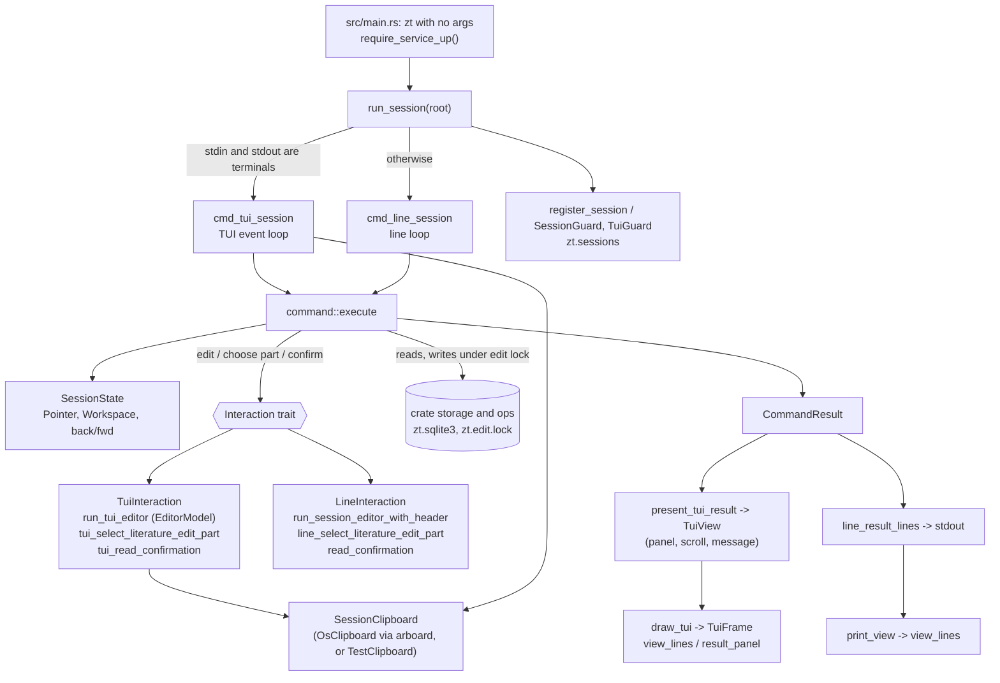

# Terminal Session

## Purpose

The Terminal Session is the interactive terminal view of the slip-box that plain `zt` opens when the service is up. It gives the human one Pointer, one current Workspace, and one command bar. With it the human reads Cards (stored Markdown, with clickable Links), walks trees, and grows and reorganizes them with short bare commands (`go`, `n`, `b`, `e`, `mv`, `del`, …). It exists so that a person can work Folgezettel-style from a keyboard, without a browser, and with the human's own Access (both Workspaces may change). There are two front ends over one command module: a full-screen crossterm TUI (raw mode, alternate screen, mouse capture, an in-terminal editor with an Edit caret, mouse selection and the operating-system clipboard) when stdin and stdout are both terminals, and a plain line Session for pipes.

**Owns:** Session startup and its registration in `zt.sessions`; the Pointer, its `back`/`fwd` history and the Session's current Workspace; the Session command set, its parsing, its help and where each command is offered; the ROOT and Card views and the result panels; TUI rendering, scrolling, Link clicking, mouse selection and clipboard copy/paste; the TUI editor (Edit caret, selection, viewport) and the line editor; the confirmation prompts; holding the edit lock while a Session command edits; the PTY test suite `tests/pty_session.rs`.

**Does not own:** the shell CLI, the service lifecycle (`is_service_up`, restart of a dead daemon), the edit-lock primitive `acquire_edit_lock`, `EditOutcome`/`EditPart`, the SQLite schema, `read_confirmation`, the delete/move plans and their verification lines, and the PTY helper `tests/support/pty.rs` — see [Service, CLI and storage](service-and-cli.md); Card text parsing, templates, Card types, Workspaces, Literature metadata and Link classification — see [Cards, Workspaces and Links](cards-and-links.md); insert/move planning and the shared operations the GUI and MCP server use — see [Card operations](card-operations.md); Model facets, levels and Math forms — see [Models and math](models-and-math.md); Hub levels — see [Hub Cards](hub-cards.md); the browser view — see [GUI](gui.md).

## At a glance

| | |
|---|---|
| Entry points | `session::run_session(root)` (called by `src/main.rs` when `zt` gets no arguments, after `require_service_up()`); `command::execute(root, state, line, interaction)` for every command line; `session::session_count`, `session::process_exists` (called by `src/main.rs` for `zt status`, `zt down`, `zt del --all`, and the stale-service check), and `session::hold_registration` with its `RegistrationGuard` (held by `zt del --all` from its Session check through its commit) |
| Key files | `src/session.rs` — the two front ends (TUI and line), views, panels, rendering, scrolling, mouse selection, clipboard, TUI editor (`EditorModel`), confirmation and Literature-part prompts, Session registration; `src/session/command.rs` — the command table and help, `Pointer`, `SessionState` (Pointer, Workspace, history), `Interaction` trait, `CommandResult`, `execute`, `recover_missing_pointer`; `tests/pty_session.rs` — end-to-end TUI tests through a real pseudo-terminal |
| Depends on | [Service, CLI and storage](service-and-cli.md) (`open_db`, `load_card(s)`, `is_service_up`, `acquire_edit_lock`, `card_counts`, `delete_plan`/`apply_delete_plan`, `apply_move_plan`, `read_confirmation`, `sessions_path`, `service_path`, `db_path`, `create_topic`, `insert_card`, `update_card_text`, Literature updates); [Cards, Workspaces and Links](cards-and-links.md) (`parse_card_text`, templates, `CardType`, `Workspace`, `workspace::counts`, `literature::parse_metadata`, `link::LinkLifecycle`, `link::fenced_code_ranges`); [Card operations](card-operations.md) (`place::move_plan`, `place::insert_plan`, `place::apply_insert_plan`); [Models and math](models-and-math.md) (`model::set`, `model::set_level`, `math::set_form`); [Hub Cards](hub-cards.md) (`hub::set_level`); crates `crossterm` 0.28 (raw mode, events, drawing), `arboard` 3.6 (OS clipboard), `rusqlite`, `anyhow`; dev crates `portable-pty` 0.9 and `assert_cmd` |
| Used by | [Service, CLI and storage](service-and-cli.md) (`src/main.rs` starts the Session and counts open Sessions) |
| Tests | unit tests in `src/session.rs` and `src/session/command.rs` (`#[cfg(test)] mod tests`); `tests/pty_session.rs` (TUI through a PTY, helper `tests/support/pty.rs`); line-Session tests live in `tests/cli_service.rs` (owned by service-and-cli) |

## Concepts

- `Session` — one interactive terminal view with its own Pointer, current Workspace, and command bar (CONTEXT.md). One OS process is one Session; it is counted by its pid in `zt.sessions`. An open GUI window is not a Session.
- `Pointer` — the current position in the card space for one Session: `Pointer::Root` or `Pointer::Card(target)`, where the target is a Location or a Citation key (`src/session/command.rs`).
- `ROOT` — the Pointer position above all trees. Its view shows the two Zones of the current Workspace: its Topics (`topics:`) and its Literature Cards (`literature:`), with a hint how to switch Workspace (`view_lines` in `src/session.rs`).
- `PointerContext` — where the Pointer is: `Root`, `TreeRoot` (a Topic or Literature Card, i.e. a Tree root) or `Regular` (a Regular Card). It decides which commands `help` lists (`pointer_context`, `src/session/command.rs`).
- `Availability` — per command: `Always`, `OnCard` (not at ROOT), `OnRegular` (only on a Regular Card) (`COMMANDS` in `src/session/command.rs`).
- `SessionState` — the Pointer, the current `Workspace`, and two history stacks `back` and `forward` of `Visit = (Pointer, Workspace)`, at most `HISTORY_LIMIT` = 100 back entries (`src/session/command.rs`).
- Current Workspace — the Workspace shown at ROOT and given to new Topics (`t`) and Literature Cards (`l`). It starts as `human` and follows the Pointer into whichever Workspace holds its Card (`SessionState::sync_workspace`).
- `Interaction` — the trait through which a command asks the human for text (`edit`), a Literature edit part (`choose_literature_edit_part`), or a typed confirmation (`confirm`). `LineInteraction` and `TuiInteraction` implement it in `src/session.rs`; tests implement `NoopInteraction` and `ScriptedInteraction`.
- `CommandResult` — what a command produced: `Noop`, `Navigated`, `Changed`, `List(Listing)`, `Stats`, `Status`, `BrokenLinks`, `Help`, `Workspaces`. The front ends present it differently (`line_result_lines`, `present_tui_result`).
- `ViewLine` — one rendered line: `Plain`, `Heading` (bold), `Hint` (grey), `Linked` (its `[[target]]` macros render as valid or Broken links), `Entry { address, rest }` (a clickable address then text) (`src/session.rs`).
- Panel — a result that lists several items (`ls`, `lsbk` with hits, `help`, `ws`) shown in the TUI in place of the card view until `Esc` or a move closes it (`result_panel`, `TuiView.panel`).
- Status message — the one to three rows above the command bar: a hint (grey), `Info`, or `Error` (dark red) (`StatusMessage`).
- `Edit caret` — the text insertion position inside a Card being edited (CONTEXT.md); `EditorModel.caret_line`/`caret_col`, counted in Unicode characters, shown 1-based as `Ln x, Col y`.
- Edit mode — the TUI editor (`run_tui_editor`) or the line editor (`run_session_editor_with_header`) that a creating or editing command opens. Its header names the stage: `edit mode` or `metadata edit`.
- Screen selection — a mouse-drag selection over rendered terminal cells in the normal view and the modal prompts (`ScreenSelection`, `RenderedScreen`); Editor selection — a selection over logical Card text in edit mode (`EditorSelection`).
- Edit lock — the file `zt.edit.lock`, created exclusively; while it exists every other writer gets `edit in progress` (`acquire_edit_lock`, `src/main.rs`). A Session holds it for the whole of an interactive edit.
- Tree root, Direct successor, Side successor, Literature tree, Topic tree, Citation key, Link, Broken link — as in CONTEXT.md; the card view lists `parent:`, `direct:` and `side:` as Links.

## Architecture

The block has three layers. `src/session/command.rs` is the deep module: it knows what each command means, moves the Pointer, and calls the storage and operation functions. It never prints; it returns a `CommandResult` and asks for human input only through the `Interaction` trait. `src/session.rs` holds two thin adapters (front ends) over it, plus everything about the screen. The TUI adapter owns the event loop, the frame (`TuiFrame`: Link spans, rendered screen, scroll), the selection models, and the clipboard handle. The line adapter reads lines and prints.



| Component | File | Role |
|---|---|---|
| `run_session` | `src/session.rs` | picks the TUI or the line Session by `IsTerminal` on stdin and stdout |
| `cmd_tui_session`, `TuiGuard` | `src/session.rs` | registers, enters raw mode + alternate screen + mouse capture, runs the event loop, restores the terminal and unregisters on drop |
| `cmd_line_session`, `SessionGuard` | `src/session.rs` | registers, prints the view, reads one command per line, unregisters on drop |
| `view_lines`, `markdown_view_lines`, `side_successors` | `src/session.rs` | the ROOT view and the Card view, shared by both front ends |
| `result_panel`, `line_result_lines`, `present_tui_result` | `src/session.rs` | turn a `CommandResult` into panel lines, printed lines, or TUI state |
| `draw_tui`, `write_tui_*`, `queue_tui_valid_link`, `command_bar_text`, `tui_hint` | `src/session.rs` | draw content, status rows and command bar; record clickable `LinkSpan`s; build the `RenderedScreen` for selection |
| `TuiFrame` | `src/session.rs` | scroll arithmetic (`scrolled_down`, `scrolled_up`, `scrolled_by`, `page`) |
| `RenderedScreen`, `ScreenSelection`, `queue_screen_selection` | `src/session.rs` | screen-cell selection, reverse-video highlight, selected text |
| `ClipboardAccess`, `OsClipboard`, `TestClipboard`, `SessionClipboard` | `src/session.rs` | OS clipboard through `arboard`, or a fake from env vars in debug builds |
| `EditorModel`, `run_tui_editor`, `draw_tui_editor`, `queue_editor_line` | `src/session.rs` | the TUI editor: lines, Edit caret, desired column, selection, viewport offsets |
| `tui_select_literature_edit_part`, `tui_read_confirmation` | `src/session.rs` | TUI modal prompts (with screen selection and copy) |
| `COMMANDS`, `help_for`, `pointer_context` | `src/session/command.rs` | the command table, availability, help |
| `SessionState`, `execute`, `execute_command`, `recover_missing_pointer` | `src/session/command.rs` | command semantics and Pointer moves |
| `register_session`, `session_count`, `update_session_pids`, `process_exists`, `hold_registration` | `src/session.rs` | the open-Session record `zt.sessions`, changed only under the `zt.sessions.lock` OS lock |

## Interfaces

### Crate-visible functions and types (`src/session.rs`)

| Item | Signature | Behaviour |
|---|---|---|
| `run_session` | `pub(crate) fn run_session(root: PathBuf) -> Result<()>` | Starts the TUI if `io::stdin().is_terminal() && io::stdout().is_terminal()`, else the line Session. Returns when the human quits or the service goes down. Errors: terminal setup failures, `register_session` I/O errors, database errors while drawing. |
| `session_count` | `pub(crate) fn session_count(root: &Path) -> i64` | Under the `zt.sessions.lock` OS lock (`update_session_pids`): reads `zt.sessions`, keeps only pids for which `process_exists` is true, writes the pruned list back (side effect), returns the count. Never fails: if the lock cannot be taken it counts the file without writing. |
| `register_session` | `pub(crate) fn register_session(root: &Path) -> Result<()>` | Adds this process's pid to `zt.sessions` (after pruning dead pids), under the lock. |
| `update_session_pids` | `fn update_session_pids(root, alive: impl Fn(u32) -> bool, change: impl FnOnce(&mut Vec<u32>)) -> Result<Vec<u32>>` | The one read-change-write of `zt.sessions`: takes the `zt.sessions.lock` OS lock through `hold_registration` (blocking), keeps the pids that are `alive`, applies `change`, writes the file, returns the list. `register_session`, `unregister_session`, and `session_count` all go through it. |
| `hold_registration` | `pub(crate) fn hold_registration(root: &Path) -> Result<RegistrationGuard>` | Takes the `zt.sessions.lock` OS lock and keeps it until the guard drops. `RegistrationGuard::prune` then reads `zt.sessions`, prunes dead pids and writes the pruned list back under that lock. `zt del --all` holds the guard from its Session check through its commit, so a Session that starts meanwhile blocks in `register_session` instead of registering between the check and the delete (S12, #135). The edit lock is always taken first; registration never waits for the edit lock while holding this guard. |
| `process_exists` | `pub(crate) fn process_exists(pid: u32) -> bool` | Windows: runs `tasklist /FI "PID eq <pid>" /NH` and looks for the pid in its output. Elsewhere: `sh -c "kill -0 <pid>"`. Also used by `src/main.rs` to detect a stale legacy service record. |
| `SessionGuard` | `pub(crate) struct SessionGuard { pub(crate) root: PathBuf }` | Unregisters the pid on drop (line Session). |
| `RegistrationGuard` | `pub(crate) struct RegistrationGuard` | Holds the `zt.sessions.lock` file lock; dropping it releases the lock. No public field. |

### Command module (`src/session/command.rs`, `pub(super)`)

| Item | Signature | Behaviour |
|---|---|---|
| `execute` | `fn execute(root: &Path, state: &mut SessionState, line: &str, interaction: &mut dyn Interaction) -> Result<Execution>` | Runs one command line; then `sync_workspace`; then records the left place in `back` (except for `back`/`fwd`). `Execution::Exit` for `q`, else `Execution::Continue(CommandResult)`. An `Err` is a one-line message for the human; the Pointer is unchanged unless the command moved it before failing. |
| `recover_missing_pointer` | `fn recover_missing_pointer(root, state) -> Result<Option<String>>` | If the Pointer's Card no longer exists, moves the Pointer to its nearest existing ancestor (by `parent_location`) or ROOT, and returns ``card `<x>` no longer exists``. |
| `help_for` | `fn help_for(context: PointerContext) -> Help` | The commands available in that context, in table order; `Help.summary` joins their syntax with ` \| `; `Help::lines()` gives `commands: <summary>` then one aligned `  <syntax>  <description>` line per command. |
| `pointer_context` | `fn pointer_context(root, pointer) -> Result<PointerContext>` | Loads the Card to tell a Tree root from a Regular Card. |
| `SessionState` | `root()`, `pointer()`, `workspace()`, `follow_link(root, target)`, `sync_workspace(root)` | `root()` = ROOT in the `human` Workspace with empty history. `follow_link` (used for mouse clicks) moves to a Card and records history. |
| `Interaction` | `edit(&mut self, initial_text, header, save: &mut dyn FnMut(&str) -> Result<()>) -> Result<bool>`; `choose_literature_edit_part(&mut self) -> Result<EditPart>`; `confirm(&mut self, expected, lines) -> Result<()>` | `edit` returns `true` after a successful `save`, `false` on cancel; it must call `save` again after each failed save (retry loop). `confirm` errors with `confirmation did not match` unless the typed text equals `expected`. |
| `CommandResult`, `Listing`, `CardSummary`, `Stats`, `Status`, `Help`, `WorkspaceSummary`, `Execution` | data types | see Concepts |

### Session commands

The command bar takes bare words; the line is split on whitespace (so quotes are literal text: `t "Quoted Topic"` makes a Topic titled `"Quoted Topic"`). A first token that matches no command gives `unknown session command: <first token>` (so `zt e` gives `unknown session command: zt`). A known command with the wrong arguments gives its `usage:` line or, for the argument-less commands `root`, `ls`, `stats`, `status`, `lsbk`, `help`, `q`, `l`, `n`, `b`, `e`, `del`, `ins`, also `unknown session command: <name>`. Commands that need a Card fail at ROOT with `<cmd> needs a Card; use go <target> first`.

"Offered" is the help context (`Availability`): ROOT, Tree root, Regular. It filters `help` only; the operations themselves refuse what does not apply (for example `b` on a Tree root).

| Command | Offered at | Effect | Pointer afterwards | Edit lock | Asks |
|---|---|---|---|---|---|
| `go` / `root` | all | to ROOT (idempotent) | ROOT | no | — |
| `go <target>` | all | to the Card with that Location or Citation key; ``target `<x>` does not exist`` otherwise; more arguments: `usage: go [<target>]` | the target | no | — |
| `ws` | all | panel of both Workspaces: `*` marks the current one, then id, label, topic trees, literature trees, cards | unchanged | no | — |
| `ws <workspace>` | all | switch the current Workspace (`human` or `agent`, `Workspace::parse`) | ROOT of that Workspace | no | — |
| `up` | Tree root, Regular | to the parent Location; a Tree root goes to ROOT; at ROOT a no-op; `usage: up` with arguments | parent / ROOT | no | — |
| `back` | all | to the last remembered place that still exists (deleted Cards are skipped); `no earlier card to go back to` | that place, with its Workspace | no | — |
| `fwd` | all | undoes a `back`; `nothing to go forward to; fwd follows back` | that place | no | — |
| `ls` | all | ROOT: panel `<ws> workspace topics and literature: N` with the current Workspace's Topics and Literature Cards. On a Card: `Topic tree <root>: N cards` or `Literature tree <key>: N cards`, the whole tree root first (`cards_for_list`) | unchanged | no | — |
| `t <title>` | all | create a Topic in the current Workspace: opens the editor on `topic_template(title)`; title must be non-empty single-line text | the new Topic after save; unchanged on cancel | yes | edit |
| `l` | all | create a Literature Card in the current Workspace in two stages: `metadata edit` (one BibTeX entry, refused if its Citation key exists, case-insensitively), then `edit mode` on `card_template(title)`; nothing is stored unless both stages save | the new Citation key after both saves | yes, across both stages | edit, edit |
| `n` | Tree root, Regular | create the Direct successor (`direct_successor`); `direct successor already exists: <loc>`; on a Literature Card it makes `<key>/1` | the new Card after save | yes | edit |
| `b` | Regular | create the next Side successor (`next_side_successor`); Tree roots refuse (`side successors cannot start from a Topic Card` / `... a Literature Card`) | the new Card after save | yes | edit |
| `e` | Tree root, Regular | edit the Card text. A Literature Card first asks `1. metadata` / `2. main text`; a metadata edit that changes the Citation key shows the rename lines (`citation_rename_lines`) and asks `move`, then renames the whole Literature tree and rewrites Links | unchanged, or the new Citation key | yes | (choice), edit, (confirm `move`) |
| `del [keep-root]` | Tree root, Regular | delete the Card and its successors after the delete verification lines; a Regular Card asks `delete`, a Tree root asks for its own address (Topic Location or Citation key). `del keep-root` empties a Topic or Literature tree and keeps its root (S11, #134): the same lines name the `root kept` and the number of Regular Cards, the root's address confirms, and a Regular Card fails with the root-kind error before any prompt | the parent Location, or ROOT; with `keep-root` the retained root | yes | confirm |
| `ins` | Regular | insert a new Card in the current Card's place; that Card and its successors move down (`place::insert_plan`); shows the insert lines and asks `insert`, then the editor | the new Card (same Location) after save | yes | confirm `insert`, edit |
| `mv [alone] <new-location>` | Regular | move the Card and its successors (`alone`: only the Card; its chain closes up) after the move verification lines; Tree roots and cross-tree moves into or out of a Literature tree are refused before any prompt | where the Card went (`plan.mapping`) | yes | confirm `move` |
| `mv [alone] before <location>` | Regular | move the Card into another Card's place; that Card moves down | where the Card went | yes | confirm `move` |
| `ty <idea\|event\|finding\|model\|hub> [<facet>]` | Regular | set the Card type; the rest of the line after `model` is a Model facet (may hold spaces) and makes the Card a Model part; a facet with another type: `only Model Cards can have a Model facet`; a part keeps its emphasis while it stays a part; Tree roots refuse | unchanged | yes | — |
| `lv <level\|none>` | Regular | on a Hub Card set its Hub level (`line`, `topic`, `field`, `register`); otherwise the Model elaboration level (`concept`, `formal`) | unchanged | yes | — |
| `mf <form\|none>` | Regular | set the Math form of a Model Card (`theory`, `definition`, `axiom`, `theorem`, `proposition`, `lemma`, `corollary`) | unchanged | yes | — |
| `stats` | all | card counts: total, topics, regular, literature (`card_counts`) | unchanged | no | — |
| `status` | all | pid from `zt.pid`, archive root, SQLite path, card count, the `locks:` line (`zt status` reads it the same way; see [Locks in the Session](#locks-in-the-session)), open Sessions (`session_count`, which also prunes `zt.sessions`) | unchanged | no | — |
| `lsbk` | all | Broken links from `link_lifecycle(&conn)?.broken_links()`: panel `broken links: N` with one `<source> <title> -> <target>: <line>` entry each, or the message `no broken links` | unchanged | no | — |
| `help` | all | panel of the commands offered at the Pointer | unchanged | no | — |
| `q` | all | quit | — | no | — |

Help at each context (from the unit test `help_shows_only_the_commands_available_at_the_pointer`):

```text
ROOT:      go [<target>] | root | ws [<workspace>] | back | fwd | ls | t <title> | l | stats | status | lsbk | help | q
Tree root: go [<target>] | root | ws [<workspace>] | up | back | fwd | ls | t <title> | l | n | e | del | stats | status | lsbk | help | q
Regular:   ... | n | b | e | del | ins | mv [alone] <new-location> | mv [alone] before <location> | ty <idea|event|finding|model|hub> [<facet>] | lv <level|none> | mf <form|none> | stats | status | lsbk | help | q
```

### TUI keys and mouse

| Mode | Input | Effect |
|---|---|---|
| Normal view | printable characters | append to the command bar (no caret; one row, shows `> ...<tail>` when too long) |
| | `Backspace` | remove the last character |
| | `Enter` | run the trimmed command bar text, then clear it |
| | `Esc` | with text: clear the command bar; when empty: close the panel and reset scroll |
| | `PgDn` / `PgUp` | scroll one screen less one line |
| | wheel | scroll 3 lines (`TUI_WHEEL_LINES`) |
| | `Ctrl+C` (plain) | quit the Session at once |
| | left click without movement | follow the clicked Link or panel address (``target `<x>` does not exist`` if gone) |
| | left drag | screen selection, reverse video; suppresses the click |
| | `Ctrl+Shift+C` | copy the screen selection (no selection: silent no-op) |
| | `Ctrl+Shift+V` | append clipboard text to the command bar (line breaks and tabs become spaces; never runs it) |
| Edit mode | characters, `Tab`, `Enter`, `Backspace`, `Delete` | edit at the Edit caret; with a selection, they replace or remove it and leave the caret at its former start |
| | arrows, `Home`, `End` | move the caret (Up/Down keep a desired column); clear the selection first |
| | `Ctrl+S` | save (retries with the error shown if the save is refused) |
| | `Esc`, `Ctrl+C` | cancel without writing |
| | left click | place the caret; left drag: select (edge rows/columns auto-scroll one step per drag event) |
| | `Ctrl+Shift+C` / `Ctrl+Shift+V` | copy the logical selection / paste at the caret or over the selection |
| Literature part choice | `1` or `2` then `Enter` | metadata or main text; anything else shows `invalid edit option` |
| Confirmation | type text then `Enter` | must equal the expected word; `Esc` or a mismatch fails with `confirmation did not match` |
| Modal prompts | left drag, `Ctrl+Shift+C` | screen selection and copy; `Ctrl+Shift+V` is ignored |

Key events of kind `Release` are ignored (`is_tui_input_key`), so Windows key-up events do not type twice.

### Line Session protocol

With a pipe on stdin or stdout, the same commands are read one per line (`read_line`; trailing `\r\n` removed). After each successful command the result lines are printed, then any missing-Pointer notice, then the whole view again. Results print as text: `Stats` as four `name: n` lines, `Status` as `state: up`, `pid:`, `archive_root:`, `sqlite:`, `cards:`, `sessions:`, panels as their line text. Errors print as one line and the view is not reprinted. The editor prints its header and the initial text, then reads raw bytes: byte `0x13` (Ctrl+S) saves everything read since the header as the new text (it replaces the initial text), `0x1b` (Esc) or end of input cancels. A Literature edit prints the numbered choice and reads `1` or `2`. A confirmation prints ``type `<word>` to confirm:`` and reads a line.

```text
t Session Topic
# Session Topic

description

<!-- zt:reverse-links -->
^S            (byte 0x13)
n
...
```

## Behaviour

### Start and registration

1. `src/main.rs` matches no arguments, calls `require_service_up()` (the archive root must be set and the service up; Cards are converted to Markdown if needed), then `session::run_session(root)`.
2. `run_session` checks `IsTerminal` on stdin and stdout. Both terminals: `cmd_tui_session`; otherwise `cmd_line_session`.
3. Both call `register_session(&root)`: under the `zt.sessions.lock` OS lock, read `zt.sessions`, drop pids whose process is gone, add `std::process::id()`, write the file.
4. The TUI enables raw mode, enters the alternate screen, enables mouse capture, and creates a `TuiGuard`. The line Session creates a `SessionGuard`.
5. The state starts as `SessionState::root()`: Pointer ROOT, Workspace `human`, no history. The TUI creates one `SessionClipboard` for its whole life and draws the first frame; the line Session prints the ROOT view.
6. On exit (`q`, plain `Ctrl+C` in the TUI, end of input in the line Session, or service disconnect) the guard drops: `TuiGuard` disables mouse capture, leaves the alternate screen, then disables raw mode (ConPTY needs cooked input restored after the alternate screen is left), then unregisters the pid. `SessionGuard` only unregisters.

### Running one command

1. The front end hands the line to `command::execute` with its `Interaction`.
2. `execute` saves `before = (pointer, workspace)`, calls `execute_command`, which pattern-matches the whitespace-split tokens.
3. Write commands take `crate::acquire_edit_lock(root, "session <command>")?` first (fail at once with `edit in progress` if another writer holds it; the command name is the `op=` of the lock's diagnostic lines), open the database, plan, and ask through `Interaction`. The `save` closure passed to `edit` performs the write; a refused save returns its error to the editor, which shows it and lets the human retry.
4. After `execute_command`, `execute` calls `state.sync_workspace(root)` (the Workspace becomes that of the Pointer's Card) and, unless the first token is `back` or `fwd`, `state.remember(before)`: if the Pointer changed, push `before` on `back` (dropping the oldest beyond 100) and clear `forward`.
5. `back`/`fwd` (`SessionState::step`) pop the stack, skip places whose Card no longer exists, push the current place on the other stack, and restore both Pointer and Workspace.

### Views

`view_lines(conn, pointer, workspace)` builds the content for both front ends:

1. ROOT: `ROOT`; hint `workspace: <ws> (switch with ws <other>)`; `topics:` then one `Entry` per Topic of the current Workspace, or the hint `(none yet; create one with t <title>)`; `literature:` then one `Entry` per Literature Card, or `(none yet; create one with l)`. Order is `load_cards` order.
2. Literature Card: `citation key: <key>`, `metadata:`, the BibTeX lines; other Cards: `location: <address>` plus a bracket after it for non-Idea Cards: `[<type> · <facet> · <emphasis>]` for a Model part, `[<type> · <form> · <level>]` (either part optional) for a Model Card, `[<type>]` otherwise. That title row then appends the Lock marks (see [Locks in the Session](#locks-in-the-session)).
3. The Card's stored Markdown verbatim, one `Linked` line per text line; lines inside fenced code blocks are `Plain`, so `[[...]]` there is not a Link (`markdown_view_lines`, `link::fenced_code_ranges`).
4. `parent: [[<parent>]]` if the parent exists; `direct: [[<direct>]]` if the Direct successor exists; `side: [[<loc>]]` for each immediate Side successor, ordered by label (not for Tree roots).
5. Hint `workspace: <ws>`.

### TUI event loop and rendering

1. At the top of each loop iteration `is_service_up(&root)` is checked; if down, the message `service disconnected` is drawn and the loop ends.
2. `read_tui_event()` blocks for one crossterm event (in debug builds it may rewrite test shortcuts, see Configuration).
3. The event is handled (keys, mouse, resize as in the tables above). `Enter` runs `command::execute` with a `TuiInteraction`, then `present_tui_result`:
   - `Noop`: nothing changes.
   - `Navigated` / `Changed`: close the panel, scroll to 0, clear the message.
   - `Stats`: message `total: N | topics: N | regular: N | literature: N`; `Status`: `state: up | sessions: N | cards: N`.
   - `BrokenLinks` empty: message `no broken links`.
   - Everything else (`List`, `BrokenLinks`, `Help`, `Workspaces`): open the panel (`result_panel`), scroll to 0, clear the message.
   - An error: `StatusMessage::Error` with the error text.
4. `recover_missing_pointer` runs after every handled event; if the Card under the Pointer was removed (by the GUI, the MCP server or a shell command), the Pointer moves to the nearest existing ancestor and the message says ``card `<x>` no longer exists``.
5. `draw_tui` opens the database, takes the panel or `view_lines`, and draws: content rows from the top, the status message (1 row, or as many rows as the message needs, at most 3), and the command bar on the last row with the terminal cursor at its end. Valid Links are blue and underlined and become `LinkSpan`s (split across soft-wrapped rows); Broken links are dark red and underlined and are not clickable; panel `Entry` addresses are always drawn as Links. The whole screen text is kept as a `RenderedScreen` for selection. Without a message the status row shows the hint: `lines a-b of N | ` when not all content fits, then `help: commands | PgUp/PgDn: scroll | q: quit` (or `Esc: close panel | ...` with a panel).
6. The view is redrawn only after an event: changes by other processes appear on the next key, click or resize.

### Scrolling

1. `TuiView.scroll` is the index of the first content line shown; `draw_tui` clamps it to `total_lines - 1`.
2. Lines that do not fit in the remaining rows end the page; only a first line taller than the whole content area is clipped to fit (`ViewLine::clipped`, by display cells, keeping an `Entry`'s address).
3. `TuiFrame::page()` is the content rows less one (one line of overlap, at least 1). `PgDn` moves by a page but never past the point where the last line reaches the bottom (`last_full_page`), and always by at least one line while more lines are hidden, so wrapped tails stay reachable. `PgUp` moves back a page, not below 0. The wheel moves 3 lines with the same limits.
4. Any `Navigated`/`Changed` result or opening a panel resets scroll to 0; `Esc` on an empty bar closes the panel and resets it.

### Panels (`ls`, `lsbk`, `help`, `ws`)

1. `result_panel` turns the result into lines: a `Heading` first (the listing heading, `broken links: N`, the help summary `commands: ...`, or `workspaces:`), then `Entry` lines for Cards and Broken-link sources (clickable), `Plain` lines for help and Workspaces, and hints (`(no cards)`, `switch with ws human or ws agent`).
2. The panel replaces the card view; it scrolls like the view.
3. A click on an entry follows it (`follow_link`), which closes the panel; `Esc` on an empty command bar closes it; any navigating or changing command closes it.
4. The line Session prints the same lines as text (`line_result_lines`).

### Edit mode (TUI) and the Edit caret

1. A creating or editing command calls `TuiInteraction::edit`, which builds an `EditorModel` from the initial text (`\r\n` and `\r` normalized to `\n`; the caret starts at line 1, column 3 when the first line is exactly `# `, so the human types the title of a new Card at once).
2. `run_tui_editor` draws (`draw_tui_editor`): row 0 `<header>: Ctrl+S save, Esc cancel`; row 1 the last save error in dark red; rows 2 to height-2 the text viewport (height-3 rows); the last row `Ctrl+S Save | Esc Cancel | Ln x, Col y`. The terminal cursor is put at the caret.
3. Keys map through `editor_intent_from_key` to `Save`, `Cancel`, or an `EditorAction` applied by `EditorModel::apply`:
   - caret movement clears any selection; Up/Down keep `desired_col` across shorter lines; Left/Right cross line ends;
   - `Insert`, `Enter`, `Backspace`, `Delete` edit at the caret; with a selection, `Backspace`/`Delete` only remove it and `Insert`/`Enter` replace it; the caret ends at the former selection start;
   - `ensure_visible` scrolls the viewport so the caret stays inside it (rows by lines, columns by display cells).
4. Columns count Unicode characters (`byte_index_for_char_col` converts to bytes); the viewport counts display cells (`char_display_width`: tab 4, other control 0, ASCII 1, any other character 2).
5. `Ctrl+S` returns `EditOutcome::Saved(editor.text())` (lines joined with `\n`). The command's `save` runs; if it fails, `tui_edit_until_saved_with_header` shows the error on row 1 and reopens the same buffer (caret and selection kept). `Esc`/`Ctrl+C` return `Canceled` and nothing is written.
6. Mouse: a press inside the text rows places the caret (`point_for_viewport_cell` snaps into a wide character or a tab to its start, and beyond the line end to the line end) and starts a gesture; a drag scrolls one row when at row 2 or below the last text row, and one column at column 0 or the last column (`scroll_for_drag`), then selects from the anchor to the character under the pointer, inclusive (`editor_drag_selection_points`, the same for forward and backward drags). The selection is reverse video, a selected line end shows as one reverse space. A resize redraws with the logical selection kept.

### Mouse selection and clipboard

1. Normal view and modal prompts use a screen selection: left press records an anchor; any drag makes `ScreenSelection { anchor, active }`; release finishes it. A release without drag is a click.
2. `RenderedScreen::from_logical_lines` wraps each output line at the terminal width (a glyph that does not fit starts a new row; tabs become 4 spaces). `selected_text` takes every glyph that overlaps the range, never half a wide character, and adds `\n` only after real line ends (soft wraps join; trailing empty cells are not copied).
3. The selection clears on any key that is not a copy or paste shortcut, on a new press, on a successful command-bar paste, and on resize (its cells would be stale). It survives a successful copy.
4. `Ctrl+Shift+C` calls `ClipboardAccess::set_text`; `Ctrl+Shift+V` calls `get_text`. In the command bar, paste text is normalized by `normalize_command_bar_clipboard` (`\r\n`, `\r`, `\n`, tab → space; any other control character rejects the whole paste). In the editor, `normalize_editor_clipboard` keeps `\n` and tabs (`\r\n`/`\r` → `\n`) and rejects other control characters; the paste replaces the selection or inserts at the caret.
5. A clipboard failure shows `clipboard copy failed: ...` or `clipboard paste failed: ...` and leaves the command bar, buffer, selection, caret and viewport unchanged. `OsClipboard` reports `operating-system clipboard is unavailable: <reason>` when `arboard` could not open it.

### Confirmations

1. `del`, `mv`, `ins`, and a Citation-key rename call `Interaction::confirm(expected, lines)` with the verification lines from the plan (`delete_verification_lines`, `move_verification_lines`, `place::insert_verification_lines`, `citation_rename_lines`).
2. The TUI (`tui_read_confirmation`) clears the screen, shows the lines, an empty row, an error row, and ``type `<expected>` to confirm: <input>``; it redraws only when the input or selection changes, so the prompt is not duplicated. `Enter` compares the trimmed input; a mismatch or `Esc` fails with `confirmation did not match`, which ends the command without any change (the plan is applied only after `confirm` returns).
3. The line Session prints the lines and uses `read_confirmation`.

### Locks in the Session

A **Lock** is the owner's promise about a whole tree, and only the GUI takes or releases it ([GUI](gui.md)). The Session shows the promise, refuses what it forbids, and offers no `lock`/`unlock` command at all (R034, R044, R231–R232, S08-AC01–AC03).

1. **Marks.** The Card view's title row — `location: <address>` for a Topic or Regular Card and `citation key: <key>` for a Literature Card — appends ` [locked]` when the held Card is a member of an active Locked tree and ` [pinned]` when one or more active Locked trees link it from outside, in that order (`card_marks`, `tree_lock::LockView::read` for that one row). A Card can carry both. The marks describe the held Card only, so any navigation to another Card clears them; line mode and the TUI render the same text, because both draw `view_lines`. ROOT and result panels carry no mark. An archive whose Tree Lock record is unreadable shows no mark rather than an invented one, and the read stays available.
2. **Refusals.** Every write command gives the gate's typed refusal, and the Session prints the error's `Display`: the refusal's message plus its owner hint (S09, #132). The message names the effect — ``card `<x>` is in locked tree `<root>`; locked Cards can be linked but not changed`` for an edit, ``card `<x>` cannot be deleted: it is in locked tree `<root>` `` for a delete, ``card `<x>` cannot be moved: …`` for a move, `` `<destination>` is inside locked tree `<root>`; a locked tree takes no new Cards`` for a creation — and the hint appends `unlock the tree in the GUI first`, or, for a pin, `write a new Card in another tree and link the locked Card, or unlock the tree in the GUI first` beside the locked source Cards that hold the Links. The error reaches the human unchanged: the line Session prints it, the TUI shows it as the status message. The same shell path prints it for `zt e`, `zt n`, `zt b`, `zt ins`, `zt mv` and `zt del`.
3. **Prechecks before a prompt.** `e`, `n`, `b`, `del`, `ins` and `mv` call `tree_lock::ensure_unlocked` between planning and the first prompt — the same `Change::Edit`/`CreateAt`/`Mapping`/`Delete` the writer will use — so a Locked Card or destination is refused before an editor opens or a confirmation is typed. `ty`, `lv` and `mf` write with no prompt and now reach the same writer path through `ops::edit_tx`, whose Lock guard checks `Change::Edit` before the change. The transaction-time guard stays mandatory for every writer: the precheck reads a view that a Lock taken later can invalidate, and the write itself is what must be safe.
4. **Concurrency.** The edit lock (previous section) is held for the whole command, so no Lock can be taken between a precheck and its write, and a Lock cannot be taken under an open Session editor. A Card frozen while the Session sat on its view is refused on the next command, not silently accepted.
5. **Status.** `status` prints the `zt status` `locks:` line: `locks: 3 trees, 412 cards, 57 pinned targets; integrity ok`, or the concise diagnostic and the faulted roots instead, or `locks: unavailable (...)` when the record cannot be read. The TUI's status message stays the short `state: up | sessions: N | cards: N` summary.

### The shared write check (S04, #146)

Every Session write reaches the service's one write gate inside its transaction: `t`, `n`, `b`, `l` and `e` through `create_topic`/`insert_card`/`insert_literature_card`/`update_card_text`/`update_literature_text`/`update_literature_metadata`, and `ty`, `lv`, `mf` through `ops::edit_tx`. An accepted write prints its warnings as `check: <line>` above the refreshed view, and its result is unchanged. A blocking check answers the typed `card_check` error: the editor's save loop prints its fault lines and reopens the editor with the same text, so the author's buffer is kept; a `ty`/`lv`/`mf` refusal leaves the stored Card untouched and prints the same lines. The archive's `gate.stage` decides whether a policy `block` refuses (`enforce`) or is reported as advice (`advisory`, the rollout default); mandatory envelope/Link/Access/Lock refusals are unchanged.

### Edit lock and concurrency with other Sessions

1. Every write command takes the edit lock before it reads the Card it changes and keeps it (the `_lock` guard) until the command returns, that is, for the whole time the editor or a confirmation is open. For `l` the lock spans both stages.
2. While it is held, every other writer fails: a shell command (`zt n --at ...`) and another Session at once with `edit in progress`; the GUI and MCP server (`acquire_edit_lock_within`) wait a short patience and then fail the same way (`src/main.rs`).
3. Read-only commands take no lock, so several Sessions can read while one edits. A Session sees another process's changes on its next redraw; a Card that disappears under the Pointer is handled by `recover_missing_pointer`.
4. Each Session has its own Pointer, Workspace and history; nothing about them is shared or stored.
5. Open Sessions block `zt down` (`cannot stop service while N session(s) are open`) and `zt del --all` (`cannot delete all while N session(s) are open`, `src/main.rs`); `zt dp` runs with an open Session but refuses while the edit lock is held (`tests/cli_service.rs`).

### Service disconnect

1. TUI: checked before each event read; the first event after the service stops ends the Session with `service disconnected`.
2. Line Session: checked after each line is read and before it runs; prints `service disconnected` and ends.
3. `is_service_up` belongs to the service block; since the service restarts a daemon that died without `zt down`, a Session normally notices only a deliberate stop (removed `zt.pid`).

### Rules

- The Pointer moves only on success: `go` to a missing target, a refused move, a cancelled edit, or a failed confirmation leaves it where it was.
- After a creation the Pointer is on the new Card only if the save succeeded; after `del` it is on the parent Location (or ROOT for a Tree root), and after `del keep-root` on the retained root; after `mv` on the moved Card's new Location; after a Citation-key rename on the new key.
- `ws <name>` always goes to that Workspace's ROOT; moving the Pointer to a Card of the other Workspace (by `go`, a click, `back`) switches the Workspace silently.
- `t` and `l` create in the current Workspace; `n`, `b` and `ins` create in the parent Card's Workspace.
- History records only real moves (same Pointer is not recorded), forgets `forward` on a new move, and never re-enters a deleted Card.
- The command bar is append/backspace only; it has no caret, history, or completion.

## Data and storage

The Session keeps no data of its own beyond the run; Pointer, Workspace and history live in memory and vanish when it quits. It exchanges:

| Item | Path | Format | Written by this block |
|---|---|---|---|
| Open-Session record | `<archive_root>/zt.sessions` | pids, one per line, `\n`-separated, no trailing newline | yes: `register_session`, `unregister_session`, `session_count` (prunes), each through `update_session_pids` |
| Open-Session record lock | `<archive_root>/zt.sessions.lock` | empty, kept; only its OS lock matters | created on first use |
| Edit lock | `<archive_root>/zt.edit.lock` | empty file created with `create_new`; removed when the guard drops | through `acquire_edit_lock` (service-and-cli) |
| Service record | `<archive_root>/zt.pid` | the daemon pid | read only (`status`) |
| Card store | `<archive_root>/zt.sqlite3` | the `cards` table (see [Service, CLI and storage](service-and-cli.md)) | through crate functions only; this block runs no SQL itself |
| Test clipboard output | path in `ZT_TEST_CLIPBOARD_OUTPUT` | the copied text, overwritten on each copy | debug builds only |

```text
zt.sessions
12345
23456
```

## Configuration

| Setting | Where | Default | Effect |
|---|---|---|---|
| `ZT_TEST_CLIPBOARD_TEXT` | env var, debug builds only (`#[cfg(debug_assertions)]`) | unset | When set, the TUI uses `TestClipboard` seeded with this text instead of the OS clipboard, and enables the test shortcuts below. |
| `ZT_TEST_CLIPBOARD_OUTPUT` | env var, debug builds only | unset | With `ZT_TEST_CLIPBOARD_TEXT`: each copy also writes the copied text to this file. |
| `ZT_TEST_SHORTCUTS` | env var, debug builds only | unset | Enables the test shortcuts with the real OS clipboard: the key `\` (byte `0x1c`) is read as `Ctrl+Shift+C` and `]` (byte `0x1d`) as `Ctrl+Shift+V`, because a PTY cannot send `Ctrl+Shift` combinations. With either test variable set, `\` and `]` cannot be typed. |
| `HISTORY_LIMIT` | constant in `src/session/command.rs` | 100 | earlier places `back` remembers |
| `TUI_WHEEL_LINES` | constant in `src/session.rs` | 3 | lines per wheel step |
| tab width | `char_display_width` in `src/session.rs` | 4 cells | tab rendering and cell arithmetic |
| fallback terminal size | `draw_tui`, `draw_tui_editor` | 80×24 (height at least 3) | used when `crossterm::terminal::size()` fails |

The Session does not use `EDITOR` (only shell commands do). The archive root and `ZT_CONFIG_DIR` belong to [Service, CLI and storage](service-and-cli.md). There are no flags; plain `zt` takes no arguments (no initial target).

## Usage

Open a Session and grow a Topic tree (TUI):

```text
zt
> t Markets            (edit mode opens on "# Markets"; type the description, Ctrl+S)
> n                    (Direct successor 0/1; caret is after "# ", type the title)
> b                    (Side successor 0/1|a)
> go 0/1
> mv 0/2|a             (shows "move verification:", type move)
> del                  (shows "delete verification:", type delete)
> ws agent             (ROOT of the agent Workspace)
> back
> q
```

Drive a line Session from a script (as `tests/cli_service.rs` does):

```powershell
"go 0/1`nls`nstats`nq`n" | zt
```

Drive the TUI from a Rust test (from `tests/pty_session.rs`):

```rust
let home = TestHome::new();
home.configure_and_up();
let mut session = PtySession::spawn(&cargo_bin("zt"), &home.config_dir);
session.wait_for_text("ROOT");
session.send_text("t 中文主题");
session.send_enter();
session.wait_for_text("edit mode");
session.send_key(Key::Down);
session.send_key(Key::Down);
session.send_text("中文正文");
session.send_key(Key::CtrlS);
session.wait_for_text("location: 0/0");
session.send_text("q");
session.send_enter();
assert!(session.wait_for_exit().success());
```

### Add a new Session command

1. Add a row to `COMMANDS` in `src/session/command.rs`: `(syntax, description, Availability)`, in the place it should appear in `help`.
2. Add a match arm in `execute_command` before the final `[name, ..] => bail!("unknown session command: {name}")`, plus an arm `["x", ..] => bail!("usage: ...")` for wrong arguments. Use `state.current_card("x")?` when it needs a Card.
3. For a write: take `let _lock = crate::acquire_edit_lock(root)?;` before loading the Card, do validation before any prompt, ask through `interaction` (`edit` with a `save` closure that does the write, or `confirm` before applying a plan), and set `state.pointer` only after success. Return `CommandResult::Changed`.
4. For a read that lists items: add a `CommandResult` variant, render it in `result_panel` (TUI panel) and `line_result_lines` (line Session), and make sure `present_tui_result` routes it (its catch-all arm opens the panel).
5. Tests: a unit test in `command.rs` with `ScriptedInteraction` (scripted edits, choices and confirmations) or `execute_without_interaction` for read-only commands; update the expected help strings in `help_shows_only_the_commands_available_at_the_pointer` and the PTY tests that wait for help text; add a PTY test in `tests/pty_session.rs` for the TUI path.

## Testing

| Suite | Command | Covers |
|---|---|---|
| Unit tests, front ends | `cargo test --bin zt session::tests` | result presentation per front end, panels, scroll arithmetic, command-bar tail, clipping by cells, key filters (release, `Ctrl+Shift+C` vs `Ctrl+C`, `Ctrl+Shift+V`), Link hit-testing (half-open spans), screen selection over wraps and wide characters, clipboard copy/paste normalization and atomic failure, `EditorModel` movement, editing, selection, paste, viewport offsets, mouse-cell mapping, drag direction, the `[locked]`/`[pinned]` title-row marks for a member, a pinned target and a Card that is both |
| Unit tests, commands | `cargo test --bin zt session::command::tests` | `go`/bare `go`/`root`, `q`, unknown commands, `ls` at ROOT and in a Literature tree, `up`, `back`/`fwd`, Literature `n`, Tree-root refusals, tree boundary on `mv`, `del` with confirmation (and a Tree root's own address), `del keep-root` on a Literature tree keeping the root and the Pointer while another tree survives, its root-kind refusal and its `usage: del [keep-root]` forms, Citation-key rename, `ty`, missing-Pointer recovery, `stats`, `status`, `lsbk`, `help` per context, `t`/`n`/`b`/`l`/`e` with scripted edits, `ins` and `mv alone before` |
| PTY tests | `cargo test --test pty_session` | the real TUI: start/quit, drag highlight, fake-clipboard copy (and resize clearing the selection), command-bar paste without running, editor copy and plain `Ctrl+C` cancel, editor paste over a selection, drag auto-scroll on both axes and selection across resize, Chinese titles and body, Literature tree growth with panels, PgUp/PgDn and `lines a-b of N`, Literature creation, retry and atomic cancel, edit lock seen by a shell write (the live Session's lock file survives it), Link and citation clicks, Tree-root refusals, Literature part choice and rename, quotes in titles, bare `go`, `go` usage, read-only commands, `n`/`b` with caret keys, service disconnect, `mv`/`del` confirmations, `del keep-root` at a Tree root (its plan, its root-address confirmation and the kept root), no duplicated delete prompt, save retry, `status --check-links` after the Session's own writes; on Windows, `zt del --all` confirmation after a Session returns to PowerShell |
| Manual clipboard smoke | `cargo test --test pty_session -- --ignored manual_real_windows_clipboard_copy_and_paste_smoke` | the real Windows clipboard (seeds and restores it) |
| Line Session | `cargo test --test cli_service session` | owned by [Service, CLI and storage](service-and-cli.md) |
| Session Lock tests | `cargo test --test tree_lock` | owned by [Service, CLI and storage](service-and-cli.md), which carries `tests/tree_lock.rs`: the line and TUI `[locked]`/`[pinned]` marks, a mark clearing on navigation, the refusal before an editor or a confirmation for `e`/`n`/`b`/`del`/`ins`/`mv` and both Literature edit parts, an editable pinned body with its move and delete refused on the pin, the unchanged archive after a refusal, the `ty`/`lv`/`mf` writer refusals, a view drawn before a Lock refusing the later write, the same work after an unlock, and the Session `status` `locks:` line |

On this machine builds usually go to another drive: prefix with `CARGO_TARGET_DIR=D:/zt-target` (Bash) or set `$env:CARGO_TARGET_DIR = 'D:/zt-target'` (PowerShell).

How the PTY tests work (helper `tests/support/pty.rs`, owned by [Service, CLI and storage](service-and-cli.md)):

- `TestHome::new()` makes a temp dir with `config/` and `archive/`; `configure_and_up()` runs `zt config set archive_root` and `zt up` with `ZT_CONFIG_DIR` pointing into it and `ZT_GUI_PORT=0` (a test service never takes the user's GUI port). Fixtures are made with shell commands and a fake `EDITOR` (a PowerShell script that writes `$env:ZT_EDITOR_TEXT`, or for `l` the `.bib` and Card stages). `Drop` removes `zt.pid`, which stops the test service.
- `PtySession::spawn*` opens a pseudo-terminal of 24×80 (or a given size) with `portable-pty`, runs `zt` in it (so `run_session` takes the TUI path), and collects all output in a background thread. Variants set `ZT_TEST_CLIPBOARD_TEXT`/`ZT_TEST_CLIPBOARD_OUTPUT` or `ZT_TEST_SHORTCUTS`.
- Input: `send_text`, `send_enter` (`\r`), `send_key(Key::…)` (ANSI sequences; `CtrlShiftC` = `0x1c`, `CtrlShiftV` = `0x1d`), SGR mouse reports for press, drag and release (`send_left_click`, `send_left_drag`, …, 0-based row/column), and `resize`.
- Output: the buffer holds every frame ever drawn. `wait_for_text(_count)` polls for 5 s for plain text (ANSI stripped; each full-screen clear starts a new line) and answers cursor-position queries (`ESC[6n`) with `ESC[1;1R`, which ConPTY needs. Tests detect a redraw by waiting for one more occurrence of a string than before (`wait_for_text_count("ROOT", n + 1)`). `wait_for_raw_text` looks for raw escapes such as reverse video `ESC[7m`. `wait_for_exit` waits 5 s for the child.

Gaps: the PTY fixtures need `powershell` for the fake editor, so the suite is effectively Windows-only; `--release` builds compile out the fake clipboard, so the clipboard PTY tests fail or touch the real clipboard; `ws`, `back`/`fwd`, `ins`, `ty`, `lv` and `mf` have no PTY test (unit tests only); `lv`, `mf` and `ws` have no unit test in `command.rs`; there is no PTY test of two Sessions at once (the unit test `sessions_that_register_at_the_same_moment_all_stay_registered` covers concurrent registration); the wheel and modal-prompt paste paths are not exercised.

## Decisions and pitfalls

### Decisions

- Bare commands in the command bar, no `zt` prefix; `zt e` inside a Session is refused, not forwarded — [docs/session-bare-subcommands-design.md](../session-bare-subcommands-design.md).
- Bare `go` equals `root` (idempotent, clears the status); `go` stays Session-only, with no shell `zt go` or initial target — [docs/session-bare-go-root-design.md](../session-bare-go-root-design.md).
- One command module with two thin adapters, joined by the `Interaction` trait, so both front ends share every command's meaning and only presentation differs — [docs/link-lifecycle-and-session-command-policy-deepening-design.md](../link-lifecycle-and-session-command-policy-deepening-design.md).
- A nano-like TUI editor with an Edit caret distinct from the Pointer; PTY tests as the main TUI coverage and model tests for fine editor behaviour — [docs/session-interactive-tests-and-edit-caret-design.md](../session-interactive-tests-and-edit-caret-design.md).
- Mouse drag selection everywhere, OS clipboard only through `Ctrl+Shift+C`/`Ctrl+Shift+V` (plain `Ctrl+C` keeps quit/cancel), selection kept after copy, logical selection in the editor and cell selection elsewhere, no partial pastes, tests never touch the real clipboard — [docs/session-mouse-selection-and-clipboard-design.md](../session-mouse-selection-and-clipboard-design.md).
- Tree roots behave alike for Topic and Literature trees (`n` allowed, `b` and `mv` refused, deleting asks for the root's address); ROOT shows both Zones; panels and scrolling — [docs/literature-tree-and-session-ui-design.md](../literature-tree-and-session-ui-design.md).
- The Session holds the edit lock for the whole interactive edit; short-write clients (GUI, MCP) wait only a little and then refuse (`acquire_edit_lock_within` comment in `src/main.rs`).

### Pitfalls

- A killed Session (closed terminal window, `taskkill`) runs no destructor: if it was editing, `zt.edit.lock` stays, but the system releases the file's OS lock, so the next writer takes the stale lock over ([Service, CLI and storage](service-and-cli.md)). Its pid in `zt.sessions` is pruned later by `process_exists`.
- `session_count` rewrites `zt.sessions`, so `status` has a write side effect. Every change to the file goes through `update_session_pids` and its OS lock; a new writer of `zt.sessions` must too, or two Sessions starting at once lose a pid (the lock is held across `process_exists`, which spawns `tasklist` on Windows, so it is held for about 100 ms per pid).
- On Windows `process_exists` runs `tasklist` once per recorded pid, so `status`, `zt status` and `zt down` get slower with many recorded pids.
- `char_display_width` treats every non-ASCII character as 2 cells. Accented Latin letters, dashes and similar 1-cell characters make Link spans, wrapping, clicks and selections drift on lines that hold them. `tui_line_height` also divides the width simply, while `RenderedScreen` wraps a wide character that does not fit to the next row; with CJK text at a wrap boundary the two can disagree by a row.
- Every redraw opens the database; the ROOT view and `side_successors` load all Cards (`load_cards`) and the ROOT view parses every Topic and Literature Card. Large archives make each keystroke redraw cost more.
- The TUI redraws only on events: it shows other processes' writes and notices a stopped service only at the next key, click or resize.
- `Availability` only filters `help`. `execute_command` does not check it: `up` at ROOT is accepted as a no-op, and refusals for Tree roots come from the operations (`ensure_side_parent`, `move_plan`, `model::set`, …). Keep the refusal texts consistent with `tests` when changing an operation.
- In the line Session the editor reads raw bytes, and the saved text is only what was typed after the header (the printed initial text is not kept). Any `0x1b` byte cancels the edit. After an error the view is not reprinted.
- The editor treats `Ctrl+<other>` as nothing (only `Ctrl+S`, `Ctrl+C`), and `Ctrl+Shift+S` (`KeyCode::Char('S')`) does not save.
- The test shortcut remap (`\` → copy, `]` → paste) is active whenever `ZT_TEST_CLIPBOARD_TEXT` or `ZT_TEST_SHORTCUTS` is set in a debug build, so tests cannot type `\` or `]`.
- Mouse rows in edit mode start at screen row 2 (header and error rows); the drag auto-scroll triggers at row 2 or below the last text row, and at column 0 or the last column. Change `draw_tui_editor` and `editor_point_from_mouse`/`scroll_for_drag` together.
- The `TuiGuard` order matters on Windows: leave the alternate screen and disable mouse capture before `disable_raw_mode`, or a later `zt del --all` in the same console cannot read its confirmation (covered by `terminal_delete_all_accepts_confirmation_after_session_returns_to_shell`).
- Confirmation prompts must redraw only on change; an unconditional redraw duplicated the prompt in the PTY output (covered by `terminal_delete_confirmation_does_not_duplicate_prompt_or_append_to_command_bar`).
- PTY tests match against all frames ever drawn: wait for "one more" occurrence than before a key, never only for a string that an earlier frame already showed.

## Change history

- `2026-10-21` — Tree Lock S12 (#135): the `zt.sessions.lock` lock is now a holdable guard (`hold_registration` / `RegistrationGuard`), and `update_session_pids` is built on it instead of opening and locking its own file. `zt del --all` holds the guard from its Session check through its commit, so a Session that starts during the confirmation blocks in `register_session` and registers only on the emptied archive; every other Session command and key is unchanged, and the Session still offers no delete-all form and refuses `clear` as an unknown command.

- `2026-10-18` — Reverify [issue #65](https://github.com/liudesheng9/zet/issues/65) at the Session boundary: after a Session `mv`/`del`, `status --check-links` confirms the derived Link index; a competing shell write is refused as busy while the live Session's lock file survives, and the next writer recovers the stale file after the Session quits.

- `2026-10-17` — Session `ty`, `lv`, and `mf` metadata changes commit with the shared archive revision in one transaction. Identical metadata does not advance it; authored Link occurrences are unchanged.

- `2026-10-21` — Tree Lock S11 (#134): `del keep-root` empties the current Topic or Literature tree and keeps its root, through the same `keep_root_delete_plan` the shell uses. It asks for the root's address after verification lines that name the retained root, and it leaves the Pointer on that root; a Regular Card answers the root-kind error before any prompt, and another argument answers `usage: del [keep-root]`. The operation stays available while a Session is open, so a Pointer on a removed child recovers to the surviving ancestor as after any delete. The command table's entry now reads `del [keep-root]`. No other Session command or key changed.
- `2026-10-21` — Tree Lock S08 (#131): the Card view's title row appends ` [locked]` and/or ` [pinned]` from one `tree_lock::LockView` read of the held row (`card_marks`), so line mode and the TUI show the same facts and navigation clears them. `e`, `n`, `b`, `del`, `ins` and `mv` precheck the Locked Card or destination between planning and the first prompt, while `ty`/`lv`/`mf` rely on the unchanged writer guards; `status` prints the `zt status` `locks:` line. No Session Lock command exists.
- `2026-10-16` — `zt.sessions` is read, changed, and written only under the `zt.sessions.lock` OS lock (`update_session_pids`), so Sessions that start or quit together keep each other's pid.
- `2026-10-16` — `del` calls `apply_delete_plan(conn, plan)`; a delete keeps later Side successors in place when a breaking Link would land on a renamed one ([Card operations](card-operations.md)).
- `2026-10-16` `753bd7b` — `ty finding`: the Session can make Finding Cards.
- `2026-10-15` `9918ba6` — `mf <form|none>` sets a Model Card's Math form; the view shows `[model · <form> · <level>]`.
- `2026-10-15` `1220aec` — `back` and `fwd`: a file-browser history of up to 100 places that skips deleted Cards.
- `2026-10-14` `82eac86` — `ty hub`; `lv` sets the Hub level on a Hub Card.
- `2026-10-13` `4f0414d` — PTY tests set `ZT_GUI_PORT=0` now that the GUI runs inside the service.
- `2026-10-13` `7d636e4` — `lv <level|none>` sets a Model Card's elaboration level; the view shows it.
- `2026-10-12` `7a878da` — `ins`, `mv before <location>`, and `mv alone`.
- `2026-10-11` `2b05ba6`, `eec0940` — `ty model <facet>`: a Model facet (the rest of the line) makes a Model part, which keeps its emphasis; the view shows facet and emphasis. `daea37b` made `process_exists` crate-visible for the service's stale-record check.
- `2026-10-10` `09f7e46` — `ty <idea|event|model>` and the type bracket after the Location.
- `2026-10-10` `d52b4ae` — human and agent Workspaces: `ws`, ROOT per Workspace, the Workspace follows the Pointer.
- `2026-09-30` `316b454` — Markdown Cards: the view shows the stored Markdown verbatim, fenced code is not linked.
- `2026-09-30` `4e4141a` — Literature trees and a consistent UI: ROOT shows Topics and Literature, `up`, `ls` per tree, help by Pointer context, result panels, scrolling, status hints.
- `2026-07-22` `41155ad` — Session commands moved to `src/session/command.rs` behind the `Interaction` trait, with TUI and line adapters.
- `2026-07-20` `3b3232b` — bare `go` returns to ROOT; `usage: go [<target>]`.
- `2026-07-14` `bff673b`, `b7bf74d` — mouse selection with `Ctrl+Shift+C`/`Ctrl+Shift+V` clipboard; Literature Cards (`l`, the metadata/text choice, Citation-key rename).
- `2026-07-08` to `2026-07-13` `28e1319`, `9f2a5f7`, `66d3538`, `2e2f420` — Session split into `src/session.rs` with the PTY suite and the TUI Edit caret; no duplicated delete prompt; bare subcommands without the `zt` prefix; raw mode restored after leaving the TUI so a later `zt clear` works on Windows.
- `2026-10-16` — Wiki doc created.


