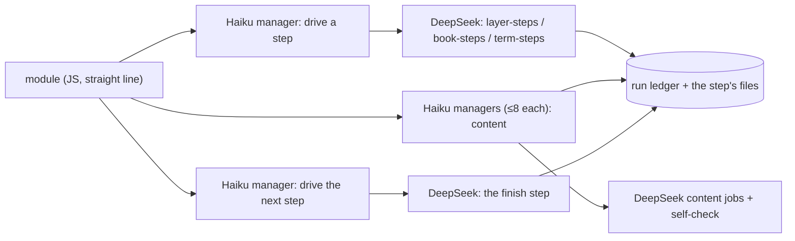

# Workflow module structure

## Purpose

The basic structure every module of the digest workflows (`zt-econ-digest`, `zt-math-digest`, their base) and of `zt-idea-grow` follows (all five slices moved the workflows to it, #175–#179): each feature block is one Haiku manager and several DeepSeek subagents, every deterministic command chain is one script step that a DeepSeek "drive" job runs, and a module is a straight line with as few decision branches as possible. Claude Code tokens are precious; DeepSeek does the labour. The full proposal, with its reasons and the migration table, is [docs/workflow-module-structure-proposal.md](../workflow-module-structure-proposal.md).

**Owns:** the module rules (§ Behaviour), the model policy, the review checklist, and the six reference step scripts `scripts/book-digest/term-steps.ps1` (the Term stages, #172), `scripts/book-digest/layer-steps.ps1` (the digest layers, #175), `scripts/book-digest/book-steps.ps1` (the book-level stages, #176), `scripts/book-digest/model-steps.ps1` (the model layer, #177), `scripts/book-digest/math-steps.ps1` (the mathematics stages, #178) and `scripts/idea-grow/grow-steps.ps1` (the idea-grow stage, #179).
**Does not own:** the stages and modes of each workflow ([Digest workflows](digest-workflows.md), [Idea-grow workflow](idea-grow-workflow.md)), the DeepSeek protocol itself (the global skill `deepseek-subagent-managed-protocol`), and the compilers the steps call ([zt-digest](zt-digest.md)).

## At a glance

| | |
|---|---|
| Entry points | `pwsh -NoProfile -File scripts/book-digest/term-steps.ps1 -Step start\|review\|fix\|finish\|link -Out <staging>`; `pwsh -NoProfile -File scripts/book-digest/layer-steps.ps1 -Step start\|apply\|finish -Out <staging> -Layer <digest\|link\|cards\|events\|findings\|explain\|terms> -Owner <label>`; `pwsh -NoProfile -File scripts/book-digest/book-steps.ps1 -Step <step> -Out <staging> [-Json '<options>']`; `pwsh -NoProfile -File scripts/book-digest/model-steps.ps1 -Step start\|brief\|fill\|derive\|review\|split\|close\|report\|finish -Out <staging> [-Work <batch>] [-Models <a,b>] [-Units <unit:token,...>]`; `pwsh -NoProfile -File scripts/book-digest/math-steps.ps1 -Step skeleton\|notation\|notation-apply\|boundary\|boundary-apply\|boundary-settle\|proof\|proof-apply\|theory\|theory-apply\|check -Out <staging> [-UnitsPerJob 4] [-Supply examples] [-MainResults 7]`; `pwsh -NoProfile -File scripts/idea-grow/grow-steps.ps1 -Step next -Work <work> -Options '<json>' [-After <token>] [-ZtConfig <dir>] [-Tool zt-digest]` |
| Key files | `scripts/book-digest/term-steps.ps1`; `scripts/book-digest/layer-steps.ps1` (#175); `scripts/book-digest/book-steps.ps1` (#176); `scripts/book-digest/model-steps.ps1` (#177); `scripts/book-digest/math-steps.ps1` (#178); `scripts/idea-grow/grow-steps.ps1` (#179); `scripts/workflow-shared/modules/zt-workflow-lib.js` v3 — `ztDrive`, the one drive helper (it records the conversation in the run ledger, or records nothing for a workflow that keeps none); `zt-term-cards.js` v5, `zt-term-link.js` v4; `zt-digest-lib.js` v39 (`layerRun`, `driveStep`, `runJobs`, `bookStep`, `cardCycle`); `zt-model-lib.js` v11 (`zmlMake` → `start`, `elaborate`, `finish`), `zt-model-layer.js` v7; `zt-math-lib.js` v5 (`zmMake` → `step`, `must`, `jobs`) and the five `zt-math-*` stage modules v2; `zt-grow-cycle.js` v13 (#179: the grow stage runs one `grow-steps.ps1 -Step next` drive job per round and dispatches its checked job set); `zt-term-link-lib.js` v3; the #176 stage modules; `docs/workflow-module-structure-proposal.md` — the proposal |
| Depends on | [zt-digest](zt-digest.md) (`group-start`/`group-finish`, `link-start`/`link-finish`, `finish-batch`, `ledger`, `card`, `finalize`, `cleanup-run`/`cleanup-finish`, `prepare`, `prepare-link`, `organize-survey`/`organize-apply`, `skeleton`, `figures`, `bridge`, `audit`, `book-cards-finish`, `math`), the DSMP block inlined by the workflow framework |
| Used by | [Digest workflows](digest-workflows.md) (every stage of the base and both variants); every module change of the digest workflow |
| Tests | `scripts/book-digest/tests/framework-harness.mjs` (the Term, #175 layer, #176 book, #177 model and #178 mathematics checks: every agent of a moved stage a Haiku DeepSeek manager, no moved stage relays a command, each step one script call, the drive steps in order, the content managers reading the step's job list, no `zt-relay` agent left); `scripts/book-digest/tests/layer-steps.tests.ps1` (the layer steps against a stand-in tool); `scripts/book-digest/tests/book-steps.tests.ps1` (the book steps against a stand-in tool); `scripts/book-digest/tests/model-steps.tests.ps1` (the model steps against a stand-in tool); `scripts/book-digest/tests/math-steps.tests.ps1` (the mathematics steps against a stand-in tool); `scripts/book-digest/tests/grow-workflow-harness.mjs` (the built `zt-idea-grow` against a stand-in runtime: every agent a Haiku DeepSeek manager, no relay, one `grow-steps.ps1 -Step next` drive job per round, the `-After` order, a failed step stopping the stage); `scripts/book-digest/tests/grow-steps.tests.ps1` (the grow step against a stand-in `zt-digest`: the checksum guard, the one status recovery, the repeated-set guard and the failure answers) |

## Concepts

- `Feature block` — one Haiku manager and the DeepSeek subagents it runs (at most 8 per manager, at most 8 managers at once).
- `Content job` — a DeepSeek job that writes Cards, Links, Term drafts, reviews or fixes, runs its own self-check tool and fixes its own faults; it writes large output to a file and answers with one status line.
- `Drive job` — a DeepSeek job that runs one script step exactly as given and answers with the step's last line (one JSON line). It replaces every Claude agent that only ran a command. `zt-workflow-lib`'s `ztDrive` builds its manager prompt, registers the conversation, collects the answer and deletes the conversation.
- `Script step` — one PowerShell call that runs a whole deterministic chain (for example plan + claim + list jobs, or the whole-book card cycle's apply + check) in one process, records unit outcomes in the run ledger, and prints one compact JSON line.
- `Relay agent` — a Claude agent that runs one command and returns its line. Not allowed in the migrated modules.

## Architecture

The module holds no per-unit logic: the script step reads and writes the ledger and the job files; the module passes the step's counts on (how many jobs, which file) and reports the last step's JSON line.

## Interfaces

### `term-steps.ps1`

| Step | Does | Writes | Prints |
|---|---|---|---|
| `start` | releases stale Term-card claims, plans (`-PerJob`, `-MathPerJob`), claims every ready job unit (lease 7200 s), lists the claimed jobs | `drive/units.json`, `drive/jobs.json` | `{ok, jobs, plan_revision, file}` |
| `review` | check + review plan | `drive/reviews.json` | `{ok, reviews, counts, file}` |
| `fix` | fix plan; each fix runs in a new conversation from its fallback files | `drive/fixes.json` | `{ok, fixes, counts, file}` |
| `finish` | completes each claimed job from the readiness result (fails the rest), releases any job unit the book claim picks up, publishes the book under its claim or the ready prefix without one | — | `{ok, done, failed, book, publication}` |
| `link` | plans, applies under the claim (or links the published prefix when the unit is blocked), completes, plans again | — | `{ok, status, unit, counts, second}` |

### `layer-steps.ps1`

One call runs one block of one digest layer (#175). `zt-workflow-lib`'s `ztDrive` runs it as a DeepSeek drive job through a Haiku manager, and `zt-digest-lib`'s `layerRun` drives the blocks (`start` → content managers → `finish`; explain adds its second content round through `apply`). The per-layer table is in the block history and in the code's own switch; the Cards layer's `start` claims and finishes a block in one `finish-batch`.

### `model-steps.ps1`

One call runs one step of the model layer (#177). `zt-model-lib`'s `modelStep` runs it as a DeepSeek drive job through a Haiku manager, and `compileBatch` lists its content jobs through `runJobs`. A block: `start` (releases a stopped run's Model claims, runs the book's `list-models`, claims up to eight ready Model units with the two-hour lease, names the block's models) → per batch `brief` → the Sonnet architect → `fill` (plan-status, the batch's one `model-deps -Units` command, its `defer`, and the fill, in one process) → `derive` → `review`/`split` rounds → `close` rounds (`-Report`) → `report` when a close round still sent follow-ups → `finish` (one `zt-digest finish-batch` for the block's units, then the gate).

| Step | Does | Prints |
|---|---|---|
| `start` | releases the Model claims a stopped run left, lists the Model Cards, claims the block, names its models | `{ok, units, claimed, models, missing, file, gate}` |
| `brief` | the brief jobs of one batch | `{ok, step, jobs, file, skipped}` |
| `fill` | plan-status, one `model-deps -Units`, the defer, the fill | `{ok, step, plans, deferred, jobs, derive, file}` |
| `derive` / `review` / `split` | that chain's jobs (a composer `-Need` string for split) | `{ok, step, jobs, file}` |
| `close` | the build faults back once; its last round writes the report | `{ok, step, jobs, faults, unowned, report, file}` |
| `report` | one report per model of the batch | `{ok, step, models, file}` |
| `finish` | the block's checked completions in one command, and the gate | `{ok, results, done, failed, gate}` |

### `book-steps.ps1`

One call runs one block of one book-level stage (#176). `zt-digest-lib`'s `bookStep` runs it as a DeepSeek drive job, and `bookStep`/`cardCycle` drive the stages. The step's options travel in `-Json`; every step prints one compact JSON line and answers `{ok:false, step, error}` for a failed command. A command the owner's Lock refused is answered with the archive's typed `card_locked` JSON and stops the stage.

| Step | Does | Prints |
|---|---|---|
| `prepare` | mode `full`: the book preparation (`prepare ... -Apply -Brief`); mode `resume`: `ledger resume`, `ledger status -Summary` and the digest gate fallback; modes `term-cards`/`term-link`: the backfill's `-Sections`/`-Validate` preparation | the tool's line plus `ok` |
| `prepare-link` (`link-prepare`) | the Link pass's receipt-owned gap set (`prepare-link -Brief`) | the tool's line plus `ok` |
| `gate` | `ledger gate -Layer -Brief` | the gate line |
| `publish` | a stage's own revision (`finalize -Step stage` with its declared artifacts), or the ledger's own publication (`Ledger: true`, the whole-book Card revision) | the publication line |
| `cards-start` | the card cycle's plan and its jobs (`card -Step plan -Compact`) | `{ok, picked, with_faults, faults, review, orphans, jobs, file}` |
| `cards-apply` | apply every ready draft, then the check (`card -Step apply` until no pending job, then `-Step check -Compact`) | `{ok, applied, faults, orphans, jobs, file}` |
| `cards-finish` | apply every ready draft, then the report (`card -Step report`) | the cycle's report line |
| `unit-fail` | record one claimed unit's fault (`ledger fail`) | `{ok, unit, state}` |
| `cards-book-start` | publish the whole-book revision (`ledger publish`) and claim it (`ledger next -Brief`) | `{ok, unit, token, input_hash, inputs, revision}` or `{ok, unit:null, waiting:true, gate}` |
| `cards-book-finish` | the whole-book cycle's checked completion (`book-cards-finish`), the ledger read for a cut line, and the claim's fault otherwise | the completion line, or `{ok:false, unit, state, error}` |
| `organize-survey` / `organize-apply` | Organize's survey and the recorded decisions | the tool's line |
| `skeleton-start` / `skeleton-finish` | the Literature index and structure Card plan (its job file) and its applied answer (`-Decisions ... -Apply`) | the plan's counts and job count, then the applied skeleton |
| `figures` | `figures -Report ... -Apply` | the figure pass's summary |
| `bridge-start` / `bridge-report` / `bridge-apply` | the Bridge plan (its judge job file), the frozen report, and an apply | each step's tool line |
| `audit` | the read-only audit of the book or the Workspace | the audit summary |
| `finalize-plan` / `-changes` / `-scope` / `-refresh` / `-final` | the finite finalization's steps | each step's tool line |
| `term-link` | the finalization's Term-link round: plan, claim, apply under the token, complete, plan again | `{ok, status, unit, plan, counts, no_op, completion, second}` |
| `cleanup-start` / `cleanup-apply` / `cleanup-report` | the settlement plan and its two paths, the provider results (or `cleanup-finish -Ready` when they are unusable), and the verified run report | the plan line with its paths, `{ok, fallback, provider, ready}`, and the run report |

### `math-steps.ps1`

One call runs one chain of a mathematics stage (#178). `zt-math-lib`'s `step` runs it as a DeepSeek drive job, `must` stops the stage with a failed step's reason, and `jobs` runs the step's content jobs in Haiku managers through `runJobs`. Every step prints one compact JSON line and answers `{ok:false, step, error}` for a failed command. Each plan step saves its job list under `<staging>\math\drive`, which is what its content manager reads.

| Step | Does | Prints |
|---|---|---|
| `skeleton` | `math -Step index`, `-Step docs` and `-Step skeleton -Apply`, in ONE process | `{ok, index, docs, skeleton}` (each command's own line) |
| `notation` | `math -Step notation`: the symbol-candidate job | `{ok, candidates, jobs, file}` |
| `notation-apply` | `math -Step notation-apply -Apply`: the Book notation table | `{ok, symbols, card}` or `{ok:false, error}` (the digest goes on without it) |
| `boundary` | `math -Step boundary -UnitsPerJob -Supply` | `{ok, units, jobs, file}` |
| `boundary-apply` | `math -Step boundary-apply -Supply`: the parts, and one review job per supplied batch | `{ok, created, skipped_supplied, jobs, file}` |
| `boundary-settle` | `math -Step boundary-settle`: delete each supplied part a review judged wrong | `{ok, kept, deleted, unreviewed}` |
| `proof` | `math -Step proof -UnitsPerJob` | `{ok, units, jobs, file}` |
| `proof-apply` | `math -Step proof-apply`: each fix that keeps every Link; the tool's counted `ok` stays nested | `{ok, applied: {ok, fixed, refused, parts}}` |
| `theory` | `math -Step theory -MainResults` | `{ok, theories, jobs, file}` |
| `theory-apply` | `math -Step theory-apply -MainResults` | `{ok, theories, answered}` |
| `check` | `math -Step check -Staging -Out`: the read-only M1–M18 report | the check line (`units`, `theories`, `faults`, `by_rule`, `report`) |

### `grow-steps.ps1`

One call runs the idea-grow stage's whole chain (#179). `zt-grow-cycle` v13 runs it as one DeepSeek drive job through a Haiku manager (`zt-workflow-lib`'s `ztDrive`, `record: false`: the run keeps no ledger), and the module dispatches each checked job set through DSMP.

| Step | Does | Prints |
|---|---|---|
| `next` | `zt-digest grow -Step next -Work -Options [-After]`: every deterministic grow round the command can run; a line that is not one of the three shapes, or whose job set fails its checksum, is read again ONCE from `grow -Step status`; a status line that only repeats the set this call already confirmed asks `next -After` again | the tool's checked line (`{next:"jobs",…}`, `{next:"done",…}` or `{next:"fault",…}`), or `{ok:false, step:"next", error}` when no readable line exists |

## Behaviour

The rules every module follows:

1. No single-command relay agent: a deterministic chain is one script step, run by a DeepSeek drive job.
2. Card composition, Links and Term work are DeepSeek content jobs under the DeepSeek Subagent Managed Protocol: Haiku managers, ≤ 8 conversations per manager and 8 managers at once, collect then delete (never archive), one retry, `wait_seconds: 0` with 90-second polls, a 240-minute budget, the workspace removed at the end.
3. Each content job carries its self-check tool (`zt-check`, the compiler's check or precheck) and fixes its own draft until it passes.
4. A module is a straight line. Its only branches are "no work" (skip the block) and "a step failed" (stop with the reason). Per-unit outcomes are ledger data, never module branches.
5. The ledger is the truth: a step records every unit's outcome and prints one JSON line; the module never re-derives state.
6. One shot, then report: no JavaScript retry loops; a retry is the DSMP retry of one job, or a later run. A declared correction count (the card cycle's `cardFixRounds`, the finalization's one cycle) is part of the plan, not a retry loop.
7. A step that starts a branch releases claims a stopped run left; a step never keeps a unit it did not ask for.
8. Every install carries the DSMP block (`dsmpSlot`, `dsCleanupWorkspaces` in the script), project and global scope.
9. The one Claude agent outside the manager role is the approved judgement role (the Opus Organize decision), and one Haiku manager may make the one call no script can (`deepseek_settle` in the settlement); neither runs a command.

Models: Haiku (effort low) for every manager; DeepSeek V4.1 Flash, official source, effort high, for all labour; Sonnet only for the overall designer of a complicated task (the model architect) and the HTML visual composer; Opus only for the judgement roles the user approved (the Organize decision).

## Data and storage

The Term steps write only under `<staging>\term-cards\drive`; the model steps only under `<staging>\models\drive` (the block's units and models, and each step's job list); the mathematics steps under `<staging>\math\drive` (the notation, boundary, boundary-review, proof and theory job lists) and the math compiler's own `math\` folders (`index.json`, `docs.json`, `units.json`, `notation\`, `boundary\`, `proof\`, `theory\`). A digest layer's steps write only under `<staging>\layer-steps\<layer>` (`units.json`, `start.json`, `jobs.json`, `apply-jobs.json`) and the compilers' own staging files. The book steps write under the stage's own folder: `cards\out\jobs.json`, `cards-link\out\jobs.json`, `cards-notes\out\jobs.json`, `finalize\fix\out\jobs.json`, `skeleton\out\jobs.json`, `bridge\out\jobs.json`, and `cleanup\settle-plan.json`/`settle-results.json`; outcomes go to the run ledger (`ledger.sqlite3`). The grow step writes no file of its own: `zt-digest grow -Step next` keeps `next.json` (the frozen options, the rounds done, the pending job set and the last line) and the run's plan, section, job, answer and report files under `out`; the script only reads the command's line and prints it.

## Configuration

`term-steps.ps1`: `-Step`, `-Out`, `-Occurrences first|all`, `-PerJob`, `-MathPerJob`, `-Tool` (default `zt-digest`). `layer-steps.ps1`: `-Step start|apply|finish`, `-Out`, `-Layer`, `-Owner`, `-Take`, `-Wait`, `-Lease`, `-MaxParts`, `-Limits` (the run's `-MaxSentences …` string), `-Tool`. `book-steps.ps1`: `-Step`, `-Out`, `-Json` (the step's options), `-Tool`. `model-steps.ps1`: `-Step`, `-Out`, `-Work`, `-Models`, `-Units`, `-CitationKey`, `-Need`, `-Level`, `-Rebuild`, `-Changed`, `-Take`, `-Owner`, the compile limits, the math instruction files (`-BriefDoc`, `-FillDoc`, `-ReviewDoc`) and `-Tool`. `math-steps.ps1`: `-Step`, `-Out`, `-UnitsPerJob` (4), `-Supply` (`examples`), `-MainResults` (7), `-Tool`. `grow-steps.ps1`: `-Step next`, `-Work` (the run's folder), `-Options` (the frozen options JSON), `-After` (the confirmed job set's token), `-ZtConfig` (the box copy; it sets `ZT_CONFIG_DIR` for the step and its children) and `-Tool` (default `zt-digest`). The modules pass the scripts' paths (defaults `E:\zet\scripts\book-digest\term-steps.ps1`, `layer-steps.ps1`, `book-steps.ps1`, `model-steps.ps1`, `math-steps.ps1` and `E:\zet\scripts\idea-grow\grow-steps.ps1`; the kernel passes no param defaults, so the module holds its own).

## Usage

A module change follows the review checklist:

- [ ] Every Claude agent is a Haiku DSMP manager (or an approved designer/decision role).
- [ ] No Claude agent runs a single command.
- [ ] Card, Link and Term content is written by DeepSeek content jobs with a self-check tool.
- [ ] Deterministic chains are script steps that print one JSON line and record outcomes in the ledger.
- [ ] The module is a straight line; its only branches are "no work" and "a step failed".
- [ ] The harness checks the drive steps' order and that no relay agent runs.
- [ ] The install carries the DSMP block in both scopes and `verify` is ok.

## Testing

`node scripts/book-digest/tests/framework-harness.mjs`: the stand-in answers each drive step on its in-memory ledger and checks that the moved stages start only Haiku DeepSeek managers, run their steps in order, give each content manager at most eight jobs, and that no moved stage relays a command; the Term and layer checks cover the drive order and the prefix publication; the #176 checks cover the book-level order (prepare → whole-book cycle → Link preparation and check → Organize → skeleton → Figures → Bridge → audit → finalization's round → settlement → report), the resume's gate steps, and the one settle call; the #178 checks cover the mathematics stages (their steps in order, every agent a Haiku manager, no relay left, every content manager reading its plan step's job file, every stage's own result in the report, and a failed step stopping its stage).

`pwsh -NoProfile -File scripts/book-digest/tests/layer-steps.tests.ps1`: the layer steps run against a stand-in `zt-digest` tool (no archive, model or provider).

`pwsh -NoProfile -File scripts/book-digest/tests/model-steps.tests.ps1`: the model steps run against a stand-in `zt-digest` tool: the block's release, listing and claim, the lost-claim and garbled `model-deps` fallbacks, the brief/fill/derive/review/split/close/report chains, the block's one `finish-batch`, and a failed command as one `ok:false` line.
`pwsh -NoProfile -File scripts/book-digest/tests/book-steps.tests.ps1`: the book steps run against a stand-in `zt-digest` tool: the preparation (full, resume with its summary and gate fallback, and the backfill branches), the Link preparation, the publication, the card cycle's plan/apply/check/report and its job files, the whole-book claim and checked finish (a cut line, a refused completion), the settlement's plan/apply/report with its fallback, the finalization's steps and Term-link round, the skeleton, Figures, the Bridge and the audit.
`node scripts/book-digest/tests/grow-workflow-harness.mjs`: the built `zt-idea-grow` runs its grow stage against a stand-in runtime: one `grow-steps.ps1 -Step next` drive job per round in order with the `-After` tokens, the checked job sets to DSMP content managers with their filled templates, every agent a Haiku DeepSeek manager, no relay, a failed step, a Lock fault and a step failure each stopping the stage, and the build's modules and the blueprint's one manager role.

`pwsh -NoProfile -File scripts/book-digest/tests/grow-steps.tests.ps1`: the grow step runs against a stand-in `zt-digest`: the done, jobs and fault lines passed through, the FNV-1a checksum rejecting a cut or rewritten line (read again from the status), a second unreadable line answering `ok:false`, the status's repeated set asking `next -After` again instead of dispatching twice, and the box config and `-After` reaching the command.

`pwsh -NoProfile -File scripts/book-digest/tests/math-steps.tests.ps1`: the mathematics steps run against a stand-in `zt-digest` tool: the one-call statement chain (index, docs and the applied skeleton), each plan step's saved job list under `math\drive`, the apply and settle chains (the proof apply's counted `ok` nested), the sizing options reaching the commands that take them, the read-only check, a refused notation table that leaves the digest going on, and a failed command as one `ok:false` line.

## Decisions and pitfalls

- The relay design (one Haiku agent per command) cost about 22 Claude agents for one wave of four Term jobs, and most of its tokens were each agent re-reading its own prompt; the drive design ran the whole Term pass of a book in 15.
- A DeepSeek drive job may run its command with full shell access: its prompt says to run the one command as given, change nothing, and answer only with the last line.
- `ledger next` hands out any ready unit of a layer: a step that wants one unit (the book) releases any other unit it receives.
- The ledger's lease is at most 7200 seconds; the migrated layers claim with that lease, because their content jobs are capped by the provider run cap and the explain layer runs two content rounds.
- Each module carries its own param defaults: the kernel passes only the params a blueprint gives.
- A relay can no longer cut a claim or a completion line; the steps still ask the ledger when a line cannot be read, because the tool's own line may be cut by a timeout or a broken pipe.
- A step's answer is authoritative (#176): a plan step that answers no line stops the cycle with its reason, instead of a module trying to read a plan from a late report.
- A failed step is data, not a branch (#178): the step's line carries `ok:false` and its reason, and the module stops the stage (or, for the mathematics notation table, logs it and goes on); no module inspects per-unit outcomes.
- The library's relay-era driver has no caller since #178 (`drive`, `runScript`, `chain`, `claim`, `gate`, `chain`, `holding`, `layer`, `runCards`). `ztRelay` left `zt-workflow-lib` in v3, which is drive-only now; the relay-era runner lives on only as `zt-digest-lib`'s private `zdRelay`, beside the dead driver that a later cleanup removes. No digest stage and no idea-grow stage names a relay helper, and no run starts a `zt-relay` agent. The base blueprint still declares the unused `relay` role.
- The idea-grow stage is a state machine, not a straight line of feature blocks (#179): the module loops
  `one grow-steps.ps1 -Step next drive job → its checked job set to DSMP → next -After`. The loop is the command's own
  round order, not a retry loop: the per-round decisions are the command's, the per-unit outcomes are its files, and
  the only branches are "no job set yet" (the command advanced), "done" (the report) and "a step or fault failed"
  (the stage stops with its reason). One Haiku manager runs each round's drive job, so a full run costs about ten
  Claude agents instead of one per relayed command.

## Change history

- `2026-10-26` — #179 (workflow structure slice 5, the last one): `scripts/idea-grow/grow-steps.ps1` is the idea-grow stage's one step script (one `next` step: the whole grow chain, the FNV-1a check of its job line, the one `grow -Step status` recovery and the repeated-set guard). `zt-grow-cycle` v13 runs it as a DeepSeek drive job through `ztDrive` (`record: false`: the idea-grow run keeps no ledger) and calls `ztRelay`/`runScript`/`wfpScript` zero times; the blueprint declares the one `manager` role instead of `relay`. `zt-workflow-lib` v3 adds the no-ledger drive job. `zt-idea-grow` 4.0.2 is installed in both scopes; `grow-steps.tests.ps1` adds 18 checks and the grow harness covers the stage. The relay-era runner moved into `zt-digest-lib` v40 beside its dead driver (no caller since #178); the base blueprint's `relay` role stays unused, for a later cleanup.
- `2026-10-26` — #178 (workflow structure slice 4, the last one): `scripts/book-digest/math-steps.ps1` is the mathematics stages' one step script (the statement chain — index, docs and the applied skeleton — in one process; the notation plan and its apply; boundary write/apply/settle; proof review/apply; Theory write/apply; the read-only check). `zt-math-lib` v5 replaces `runMathScript`/`mstep`/`mathOpts` with `step` (one chain as a DeepSeek drive job through `ztDrive`), `must` (the stage's stop with the step's reason) and `jobs` (the plan step's content jobs in Haiku managers through `runJobs`); the five `zt-math-*` stage modules v2 are straight lines of those steps. The mathematics modules call `ztRelay`/`runScript`/`wfpScript` zero times, and no digest run starts a `zt-relay` agent any more: the library's relay-era driver has no caller. Base 5.6.6, econ 6.6.6, math 5.6.6; `math-steps.tests.ps1` adds 26 checks against a stand-in tool, and the framework harness's #178 checks cover the stage order, the agents, the content managers and a failed step.
- `2026-10-26` — #177 (workflow structure slice 3): `scripts/book-digest/model-steps.ps1` is the model layer's one step script (a block's `start` and `finish`, and each batch's brief, fill, derive, review, split, close and report). `zt-model-lib` v11 adds `modelStep`, `start`, `elaborate` and `finish` and runs its content jobs in Haiku managers through `runJobs`; `zt-model-layer` v7 is the straight line of those steps. `zt-model-lib` and `zt-model-layer` call `ztRelay`/`runScript`/`wfpScript` zero times, and the digest run has no `zt-relay` agent left (the mathematics layer keeps its own until #178). Base 5.6.5, econ 6.6.5, math 5.6.5.
- `2026-10-26` — #176 (workflow structure slice 2): `scripts/book-digest/book-steps.ps1` is the book-level stages' one step script (the preparation and its resume/backfill branches, the Link preparation, a stage's own publication, the card cycle's plan/apply/check/report, the whole-book claim and checked finish, Organize's survey/apply, the skeleton, Figures, the Bridge, the audit, the finalization's plan/changes/scope/refresh/final, the Term-link round, and the settlement's plan/apply/report). `zt-digest-lib` v39 adds `bookStep` and `cardCycle`, and reads a resume's retained-layer gates through `bookStep`; `zt-term-link-lib` v3 is the finalization round's one drive job. zt-digest-prepare v16, zt-link-prepare v7, zt-link-check v3, zt-cards-book v5, zt-figures v6, zt-audit v5, zt-organize v9, zt-bridge v10, zt-finalize v4 and zt-dsh-cleanup v12 call `ztRelay`/`runScript`/`wfpScript` zero times; one Haiku manager makes the one `deepseek_settle` call. Base 5.6.4, econ 6.6.4, math 5.6.4. The relay helpers stay only for the model and math layers (the later slices).
- `2026-10-26` — #175 (workflow structure slice 1): the shared drive helper `ztDrive` (zt-workflow-lib v2) runs one deterministic script step as a DeepSeek drive job through a Haiku manager; `layer-steps.ps1` is the digest layers' step script and zt-digest-lib v38 drives it (`layerRun`, `driveStep`, `runJobs`), replacing the relay-era block driver. zt-group-cycle v7, zt-cards-layer v3, zt-link-pass v8, zt-book-terms v5, zt-event-layer v5, zt-finding-layer v5 and zt-explain v8 no longer call the relay helpers; base 5.6.3, econ 6.6.3, math 5.6.3.
- `2026-10-26` — Created from the user's proposal (#172): the Term stages of base 5.6.2 / econ 6.6.2 / math 5.6.2 are the reference implementation; the other modules move to the structure when next changed (the migration table is in the proposal).
