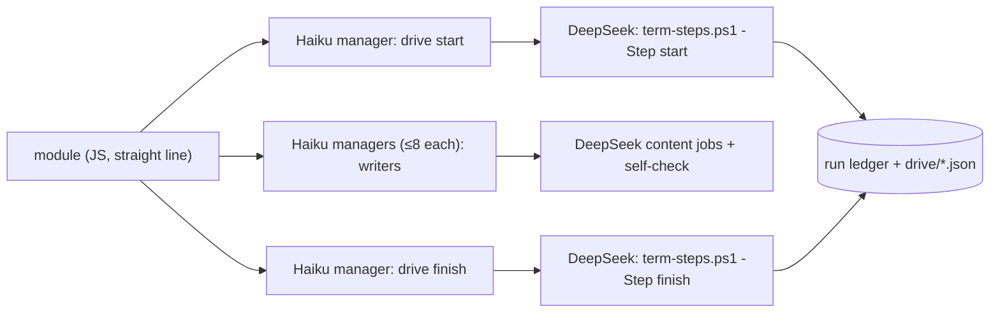

# Workflow module structure

## Purpose

The basic structure every module of the digest workflows (`zt-econ-digest`, `zt-math-digest`, their base) and of `zt-idea-grow` follows: each feature block is one Haiku manager and several DeepSeek subagents, every deterministic command chain is one script step that a DeepSeek "drive" job runs, and a module is a straight line with as few decision branches as possible. Claude Code tokens are precious; DeepSeek does the labour. The full proposal, with its reasons and the migration table, is [docs/workflow-module-structure-proposal.md](../workflow-module-structure-proposal.md).

**Owns:** the module rules (§ Behaviour), the model policy, the review checklist, and the reference step script `scripts/book-digest/term-steps.ps1`.
**Does not own:** the stages and modes of each workflow ([Digest workflows](digest-workflows.md), [Idea-grow workflow](idea-grow-workflow.md)), the DeepSeek protocol itself (the global skill `deepseek-subagent-managed-protocol`), and the compilers the steps call ([zt-digest](zt-digest.md)).

## At a glance

| | |
|---|---|
| Entry points | `pwsh -NoProfile -File scripts/book-digest/term-steps.ps1 -Step start\|review\|fix\|finish\|link -Out <staging>` |
| Key files | `scripts/book-digest/term-steps.ps1` — the Term stages' deterministic steps (reference implementation); `scripts/book-digest/workflow/modules/zt-term-cards.js` v4 and `zt-term-link.js` v3 — the modules built on them; `docs/workflow-module-structure-proposal.md` — the proposal |
| Depends on | [zt-digest](zt-digest.md) (`term-cards`, `term-link`, `ledger`), the DSMP block inlined by the workflow framework |
| Used by | [Digest workflows](digest-workflows.md) (the `term-cards` and `term-link` stages); every module change of the digest and idea-grow workflows |
| Tests | `scripts/book-digest/tests/framework-harness.mjs` (the v4 Term checks: drive order, no relay agent, writers ≤ 8 per manager, prefix publication and link) |

## Concepts

- `Feature block` — one Haiku manager and the DeepSeek subagents it runs (at most 8 per manager, at most 8 managers at once).
- `Content job` — a DeepSeek job that writes Cards, Links, Term drafts, reviews or fixes, runs its own self-check tool and fixes its own faults; it writes large output to a file and answers with one status line.
- `Drive job` — a DeepSeek job that runs one script step exactly as given and answers with the step's last line (one JSON line). It replaces every Claude agent that only ran a command.
- `Script step` — one PowerShell call that runs a whole deterministic chain (for example plan + claim + list jobs) in one process, records unit outcomes in the run ledger, and prints one compact JSON line.
- `Relay agent` — a Claude agent that runs one command and returns its line. Not allowed.

## Architecture

The module holds no per-unit logic: the script step reads and writes the ledger and the job files; the module passes the step's counts on (how many jobs, which file) and reports the last step's JSON line.

## Interfaces

### `term-steps.ps1`

| Step | Does | Writes | Prints |
|---|---|---|---|
| `start` | releases stale Term-card claims, plans (`-PerJob`, `-MathPerJob`), claims every ready job unit (lease 7200 s), lists the claimed jobs | `drive/units.json`, `drive/jobs.json` | `{ok, jobs, plan_revision, file}` |
| `review` | check + review plan | `drive/reviews.json` | `{ok, reviews, counts, file}` |
| `fix` | fix plan; each fix runs in a new conversation from its fallback files | `drive/fixes.json` | `{ok, fixes, counts, file}` |
| `finish` | completes each claimed job from the readiness result (fails the rest), releases any job unit the book claim picks up, publishes the book under its claim or the ready prefix without one | — | `{ok, done, failed, book, publication}` |
| `link` | plans, applies under the claim (or links the published prefix when the unit is blocked), completes, plans again | — | `{ok, status, unit, counts, second}` |

A failed step prints `{ok:false, step, error}`; the module stops with that reason.

## Behaviour

The rules every module follows:

1. No single-command relay agent: a deterministic chain is one script step, run by a DeepSeek drive job.
2. Card composition, Links and Term work are DeepSeek content jobs under the DeepSeek Subagent Managed Protocol: Haiku managers, ≤ 8 conversations per manager and 8 managers at once, collect then delete (never archive), one retry, `wait_seconds: 0` with 90-second polls, a 240-minute budget, the workspace removed at the end.
3. Each content job carries its self-check tool (`zt-check`, the compiler's check or precheck) and fixes its own draft until it passes.
4. A module is a straight line. Its only branches are "no work" (skip the block) and "a step failed" (stop with the reason). Per-unit outcomes are ledger data, never module branches.
5. The ledger is the truth: a step records every unit's outcome and prints one JSON line; the module never re-derives state.
6. One shot, then report: no JavaScript retry loops; a retry is the DSMP retry of one job, or a later run.
7. A step that starts a branch releases claims a stopped run left; a step never keeps a unit it did not ask for.
8. Every install carries the DSMP block (`dsmpSlot`, `dsCleanupWorkspaces` in the script), project and global scope.

Models: Haiku (effort low) for every manager; DeepSeek V4.1 Flash, official source, effort high, for all labour; Sonnet only for the overall designer of a complicated task (the model architect) and the HTML visual composer; Opus only for the judgement roles the user approved (the Organize decision).

## Data and storage

Each Term step writes only under `<staging>\term-cards\drive` (`units.json`, `jobs.json`, `reviews.json`, `fixes.json`) and the compilers' own staging files; outcomes go to the run ledger (`ledger.sqlite3`).

## Configuration

`term-steps.ps1` parameters: `-Step`, `-Out`, `-Occurrences first|all`, `-PerJob`, `-MathPerJob`, `-Tool` (default `zt-digest`). The modules pass the script path (default `E:\zet\scripts\book-digest\term-steps.ps1`; the kernel passes no param defaults, so the module holds its own).

## Usage

A module change follows the review checklist:

- [ ] Every Claude agent is a Haiku DSMP manager (or an approved designer/decision role).
- [ ] No Claude agent runs a single command.
- [ ] Card, Link and Term content is written by DeepSeek content jobs with a self-check tool.
- [ ] Deterministic chains are script steps that print one JSON line and record outcomes in the ledger.
- [ ] The module is a straight line; its only branches are "no work" and "a step failed".
- [ ] The harness checks the drive steps' order and that no relay agent runs.
- [ ] The install carries the DSMP block in both scopes and `verify` is ok.

## Testing

`node scripts/book-digest/tests/framework-harness.mjs`: the stand-in answers each drive step on its in-memory ledger and checks that the Term stages start only Haiku DeepSeek managers, run `start, review, fix, finish, link` in order, give each writer manager at most eight jobs, fail a not-ready job alone, publish and link the ready prefix, and keep a resume's Term switches.

## Decisions and pitfalls

- The relay design (one Haiku agent per command) cost about 22 Claude agents for one wave of four Term jobs, and most of its tokens were each agent re-reading its own prompt; the drive design ran the whole Term pass of a book in 15.
- A DeepSeek drive job may run its command with full shell access: its prompt says to run the one command as given, change nothing, and answer only with the last line.
- `ledger next` hands out any ready unit of a layer: a step that wants one unit (the book) releases any other unit it receives.
- The ledger's lease is at most 7200 seconds; a longer `-Lease` is refused and the claim returns nothing.
- Each module carries its own param defaults: the kernel passes only the params a blueprint gives.

## Change history

- `2026-10-26` — Created from the user's proposal (#172): the Term stages of base 5.6.2 / econ 6.6.2 / math 5.6.2 are the reference implementation; the other modules move to the structure when next changed (the migration table is in the proposal).
