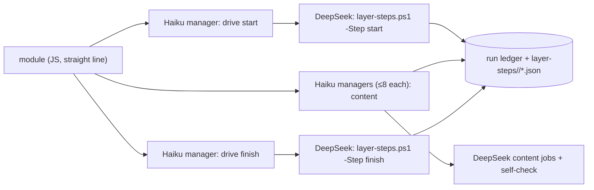

# Workflow module structure

## Purpose

The basic structure every module of the digest workflows (`zt-econ-digest`, `zt-math-digest`, their base) and of `zt-idea-grow` follows: each feature block is one Haiku manager and several DeepSeek subagents, every deterministic command chain is one script step that a DeepSeek "drive" job runs, and a module is a straight line with as few decision branches as possible. Claude Code tokens are precious; DeepSeek does the labour. The full proposal, with its reasons and the migration table, is [docs/workflow-module-structure-proposal.md](../workflow-module-structure-proposal.md).

**Owns:** the module rules (§ Behaviour), the model policy, the review checklist, and the two reference step scripts `scripts/book-digest/term-steps.ps1` (the Term stages, #172) and `scripts/book-digest/layer-steps.ps1` (the digest layers, #175).
**Does not own:** the stages and modes of each workflow ([Digest workflows](digest-workflows.md), [Idea-grow workflow](idea-grow-workflow.md)), the DeepSeek protocol itself (the global skill `deepseek-subagent-managed-protocol`), and the compilers the steps call ([zt-digest](zt-digest.md)).

## At a glance

| | |
|---|---|
| Entry points | `pwsh -NoProfile -File scripts/book-digest/term-steps.ps1 -Step start\|review\|fix\|finish\|link -Out <staging>`; `pwsh -NoProfile -File scripts/book-digest/layer-steps.ps1 -Step start\|apply\|finish -Out <staging> -Layer <digest\|link\|cards\|events\|findings\|explain\|terms> -Owner <label>` |
| Key files | `scripts/book-digest/term-steps.ps1` — the Term stages' deterministic steps (reference implementation); `scripts/book-digest/layer-steps.ps1` — the digest layers' deterministic steps (#175); `scripts/workflow-shared/modules/zt-workflow-lib.js` v2 — `ztDrive`, the one drive helper; `zt-term-cards.js` v5, `zt-term-link.js` v4, `zt-digest-lib.js` v38 (`layerRun`, `driveStep`, `runJobs`) and the layer modules built on them; `docs/workflow-module-structure-proposal.md` — the proposal |
| Depends on | [zt-digest](zt-digest.md) (`group-start`/`group-finish`, `link-start`/`link-finish`, `finish-batch`, `ledger`), the DSMP block inlined by the workflow framework |
| Used by | [Digest workflows](digest-workflows.md) (the `terms`, `term-cards`, `digest`, `cards`, `events`, `findings`, `explain`, `link`, `term-link` stages); every module change of the digest and idea-grow workflows |
| Tests | `scripts/book-digest/tests/framework-harness.mjs` (the Term checks and the #175 layer checks: every agent a Haiku DeepSeek manager, no moved layer relays a command, the drive steps in order, the content managers at most eight jobs); `scripts/book-digest/tests/layer-steps.tests.ps1` (the layer steps against a stand-in tool) |

## Concepts

- `Feature block` — one Haiku manager and the DeepSeek subagents it runs (at most 8 per manager, at most 8 managers at once).
- `Content job` — a DeepSeek job that writes Cards, Links, Term drafts, reviews or fixes, runs its own self-check tool and fixes its own faults; it writes large output to a file and answers with one status line.
- `Drive job` — a DeepSeek job that runs one script step exactly as given and answers with the step's last line (one JSON line). It replaces every Claude agent that only ran a command. `zt-workflow-lib`'s `ztDrive` builds its manager prompt, registers the conversation, collects the answer and deletes the conversation.
- `Script step` — one PowerShell call that runs a whole deterministic chain (for example plan + claim + list jobs) in one process, records unit outcomes in the run ledger, and prints one compact JSON line.
- `Relay agent` — a Claude agent that runs one command and returns its line. Not allowed in the migrated modules.

## Architecture

The module holds no per-unit logic: the script step reads and writes the ledger and the job files; the module passes the step's counts on (how many jobs, which file) and reports the last step's JSON line.

## Interfaces

### `term-steps.ps1`

| Step | Does | Writes | Prints |
|---|---|---|---|
| `start` | releases stale Term-card claims, plans (`-PerJob`, `-MathPerJob`), claims every ready job unit (lease 7200 s), lists the claimed jobs | `drive/units.json`, `drive/jobs.json` | `{ok, jobs, plan_revision, file}` |
| `review` | check + review plan | `drive/reviews.json` | `{ok, reviews, counts, file}` |
| `fix` | fix plan; each fix runs in a new conversation from its fallback files | `drive/fixes.json` | `{ok, fixes, counts, file}` |
| `finish` | completes each claimed job from the readiness result (fails the rest), releases any job unit the book claim picks up, publishes the book under its claim or the ready prefix without one | — | `{ok, done, failed, book, publication}` |
| `link` | plans, applies under the claim (or links the published prefix when the unit is blocked), completes, plans again | — | `{ok, status, unit, counts, second}` |

### `layer-steps.ps1`

One call runs one block of one digest layer (#175). `zt-workflow-lib`'s `ztDrive` runs it as a DeepSeek drive job through a Haiku manager, and `zt-digest-lib`'s `layerRun` drives the blocks (`start` → content managers → `finish`; explain adds its second content round through `apply`).

| Layer | `start` | `apply` | `finish` |
|---|---|---|---|
| `digest` | claim a block (`ledger next -Brief -Lease 7200`), `group-start` each held group, list its jobs | — | `group-finish` each held unit from its bound draft, fault the rest, brief gate |
| `link` | claim, `link-start` each held group, list its jobs | — | `link-finish` each held unit, fault the rest, brief gate |
| `cards` | one `zt-digest finish-batch -Layer cards -Take -Owner` claims and records the block; brief gate | — | — |
| `events` | claim, `event -Step plan`, list its jobs | — | `event -Step apply -Apply`, `event -Step report`, `finish-batch` the held units, brief gate |
| `findings` | claim, `finding -Step plan`, list its jobs | — | `finding -Step apply -Apply`, `finding -Step report`, `finish-batch`, brief gate |
| `explain` | claim, `model -Step explain` with the claimed models and the run limits, list its jobs | `model -Step explain-apply` and the fix jobs it lists (each continues its first conversation) | `model -Step explain-report`, `finish-batch`, brief gate |
| `terms` | claim the one `terms/book@1` unit, `terms -Step plan` | — | `terms -Step apply -Apply -Token` (the compiler completes the unit) |

A claim that fails is tried three times; a claim line without its units, and a completion line that came back unreadable, are answered from the ledger (`status -Held`, `status -Units`) before anything is faulted. A failed step prints `{ok:false, step, error}`; the Lock refuses a completion with `{ok:false, code:"card_locked", ...}`, which is that unit's content fault and stops the stage.

## Behaviour

The rules every module follows:

1. No single-command relay agent: a deterministic chain is one script step, run by a DeepSeek drive job.
2. Card composition, Links and Term work are DeepSeek content jobs under the DeepSeek Subagent Managed Protocol: Haiku managers, ≤ 8 conversations per manager and 8 managers at once, collect then delete (never archive), one retry, `wait_seconds: 0` with 90-second polls, a 240-minute budget, the workspace removed at the end.
3. Each content job carries its self-check tool (`zt-check`, the compiler's check or precheck) and fixes its own draft until it passes.
4. A module is a straight line. Its only branches are "no work" (skip the block) and "a step failed" (stop with the reason). Per-unit outcomes are ledger data, never module branches.
5. The ledger is the truth: a step records every unit's outcome and prints one JSON line; the module never re-derives state.
6. One shot, then report: no JavaScript retry loops; a retry is the DSMP retry of one job, or a later run.
7. A step that starts a branch releases claims a stopped run left; a step never keeps a unit it did not ask for.
8. Every install carries the DSMP block (`dsmpSlot`, `dsCleanupWorkspaces` in the script), project and global scope.

Models: Haiku (effort low) for every manager; DeepSeek V4.1 Flash, official source, effort high, for all labour; Sonnet only for the overall designer of a complicated task (the model architect) and the HTML visual composer; Opus only for the judgement roles the user approved (the Organize decision).

## Data and storage

The Term steps write only under `<staging>\term-cards\drive`. A digest layer's steps write only under `<staging>\layer-steps\<layer>` (`units.json`, `start.json`, `jobs.json`, `apply-jobs.json`) and the compilers' own staging files; outcomes go to the run ledger (`ledger.sqlite3`).

## Configuration

`term-steps.ps1`: `-Step`, `-Out`, `-Occurrences first|all`, `-PerJob`, `-MathPerJob`, `-Tool` (default `zt-digest`). `layer-steps.ps1`: `-Step start|apply|finish`, `-Out`, `-Layer`, `-Owner`, `-Take`, `-Wait`, `-Lease`, `-MaxParts`, `-Limits` (the run's `-MaxSentences …` string), `-Tool` (default `zt-digest`). The modules pass the scripts' paths (defaults `E:\zet\scripts\book-digest\term-steps.ps1` and `E:\zet\scripts\book-digest\layer-steps.ps1`; the kernel passes no param defaults, so the module holds its own).

## Usage

A module change follows the review checklist:

- [ ] Every Claude agent is a Haiku DSMP manager (or an approved designer/decision role).
- [ ] No Claude agent runs a single command.
- [ ] Card, Link and Term content is written by DeepSeek content jobs with a self-check tool.
- [ ] Deterministic chains are script steps that print one JSON line and record outcomes in the ledger.
- [ ] The module is a straight line; its only branches are "no work" and "a step failed".
- [ ] The harness checks the drive steps' order and that no relay agent runs.
- [ ] The install carries the DSMP block in both scopes and `verify` is ok.

## Testing

`node scripts/book-digest/tests/framework-harness.mjs`: the stand-in answers each drive step on its in-memory ledger and checks that the moved stages start only Haiku DeepSeek managers, run `start`/`apply`/`finish` in order, give each content manager at most eight jobs, and that no moved layer relays a command; the Term checks cover the drive order, the prefix publication and the link.

`pwsh -NoProfile -File scripts/book-digest/tests/layer-steps.tests.ps1`: the layer steps run against a stand-in `zt-digest` tool (no archive, model or provider): the claim and the start of every layer, the job lists, the checked finishes, the Cards claim-and-finish, the typed Lock stop, the three claim tries, the ledger fallback for a lost claim line and the empty block.

## Decisions and pitfalls

- The relay design (one Haiku agent per command) cost about 22 Claude agents for one wave of four Term jobs, and most of its tokens were each agent re-reading its own prompt; the drive design ran the whole Term pass of a book in 15.
- A DeepSeek drive job may run its command with full shell access: its prompt says to run the one command as given, change nothing, and answer only with the last line.
- `ledger next` hands out any ready unit of a layer: a step that wants one unit (the book) releases any other unit it receives.
- The ledger's lease is at most 7200 seconds; the migrated layers claim with that lease, because their content jobs are capped by the provider run cap and the explain layer runs two content rounds.
- Each module carries its own param defaults: the kernel passes only the params a blueprint gives.
- A relay can no longer cut a claim or a completion line; the steps still ask the ledger when a line cannot be read, because the tool's own line may be cut by a timeout or a broken pipe.

## Change history

- `2026-10-26` — #175 (workflow structure slice 1): the shared drive helper `ztDrive` (zt-workflow-lib v2) runs one deterministic script step as a DeepSeek drive job through a Haiku manager; `layer-steps.ps1` is the digest layers' step script and zt-digest-lib v38 drives it (`layerRun`, `driveStep`, `runJobs`), replacing the relay-era block driver. zt-group-cycle v7, zt-cards-layer v3, zt-link-pass v8, zt-book-terms v5, zt-event-layer v5, zt-finding-layer v5 and zt-explain v8 no longer call `ztRelay`/`runScript`/`wfpScript`; base 5.6.3, econ 6.6.3, math 5.6.3. The relay helpers stay only for the model layer, the whole-book cycle, the preparation and the settlement (the later slices).
- `2026-10-26` — Created from the user's proposal (#172): the Term stages of base 5.6.2 / econ 6.6.2 / math 5.6.2 are the reference implementation; the other modules move to the structure when next changed (the migration table is in the proposal).

