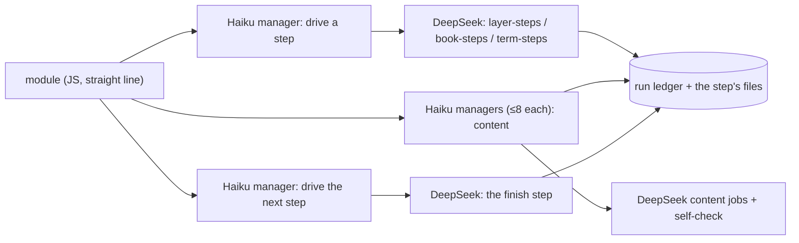

# Workflow module structure

## Purpose

The basic structure every module of the digest workflows (`zt-econ-digest`, `zt-math-digest`, their base) and of `zt-idea-grow` follows (all five slices moved the workflows to it, #175–#179): each feature block is one Haiku manager and several DeepSeek subagents, every deterministic command chain is one script step that a DeepSeek "drive" job runs, and a module is a straight line with as few decision branches as possible. Claude Code tokens are precious; DeepSeek does the labour. The full proposal, with its reasons and the migration table, is [docs/workflow-module-structure-proposal.md](../workflow-module-structure-proposal.md).

**Owns:** the module rules (§ Behaviour), the model policy, the review checklist, and the six reference step scripts `scripts/book-digest/term-steps.ps1` (the Term stages, #172), `scripts/book-digest/layer-steps.ps1` (the digest layers, #175), `scripts/book-digest/book-steps.ps1` (the book-level stages, #176), `scripts/book-digest/model-steps.ps1` (the model layer, #177), `scripts/book-digest/math-steps.ps1` (the mathematics stages, #178) and `scripts/idea-grow/grow-steps.ps1` (the idea-grow stage, #179).
**Does not own:** the stages and modes of each workflow ([Digest workflows](digest-workflows.md), [Idea-grow workflow](idea-grow-workflow.md)), the DeepSeek protocol itself (the global skill `deepseek-subagent-managed-protocol`), and the compilers the steps call ([zt-digest](zt-digest.md)).

## At a glance

| | |
|---|---|
| Entry points | `pwsh -NoProfile -File scripts/book-digest/term-steps.ps1 -Step start\|review\|fix\|finish\|link -Out <staging>`; `pwsh -NoProfile -File scripts/book-digest/layer-steps.ps1 -Step start\|apply\|finish -Out <staging> -Layer <digest\|link\|cards\|events\|findings\|explain\|terms> -Owner <label>`; `pwsh -NoProfile -File scripts/book-digest/book-steps.ps1 -Step <step> -Out <staging> [-Json '<options>']`; `pwsh -NoProfile -File scripts/book-digest/model-steps.ps1 -Step start\|brief\|fill\|derive\|review\|split\|close\|report\|finish -Out <staging> [-Work <batch>] [-Models <a,b>] [-Units <unit:token,...>]`; `pwsh -NoProfile -File scripts/book-digest/math-steps.ps1 -Step skeleton\|notation\|notation-apply\|boundary\|boundary-apply\|boundary-settle\|proof\|proof-apply\|theory\|theory-apply\|check -Out <staging> [-UnitsPerJob 4] [-Supply examples] [-MainResults 7]`; `pwsh -NoProfile -File scripts/idea-grow/grow-steps.ps1 -Step next -Work <work> -Options '<json>' [-After <token>] [-ZtConfig <dir>] [-Tool zt-digest]` |
| Key files | `scripts/book-digest/term-steps.ps1`; `scripts/book-digest/layer-steps.ps1` (#175); `scripts/book-digest/book-steps.ps1` (#176); `scripts/book-digest/model-steps.ps1` (#177); `scripts/book-digest/math-steps.ps1` (#178); `scripts/idea-grow/grow-steps.ps1` (#179); `scripts/book-digest/step-line.ps1` — the one writer of a step's compact line (`Send-StepLine`); `scripts/workflow-shared/modules/zt-workflow-lib.js` v5 — `ztDrive`, the one drive helper (it records the conversation in the run ledger, or records nothing for a workflow that keeps none) and `ztDriveAnswer`, the strict reader (only the last non-empty line, one JSON object with a boolean top-level `ok`, copied verbatim); `zt-term-cards.js` v6, `zt-term-link.js` v5; `zt-digest-lib.js` v42 (`layerRun`, `driveStep`, `runJobs`, `bookStep`, `cardCycle`; `zdMake` reads the book's Citation key from the stage's `key` param only, #181); `zt-model-lib.js` v12 (`zmlMake` → `start`, `elaborate`, `finish`), `zt-model-layer.js` v8; `zt-math-lib.js` v5 (`zmMake` → `step`, `must`, `jobs`) and the five `zt-math-*` stage modules v3; `zt-grow-cycle.js` v14 (#180: the grow stage runs one `grow-steps.ps1 -Step next` drive job per round and one manager per eight entries of the job file it wrote); `zt-term-link-lib.js` v4; the #176 stage modules; `docs/workflow-module-structure-proposal.md` — the proposal |
| Depends on | [zt-digest](zt-digest.md) (`group-start`/`group-finish`, `link-start`/`link-finish`, `finish-batch`, `ledger`, `card`, `finalize`, `cleanup-run`/`cleanup-finish`, `prepare`, `prepare-link`, `organize-survey`/`organize-apply`, `skeleton`, `figures`, `bridge`, `audit`, `book-cards-finish`, `math`), the DSMP block inlined by the workflow framework |
| Used by | [Digest workflows](digest-workflows.md) (every stage of the base and both variants); every module change of the digest workflow |
| Tests | `scripts/book-digest/tests/framework-harness.mjs` (the Term, #175 layer, #176 book, #177 model and #178 mathematics checks: every agent of a moved stage a Haiku DeepSeek manager, no moved stage relays a command, each step one script call, the drive steps in order, the content managers reading the step's job list, no `zt-relay` agent left); `scripts/book-digest/tests/layer-steps.tests.ps1` (the layer steps against a stand-in tool); `scripts/book-digest/tests/book-steps.tests.ps1` (the book steps against a stand-in tool); `scripts/book-digest/tests/model-steps.tests.ps1` (the model steps against a stand-in tool); `scripts/book-digest/tests/math-steps.tests.ps1` (the mathematics steps against a stand-in tool); `scripts/book-digest/tests/grow-workflow-harness.mjs` (the built `zt-idea-grow` against a stand-in runtime: every agent a Haiku DeepSeek manager, no relay, one `grow-steps.ps1 -Step next` drive job per round, the `-After` order, a failed step stopping the stage); `scripts/book-digest/tests/grow-steps.tests.ps1` (the grow step against a stand-in `zt-digest`: the checksum guard, the one status recovery, the repeated-set guard and the failure answers) |

## Concepts

- `Feature block` — one Haiku manager and the DeepSeek subagents it runs (at most 8 per manager, at most 8 managers at once).
- `Content job` — a DeepSeek job that writes Cards, Links, Term drafts, reviews or fixes, runs its own self-check tool and fixes its own faults; it writes large output to a file and answers with one status line.
- `Drive job` — a DeepSeek job that runs one script step exactly as given and answers with the step's last line (one JSON line). It replaces every Claude agent that only ran a command. `zt-workflow-lib`'s `ztDrive` builds its manager prompt, registers the conversation, collects the answer and deletes the conversation.
- `Script step` — one PowerShell call that runs a whole deterministic chain (for example plan + claim + list jobs, or the whole-book card cycle's apply + check) in one process, records unit outcomes in the run ledger, and prints one compact JSON line.
- `Relay agent` — a Claude agent that runs one command and returns its line. Not allowed in the migrated modules.

## Architecture

The module holds no per-unit logic: the script step reads and writes the ledger and the job files; the module passes the step's counts on (how many jobs, which file) and reports the last step's JSON line.

## Interfaces

### The step line (all six scripts)

Every step of every script prints ONE compact JSON line as its last output: a top-level boolean `ok` first, then only the counts and file paths the module reads, at most 400 characters. Anything larger (a gate, a unit list, a report body, a tool's own line) goes to `<stage folder>\drive-lines\<step>.json`, written by `scripts/book-digest/step-line.ps1` and named in the line as `detail`. A zero, an empty string and a false are left out: the module reads an absent count as 0 and an absent flag as false. A step a command failed answers `{ok:false, step, error}` and exits 0; a step whose command the owner's Lock refused answers `{ok:false, code:"card_locked", message, tree, lock_id, unit, error}` with the whole refusal in its detail file.

A module reads only those top-level fields. What a module needs beyond counts and paths, its next step script prints (the model layer's `start` answers the architect batching as one packed `kind:addresses;...` string, a plan as `address:status` pairs, and a finalization round reads its changed Cards from the immutable manifest the step itself reads).

`zt-workflow-lib` v6 (`ztDrive`) accepts ONLY a drive answer whose last non-empty line parses as a JSON object with a boolean top-level `ok` (v6: a line that does not parse is parsed once more with its lone backslashes doubled, as a manager that copied a Windows path unescaped gives it); the manager prompt says the `answer` field is that line copied character for character, and any prose, retyped or nested answer throws: the stage fails with the answer text instead of reading a nested object and ending `done` (the live run of #180).

### `term-steps.ps1`

| Step | Does | Writes | Prints |
|---|---|---|---|
| `start` | releases stale Term-card claims, plans (`-PerJob`, `-MathPerJob`), claims every ready job unit (lease 7200 s), lists the claimed jobs | `drive/units.json`, `drive/jobs.json` | `{ok, jobs, plan_revision, file}` |
| `review` | check + review plan | `drive/reviews.json` | `{ok, reviews, counts, file}` |
| `fix` | fix plan; each fix runs in a new conversation from its fallback files | `drive/fixes.json` | `{ok, fixes, counts, file}` |
| `finish` | completes each claimed job from the readiness result (fails the rest), releases any job unit the book claim picks up, publishes the book under its claim or the ready prefix without one | — | `{ok, done, failed, book, publication}` |
| `link` | plans, applies under the claim (or links the published prefix when the unit is blocked), completes, plans again | — | `{ok, status, unit, counts, second}` |

### `layer-steps.ps1`

One call runs one block of one digest layer (#175). `zt-workflow-lib`'s `ztDrive` runs it as a DeepSeek drive job through a Haiku manager, and `zt-digest-lib`'s `layerRun` drives the blocks (`start` → content managers → `finish`; explain adds its second content round through `apply`). The per-layer table is in the block history and in the code's own switch; the Cards layer's `start` claims and finishes a block in one `finish-batch`.

### `model-steps.ps1`

One call runs one step of the model layer (#177). `zt-model-lib`'s `modelStep` runs it as a DeepSeek drive job through a Haiku manager, and `compileBatch` lists its content jobs through `runJobs`; since #194 every content job after the brief continues the model's conversation, and the math variant's review step carries `-IndependentReview`. Since #195 the batch also runs its own explain round after `close`, and `finish-batch` completes the Explain units the batch wrote. A block: `start` (releases a stopped run's Model claims, runs the book's `list-models`, claims up to eight ready Model units with the two-hour lease, names the block's models) → per batch `brief` → the Sonnet architect → `fill` (plan-status, the batch's one `model-deps -Units` command, its `defer`, and the fill, in one process) → `derive` → `review`/`split` rounds → `close` rounds (`-Report`) → `explain` (one job per model, `-Batch`, from the architect's design) → `explain-apply` (and one fix job per refused part, at most three rounds) → `report` when a close round still sent follow-ups → `finish` (one `zt-digest finish-batch` for the block's units, which also records the Explain units of the models it explained, then the gate).

| Step | Does | Prints |
|---|---|---|
| `start` | releases the Model claims a stopped run left, lists the Model Cards, claims the block, names its models | `{ok, units, claimed, models, missing, file, gate}` |
| `brief` | the brief jobs of one batch | `{ok, step, jobs, file, skipped}` |
| `fill` | plan-status, one `model-deps -Units`, the defer, the fill | `{ok, step, plans, deferred, jobs, derive, file}` |
| `derive` / `review` / `split` | that chain's jobs (a composer `-Need` string for split); `review` passes `-IndependentReview` to the compiler when the variant's profile sets it (#194) | `{ok, step, jobs, file}` |
| `close` | the build faults back once; its last round writes the report | `{ok, step, jobs, faults, unowned, report, file}` |
| `explain` | one explain job per model of the batch, continuing its conversation, carrying the architect's `explain` design (`-Batch`); `-Models` names the batch (#195) | `{ok, step, jobs, parts, file}` |
| `explain-apply` | the explanation answers of the batch: accepted text written, one fix job per refused part (its follow-up continues the same conversation) | `{ok, step, jobs, applied, refused, blocked, file}` |
| `report` | one report per model of the batch | `{ok, step, models, file}` |
| `finish` | the block's checked completions in one command, and the gate; `explain_done`/`explain_ready` carry the Explain units the batch finished or left ready (#195) | `{ok, results, done, failed, gate, explain_done, explain_ready}` |

### `book-steps.ps1`

One call runs one block of one book-level stage (#176). `zt-digest-lib`'s `bookStep` runs it as a DeepSeek drive job, and `bookStep`/`cardCycle` drive the stages. The step's options travel in `-Json`; every step prints one compact JSON line and answers `{ok:false, step, error}` for a failed command. A command the owner's Lock refused is answered with the archive's typed `card_locked` JSON and stops the stage.

| Step | Does | Prints |
|---|---|---|
| `prepare` | mode `full`: the book preparation (`prepare ... -Apply -Brief`); mode `resume`: `ledger resume`, `ledger status -Summary` and the digest gate fallback; modes `term-cards`/`term-link`: the backfill's `-Sections`/`-Validate` preparation | the tool's line plus `ok` |
| `prepare-link` (`link-prepare`) | the Link pass's receipt-owned gap set (`prepare-link -Brief`) | the tool's line plus `ok` |
| `gate` | `ledger gate -Layer -Brief` | the gate line |
| `publish` | a stage's own revision (`finalize -Step stage` with its declared artifacts), or the ledger's own publication (`Ledger: true`, the whole-book Card revision) | the publication line |
| `cards-start` | the card cycle's plan and its jobs (`card -Step plan -Compact`) | `{ok, picked, with_faults, faults, review, orphans, jobs, file}` |
| `cards-apply` | apply every ready draft, then the check (`card -Step apply` until no pending job, then `-Step check -Compact`) | `{ok, applied, faults, orphans, jobs, file}` |
| `cards-finish` | apply every ready draft, then the report (`card -Step report`) | the cycle's report line |
| `unit-fail` | record one claimed unit's fault (`ledger fail`) | `{ok, unit, state}` |
| `cards-book-start` | publish the whole-book revision (`ledger publish`) and claim it (`ledger next -Brief`) | `{ok, unit, token, input_hash, inputs, revision}` or `{ok, unit:null, waiting:true, gate}` |
| `cards-book-finish` | the whole-book cycle's checked completion (`book-cards-finish`), the ledger read for a cut line, and the claim's fault otherwise | the completion line, or `{ok:false, unit, state, error}` |
| `organize-survey` / `organize-apply` | Organize's survey and the recorded decisions | the tool's line |
| `skeleton-start` / `skeleton-finish` | the Literature index and structure Card plan (its job file) and its applied answer (`-Decisions ... -Apply`) | the plan's counts and job count, then the applied skeleton |
| `figures` | `figures -Report ... -Apply` | the figure pass's summary |
| `bridge-start` / `bridge-report` / `bridge-apply` | the Bridge plan (its judge job file), the frozen report, and an apply | each step's tool line |
| `audit` | the read-only audit of the book or the Workspace | the audit summary |
| `coverage` | the Literature-note coverage measurement (`coverage -Step`), one read-only command (#188) | `{ok, units, covered, skipped, uncovered, pct}` |
| `finalize-plan` / `-changes` / `-scope` / `-refresh` / `-final` | the finite finalization's steps | each step's tool line |
| `term-link` | the finalization's Term-link round: plan, claim, apply under the token, complete, plan again | `{ok, status, unit, plan, counts, no_op, completion, second}` |
| `cleanup-start` / `cleanup-apply` / `cleanup-report` | the settlement plan and its two paths, the provider results (or `cleanup-finish -Ready` when they are unusable), and the verified run report | the plan line with its paths, `{ok, fallback, provider, ready}`, and the run report |

### `math-steps.ps1`

One call runs one chain of a mathematics stage (#178). `zt-math-lib`'s `step` runs it as a DeepSeek drive job, `must` stops the stage with a failed step's reason, and `jobs` runs the step's content jobs in Haiku managers through `runJobs`. Every step prints one compact JSON line and answers `{ok:false, step, error}` for a failed command. Each plan step saves its job list under `<staging>\math\drive`, which is what its content manager reads.

| Step | Does | Prints |
|---|---|---|
| `skeleton` | `math -Step index`, `-Step docs` and `-Step skeleton -Apply`, in ONE process | `{ok, index, docs, skeleton}` (each command's own line) |
| `notation` | `math -Step notation`: the symbol-candidate job | `{ok, candidates, jobs, file}` |
| `notation-apply` | `math -Step notation-apply -Apply`: the Book notation table | `{ok, symbols, card}` or `{ok:false, error}` (the digest goes on without it) |
| `boundary` | `math -Step boundary -UnitsPerJob -Supply` | `{ok, units, jobs, file}` |
| `boundary-apply` | `math -Step boundary-apply -Supply`: the parts, and one review job per supplied batch | `{ok, created, skipped_supplied, jobs, file}` |
| `boundary-settle` | `math -Step boundary-settle`: delete each supplied part a review judged wrong | `{ok, kept, deleted, unreviewed}` |
| `proof` | `math -Step proof -UnitsPerJob` | `{ok, units, jobs, file}` |
| `proof-apply` | `math -Step proof-apply`: each fix that keeps every Link; the tool's counted `ok` stays nested | `{ok, applied: {ok, fixed, refused, parts}}` |
| `theory` | `math -Step theory -MainResults` | `{ok, theories, jobs, file}` |
| `theory-apply` | `math -Step theory-apply -MainResults` | `{ok, theories, answered}` |
| `check` | `math -Step check -Staging -Out`: the read-only M1–M18 report | the check line (`units`, `theories`, `faults`, `by_rule`, `report`) |

### `grow-steps.ps1`

One call runs the idea-grow stage's whole chain (#179). `zt-grow-cycle` v13 runs it as one DeepSeek drive job through a Haiku manager (`zt-workflow-lib`'s `ztDrive`, `record: false`: the run keeps no ledger), and the module dispatches each checked job set through DSMP.

| Step | Does | Prints |
|---|---|---|
| `next` | `zt-digest grow -Step next -Work -Options [-After]`: every deterministic grow round the command can run; a line that is not one of the three shapes, or whose job set fails its checksum, is read again ONCE from `grow -Step status`; a status line that only repeats the set this call already confirmed asks `next -After` again | the tool's checked line (`{next:"jobs",…}`, `{next:"done",…}` or `{next:"fault",…}`), or `{ok:false, step:"next", error}` when no readable line exists |

## Behaviour

The rules every module follows:

1. No single-command relay agent: a deterministic chain is one script step, run by a DeepSeek drive job.
2. Card composition, Links and Term work are DeepSeek content jobs under the DeepSeek Subagent Managed Protocol: Haiku managers, ≤ 8 conversations per manager and 8 managers at once, collect then delete (never archive), one retry, `wait_seconds: 0` with 90-second polls, a 240-minute budget, the workspace removed at the end.
3. Each content job carries its self-check tool (`zt-check`, the compiler's check or precheck) and fixes its own draft until it passes.
4. A module is a straight line. Its only branches are "no work" (skip the block) and "a step failed" (stop with the reason). Per-unit outcomes are ledger data, never module branches.
5. The ledger is the truth: a step records every unit's outcome and prints one JSON line; the module never re-derives state.
6. One shot, then report: no JavaScript retry loops; a retry is the DSMP retry of one job, or a later run. A declared correction count (the card cycle's `cardFixRounds`, the finalization's one cycle) is part of the plan, not a retry loop.
7. A step that starts a branch releases claims a stopped run left; a step never keeps a unit it did not ask for.
8. Every install carries the DSMP block (`dsmpSlot`, `dsCleanupWorkspaces` in the script), project and global scope.
9. The one Claude agent outside the manager role is the approved judgement role (the Opus Organize decision), and one Haiku manager may make the one call no script can (`deepseek_settle` in the settlement); neither runs a command.
10. Every step answers one compact line (at most 400 characters, boolean `ok`, counts and paths only) with its full data in the detail file the line names; `ztDrive` reads only a verbatim last line that is one JSON object with a boolean `ok`, so a retyped line fails the stage instead of being reinterpreted.
11. The book's Citation key has one source: the prepared run (`stages.prepare.output.citation_key`). The blueprint hands it to each stage's `key` param (`args.citationKey` reaches only `prepare`, which creates a fresh run), `zdMake` never reads `args.citationKey`, and `book-steps.ps1`/`model-steps.ps1` fall back to `<out>\manifest.json`'s `citation_key` when a step's options name none, so a resume (which passes only `out`) never hands `zt-digest` an empty `-CitationKey`/`-Book` (#181).

Models: Haiku (effort low) for every manager; DeepSeek V4.1 Flash, official source, effort high, for all labour; Sonnet only for the overall designer of a complicated task (the model architect) and the HTML visual composer; Opus only for the judgement roles the user approved (the Organize decision).

## Data and storage

The Term steps write only under `<staging>\term-cards\drive`; the model steps only under `<staging>\models\drive` (the block's units and models, and each step's job list, named after its batch folder as `jobs.<batch>.json`, because the batches run side by side: live run 2026-10-29 lost five briefs to a shared `jobs.json`); the mathematics steps under `<staging>\math\drive` (the notation, boundary, boundary-review, proof and theory job lists) and the math compiler's own `math\` folders (`index.json`, `docs.json`, `units.json`, `notation\`, `boundary\`, `proof\`, `theory\`). A digest layer's steps write only under `<staging>\layer-steps\<layer>` (`units.json`, `start.json`, `jobs.json`, `apply-jobs.json`) and the compilers' own staging files. The book steps write under the stage's own folder: `cards\out\jobs.json`, `cards-link\out\jobs.json`, `cards-notes\out\jobs.json`, `finalize\fix\out\jobs.json`, `skeleton\out\jobs.json`, `bridge\out\jobs.json`, and `cleanup\settle-plan.json`/`settle-results.json`; outcomes go to the run ledger (`ledger.sqlite3`). Every step also writes its detail file: `term-cards\drive-lines\`, `layer-steps\<layer>\drive-lines\`, `drive-lines\` (the book-level stages), `models\drive-lines\`, `math\drive-lines\` and `grow\drive-lines\`, one `<step>.json` per step holding the tool lines, per-unit outcomes and the gate. The grow step writes no file of its own: `zt-digest grow -Step next` keeps `next.json` (the frozen options, the rounds done, the pending job set and the last line) and the run's plan, section, job, answer and report files under `out`; the script only reads the command's line and prints it.

## Configuration

`term-steps.ps1`: `-Step`, `-Out`, `-Occurrences first|all`, `-PerJob`, `-MathPerJob`, `-Tool` (default `zt-digest`). `layer-steps.ps1`: `-Step start|apply|finish`, `-Out`, `-Layer`, `-Owner`, `-Take`, `-Wait`, `-Lease`, `-MaxParts`, `-Limits` (the run's `-MaxSentences …` string), `-Tool`. `book-steps.ps1`: `-Step`, `-Out`, `-Json` (the step's options), `-Tool`. `model-steps.ps1`: `-Step`, `-Out`, `-Work`, `-Models`, `-Units`, `-CitationKey`, `-Need`, `-Level`, `-Rebuild`, `-Changed`, `-Take`, `-Owner`, the compile limits, the math instruction files (`-BriefDoc`, `-FillDoc`, `-ReviewDoc`) and `-Tool`. `math-steps.ps1`: `-Step`, `-Out`, `-UnitsPerJob` (4), `-Supply` (`examples`), `-MainResults` (7), `-Tool`. `grow-steps.ps1`: `-Step next`, `-Work` (the run's folder), `-Options` (the frozen options JSON), `-After` (the confirmed job set's token), `-ZtConfig` (the box copy; it sets `ZT_CONFIG_DIR` for the step and its children) and `-Tool` (default `zt-digest`). The modules pass the scripts' paths (defaults `E:\zet\scripts\book-digest\term-steps.ps1`, `layer-steps.ps1`, `book-steps.ps1`, `model-steps.ps1`, `math-steps.ps1` and `E:\zet\scripts\idea-grow\grow-steps.ps1`; the kernel passes no param defaults, so the module holds its own).

## Usage

A module change follows the review checklist:

- [ ] Every Claude agent is a Haiku DSMP manager (or an approved designer/decision role).
- [ ] No Claude agent runs a single command.
- [ ] Card, Link and Term content is written by DeepSeek content jobs with a self-check tool.
- [ ] Deterministic chains are script steps that print one JSON line and record outcomes in the ledger.
- [ ] The module is a straight line; its only branches are "no work" and "a step failed".
- [ ] The harness checks the drive steps' order and that no relay agent runs.
- [ ] The install carries the DSMP block in both scopes and `verify` is ok.

## Testing

`node scripts/book-digest/tests/framework-harness.mjs`: the stand-in answers each drive step on its in-memory ledger and checks that the moved stages start only Haiku DeepSeek managers, run their steps in order, give each content manager at most eight jobs, and that no moved stage relays a command; the Term and layer checks cover the drive order and the prefix publication; the #176 checks cover the book-level order (prepare → whole-book cycle → Link preparation and check → Organize → skeleton → Figures → Bridge → audit → finalization's round → settlement → report), the resume's gate steps, and the one settle call; the #178 checks cover the mathematics stages (their steps in order, every agent a Haiku manager, no relay left, every content manager reading its plan step's job file, every stage's own result in the report, and a failed step stopping its stage); the #181 checks run a resume that names only `out` and check that no command or agent prompt names `undefined`, that no step hands `zt-digest` an empty `-CitationKey`/`-Book`, and that Organize, Figures, the link-check card cycle and the Bridge name the prepared run's key.

`pwsh -NoProfile -File scripts/book-digest/tests/term-steps.tests.ps1`: the Term steps run against a stand-in `zt-digest` tool: the plan and claim, the review/fix job lists, the checked finishes, the publication counts, the Term-link round and the skipped pass; every step's last line is at most 400 characters with a boolean top-level `ok` and its detail file.

`pwsh -NoProfile -File scripts/book-digest/tests/layer-steps.tests.ps1`: the layer steps run against a stand-in `zt-digest` tool (no archive, model or provider).

`pwsh -NoProfile -File scripts/book-digest/tests/model-steps.tests.ps1`: the model steps run against a stand-in `zt-digest` tool: the block's release, listing and claim, the lost-claim and garbled `model-deps` fallbacks, the brief/fill/derive/review/split/close/report chains, the block's one `finish-batch`, a failed command as one `ok:false` line, and the manifest key fallback (a `start` that names no Citation key lists the book's Models from `<out>\manifest.json`; #181).
`pwsh -NoProfile -File scripts/book-digest/tests/book-steps.tests.ps1`: the book steps run against a stand-in `zt-digest` tool: the preparation (full, resume with its summary and gate fallback, and the backfill branches), the Link preparation, the publication, the card cycle's plan/apply/check/report and its job files, the whole-book claim and checked finish (a cut line, a refused completion), the settlement's plan/apply/report with its fallback, the finalization's steps and Term-link round, the skeleton, Figures, the Bridge, the audit, and the manifest key fallback (figures, the card plan, the Bridge and the audit read `<out>\manifest.json`'s citation_key when their options name none; #181).
`node scripts/book-digest/tests/grow-workflow-harness.mjs`: the built `zt-idea-grow` runs its grow stage against a stand-in runtime: one `grow-steps.ps1 -Step next` drive job per round in order with the `-After` tokens, the checked job sets to DSMP content managers with their filled templates, every agent a Haiku DeepSeek manager, no relay, a failed step, a Lock fault and a step failure each stopping the stage, and the build's modules and the blueprint's one manager role.

`pwsh -NoProfile -File scripts/book-digest/tests/grow-steps.tests.ps1`: the grow step runs against a stand-in `zt-digest`: the done, jobs and fault lines passed through, the FNV-1a checksum rejecting a cut or rewritten line (read again from the status), a second unreadable line answering `ok:false`, the status's repeated set asking `next -After` again instead of dispatching twice, and the box config and `-After` reaching the command.

`pwsh -NoProfile -File scripts/book-digest/tests/math-steps.tests.ps1`: the mathematics steps run against a stand-in `zt-digest` tool: the one-call statement chain (index, docs and the applied skeleton), each plan step's saved job list under `math\drive`, the apply and settle chains (the proof apply's counted `ok` nested), the sizing options reaching the commands that take them, the read-only check, a refused notation table that leaves the digest going on, and a failed command as one `ok:false` line.

## Decisions and pitfalls

- The relay design (one Haiku agent per command) cost about 22 Claude agents for one wave of four Term jobs, and most of its tokens were each agent re-reading its own prompt; the drive design ran the whole Term pass of a book in 15.
- A DeepSeek drive job may run its command with full shell access: its prompt says to run the one command as given, change nothing, and answer only with the last line.
- `ledger next` hands out any ready unit of a layer: a step that wants one unit (the book) releases any other unit it receives.
- The ledger's lease is at most 7200 seconds; the migrated layers claim with that lease, because their content jobs are capped by the provider run cap and the explain layer runs two content rounds.
- Each module carries its own param defaults: the kernel passes only the params a blueprint gives.
- A relay can no longer cut a claim or a completion line; the steps still ask the ledger when a line cannot be read, because the tool's own line may be cut by a timeout or a broken pipe.
- A step's answer is authoritative (#176): a plan step that answers no line stops the cycle with its reason, instead of a module trying to read a plan from a late report.
- A failed step is data, not a branch (#178): the step's line carries `ok:false` and its reason, and the module stops the stage (or, for the mathematics notation table, logs it and goes on); no module inspects per-unit outcomes.
- The library's relay-era driver has no caller since #178 (`drive`, `runScript`, `chain`, `claim`, `gate`, `chain`, `holding`, `layer`, `runCards`). `ztRelay` left `zt-workflow-lib` in v3, which is drive-only now; the relay-era runner lives on only as `zt-digest-lib`'s private `zdRelay`, beside the dead driver that a later cleanup removes. No digest stage and no idea-grow stage names a relay helper, and no run starts a `zt-relay` agent. The base blueprint still declares the unused `relay` role.
- The idea-grow stage is a state machine, not a straight line of feature blocks (#179): the module loops
  `one grow-steps.ps1 -Step next drive job → its checked job set to DSMP → next -After`. The loop is the command's own
  round order, not a retry loop: the per-round decisions are the command's, the per-unit outcomes are its files, and
  the only branches are "no job set yet" (the command advanced), "done" (the report) and "a step or fault failed"
  (the stage stops with its reason). One Haiku manager runs each round's drive job, so a full run costs about ten
  Claude agents instead of one per relayed command.

## Change history
- `2026-10-31` — `cited-steps.ps1 -Step list -Source <file>` forwards the whole source to `zt-digest cited -Step plan` (pilot of #222). Test: `cited-steps.tests.ps1` (37).
- `2026-10-31` — #221: `scripts/book-digest/cited-steps.ps1` is the Cited stages' step script: `list` (`zt-digest cited -Step plan`, its normalize job file), `list-finish` (claim `cited/book@1`, `cited -Step apply -Token -Apply`, `ledger done` from `cited\apply.json`; without a ledger or a unit, the apply alone), `start` (release a stopped run's `citedcards` claims, `cited-cards -Step plan`, claim the job units, release the book unit `next` handed out, `cited-cards -Step jobs -Tokens` → `cited\drive\jobs.json`) and `finish` (`cited-cards -Step check`, `ledger done` per job from the readiness artifact, claim the book unit, apply under it and complete it from `cited-cards\report.json`, else publish the ready prefix without a claim). Each answers one compact line with its detail under `cited\drive-lines`. The module `zt-cited-cards` v1 drives it with `ztDrive` and runs the normalize and writer jobs in Haiku managers, the shape of `zt-term-cards` v8 without a review round. Test: `scripts/book-digest/tests/cited-steps.tests.ps1` (36 checks against a stand-in `zt-digest`). `book-steps.ps1 -Step prepare` treats mode `cited-cards` as a backfill that validates only (`-Validate`, like `term-link`); `book-steps.tests.ps1` checks it.
- `2026-10-29` — base **5.9.1**, econ **6.9.1**, math **5.9.1**, idea-grow **4.0.8** (zt-workflow-lib v9, zt-audit v7, zt-finalize v7; zt-digest **0.35.5**), from the hansen2021demand run and its resume: (1) the resume republished Term cards and redid the link check, then its Audit reused the run-1 audit as settled, and Finalize planned from three Term-card parts that no longer existed. On resume the audit now runs again; only a final audit the finalization already published is kept (`finalize changes` answers `finalized`). (2) A drive manager wrapped the step's line in a json code fence, and another retyped its quotes as curly ones, so finished steps read as failed stages. `ztDriveAnswer` leaves fence lines out and reads a line with only curly quotes as straight (`ztDriveLast`). (3) `finalize changes` answered `ok:false` when the run had recorded no correction cycle. `zt-digest finalize -Step changes` now answers `recorded: false`, book-steps passes a no-op line, and `zt-finalize` continues a cycle only on `recorded`, since a step line drops every false. Tests: `framework-harness.mjs` (resume audit rerun and kept final audit, no-manifest probe, fenced and curly drive lines), `book-steps.tests.ps1` (235), `finalize` unit tests (two new), release-set (114).
- `2026-10-27` — the M3 release build (#196): base **5.9.0**, econ **6.9.0**, math **5.9.0** with zt-digest **0.34.0** embedding them. No module version changed in the release: the layer structure is the one #194/#195 shipped (zt-model-lib v15's one-job-per-model batch continuing the brief's conversation, the `explain` round after close, `explain-finish` inside `finish-batch`, zt-explain v10). The release is a minor, so a run prepared under 5.8 is a different run contract: adopt it on a copy. Both variants were built from the three blueprints, installed in project and global scope and verified with no library drift, and modes `full`, `models` and `explain` dry-ran for both; the release manifest names the set. Tests: `framework-harness.mjs` (failed: 0), `cargo test` in `tools/zt-digest`, `release_manifest`, `release-set.tests.ps1`, `wiki.mjs check`.
- `2026-10-27` — base **5.8.6**, econ **6.8.6**, math **5.8.6**, idea-grow **4.0.7** (zt-workflow-lib v8, zt-digest-prepare v19, zt-finalize v6): `ztDrive` takes a `workspace` folder for a job that runs before its run folder exists; the fresh preparation runs in the staging folder's parent, because the staging folder does not exist until it creates it (live run becker2025division: `deepseek_run` refused the cwd). `book-steps.ps1 -Step finalize-final` carries only the fields `zt-finalize` reads (its line overflowed at 429 characters on the same run) and sends `term_inapplicable` for a Term round that does not apply. Tests: `framework-harness.mjs`, `book-steps.tests.ps1` (230).
- `2026-10-27` — `term-steps.ps1 -Step link` relinks a book whose Term-link unit is already done (status `relinked`, no claim) instead of skipping it; mode `cards` runs the `term-link` stage after the card cycle (base 5.8.4).
- `2026-10-27` — zt-digest-lib v46 (base 5.8.3): a kept card-cycle round keeps its DeepSeek conversations as #191 intended (the managers' lead line no longer says to delete them); the delete manager counts an already-absent conversation as deleted.
- `2026-10-27` — #191: `book-steps.ps1` `Expand-Cards` expands the card plan's compact kind `both` to both shared instruction files and the job's own file, in that order; the card cycle's module `zt-digest-lib` v45 keeps one DeepSeek conversation per job, continues it in the fix rounds and deletes every kept conversation after the last round.
- `2026-10-26` — `term-steps.ps1 -Step finish` binds a review-and-fix job's `ok` verdict when it was written after this round's review plan (`drive\reviews.json`), not only when it is newer than the draft: on the live box (acemoglu2025nobel row 15) the job touched the draft again after writing its answer and the row stayed `needs_review`. An answer from before the round is never carried over. Test: `term-steps.tests.ps1` (49).
- `2026-10-26` — `tests/grow-steps.tests.ps1` checks that a `-ZtConfig` named with doubled separators reaches the tool with one per step (live run grow5).

- `2026-10-26` — base **5.7.1**, econ **6.7.1**, math **5.7.1** (zt-term-cards v8, zt-digest 0.29.13), at the user's request: one DeepSeek job reviews AND fixes each math Term-card draft. `term-steps.ps1 -Step review` gives each review job the writer's instructions and job file (draft path, SELF-CHECK) after the review instructions and lets it write under the Term-card folder; the job fixes what it finds in the draft, runs the self-check to `faults: 0` and writes `{"ok":true,"fixed":n}`, or `{"ok":false,"faults":[…]}` only for a fault it cannot fix. `-Step finish` binds that verdict to the draft it left (an `ok` answer newer than the draft is copied to the current draft's review path; an answer older than the draft never is). The `fix` step, the fix round and the second review are removed. The review criteria are looser: only a fault that teaches a wrong result refuses (a wrong formula, step, number or conclusion, a contradiction with the book, a derivation on an unlisted premise); wording, section numbers, a missing symbol, a missing supplement mark, precision of a type and depth are fixed, never refused. Tests: `term-steps.tests.ps1` (the combined job's files and writes, no fix step, the verdict binding and its age guard), `framework-harness.mjs` (drive order start, review, finish, link).
- `2026-10-26` — base **5.7.0**, econ **6.7.0**, math **5.7.0**: the `term-cards` stage runs `after: cards-book` (was `terms`), so the Term-card branch starts once the Literature content is settled and runs beside the link → organize → figures → bridge chain; `term-steps.ps1 -Step finish` names an apply that answers `{ok:false, code}` in `publish_error` (`plan_stale: run -Step plan again`). Found on the live runs (staging5, staging6): beside the digest writers the frozen Term-card plan went stale before it published (the notation table the model layer writes, the rows' evidence and the job grouping changed), and 0 rows were published. Tests: `framework-harness.mjs` asserts the new edge; `term-steps.tests.ps1` (49) names a refused publication.
- `2026-10-26` — base **5.6.16**, econ **6.6.16**, math **5.6.16** (zt-digest-lib v43): the content managers (`runJobs`, a layer chain, the second content round) run a continued job whose conversation the Desktop answers as unknown or closed once as a new conversation from its fallback files. Found on the live run (staging6, after a Desktop restart): the close rounds' follow-ups were refused as closed sessions, so five models kept their closure faults. Test: `framework-harness.mjs` asserts every continuing manager prompt names the fallback.
- `2026-10-26` — base **5.6.15**, econ **6.6.15**, math **5.6.15**, idea-grow **4.0.6** (zt-workflow-lib v7, zt-term-cards v7): `ztDriveText` cuts a drive answer at the first leaked tool-call tag (`</answer>`, `<parameter …>`, `<invoke …>`) before its last line is read; `term-steps.ps1 -Step finish` names a publication that printed no line (`publish_error`) and the module puts it in the Term-card error, never zero rows with no reason. Found on the live run (staging5): the cleanup report's right line came back followed by `</answer>` and a `<parameter name="session_id">` line and failed the stage; the Term-card publication answered rows 0 with no reason. Tests: `grow-workflow-harness.mjs` reads a line followed by leaked markup; `term-steps.tests.ps1` (48) names a failed publication.
- `2026-10-26` — base **5.6.14**, econ **6.6.14**, math **5.6.14** (zt-cards-book v6): the whole-book Cards claim (`cards-book-start`) requests `LAYER_LEASE` (7200 s) instead of 300 s. On the live run (staging5) the 300-second lease expired during the whole-book card cycle and `book-cards-finish` refused it as `stale_claim`, leaving the cards-book unit in retry. Test: `framework-harness.mjs` asserts the claim's lease is at least 7200.
- `2026-10-26` — base **5.6.13**, econ **6.6.13**, math **5.6.13** (zt-model-lib v13): `step-line.ps1` answers a line still over 400 characters as a failed step (`{ok:false, step, error:"line_overflow: ...", detail}`) instead of `{ok:true, detail}`, which a module read as a success with no fields; `model-steps.ps1` names models without the book key (`2|a`, `Short`) in the start plan, the brief's skipped list (now a list, not a count), the fill's deferred pairs and every statuses list, drops the fill's `planned` list, and `zt-model-lib` v13 adds the key back (`full`). Found on the live run (staging4): the fill line of six formal models overflowed, answered `{ok, detail}`, the module ran no fill job and the six models stayed `待写` (112 placeholders). Tests: `model-steps.tests.ps1` (30) asserts the key-relative lines and the overflow failure; the framework harness stand-in prints the same lines.
- `2026-10-26` — `book-steps.ps1 -Step prepare` in mode resume runs `zt-digest ledger reclaim -Out <out> -Release -Take 64` before the one `ledger resume`: a stage that halted leaves its claims leased, and the resume refuses `run_active` while one is live. `-Release` frees only a quiet claim (no event in the quiet window, guard free, no live registered run), so a live invocation is never taken over. Found on the live run (staging4): the resume after the link-start halt was refused for the link units' two-hour lease. Test: `book-steps.tests.ps1` asserts the release precedes the resume.
- `2026-10-26` — base **5.6.12**, econ **6.6.12**, math **5.6.12**, idea-grow **4.0.5** (zt-workflow-lib v6): a drive answer whose Haiku manager copied each doubled backslash of a Windows path as one (`"file":"D:zt-pilot-172..."`) is read: when the last line does not parse, `ztDriveParse` doubles its lone backslashes and parses that same line once more; it must still be one object with a boolean top-level `ok`. Found on the live run (staging4): the link stage halted at its start step with a right line. Test: `grow-workflow-harness.mjs` reads a jobs line copied with unescaped backslashes.
- `2026-10-26` — #181: the prepared run's Citation key is the one source. The base blueprint passes `args.citationKey` to `prepare` only (its new `key` param), `zt-digest-lib` v42's `zdMake` reads the key from the stage's `key` param and never from `args.citationKey`, `zt-digest-prepare` v18 hands its own `key` on, and every other stage keeps reading `stages.prepare.output.citation_key`, so a resume that names only `out` names the book in Organize's Opus decision (the title, else the key), Figures, the link-check card cycle and the Bridge. `book-steps.ps1` and `model-steps.ps1` fall back to `<out>\manifest.json`'s `citation_key` when a step's options name none, and the card, skeleton and Bridge content managers always name their subject (no `ZET undefined` prompt). Base 5.6.11, econ 6.6.11, math 5.6.11, zt-digest 0.29.8; both scopes installed and verified. Tests: six new `framework-harness.mjs` checks (a resume with `{ out }` only: no command or prompt names `undefined`, no empty `-CitationKey`/`-Book`, and Organize, Figures, the link-check plan and the Bridge name the prepared key), and the manifest-fallback checks in `book-steps.tests.ps1` and `model-steps.tests.ps1`.
- `2026-10-26` — #179 (workflow structure slice 5, the last one): `scripts/idea-grow/grow-steps.ps1` is the idea-grow stage's one step script (one `next` step: the whole grow chain, the FNV-1a check of its job line, the one `grow -Step status` recovery and the repeated-set guard). `zt-grow-cycle` v13 runs it as a DeepSeek drive job through `ztDrive` (`record: false`: the idea-grow run keeps no ledger) and calls `ztRelay`/`runScript`/`wfpScript` zero times; the blueprint declares the one `manager` role instead of `relay`. `zt-workflow-lib` v3 adds the no-ledger drive job. `zt-idea-grow` 4.0.2 is installed in both scopes; `grow-steps.tests.ps1` adds 18 checks and the grow harness covers the stage. The relay-era runner moved into `zt-digest-lib` v40 beside its dead driver (no caller since #178); the base blueprint's `relay` role stays unused, for a later cleanup.
- `2026-10-26` — #178 (workflow structure slice 4, the last one): `scripts/book-digest/math-steps.ps1` is the mathematics stages' one step script (the statement chain — index, docs and the applied skeleton — in one process; the notation plan and its apply; boundary write/apply/settle; proof review/apply; Theory write/apply; the read-only check). `zt-math-lib` v5 replaces `runMathScript`/`mstep`/`mathOpts` with `step` (one chain as a DeepSeek drive job through `ztDrive`), `must` (the stage's stop with the step's reason) and `jobs` (the plan step's content jobs in Haiku managers through `runJobs`); the five `zt-math-*` stage modules v2 are straight lines of those steps. The mathematics modules call `ztRelay`/`runScript`/`wfpScript` zero times, and no digest run starts a `zt-relay` agent any more: the library's relay-era driver has no caller. Base 5.6.6, econ 6.6.6, math 5.6.6; `math-steps.tests.ps1` adds 26 checks against a stand-in tool, and the framework harness's #178 checks cover the stage order, the agents, the content managers and a failed step.
- `2026-10-27` — #195: `model-steps.ps1` gains the `explain` and `explain-apply` steps (fields `-Batch` and `-Models` for the former); `zt-model-lib` v15's `compileBatch` runs the explain round after the close rounds and `zt-model-layer` v9 logs the Explain units `finish-batch` recorded (base 5.8.8, econ 6.8.8, math 5.8.8, zt-digest 0.33.9). A local variable may not share a switch parameter's name (`$batch` against `-Batch`): assigning the tool's PSCustomObject to it fails parameter binding, so the fill step's deps result is `$deps`. Tests: `model-steps.tests.ps1` (30 checks), `framework-harness.mjs`'s `#195` checks.
- `2026-10-27` — #194: `model-steps.ps1`'s `review` step forwards `-IndependentReview` (the math variant) to `zt-digest model -Step review`; the model layer's content rounds list one job per model, each continuing the model's brief conversation. `framework-harness.mjs` holds the `#194` checks (base 5.8.7, econ 6.8.7, math 5.8.7, zt-digest 0.33.8).
- `2026-10-26` — #177 (workflow structure slice 3): `scripts/book-digest/model-steps.ps1` is the model layer's one step script (a block's `start` and `finish`, and each batch's brief, fill, derive, review, split, close and report). `zt-model-lib` v11 adds `modelStep`, `start`, `elaborate` and `finish` and runs its content jobs in Haiku managers through `runJobs`; `zt-model-layer` v7 is the straight line of those steps. `zt-model-lib` and `zt-model-layer` call `ztRelay`/`runScript`/`wfpScript` zero times, and the digest run has no `zt-relay` agent left (the mathematics layer keeps its own until #178). Base 5.6.5, econ 6.6.5, math 5.6.5.
- `2026-10-26` — #176 (workflow structure slice 2): `scripts/book-digest/book-steps.ps1` is the book-level stages' one step script (the preparation and its resume/backfill branches, the Link preparation, a stage's own publication, the card cycle's plan/apply/check/report, the whole-book claim and checked finish, Organize's survey/apply, the skeleton, Figures, the Bridge, the audit, the finalization's plan/changes/scope/refresh/final, the Term-link round, and the settlement's plan/apply/report). `zt-digest-lib` v39 adds `bookStep` and `cardCycle`, and reads a resume's retained-layer gates through `bookStep`; `zt-term-link-lib` v3 is the finalization round's one drive job. zt-digest-prepare v16, zt-link-prepare v7, zt-link-check v3, zt-cards-book v5, zt-figures v6, zt-audit v5, zt-organize v9, zt-bridge v10, zt-finalize v4 and zt-dsh-cleanup v12 call `ztRelay`/`runScript`/`wfpScript` zero times; one Haiku manager makes the one `deepseek_settle` call. Base 5.6.4, econ 6.6.4, math 5.6.4. The relay helpers stay only for the model and math layers (the later slices).
- `2026-10-26` — #175 (workflow structure slice 1): the shared drive helper `ztDrive` (zt-workflow-lib v2) runs one deterministic script step as a DeepSeek drive job through a Haiku manager; `layer-steps.ps1` is the digest layers' step script and zt-digest-lib v38 drives it (`layerRun`, `driveStep`, `runJobs`), replacing the relay-era block driver. zt-group-cycle v7, zt-cards-layer v3, zt-link-pass v8, zt-book-terms v5, zt-event-layer v5, zt-finding-layer v5 and zt-explain v8 no longer call the relay helpers; base 5.6.3, econ 6.6.3, math 5.6.3.
- `2026-10-26` — Created from the user's proposal (#172): the Term stages of base 5.6.2 / econ 6.6.2 / math 5.6.2 are the reference implementation; the other modules move to the structure when next changed (the migration table is in the proposal).
- `2026-10-26` — #180: the step-line contract. Every step script prints one compact JSON line (at most 400 characters, boolean `ok`, counts and paths only) and writes its full data to its `drive-lines` detail file (`scripts/book-digest/step-line.ps1`, new); `zt-workflow-lib` v5 adds `ztDriveAnswer` — only the last non-empty line, one JSON object with a boolean top-level `ok` — and the manager prompt copies that line character for character, replacing the `ztLastJson` fallback for drive answers (the live run's retyped gate line read a nested `counts` object, ran no writer and ended the stage `done` with eight units claimed). The layer, book, model, math, Term and grow steps answer the counts their modules read; the model layer's architect batching moved into its `start` step and a finalization round reads its changed Cards from the immutable manifest; the stage results carry layer totals (the per-unit facts stay in the ledger report and the detail files). Base 5.6.10, econ 6.6.10, math 5.6.10, idea-grow 4.0.4, installed in both scopes; `term-steps.tests.ps1` is new, and the framework and grow harnesses assert every drive answer is at most 400 characters and that a prose or `ok`-less answer fails the stage.

