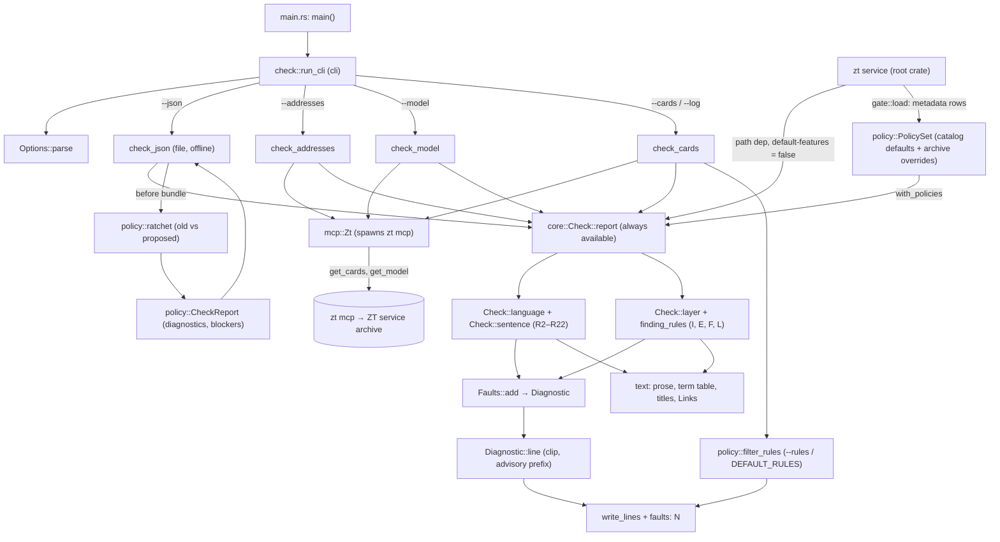

# zt-check

## Purpose

`zt-check` is the Card quality check of the book digest, built as one fast Rust binary. It reads Cards (from a JSON file of drafts, or from the live archive through `zt mcp`) and prints one line per fault against the Card language and structural rules (R2 to R22), the Card layer rules (I, E, F, L), and the Term content rules (T1 to T10). Every agent that writes digest Cards calls it: Claude sessions, workflow agents, Haiku managers, DeepSeek Harness runs, and the digest scripts through `Invoke-ZtCheck`. It is the only source of truth for Card quality (`tools/zt-check/src/main.rs`, `tools/zt-check/src/check.rs`). It exists as a crate of its own so that it builds and installs without building zt or stopping the ZT service (`tools/zt-check/Cargo.toml`, `scripts/install-zt-check.ps1`).

Since #143 the same crate is also a process-free library. `core` (the rules), `text` (the text semantics and the term-table parse), `policy` (the rule catalog), and `term` (the Term content contract: draft schema, renderer, template parse) build without the `cli` feature and hold no file reader, no `zt mcp` client, no process launcher, and no platform binding. The zt service links that core as a path dependency with `default-features = false` (`Cargo.toml`), so one definition of Card legality serves the standalone tool, zt-digest, and the service's in-process check. A change to a shared rule is therefore a service change too: rebuild and redeploy `zt` as well as `zt-check`/`zt-digest`.

Since #144 every fault is a structured `core::Diagnostic`: the address, the rule, a rule-specific fault code, an unclipped semantic key, the full message, the severity, the legacy flag, and the scope. The familiar line is formatted from it at the boundary. `policy::ratchet` compares the report of a Card's old authored version with the report of its proposed version under the same rules and policy, consumes old occurrences in multiplicity, and turns a retained fault into legacy advice; only an unmatched blocking fault still blocks. A draft bundle therefore carries `before` beside each proposed entry (design 5.4 and 6.3 of the Term Cards and shared Card check implementation design, 2026-10-24). `Diagnostic::to_json` returns the eight fields under their published names, with `severity` as `block`/`advise` and `scope` as `local`/`graph`, so a service, batch or future MCP reply carries the same value as the CLI line.

Since #145 the crate also owns the **gate policy**. `policy::catalog` names every mechanically implemented rule with its default `Setting` (`block`, `advise`, `off`) for the human and the agent Workspace; `Policy` holds one Workspace's effective policy (the catalog default plus the archive's overrides) and `PolicySet` holds both Workspaces of one archive. `Policy::change` validates a rule id, a Workspace and a value, refuses a mandatory service invariant, a mandatory rule (T7), a not-yet-implemented Term rule, an alias (T10 is R22's Term-facing label) and a graph-only blocking override, and `PolicySet::hash` publishes the SHA-256 of the effective policy. `Check::with_policies` applies one snapshot to a whole run: each diagnostic takes its entry's Workspace setting, `off` removes it, and an advisory subcase the core marked (`Diagnostic::subcase`, I7's unknown source) stays advice whatever the setting. Without a snapshot every mode keeps its pre-S03 severity, which only `zt-check`'s own pre-S06 tests used. The archive's stored rows and the `zt config` commands belong to [Service, CLI and storage](service-and-cli.md).

Since #148 the crate also owns the **check contract** (`contract.rs`, always available). `contract::RULE_VERSION`, `DIAGNOSTIC_SCHEMA`, and `APPLICABILITY_VERSION` are stable, independent of the executable version (R0197); `Contract` publishes the facts that decide one check — rule and diagnostic versions, the effective policy and its hash, the limits, the archive identity/revision/stage, and the syntax capabilities (`term_cards` and `term_links`, both `true` since S10) — and reads them back from a service reply. The service publishes that object as `get_cards.check_contract` and declares `zt_check_version` plus the three versions in MCP `initialize`; a live CLI compares its own versions with the served contract and the proxy's declaration, applies the served policy, and refuses an answer whose contract is not the one that would decide a write. The command line also owns the draft bundle (`--draft`), the Workspace flag, the `--report` status document, and the 0/1/2 exit contract (all below).

Since #152 the crate also owns the **Term content contract** (`term.rs`, always available): the proposal's draft JSON schema with every field validated, the deterministic renderer that turns one draft into its head and continuation parts, the greedy step/prose partition, and the template parse the T1–T10 rules read. `term::parse_terms` reads `{"terms":[…]}` and collects every fault by JSON path; `term::render` writes the exact Card text and refuses an oversized unsplittable block or oversized mandatory head instead of truncating; `term::parse_template`, `term::step_blocks`, `term::symbol_table`, and `term::prose_units` are the same text view a rendered draft and a manually edited stored Card go through. The bounded Term context (role, list rows, head, head category, Term-link target names) is materialized by the service gate inside its transaction and by `--cards` through `get_terms`; the rules themselves are in `core::Check`.

**Owns:** the rule definitions and their fault text, the order of fault lines, the default rule set of `--cards`, the size limits and their defaults, the Card categories of `--cards` mode, the `--json` entry and `before` bundle format, the exact draft bundle and its declared check families (`--draft`, `--workspace`, `--report`, design 8.1 and 8.2), the published check contract and its stable versions (`tools/zt-check/src/contract.rs`), the process exit contract, the pure rule core (`tools/zt-check/src/core.rs`), the pure text operations (`tools/zt-check/src/text.rs`), the Term content contract — the draft schema, the deterministic renderer, the continuation partition, and the template parse (`tools/zt-check/src/term.rs`) — the rule catalog, the gate policy catalog with its Workspace defaults, its validation and its effective-policy hash, and the legacy ratchet (`tools/zt-check/src/policy.rs`), the `zt mcp` client in `tools/zt-check/src/mcp.rs`, the process-wide Literature write scope that client enforces (`tools/zt-check/src/mcp/scope.rs`), the library entry points (`tools/zt-check/src/lib.rs`: `contract`, `core`, `text`, `term`, `policy` always; `check::run`, `check::run_lines`, `check::run_cli`, `graph`, `mcp::Zt` with the `cli` feature), and the build and install of `zt-check.exe`.

**Does not own:** the MCP tools it calls (`get_card`, `get_model`, `get_tree`, `list_trees`; see [MCP server](mcp-server.md)), the ZT service that `zt mcp` needs, the archive's stored `gate.<workspace>.<rule>` rows and the `zt config` commands (see [Service, CLI and storage](service-and-cli.md)), Relation kinds and Link parsing inside zt (see [Cards, Workspaces and Links](cards-and-links.md)), the build report and Elaboration level (see [Models and math](models-and-math.md)), the PowerShell wrapper `Invoke-ZtCheck` and the compilers and audit that build its input (see [Digest scripts](digest-scripts.md)), the SELF-CHECK lines in the agent prompts (see [Digest prompts](digest-prompts.md)), the approval rules in the workflows (see [Digest workflows](digest-workflows.md)), and the `zt-digest-protocol` skill that documents it for agents (see [Agent skills](agent-skills.md)).

## At a glance

| | |
|---|---|
| Entry points | `zt-check` command line (`main` in `tools/zt-check/src/main.rs` → `check::run_cli`); the library (`zt_check::check::run(args, Some(&mut zt))` and its `run_lines` compatibility wrapper, `zt_check::mcp::Zt`), which [zt-digest](zt-digest.md) runs in-process; the process-free core (`zt_check::contract::Contract`, `zt_check::core::Check`, `zt_check::text`, `zt_check::policy`), which the zt service links and calls in-process; `scripts/install-zt-check.ps1` (build and install) |
| Key files | `tools/zt-check/Cargo.toml` — a crate with its own `[workspace]`, so it never builds zt; features `default = ["cli"]` and `cli = ["dep:windows-sys", "dep:libc"]`; the binary has `required-features = ["cli"]`; `anyhow`, `regex`, `serde_json` and `sha2` are the pure core's only dependencies |
| | `tools/zt-check/src/contract.rs` — the published check contract (`RULE_VERSION`, `DIAGNOSTIC_SCHEMA`, `APPLICABILITY_VERSION`, `FAMILIES`, `Contract::served`/`built_in`/`publish`/`read`/`version_gaps`/`limit_gaps`, `ArchiveFacts`, `Capabilities`); its unit tests |
| | `tools/zt-check/Cargo.lock` — pinned versions (regex 1.13.1, anyhow 1.0.104, serde_json) |
| | `tools/zt-check/src/lib.rs` — exports `VERSION`, `core`, `text`, `policy` always; `check`, `graph`, `mcp` only with `cli` |
| | `tools/zt-check/src/main.rs` — collects the arguments, calls `zt_check::check::run_cli`, prints `zt-check: <error>` and exits 1 on an error |
| | `tools/zt-check/src/core.rs` — the rule core: `Check` (the language, layer, and title rules), `Diagnostic`/`Severity`/`Scope` (the structured fault contract), `Faults` (the diagnostics a run raises), `Limits`, the corruption scan, the derivation-facet predicate, and the orphan predicate; its unit tests |
| | `tools/zt-check/src/text.rs` — the PowerShell text semantics (UTF-16 form and lengths, culture comparisons, JSON conversions), the prose projection and the shared visible-text projection (`strip_term_links`, `LinkOccurrence::is_valid_term_macro`), sentence splitting, the term-table parse, the title context, the shared lexical Link scan (`LinkForm`, `LinkOccurrence`, `LinkFault`, `LinkFaultAt`, `link_occurrences`, `parse_links`, `parse_links_at`, `code_ranges`, `fenced_code_ranges`, `math_ranges`, `MAX_TERM_NAME`), the envelope operations, and the public `literature_tree` book identity the service gate shares; its unit tests |
| | `tools/zt-check/src/term.rs` — the Term content contract (S09, #152; design 11): the Appendix-C draft schema and its validation (`Draft`, `BookDefinition`, `Hypothesis`, `Definition`, `Symbol`, `EquivalentForm`, `Derivation`, `Step`, `LimitCase`, `Distinction`, `DraftFault`, `parse_terms`, `parse_draft`), the deterministic renderer and continuation partition (`render`, `Rendered`, `RenderedCard`, `CONTINUES`), the template parse the T rules read (`Template`, `parse_template`, `TemplateSection`, `step_blocks`, `result_line`, `symbol_table`), the shared prose measurement (`prose_units`), and the LaTeX identifier scan (`latex_identifiers`); its unit tests |
| | `tools/zt-check/src/policy.rs` — the rule catalog (`DEFAULT_RULES`, `ADVISORY_RULES`, `GRAPH_RULES`, `severity`, `scope`), the gate policy catalog (`Workspace`, `Setting`, `RuleState`, `RuleSpec`, `catalog`, `rule_of`, `Invariant`, `invariants`, `invariant`), the declared-key grammar (`gate_key`, `parse_gate_key`), the change values (`Change`), the effective policy (`Policy`, `PolicySet`, `POLICY_SCHEMA`), `CheckReport` (diagnostics and blockers), `Applicability` (the per-rule signature a metadata change compares), and `ratchet` (the legacy comparison); its unit tests |
| | `tools/zt-check/src/check.rs` — the CLI input adapter: the four input modes, the option parser, the output, and the compatibility re-exports (`check::run_lines`, `check::term_table`, ...) |
| | `tools/zt-check/src/graph.rs` — the whole-archive orphan report (`cli`); re-exports the core's `category`, `category_with_parts`, `is_restatement_entry`, `is_orphan`, `SUBSTANTIVE`, `EXCLUDED` |
| | `tools/zt-check/src/mcp.rs` — `Zt`, a minimal JSON-RPC client that starts `zt mcp` and makes `tools/call` requests |
| | `tools/zt-check/src/mcp/owned.rs` — owned process-tree containment, bounded exit observation and termination |
| | `tools/zt-check/src/mcp/scope.rs` — the process-wide Literature write scope: `set_literature_only`, `literature_only`, `is_topic_address`, `topic_links`, `literature_refusal` |
| | `tools/zt-check/tests/check_parity.rs` — the executable, the library adapter, and the process-free core print the same ordered lines for both recorded fixtures, and the executable and the library print the same ratcheted `before` bundle; the envelope error and the version are the same too |
| | `tools/zt-check/tests/fixtures/` — the recorded ordered lines of both fixtures, the `before` bundle (`legacy-bundle.json` with `legacy-expected.txt`), and the `--json` envelope fixtures (single object, BOM, bundle context, case-folded names, shared line, not JSON) |
| | `scripts/install-zt-check.ps1` — `cargo build --release` into `D:\zt-check-target`, then copies `zt-check.exe` beside `zt.exe` |
| Depends on | [MCP server](mcp-server.md) (`zt mcp`, read tools only; `cli` feature); [Service, CLI and storage](service-and-cli.md) (the service must be up for `zt mcp` tool calls); the answer shapes of [Models and math](models-and-math.md) (`get_model` `head`, `parts`, `level`, `build.setting`, `build.order`) and [Cards, Workspaces and Links](cards-and-links.md) (`get_tree` `links`, `kinds`); Rust crates `regex`, `serde_json`, `anyhow` |
| Used by | [zt-digest](zt-digest.md) (a path dependency with the default `cli` feature: `Check::run` calls `run_lines` on the step's own `zt mcp`; `main` sets the Literature scope for every digest step through `mcp::scope::set_literature_only`); the zt service (a path dependency with `default-features = false`: `src/main.rs` links the crate and `tests/check_core.rs` checks a Card through `core::Check` in-process); [Digest scripts](digest-scripts.md) (`Invoke-ZtCheck` in `scripts/book-digest/zt-calls.ps1`, for PowerShell callers and the tests; every digest script now forwards to a `zt-digest` tool that runs the check in-process); [Digest prompts](digest-prompts.md) (DeepSeek SELF-CHECK commands); [Digest workflows](digest-workflows.md) (managers approve `zt-check` as read-only); [Agent skills](agent-skills.md) (`skills/zt-digest-protocol/SKILL.md`, `skills/zettelkasten/SKILL.md`) |
| Tests | `mod tests` in `tools/zt-check/src/core.rs` (the rules, the structured diagnostics, and the T1–T10 rules), `src/text.rs` (the text semantics and term table), `src/term.rs` (the draft schema, renderer, partition, template parse and prose measurement), `src/policy.rs` (the rule filter, `CheckReport`, `Applicability`, and the ratchet), and `src/mcp/scope.rs`; `tests/check_parity.rs` (the CLI, the library, and the core on both recorded fixtures, plus the `before` bundle); the root crate's `tests/term_cards.rs` (a rendered draft through the live gate, manual edits, a part chain, the T7 advice, and the T8 book audit); `scripts/book-digest/tests/zt-check.tests.ps1` with `card-style-fixture.json`; `scripts/book-digest/tests/card-layer.tests.ps1` with `card-layer-fixture.json`; the root crate's `tests/check_core.rs` (the service link) | S29 (#171) adds `term_markup_adds_no_prose_fault`: one body with and without its Term macros (`[[均衡@K/10]]`) produces byte-identical diagnostics, including a real R3 fault, so linking a Card adds no prose fault (R0561).

## Concepts

- `Card language` — the plain-text rules for Card titles and bodies (ASD-STE100 adapted for Chinese). zt-check checks rules 2 to 7, 9, 12 to 17, and the standalone pilot rules 20 and 21 of the list in [docs/self-sufficient-models-proposal.md](../self-sufficient-models-proposal.md) and [docs/derivation-explanations-proposal.md](../derivation-explanations-proposal.md); rules 1, 8, 10, and 11 are not mechanical and are not checked (`Check::language`, `Check::sentence`, `local_reference`, `unnamed_referent` in `tools/zt-check/src/check.rs`).
- `Card layer rules` — the checks on Cards outside models: I (Idea Cards), E (Event Cards), F (Finding Cards), L (Links). They run only on entries that carry a `category` (`Check::layer`, `finding_rules`).
- `Diagnostic` — one fault under the structured contract (`core::Diagnostic`, design 5.4): `address`, `rule`, `fault`, `key`, `message`, `severity`, `legacy`, `scope`. `fault` is a rule-specific code (`sentence_length`, `missing_labels`, ...); `key` is the rule-specific semantic identity, built from the full offending fragment or missing requirement, never from a line number or the clipped display; `message` is the full text. `Diagnostic::line` formats the familiar line at the boundary; `Diagnostic::to_json` returns those eight fields as the design's JSON document (the policy names `block`/`advise` and `local`/`graph`).
- `Fault line` — `<address> <rule> [(advisory) ]<message>`: the text on one line, white space collapsed, clipped to 90 UTF-16 units with `…` (`Diagnostic::line`). A run ends with `faults: N`.
- `Severity` / `Scope` — `block` or `advise`, and `local` (the Card and its bounded context) or `graph` (whole-archive evidence: I5, I6, E4, E5, F4, L3). `policy::severity` and `policy::scope` hold the checker's own defaults; I7's unknown-source subcase is marked by the core (`Faults::advise`, `Diagnostic::subcase`). A `graph` fault is audit evidence, not a per-write decision (design 6.2). A `graph` rule cannot be configured to block; it may stay advice or be silenced (`Setting::Off`).
- `Gate policy` — the severity the write gate gives every catalogued rule in one archive, separately for the human and the agent Workspace (design 6.1 and 6.2). The checker owns the catalog and the defaults; the service stores only the `gate.<workspace>.<rule>` overrides (`Policy::overrides`). A missing override means the default; `default` removes the row (`Change::Reset`).
- `Setting` — one configured severity: `block` (the gate refuses), `advise` (the line is reported), `off` (the rule is not reported). `Setting::parse` accepts exactly those three names; `Change::parse` also accepts `default`.
- `RuleState` — how a catalogued rule takes part: `configurable` (mechanically implemented and settable), `mandatory` (an existing service invariant no policy can change; T7 is the one rule id here), or `pending` (catalogued with its design default for a later slice: not enforced and not settable). Since S09 (#152) every catalogued rule is implemented, so the catalog names no pending rule; the variant remains for a future slice that catalogues a rule before implementing it.
- `Policy hash` — the SHA-256 of `PolicySet::canonical`: the schema marker `zt-gate-policy/1`, both Workspaces, and the effective setting of every catalogued rule, in catalog order. An override that changes a decision changes the hash; pinning a rule to its current default does not. A check-contract reader compares it (design 6.1, R0120); it is not persisted, because two processes with the same effective policy compute the same value.
- `Policy snapshot` — one `PolicySet` value passed to `Check::with_policies`, so an entire run (both sides of a legacy comparison included) uses one policy and each entry takes its own Workspace's setting (design 6.1, S03-AC05). An entry that names no Workspace is a draft in the agent Workspace.
- `Advisory subcase` — a diagnostic the core marks `subcase` (`Faults::advise`): I7's unknown source. It stays advice whatever its rule's setting, so a blocking I7 default can never promote an unknown-evidence finding to a refusal.
- `Advisory` — a diagnostic whose severity is `advise`: its line carries `(advisory)`. The default advisory rules are `R20`, `R21`, `I1`, `I6`, `L3`, `E5`, plus I7's unknown-source subcase (`policy::ADVISORY_RULES`). In `--cards` mode it is printed but not counted (`filter_rules`); in `--json`, `--model`, `--addresses` every line counts; in a `before` bundle the count is the number of blockers.
- `Legacy fault` — a diagnostic the old authored version of the same Card already carried, matched by `(rule, fault, key)` in multiplicity under the same rules and policy (`policy::ratchet`); the CLI pairs each `before` entry with its proposed Card, so a Card that moves to another address still keeps an unchanged fault. It becomes `legacy: true` advice and stops blocking. The same identity appearing more often than before is a new occurrence and blocks.
- `Applicability` — the facts a metadata change can alter, grouped into a per-rule signature (`policy::Applicability`): category, level, facet/derivation, shared term table, book, and the authored term name. A rule is compared only when its signature is unchanged, so a Card retyped from Idea to Event must meet the Event format, a concept model promoted to formal must meet R13–R17, and a term-table or book change is a new requirement. A rule the catalog does not name yet keeps the conservative signature: category, level, part/facet, derivation, shared list, book and term name must all be unchanged, so a rule added later is never inherited across a transition until its own signature is named.
- `CheckReport` — the assembled result of one check (`policy::CheckReport`): every diagnostic in the core's traversal order and `blockers`, the number that still block. `lines()` formats the report. It holds no saved baseline: both versions are computed on every run (design 6.4).
- `Standalone rule` — R20 and R21, the pilot's text heuristics for a Card that must stand alone (D125–D134). They are advice in the pilot: they name the matched fragment, the text and the reason, and a semantic review still decides.
- `Source evidence` — the Citation keys a Card's claim comes from, as I7 reads them: an explicit `sources` set, else the `来源` line's Literature Links, else the Literature tree the Card is filed in. Empty is unknown, never a pass (D069–D073).
- `Entry` — one Card as zt-check reads it: a JSON object with `address`, `title`, `body`, `facet`, and optional layer fields (see "Data and storage"). Property names ignore case (`prop`).
- `Category` — what a Card is for the layer rules: `idea`, `anchor`, `event`, `finding` get layer rules; `root`, `hub`, `part`, `model`, `terms`, `structure` get the R rules only. The one implementation is `core::category_with_parts` (re-exported by `graph`), so `--cards` mode and the service write gate cannot disagree; `--cards` computes it as `digest-audit.ps1` (`Get-Category`) does (`check_cards`).
- `Model part` / `Model Card` — read from `get_model`; a Card with a `facet` is a part. A part whose facet starts with `推导` (or `derivation`, any case) is a `Derivation part`, which gets the step and explanation rules R14 to R17 (`Check::language`).
- `Elaboration level` — `concept` or `formal`. A concept model skips R13 to R17; a model with no level gets the formal rules (`Check::language`).
- `Term table` — the table under the line holding `术语表` in the setting Card's body (a model's setting, or the Book term table): `| term | words not to use | 意思 | 首次定义 |`. R6 reads the first two columns (`read_terms`, `Check::with_terms`); every left-column term, rows without a rejected word too, is kept longest first in `Check::kept` and masked before R6 matches; `term_table` is the public parser the digest uses for all four (`zt_check::check::term_table`, `TermRow`; #97, D063). Both share one row parse, so R6 and the digest never disagree about a row: `不用` splits on `、,，/`, allows the `—`/`无` of "none", and a later row naming the same term (case ignored) replaces the earlier one. R6 still skips a row with no rejected word, exactly as before, and the four-column reader reports such a row with an empty `avoid`. `text::term_rows_raw` reads every row before that replacement, and `text::term_row_duplicates` groups the raw rows whose names are the same exactly or only in case (`TermRowDuplicate { term, spellings, rows }`), so a publication that allocates one head per row resolves an ambiguous table instead of losing a row the compatibility reader folded (S08, #150; design 9.3).
- `Lexical Link scan` — the one implementation of `[[…]]` macro shape (S10, #151; design 10.1), in `text`: `link_occurrences` (tolerant) and `parse_links` (strict) return `LinkOccurrence { target, label, form, macro_range, target_range, label_range }` with UTF-8 byte ranges into the input. `LinkForm::Term` means the content holds `@`: split at the first `@` into a label of 1–40 scalar values on one line and an address; a second `@` is `LinkFault::SecondSeparator`. A content that starts with `@@` is the identified-batch reference instead (S21, #165; design 12.5): publication's placeholder for a Card that does not exist yet, so the macro is one ordinary Link whose target is the reference, never a Term link with an empty label. Without that reading a draft's continuation part could name neither its head nor pass the check that reads it. Code spans and fences are excluded everywhere, and a Term-like macro inside inline/display math is literal (no occurrence); an ordinary macro there stays an ordinary Link. `code_ranges` and `fenced_code_ranges` are the range helpers the service re-exports. The strict scan refuses the macro-shape faults with the root parser's existing wording; the address grammar and the Term-head rule stay in [Cards, Workspaces and Links](cards-and-links.md), so the checker links no archive. `parse_links_at` (#160) answers the same strict result with a `LinkFaultAt { fault, at }`, the refused macro's byte offset, so a deterministic editor names the exact Card line to repair; `math_ranges` publishes the dollar-form spans the scan already treats as literal, so the Term-link pass protects the same formulas without keeping a second math scanner.
- `Visible-text projection` — `text::strip_term_links` (S12, #154; design 10.4) replaces every syntactically valid Term-link macro outside literal syntax by its label and keeps every other byte. It is lexical: `LinkOccurrence::is_valid_term_macro` decides the label grammar and the one `@` without resolving the target, so a stale target still strips, an ordinary Link is never stripped, and a malformed Term-like macro stays authored for the strict scan to refuse. The prose projection (`plain`) runs it first and then removes the ordinary Link markup as before, so R2, R3, R4, R5, R6, R7, R9, R12 and the Term prose measurement (T9) read the sentence a reader sees: the label is prose and the address is not. The Literature scope, the statement comparison and the optional label-only reads call the same function, so no consumer keeps a second projection.
- `Literature scope` — a process-wide write scope of the `zt mcp` client (`mcp::scope`), off by default (the open scope). A process that turns it on (every [zt-digest](zt-digest.md) digest step) can write only Literature trees: `Zt::request` refuses `create_topic`, a write that names a Topic-tree Card, a Hub Card, and authored text that links a Topic-tree Card, before the call reaches the archive (`docs/literature-only-digest-design.md`). Reads always pass. `topic_links` reads each macro's actual target through the shared Link scan, so a Term use of a Topic Card is refused by the address after `@`, never by a `label@target` string; a malformed Term-like macro is no Link and is refused by the strict write path itself.
- `Term rule` / `T rule` — one of T1–T10, the content rules on a named Term Card (S09, #152; design 11.3). They read the authored template through `term::parse_template` and run inside `core::Check` for every entry whose `type` is `term`; a rendered draft and a stored Card go through one evaluator. T1 is the known ordered head lines and sections, the required common fields, the `类别` value, the `自动链接：否`/`自动链接理由：` pair and a part's `续：` head Link; T2 is the exact title/name/`术语：`/row identity and the `推导（续 k/n）：…` part title; T3 is the mathematical head (labelled hypotheses, a display definition, a `符号表` and a derivation) and the concept refusal of formal sections (a part inherits its head's category and definition, and a contradicting part category is `chain_category`); T4 is the approximate formula-symbol coverage (advice); T5 is numbered steps with a `依据：` basis and a `结果：` line (or the `（续见下卡）` continuation line), and the 12-step bound; T6 is the five skipped-step phrases without a named step; T7 is the retained legacy target role and label mismatch (advice; a new invalid target is the mandatory Link invariant), and it applies to a Term use on any Card; T8 is the book audit of one Term list (the `T8` coverage and table-shape entries in `get_terms`); T9 is the 1,600 measured prose units; T10 is the balanced-formula predicate of R22 under its Term-facing label, with no duplicate R22 fault.
- `Term head line` — one recognized `<label>：` line of a Term Card's authored template: `术语`, `原文`, `不用`, `类别`, `首次定义`, `自动链接`, `自动链接理由` on a head; `类别` and `续` on a part. The language rules skip these lines: they are authored metadata, not prose, so R6 never rejects the term's own `不用：` list. The source trailer `来源：` is read separately by T1.
- `Term draft` — the proposal's Appendix-C JSON for one term (S09, #152): `term`, `original`, `category`, `link`, `link_reason`, `first_defined`, `explanation`, `book_definition`, `hypotheses`, `definition`, `symbols`, `equivalent_forms`, `derivations`, `limits`, `example`, `intuition`, `distinctions`, `misreadings`, and `role_in_book`. `term::parse_draft` validates every field and its sentence bounds and refuses an unknown field; `term::render` writes the Card text the compiler publishes. A concept draft carries no formal math field; a math draft carries all of them, and an explicit no-limit or no-equivalent statement is the writer's honest entry rather than an invented formula.
- `Continuation part` — a Term part the renderer creates when the head plus the later sections exceed one Card: a Direct successor with the same stored term name, the title `推导（续 k/n）：<label>`, the `类别：` and `续：[[head]]` lines, the continuation sections, and the head's source trailer. A derivation continues at a whole-step boundary; a chunk that is not the last ends with `（续见下卡）`, which T5 accepts instead of the final `结果：`. No content is truncated and no bound is silently raised.
- `Automatic-link opt-out` — the two authored head lines `自动链接：否` and `自动链接理由：…` (design 9.4, R0231). Absence means enabled. A `link:false` draft must carry a reason and renders both lines; T1 refuses a missing reason, an orphan reason, and any value other than `否`; the list's four-column table gains no column or comment.
- `Shared part` — a part whose `build.order` item (or `--json` entry) has `line: shared`. It follows its home model's term table, so R6 skips it; `--skip-shared` drops it from a `--model` run (`check_model`, `Check::with_shared`).
- `Limits` — the size numbers of R13, R14, R17, I2, L2, T5 and T9 (`Limits` struct; defaults in "Configuration"). The two Term limits are fixed at 12 steps and 1,600 prose units and travel in the published contract like the others.
- `Literature scope` — a process-wide write scope of the `zt mcp` client (`mcp::scope`), off by default (the open scope). A process that turns it on (every [zt-digest](zt-digest.md) digest step) can write only Literature trees: `Zt::request` refuses `create_topic`, a write that names a Topic-tree Card, a Hub Card, and authored text that links a Topic-tree Card, before the call reaches the archive (`docs/literature-only-digest-design.md`). Reads always pass.
- `Topic address` — an address, Citation key or Link target whose tree part (the text before the first `/`) is all ASCII digits: a Topic tree's id. `is_topic_address` decides it from the text alone, with no archive read; `Smith2024/1` and `2002grossman/1` are Literature addresses.
- `UTF-16 form` — text in which each character outside the Basic Multilingual Plane is two private-use stand-ins (U+E000.., U+E400..), so lengths, regex classes, and clips match .NET (`utf16_form`, `from_utf16_form`).

## Architecture

The crate has a library and a binary (`main.rs`). The library is layered by feature. `core`, `text`, and `policy` are always available and are the process-free part: `text` owns the PowerShell text semantics, the prose projection, the term-table parse, the title context, the shared lexical Link scan, and the envelope operations; `core` owns `Check` (the language rules per Card, then the layer rules across Cards), `Diagnostic`/`Severity`/`Scope` and `Faults` (the structured faults and their line format), the corruption scan, and the orphan predicate; `policy` owns the rule catalog (`severity`, `scope`, `DEFAULT_RULES`), the gate policy catalog and its effective policy (`Workspace`, `Setting`, `RuleSpec`, `Policy`, `PolicySet`), `CheckReport`, `Applicability`, the legacy `ratchet`, and the filter that counts a `--cards` report. `check`, `graph`, and `mcp` need the `cli` feature: `check` reads the four inputs, materializes the term table, level, shared list, and Workspace title context, calls the core, applies the ratchet when a bundle carries `before`, filters, and prints; `graph` classifies a whole archive for the audit; `mcp` is the `zt mcp` client and its process containment. `run_lines(args, zt)` takes an open `Zt` or, given `None`, starts one only when the mode reads the archive (`--json` and an empty `--cards` start none).



| Component | File | Role |
|---|---|---|
| `main` | `tools/zt-check/src/main.rs` | Arguments in; on `Err`, `zt-check: {error:#}` on stderr and exit code 1 |
| `Options`, `run_cli`, `write_lines` | `tools/zt-check/src/check.rs` | Parse flags, pick one mode, run, filter, print UTF-8 with CRLF on Windows |
| `check_json`, `check_addresses`, `check_model`, `check_cards` | `tools/zt-check/src/check.rs` | Build the entries, the term table, the level, the shared list, and the title context for one mode |
| `Check` (`new`, `with_terms`, `with_shared`, `with_context`, `with_policies`, `report`, `run`, `language`, `sentence`, `layer`) | `tools/zt-check/src/core.rs` | The rules; `with_policies` gives the run its effective policy; `run` returns the ordered fault lines |
| `Diagnostic`, `Severity`, `Scope`, `Check::report`, `Faults`, `Limits`, `corruption`, `source_evidence`, `is_orphan` | `tools/zt-check/src/core.rs` | The structured fault contract (including the `subcase` flag) and its line format, the limit defaults, the R18/R19 scan, I7's source evidence, and the orphan predicate I5 and the audit share |
| Text helpers (a `?` or `!` inside 《…》 ends no sentence in `split_sentences`; the Bridge label `跨书关联：` (`BRIDGE_LABEL`) is stripped before a line's sentences are measured; `plain`, `measure`, `prose_lines`, `split_sentences`, `passive`, `read_terms`, `leads_to`, `book_place`, `bigrams`, `similarity`) | `tools/zt-check/src/text.rs` | What text the rules see and how it is counted |
| `Draft`, `parse_terms`, `parse_draft`, `render`, `Rendered`, `RenderedCard`, `Template`, `parse_template`, `step_blocks`, `result_line`, `prose_units`, `latex_identifiers`, `CONTINUES` | `tools/zt-check/src/term.rs` | The Term content contract: the Appendix-C draft schema and its faults, the deterministic head/part renderer and partition, the template parse T1–T10 read, the shared prose measurement, and the approximate LaTeX symbol scan (S09, #152) |
| PowerShell semantics (`ps_eq`, `ps_in`, `culture`, `culture_starts_with`, `culture_cmp`, `ps_string`, `truthy`, `strings`, `ps_int`, `key`, `utf16_form`) | `tools/zt-check/src/text.rs` | Reproduce the deleted PowerShell checkers' comparisons and conversions |
| `DEFAULT_RULES`, `ADVISORY_RULES`, `GRAPH_RULES`, `severity`, `scope`, `CheckReport`, `Applicability`, `ratchet`, `filter_rules` | `tools/zt-check/src/policy.rs` | The rule catalog (severity and scope per rule), the assembled report, the applicability signature, the legacy ratchet, and the report filter |
| `Workspace`, `Setting`, `RuleState`, `RuleSpec`, `catalog`, `rule_of`, `Invariant`, `invariants`, `invariant`, `gate_key`, `parse_gate_key`, `Change`, `Policy`, `PolicySet`, `POLICY_SCHEMA` | `tools/zt-check/src/policy.rs` | The gate policy: the design-6.2 defaults per Workspace, the key grammar and value/rule validation, the effective policy of one archive (default plus overrides), the policy hash, and the application of one snapshot to a report |
| `Zt` (`start`, `call`, `request`, `Drop`) | `tools/zt-check/src/mcp.rs` | The `zt mcp` client (`cli`) |
| `scope` (`set_literature_only`, `literature_only`, `is_topic_address`, `topic_links`, `literature_refusal`) | `tools/zt-check/src/mcp/scope.rs` | The Literature write scope `Zt::request` checks before each tool call (`cli`) |

### Feature boundary and the service link (S01 / #143)

`tools/zt-check/Cargo.toml` declares `default = ["cli"]` and `cli = ["dep:windows-sys", "dep:libc"]`; the binary has `required-features = ["cli"]`. Building with `--no-default-features --lib` therefore compiles only `core`, `text`, and `policy`, and `cargo tree --no-default-features -e normal` names no `windows-sys`, no `libc`, and no archive client. `check.rs` keeps the existing public surface as re-exports (`check::run_lines`, `check::run_cli`, `check::term_table`, `check::TermRow`, `check::source_evidence`, `check::title_key`, `check::title_bigrams`, `check::title_similarity`, `check::TITLE_SIMILARITY`, `check::title_fits`, `check::sentence_fits`), so zt-digest and the digest reports keep their calls while the implementation lives in `core` and `text`.

The root crate (`Cargo.toml`) adds `zt-check = { path = "tools/zt-check", default-features = false }`. There is no dependency cycle: zt-check depends only on `anyhow`, `regex`, `serde_json`, and `sha2` (the policy hash), and zt-digest's `zt-check` path dependency keeps the default `cli` feature. The root's `tests/check_core.rs` proves the link with an in-process check through `zt_check::core::Check`, with no service, no `zt mcp`, and no gate process. Because the rules now ship in the service binary too, a shared-rule change is a deployment of the service (see [Service, CLI and storage](service-and-cli.md)): rebuild and reinstall `zt`, stop and start the daemon, and rebuild `zt-check`/`zt-digest`. A running old service would keep checking with the old rules.

### Structured diagnostics and the legacy ratchet (S02)

`core::Check::report(cards) -> Vec<Diagnostic>` is the rule evaluation; `Check::run` stays the compatibility wrapper that formats the same list (`Diagnostic::line`), so zt-digest's `run_lines` and every fixture keep their bytes. A `Diagnostic` is `address`, `rule`, `fault`, `key`, `message`, `severity`, `legacy`, `scope`; the published JSON form (`Diagnostic::to_json`) is:

```json
{ "address": "K/14", "rule": "E2", "fault": "missing_labels", "key": "labels:参与者,来源",
  "message": "missing labels: 参与者、来源", "severity": "block", "legacy": false, "scope": "local" }
```

`policy::CheckReport { diagnostics, blockers }` assembles one check; `CheckReport::of` counts `severity == block`, and `CheckReport::lines()` formats the familiar text. `policy::ratchet(before, proposed, comparable)` consumes the paired old report's `(rule, fault, key)` multiset one occurrence at a time in the proposed report's order, marks a consumed diagnostic `legacy: true` with `Severity::Advise`, and returns the proposed report with its remaining blockers. It never reads a clipped line, a line number, or a set of identities, so moving an unchanged faulty paragraph keeps its fault, a second copy of a known faulty sentence is a new occurrence, and a different fragment that clips to the same prefix stays distinct.

`policy::Applicability::of(entry)` reads `category`, `level`, `facet`, `line`, and `book`; `comparable(proposed, rule)` compares the rule's own signature. The text rules (R2–R5, R7, R9, R12, R18–R22) mean the same for every type; R6 follows the shared term table; R13–R17 follow the facet, derivation, and formal level; I1/I2/I4/I7 follow the Idea role, I3/F2 also the book; the E/F rules follow the Event/Finding role; L follows the layer role; an unnamed rule falls back to the whole metadata, so a term rule added later is not grandfathered across a term transition until its signature is named.

A `--json` entry may carry `before`: the old authored version as an entry object (its own `title`, `body`, `category`, `facet`, `level`, `line`, `book`), or `null`/absent for a new Card. When at least one entry has a non-null `before`, `check_json` checks the old entries and the proposed entries with one `Check` (same limits, term table, title context), ratchets the proposed report, and returns `faults: N` as the number of remaining blockers; a bundle with no `before` keeps the old output and count. A `before` that is not an object is refused. The old entry's own metadata is what its report is checked with, so a concept→formal or Idea→Event change is evaluated under the old metadata and compared only under the signatures that did not change. There is no persistent baseline table: both sides are computed on every run (design 6.4), and a rule-version change applies to both sides at once.

### The gate policy catalog and the effective policy (S03 / #145)

`policy::catalog()` is the one table of the policy. Every entry is a `RuleSpec`: the rule id, its default `Setting` in the human and in the agent Workspace, its `Scope`, its `RuleState`, and an optional `alias_of`. The defaults are design 6.2:

| Rule family | Human | Agent | Evaluation |
|---|---|---|---|
| Envelope, valid fields, address/Link grammar, target validation, Access, Locks | mandatory | mandatory | Existing service invariants (`policy::invariants()`); no rule id, not disableable |
| E1, E2, F1, F2, F3, R18, R19, R22 | block | block | Local/bounded-context format |
| R13–R17 on formal models | advise | block | Bounded model context; a concept model keeps the rule's own exemption |
| R2–R5, R7, R9, R12, I2–I4, I7, L1, L2 | advise | block | Only where the existing rule applies |
| I1, R20, R21 | advise | advise | Advisory subcases remain advisory (I7's unknown source is a `subcase`) |
| R6 | off | advise | The existing meaning-sensitive remediation decision |
| I5, I6, E4, E5, F4, L3 | advise | advise | `graph` scope: audit evidence, not a write gate |
| T1, T2, T3, T5, T6, T9, T10 | block | block | The Term content format (S09, #152; design 11.3); T10 shares R22's setting |
| T4 | advise | advise | The approximate LaTeX symbol scan; advice in both Workspaces |
| T8 | advise | advise | `graph`: the book audit of one Term list, not a write decision |
| T4 | advise | advise | `pending`; approximate LaTeX symbol coverage |
| T7 | mandatory | mandatory | The existing Link write invariant; the label-mismatch subcase is advice |
| T8 and computed term structure | advise | advise | `graph` scope, `pending` |

`RuleState::Pending` is the honest part of "the policy applies to rules that exist mechanically": a pending rule carries its design default so the table shows what it will decide, but `Policy::change` refuses an override until the slice that implements it flips the state to `Configurable`. `RuleSpec::alias_of` holds the one deliberate duplicate: `T10` is the Term-facing label of R22's open-formula predicate, so `Policy::effective("T10")` reads R22's setting and configuring T10 is refused with "configure gate.<workspace>.R22 instead". The envelope's repeated leading title is a service invariant, not a rule id (see the pitfall below), so it has no second catalog entry beside R19.

`Policy::change(rule, Change)` is the whole write-side contract: it validates the rule id against the catalog (`unknown rule`), refuses an invariant by name (`mandatory service invariant`), a mandatory rule (`T7 is a mandatory rule`), a pending rule (naming its future default), an alias, and a `graph` rule set to `block` (`cannot block a single write`); `off` and `advise` are accepted for a graph rule. It returns whether the stored overrides changed, so an identical value or a reset of an absent row writes nothing. `PolicySet::from_pairs` rebuilds the policy from stored `(key, value)` rows and fails with the row in the message (`gate.agent.R2=warn: unknown policy value`) rather than silently falling back to a default, so a corrupted archive cannot weaken a check (design 6.1, S03-AC02).

`Check::with_policies(PolicySet)` applies the snapshot in `Check::report`, after the rules and before the ratchet: an `off` diagnostic is dropped, `block`/`advise` set the diagnostic's severity, an advisory `subcase` stays advice, and a rule the catalog does not name keeps the severity the core gave it (a later checker's rule is never silently disabled). The entry's own `workspace` selects the policy, and an entry without one is a draft in the agent Workspace (design 8.1). `Policy::canonical` is the text `PolicySet::hash` covers: the schema marker, both Workspaces, and every catalogued rule's effective setting in catalog order. Pinning a rule to the default it already has stores the override but leaves the effective policy — and its hash — unchanged.

The catalog is data in a test: `the_catalog_names_the_design_defaults_for_both_workspaces` pins every group above, `the_catalog_is_complete_and_unambiguous` names every mechanically implemented rule once, and `a_gate_key_and_its_change_are_validated_before_they_reach_a_policy` pins the refusals. Since S06 (#148) every mode applies a policy snapshot: a draft uses the built-in defaults for the Workspace the bundle or `--workspace` names (an entry without one is an agent draft, design 8.1), and a live mode applies the effective policy the running service publishes in its check contract. The service's stored rows, `zt config set gate.<workspace>.<rule>`, `zt config show` and `zt config policy` are owned by [Service, CLI and storage](service-and-cli.md).

**Policy rollback is not schema rollback.** Returning the stage to `advisory` (`zt config set gate.stage advisory`) or a rule to `advise`/`off` changes which quality diagnostics refuse a write, and nothing else: it rewrites no Card, grants no Access, unlocks no tree, and makes no older binary able to read a newer archive. After Term data exists, `cards.term_name`, the sixth Card type and `[[label@address]]` macros are outside an older binary's syntax, so a full downgrade needs a separately reviewed conversion or the pre-Term backup restore, never an advisory setting (S17-AC05/R0478).

### The published check contract and the exact draft (S06 / #148)

`tools/zt-check/src/contract.rs` owns the three stable versions and the contract value. `RULE_VERSION` changes when rule semantics, the visible-text projection, the limits, or the diagnostic schema change; `DIAGNOSTIC_SCHEMA` changes when `Diagnostic::to_json`'s eight fields or its `block`/`advise` and `local`/`graph` names change; `APPLICABILITY_VERSION` changes when a rule's `policy::Applicability` signature changes. All three are independent of the crate version, which the contract publishes separately as `checker_version` (R0197). `RULE_VERSION` is 4 since S16 (#158): a Term use is no reasoning Link, so L1/L2/L3 read an ordinary Link only and the same authored text is checked differently than under version 3 (version 3 was S12, #154: the visible-text projection reads a Term link as its label). `Contract::served(&PolicySet, &Limits, ArchiveFacts)` builds the running service's value, `Contract::built_in(&Limits)` the offline one (the catalog defaults and the built-in policy hash), and `publish()`/`read()` are the published JSON and its strict reader. `read` rebuilds the policy from the published per-Workspace settings and refuses a hash that does not match them, so a tampered or truncated reply is an incomplete contract, never a weaker default. `version_gaps()` and `limit_gaps()` name each difference. Since S17 (#155) `version_gaps()` also compares the published `term_links`/`term_cards` capabilities with this build's: a service that does not implement the same syntax computes a different answer for the same authored bytes, so the difference is a contract gap and never a comparable pass (R0204, R0477). A build that predates the capability comparison still refuses the new service through its own older `RULE_VERSION`; the capability comparison is the explicit floor, not the only one.

The service publishes it in two places: `get_cards` carries `check_contract` (the authoritative facts, including `archive {id, path}` and the read's revision, the effective `policy`, `stage`, and `capabilities`), and MCP `initialize` carries `zt_check_version` plus the three versions as the stdio proxy's own declaration (R0198). `check::served` reads the empty `get_cards` view once, refuses a reply without a complete contract, compares the three versions and the two Term syntax capabilities with this binary's, and compares the proxy's declaration with the served contract: either difference is a `stale check contract` or `incomplete check contract` message and an `unverified` run (a `check: incomplete: …` line, `faults: 0`, exit 2, and no rule line, R0206). The write gate keeps its own report: an accepted write's `check` block carries `rule_version`, `policy_hash`, `stage`, and `checker_version`, and a refusal carries `zt_check_version` (the build), `rule_version`, and `policy_hash` (S04, R0205).

`check::check_draft` is the one draft run: it reads either format (`InputKind::Json` for `--json`, `InputKind::Draft` for the exact-write bundle), resolves the Workspace (the bundle's, else `--workspace`, else `agent`; two different ones are refused), refuses a bound `rule_version` other than this binary's, applies the built-in policy, checks the Cards with one `Check` (and the ratchet when any carries `before`), and assembles `missing`/`reasons` from the declared families and the facts that back them. `check::run` dispatches the five modes and builds a `Run { lines, status }`; `run_cli` prints the lines, writes `--report`, and returns the status's exit code; `run_lines` stays the lines-only compatibility entry zt-digest calls. A live mode's `Checked` also carries a `workspace` gap (a flag that contradicts a stored Card) and the run adds a `limits` gap when its explicit limits differ from the contract's.

## Interfaces

`mcp::Zt::archive_view()` makes one `get_cards` call with no addresses and validates the complete empty read, revision, persisted 32-hex archive id and nonempty resolved path. It returns that verified view for preparation/ledger binding. Missing identity or incomplete protocol data raises an explicit error before a caller begins writing; ordinary bulk readers retain their existing API.

`mcp::Zt::server_version()` returns the `version` of the `zt` build from the `initialize` answer the client already received (empty when the server named none). The digest audit records it as the software version that measured the archive (#94 S01), so no report parses `zt --version` or starts a second process.

`check::VERSION` is `lib.rs`'s `zt_check::VERSION` (the crate version), and `zt-check --version` prints it as `zt-check <version>` without starting a client (#102 S25). A review records the checker that produced its lines from the binary itself, so a copied or replaced `zt-check.exe` states which one it is; the version argument is answered before any option parsing or archive read.

### Shared title and source evidence (#94 S01)

Three functions are public so a digest report uses the checker's rules instead of a second copy of them:

| Item | Behaviour |
|---|---|
| `check::source_evidence(card)` | D068–D072's direct set: an explicit `sources` array, else the Citation keys the Card's `来源` lines name, else the Literature tree it is filed in. Empty is unknown, which is not a pass. I7 and the digest audit's `audit-sources.json` call it. |
| `check::title_key(title)` | The title's identity for an exact pair: its letters and digits, lower cased, so case, spacing and punctuation never split two spellings of one title. |
| `check::title_bigrams(title)`, `check::title_similarity(a, b)`, `check::TITLE_SIMILARITY` | I6's own bigram set, the Dice coefficient between two titles, and the 0.8 threshold I6 reports at. A report builds one inverted index over these bigrams with case-folded keys, so neither a near pair nor an exact copy needs a pairwise scan. |

### Shared graph classification and orphan evidence

`tools/zt-check/src/core.rs` now owns the pure shared classification (S04, #146): `category(card, literature, anchor_counts)` and `category_with_parts(…, declared_register_parts)` replace separate audit/compiler/standalone classification code; `graph.rs` re-exports them, so the CLI/audit path and the service write gate call one implementation. A Card whose body holds a `## 同述入口` section (or whose catalogue row says `restatement`) is `restatement-entry`, the derived navigation role of an accepted restatement entry (§4.5, D086): it is navigation, so it takes no claim-title, Idea-size or duplicate-title rule, and it is excluded from the orphan population. `category` is that function with no declared part, for a scope that read no register. It retains typed Finding/Event/Model/part/Hub distinctions and Literature anchors, term tables and structure inference; notation tables are explicit `notation`, a named Term Card is `term` (no Idea/Event/Finding layer rule — the T rules replace them) and a Term list is `terms`. Callers supply the complete anchor counts needed by structure inference. `check::check_cards` obtains those counts from one fresh, complete `export_titles` at the same revision as its selected body reads; it does not infer a whole-book denominator from a requested subset. The service gate supplies its own bounded tree/anchor read instead. `text::literature_tree(target)` is public for the same reason: the gate and the checker agree on which tree is a book.

`graph::is_orphan(address, category, inbound)` defines one orphan: an eligible substantive Regular Card without a valid authored inbound Link from another Card. Eligible categories are `idea,event,finding,model,part`; excluded purposes are `root,anchor,structure,terms,notation,hub,register-part,restatement-entry`. A self-Link does not help. Filing, a navigation parent, outbound citations and generated Reverse text are not authored inbound evidence. An actual authored Link from the parent does count. Inbound sources span both Workspaces; repair targets stay in the agent Workspace.

`graph::orphan_report(cards, revision, changed_cards)` requires explicit classification and complete inbound/Idea-kinded facts. It returns sorted target/eligible/excluded/orphan addresses, count, source Workspaces, revision and a separate `inbound_from_idea_with_kind` map. Missing facts, unknown categories, duplicate targets and human repair targets are errors. `changed_cards` describes authored target changes; callers label the baseline with `changes_since`. No stronger layer statistic is used to define orphanhood. I5 uses the same predicate; E4/F4 continue to report the stronger Idea-kinded evidence separately.

`mcp::Zt::cards(addresses, view)` returns `CardRead { cards, archive_revision }` through that command's existing MCP process. It chunks at 200 addresses, halves a chunk after a structured byte/address limit error, and fails when a single Card still cannot fit. It verifies complete/missing/count/address order and a common revision across chunks. Missing input or a changing read view fails explicitly; it cannot become an empty successful dataset.

`--addresses` and `--cards` use lean batches through one MCP process. `--addresses` asks for a model context only when its first Card is a Model Card/part. `--cards` uses the returned Link/kind/parent facts and reads each required primary model context once when its filed members establish ownership; a shared part's home is resolved independently. The valid numeric Topic ids and letter-led Literature keys identify agent Literature membership without tree scans. The existing categories, language and layer rules are unchanged.

`--model` uses the head and parts in its complete model context. Required external settings use lean batches. Each live mode compares the archive revision before and after collecting inputs and refuses a changing view. Public temporary-archive tests retain language, term-table and formal explanation faults while blocking old per-Card/tree reads. See `docs/digest-reliability-delivery-status.md` for the current completion boundary.

### Command line

```text
zt-check --version
zt-check --json <file> [--setting <address>] [--level concept|formal] [--require-explain] [limits]
zt-check --draft <file> [--report <file>] [--workspace human|agent] [--setting <address>] [limits]
zt-check --model <address> [--skip-shared] [--setting <address>] [--level concept|formal] [--require-explain] [limits]
zt-check --addresses <a,b,...> [--setting <address>] [--level concept|formal] [--require-explain] [limits]
zt-check --cards <a,b,...> [--log <file>] [--book <key>] [--rules R2,R3,...] [limits]
every mode: [--workspace human|agent] [--report <file>]
limits: --max-sentences 12 --max-chars 400 --max-steps 6 --max-explain-sentences 16
        --max-explain-chars 600 --min-idea-chars 40 --max-idea-chars 300 --min-reason 8
```

(`USAGE` in `tools/zt-check/src/check.rs`; the doc comment in `main.rs` lists the modes.)

| Mode | Input | Reads zt | Term table (R6) | Level | Layer rules | `faults: N` counts |
|---|---|---|---|---|---|---|
| `--json <file>` | A JSON array of entries, or one entry (BOM allowed) | no | `--setting` names an entry in the file; its body gives the table | `--level`, else none (formal rules) | yes, for entries with `category` | blockers after policy and ratchet |
| `--draft <file>` | The exact-write bundle of design 8.2: `workspace`, `rule_version`, `policy_hash`, `cards[]` with their own `text`, `type`, `term`, `before`, and `context` (`cards`, `complete_for`) | no | `--setting` names an entry among the bundle's cards | `--level` | yes, from `type` | blockers after policy and ratchet |
| `--addresses <list>` | Addresses (split on commas and white space) | The empty `get_cards` contract read, then bounded `get_cards` text batches; `get_model` for the first Card only when it is a Model Card/part; final revision probe | `--setting`, else the first model's `build.setting`; a required external setting is another lean batch | `--level`, else the first model's `level` | no | blockers after the archive policy |
| `--model <address>` | Any Card of a model | The contract read, `get_model` head/parts; revision probes; lean external setting when required | `--setting`, else `build.setting` | `--level`, else the model's `level` | no | blockers after the archive policy |
| `--cards <list>` / `--log <file>` | Addresses from the list plus one per line of the log file | The contract read; bounded lean batches; required primary model contexts shared across known filed members; one complete `export_titles` that is also I6's Workspace context; final revision probe | each model's own setting | each model's own level | yes, by computed category | blockers after the archive policy, among the selected rules |

Flags:

| Flag | Applies to | Effect |
|---|---|---|
| `--version`, `-v` | alone | Prints `zt-check <crate version>` and exits 0 before any archive read; with any other argument the run is a check, never a version answer |
| `--setting <address>` | `--json`, `--draft`, `--model`, `--addresses` | The setting Card whose `术语表` gives R6's term table |
| `--level concept\|formal` | `--json`, `--draft`, `--model`, `--addresses` | Overrides the level; any other value is an error; lower-cased |
| `--workspace human\|agent` | every mode | The Workspace a draft belongs to (default `agent`); on a live check it must agree with every stored Card, or the run is incomplete (R0183, R0186) |
| `--report <file>` | every mode | Writes the structured status document (below) beside the ordinary fault lines |
| `--require-explain` | `--json`, `--model`, `--addresses` | R15 to R17 also on Derivation parts with neither 思路 nor 解读 (older parts) |
| `--skip-shared` | `--model` only | Drops shared parts from the run |
| `--log <file>` | `--cards` | Adds one address per line; a missing file is ignored silently |
| `--book <key>` | `--cards` only | The Citation key for I3 and F2 on every layer Card; default: the Card's tree when it is an agent Literature tree |
| `--rules <list>` | `--cards` only | The rules to print and count; default `DEFAULT_RULES` |
| `--max-*`, `--min-*` | all | The limits; each takes a whole number; a live run whose explicit limits differ from the published contract is incomplete |
| `-h`, `--help` | — | Prints the usage as an error (exit code 2) |

Errors (exit code 1, `zt-check: <message>` on stderr, no `faults:` line): no mode or two modes (`name one input: --json, --model, --addresses, or --cards/--log`); `--cards` with `--setting`, `--level`, `--require-explain`, or `--skip-shared`; `--book` or `--rules` outside `--cards`; `--skip-shared` outside `--model`; a flag without its value; a limit that is not a whole number; an unknown option; a file that cannot be read or is not JSON; `zt mcp` that does not start or closes; a tool error (`zt: <message>`, for example `the ZT service is not available; run zt up`); `get_model` of a Card in no model (`` `<at>` belongs to no model``).

### Output

```text
K/1|a|a|1 R3 E 在时点 1 付不出去；E 能部分付出。
K/1|a|a|4 R13 (13 sentences > 12) split the part into two or more parts
5/1 I1 (advisory) the title states no claim: 税
faults: 2
```

UTF-8 whatever the console code page, CRLF line ends on Windows and LF elsewhere (`write_lines`). `faults: N` counts the blocking diagnostics only, in every mode, after the effective policy and the legacy ratchet (design 8.1, R0187); an advisory line is printed with `(advisory)` and not counted. With `--cards` and no addresses, the output is `no Cards to check` and `faults: 0`. A run that prints no `faults:` line did not run; a live run that could not read the running service's contract prints one `check: incomplete: …` line and `faults: 0` instead of any rule line.

### The exit contract (S06, R0188–R0191)

| Code | Meaning |
|---|---|
| 0 | A complete evaluation with no blocking fault |
| 1 | A complete evaluation with a blocking fault |
| 2 | Invalid invocation, missing required context, a stale or mismatched check contract, or an infrastructure failure |

An error (`zt-check: <message>` on stderr) is code 2 before any status is written. The status document's `verdict` is `pass`, `block`, or `incomplete`, and its `exit_code` is the verdict's: a run with an incomplete part exits 2 even when it also found blocking faults, because it cannot promise what the missing part would have decided.

### The status document (`--report`)

```json
{
  "mode": "live", "verdict": "block", "complete": true, "missing": [], "reasons": [],
  "blocking": 1, "advisory": 2, "workspace": "each stored Card's own",
  "policy_source": "archive",
  "contract": { "rule_version": "1", "diagnostic_schema": "1", "applicability_version": "1",
                "checker_version": "0.5.0", "policy": {"human": {"R2": "advise"}, "agent": {"R2": "block"}},
                "policy_hash": "…", "limits": {"max_sentences": 12},
                "stage": "advisory", "archive": {"id": "…", "path": "D:\\zt", "revision": 7921},
                "capabilities": {"term_links": true, "term_cards": true} },
  "gate": { "stage": "advisory", "would_refuse": false, "note": "the archive's gate stage is advisory: it reports these lines and refuses no write" },
  "diagnostics": [ { "address": "K/1", "rule": "R3", "fault": "semicolon", "key": "…", "message": "…",
                     "severity": "block", "legacy": false, "scope": "local" } ]
}
```

`mode` is `live`, `draft` (the entry format), or `draft_bundle` (the exact-write bundle). `policy_source` is `archive` (the running service's policy), `built_in` (the checker's defaults: local conformance only), or `unverified` (no contract could be read). `missing` names every check family or fact the answer did not cover: the five draft families (`envelope`, `local`, `graph`, `placement`, `policy`) plus the live-only `workspace`, `limits`, and `contract`. A draft with `policy_source: built_in` is never an acceptance prediction against unknown archive overrides (R0196).

### The draft bundle (`--draft`, design 8.2)

```json
{
  "workspace": "agent",
  "rule_version": "1",
  "policy_hash": "<the archive's policy hash>",
  "cards": [
    { "address": "K/14", "type": "idea", "term": "替代弹性",
      "text": "# 替代弹性\n\n…", "before": null }
  ],
  "context": { "cards": [ { "address": "K/1", "title": "…", "workspace": "agent" } ],
               "complete_for": ["envelope", "local", "graph", "placement", "policy"] }
}
```

Each card carries its exact `text` (the first line is `# <title>`, the rest is the body), its `type` (`idea`, `event`, `finding`, `model`, `hub`, or the Term type `term`), its `term`, and its optional prior state `before`. Every other entry fact the rules read (`facet`, `level`, `line`, `book`, `parent`, `links`, `kinds`, `relations`, `sources`, `workspace`, `inbound`, `inbound_kinded`) travels unchanged, and a Term draft also carries its bounded Term context (`term_role`, `term_list`, `term_rows`, `term_head`, `term_head_category`, `term_targets`, `term_invalid_targets`), exactly the fields a live read materializes, so a rendered head/part is checked by the same T rules the gate would run. An address the caller cannot know yet stays absent, and the fault lines name the draft `draft:<n>` rather than inventing an allocation (R0195). `rule_version` must equal this binary's; a different one is a stale contract and is refused. `policy_hash` makes the `policy` family complete only when it is the built-in policy's hash; the archive's own hash belongs to a live check. `context.cards` supplies the Workspace title context, and `complete_for` is the caller's explicit completeness declaration: a family the bundle does not declare, or declares without the fact that backs it (no context for `graph`, no matching policy hash for `policy`, no exact text for `envelope`), stays in `missing`. The draft's default declaration is `envelope` and `local`; the entry format's (`--json`) is `local` alone. Placement-dependent checks (the allocated address, Link-target existence, Access and Locks) need the service's `apply_batch` preview; a self-check reserves no future write (S06-AC08).

### Rules

The default column is the default rule set of `--cards` (`DEFAULT_RULES`). The other modes print every rule they check.

| Rule | Checks | Applies to | Default | Fault text |
|---|---|---|---|---|
| R2 | Sentence length: Chinese at most 40 characters (30 in a numbered Derivation step); other text at most 25 words (20 in a step). Formulas, Links, code, bold marks, quotes and brackets do not count | every prose sentence | yes | `(N characters > 40) <sentence>` |
| R3 | No `；` or `;` | every sentence | yes | `<sentence>` |
| R4 | No `被` passive, except `被告`, `被保险`, `被动`, `被子`, and a party (`被收购方`: one or two CJK characters then `方`) | every sentence | yes | `<sentence>` |
| R5 | No light verb + CJK (`进行`, `加以`, `予以`, `作出`, `做出`) | every sentence | yes | `<sentence>` |
| R6 | No word the term table rejects for a term (every term the table keeps, its left column, is masked first, so a rejected word inside another kept term is that term) | every sentence of a non-shared Card, when a term table is known | no | ``uses `<word>` for `<term>`: <sentence>`` |
| R7 | At most two `的` in one noun phrase (three `的` with at most 7 non-punctuation characters between) | every sentence | yes | `<sentence>` |
| R9 | No hedge or praise word (18 listed in `HEDGES`, such as `值得注意的是`, `精妙`) | every sentence | yes | `` `<word>`: <sentence>`` |
| R12 | Title at most 40 characters (25 words), and no `；`/`;` (two claims) | every title | yes | `(N characters > 40) <title>` or `two claims: <title>` |
| R13 | A Model part holds at most `max-sentences` prose sentences, else at most `max-chars` Chinese prose characters. Steps and explanation do not count | Cards with a facet, not in a concept model | yes | `(N sentences > 12) split the part into two or more parts` |
| R14 | A Derivation part holds at most `max-steps` numbered steps | Derivation parts, not in a concept model | yes | `(N steps > 6) split the derivation into a chain of Derivation parts` |
| R15 | The sections are exactly `思路, 起点, 步骤, 结果, 解读`, in that order | Derivation parts that have 思路 or 解读 (all of them with `--require-explain`), not in a concept model | yes | `sections <found>; want 思路, 起点, 步骤, 结果, 解读` |
| R16 | 思路 at most 5 sentences; 解读 at most 6 (`待写` does not count) | as R15 | yes | `(思路 has N sentences > 5)` |
| R17 | One `说明` line per numbered step, not before the first step, of at most 2 sentences; 思路 + 说明 + 解读 together at most `max-explain-sentences` sentences, else at most `max-explain-chars` characters | as R15 (the position errors are reported in every Derivation part) | yes | `a second 说明 line under step N: …`, `(N explanation sentences > 16) shorten the explanation` |
| R18 | Exact repeated substantive prose paragraph, after only line-ending/outer-whitespace normalization | every authored body outside excluded regions | yes | `repeated prose paragraph at lines A-B and C-D` |
| R19 | A repeated Card title heading in authored body text | every authored body outside excluded regions | yes | `repeated Card title at body line N` |
| R20 | Advisory: a local label that stands in for content — `式 (12)`, `命题 3.G.3`, `第 6 章`, `模型 1`, `本节`/`本章`, `§11.D`. The text left after the labels must carry at least `LOCAL_REFERENCE_CONTENT` (5) characters of content, so `式 (12) 的加成项来自需求弹性` passes and `式 (12) 有该项` does not. `第一福利定理` is a name, code/quotes/formulas are skipped, and a `来源` line may carry the locator (D126, D132–D134) | every title and authored prose sentence | yes (advice) | ``(advisory) local reference `<label>` names no content: <text>`` |
| R21 | Advisory: a deictic phrase (`那里`, `那儿`, `那张卡`, `这张卡`, `该卡`, `该卡片`) with no `[[Link]]` in the same sentence. A Link in the sentence before does not name it (D127, D134) | every title and authored prose sentence | yes (advice) | ``(advisory) unnamed referent `<word>` with no named Link in its sentence: <text>`` |
| R22 | An inline formula left open: an odd number of unescaped `$` in the title, or in the body once `$$` display blocks, fenced code and inline code are set aside (`open_math`). A writer that builds a Card in a PowerShell double-quoted string loses `$A_I` and leaves `<A_O$` | every title and authored body | yes | `the title leaves an inline formula open (an odd number of $): <title>` / `the body leaves an inline formula open …` |
| I1 | Advisory: a title of at most 6 characters with no claim verb (`CLAIM_VERB`) | `idea`, `anchor` | yes | `(advisory) the title states no claim: <title>` |
| I2 | Prose size: over `max-idea-chars` is a split candidate, under `min-idea-chars` a merge candidate | `idea` | yes | `(N characters > 300) split candidate` |
| I3 | A Link to the book's Literature Card or one of its anchors (`<key>/<n>`) | `idea`, `event` with `book` and `links` | yes | `no source line: no Link to [[key]] or one of its anchors` |
| I4 | A kinded Link to a Card other than the parent | `idea` with `kinds` | yes | `no kinded Link to a Card other than the parent` |
| I5 | Another Card has a valid authored inbound Link here; a self-Link does not count | substantive categories with `inbound` | no | `no other Card has an authored Link here` |
| I6 | Advisory: no other title in the same Workspace with bigram (Dice) similarity of 0.8 or more, or an exact normalized equality. Candidates come from an inverted bigram index over the Workspace title context (its keys fold case, so an exact copy that differs only in case is a candidate too: no per-Card scan of the catalogue); only pairs touching the checked Cards are reported, once per unordered pair. A context supplied as incomplete (`"complete": false`, or no `complete` key) reports one line per checked Idea Card naming the known rows, so a tree-only read never claims a Workspace-wide check. A context supplied for an entry that names no `workspace` reports the scope as unknown and compares nothing, so no pair crosses a Workspace boundary | `idea` (a checked Idea Card; the context is read-only) | no | `(advisory) a title very similar to [[a]]`; `(advisory) Workspace title context incomplete: 1 known title compared, others unknown`; `(advisory) Workspace scope unknown: the entry names no Workspace, so nothing is compared` |
| I7 | A Topic Idea Card's `rests-on` Link enters its own source's Literature tree. `illustrates`, `corresponds`, and `contrasts` are no dependency, another book is none, and a Card filed in that tree rests on it by design. Missing source evidence is reported as unknown, never as a pass | `idea` with `relations` | yes | `` `rests-on` [[a]] enters its own source `key` `` or `(advisory) source evidence unknown, so [[a]] may be an own-source premise` |
| E1 | A date in the title (a year 1000–2099, or a number + `年`/`世纪`) | `event` | yes | `no date in the title: <title>` |
| E2 | The labels `时间`, `地点`, `参与者`, `经过`, `来源` at line starts (list marker and bold allowed) | `event` | yes | `missing labels: 参与者、经过、来源` |
| E4 | An Idea Card links it with a kind word (`inbound_kinded` > 0) | `event` with `inbound_kinded` | no | `no Idea Card links it with a kind word` |
| E5 | Advisory: no other Event Card with the same year and bigram similarity of 0.5 or more | `event` | no | `(advisory) the same event as [[a]]?` |
| F1 | The labels `测量`, `数据`, `方法`, `结果`, `局限`, `来源` at line starts | `finding` | yes | `missing labels: 方法` |
| F2 | The `来源` line links the book or one of its anchors when the book is known, else is not empty | `finding` with a `来源` line | yes | `the source line links neither [[key]] nor one of its anchors` |
| F3 | One `结果` label, with at most one list item under it (to the next label or blank line) | `finding` | yes | `(2 结果 labels) one result per Card: split it` |
| F4 | As E4, for a Finding Card | `finding` with `inbound_kinded` | no | `no Idea Card links it with a kind word` |
| L1 | Every Link has a Relation kind: not in `kinds`, not a book place (a Citation key or `<key>/<n>`), and not after `引出` in its sentence → `refers`. A target the body reaches only by a Term use is no reasoning Link and is skipped (S16, #158); an ordinary Link to the same target still reports | layer Cards with `links` | yes | `(N Links read as refers) [[a]] [[b]]` (at most 5 shown) |
| L2 | A sentence with a Link (not a `来源`/`出处`/`Source` line) has at least `min-reason` characters of reason, or an inline formula. The body is read with each Term use projected to its label, so a Term use starts no Link sentence (S16, #158) | layer Cards | yes | `(N characters < 8) a Link with no reason: <sentence>` |
| L3 | Advisory: one target linked in two or more paragraphs, read over the same Term-projected body, so repeated Term uses are no repeat (S16, #158) | layer Cards | no | `(advisory) [[a]] is linked in N paragraphs` |
| T1 | A named Term Card's authored template: known head labels (`术语`, `原文`, `不用`, `类别`, `首次定义`, `自动链接`, `自动链接理由`; a part: `类别`, `续`) in template order, no unknown or repeated label/section, the required common fields and section, a recognized `类别` value, the complete auto-link pair, and a final `来源：` line naming a book Link | every named Term Card (head or part) | yes | `line N is no Term head line: …`, `line N is no Term section: ## …`, `head lines out of template order: …`, `missing the 术语： line`, `the 来源： line must be the last line of the Card` |
| T2 | The head title, the stored term name, the `术语：` line and one exact table row agree; a part title is `推导（续 k/n）：…` with 2 ≤ k ≤ n | a named Term Card | yes | `the title is not the exact term`, `the 术语： line differs from the stored term`, `is no row of this list's term table`, `is no continuation title` |
| T3 | A math head carries labelled hypotheses (`- (H1) …`), a display definition, a `符号表` table and a `## 推导` section; a concept term carries none of the four formal sections or a symbol table; a part inherits its head's category and definition, and a contradicting category is `chain_category` | a named Term Card | yes | `a mathematical term carries the ## 数学定义 section`, `lists labelled hypotheses`, `is a display formula`, `carries its 符号表 table`, `carries its ## 推导：… section`, `a concept term carries no formal section`, `chain_category` names the part's category and the head's |
| T4 | Advisory: every LaTeX identifier of the math definition and derivation formulas is covered by the symbol table (an approximate scan: standard operators ignored, a `\tag{}` argument skipped) | a math Term Card with a symbol table | no | `the formula symbol \zeta is not in the symbol table; a LaTeX scan is approximate` |
| T5 | Each `## 推导：claim` section has 1…n numbered steps in order, each with a `依据：` basis and step text, ends with `结果：` or the `（续见下卡）` continuation line, and holds at most 12 steps per Card | a named Term Card | yes | `the steps of ## … are numbered [1, 3]; expected 1…2`, `step 1 names no 依据： basis`, `step 1 holds no text`, `ends without a 结果： line`, `(13 derivation steps > 12) split the derivation into continuation parts` |
| T6 | No unexpanded `易知`, `显然`, `不难看出`, `容易证明` or `同理可得`; a named step (`步骤 3`, `第 2 步`, `同步骤`, `(T1)`, `式 (4)`) in the same sentence allows it | every prose line of a named Term Card | yes | `` `显然` without the named step it skips: …`` |
| T7 | Advisory: a retained legacy Term-link target is no head, and a Term-link label differs from the head's exact name. A new invalid target is the mandatory Link invariant, not this rule | any Card whose body holds a Term use | yes (T7 is the mandatory rule; these are its advisory subcases) | `the retained Term link target is no Term head`, `the Term link label differs from the term` |
| T8 | The book audit of one Term list (`get_terms`): exactly one head per table row, every row has a head, every head has a row, a row has no fifth column, and the list body carries no HTML comment other than the generated Reverse marker | one Term list (graph) | no | `term_duplicate`, `term_row_without_card`, `term_card_without_row`, `extra_column`, `hidden_comment` |
| T9 | A named Term Card holds at most 1,600 measured prose units; formulas and tables do not count and a source locator is not prose. It replaces the Idea-size rule | a named Term Card | yes | `(1700 prose units > 1600) split the term into a head and continuation parts` |
| T10 | A Term Card's title or body leaves an inline formula open: an odd number of unescaped `$` after `$$` blocks and code are set aside (the R22 predicate under its Term-facing rule id) | a Term Card | yes | `the body leaves an inline formula open …` / `the title leaves an inline formula open …` |

Rules R1, R8, R10, R11, and E3 exist in the design docs but zt-check does not check them.

### Fault codes and semantic keys (`core::Faults::add` call sites)

Every diagnostic names a rule-specific `fault` and a `key` built from the full offending fragment or missing requirement. The key never contains a source line number or the clipped display, so it is safe for the legacy comparison.

| Rule | `fault` | `key` |
|---|---|---|
| R2 | `sentence_length` | `<measured> <unit> > <limit>: <sentence>` |
| R3 / R4 / R5 / R7 | `semicolon` / `passive` / `light_verb` / `noun_phrase` | the full sentence |
| R6 | `forbidden_word` | `<term>\|<word>\|<sentence>` |
| R9 | `hedge` | `<word>\|<sentence>` |
| R12 | `title_size` / `two_claims` | `<measured> <unit> > <limit>: <title>` / the title |
| R13 | `part_size` | `sentences:<n>/<limit>` or `characters:<n>/<limit>` |
| R14 | `steps` | `steps:<n>/<limit>` |
| R15 | `sections` | the found section order (`思路,步骤`) |
| R16 | `thought_sentences` / `reading_sentences` | `<n> sentences > 5` / `> 6` |
| R17 | `note_before_step` / `second_note` / `note_sentences` / `explanation_size` | the 说明 line; the 说明 line; `<step>:<n> sentences > 2`; `sentences:<n>/<limit>` or `characters:<n>/<limit>` |
| R18 | `repeated_prose` | the repeated paragraph text |
| R19 | `repeated_title` | `heading:<occurrence>` (1-based, so a moved heading keeps its fault) |
| R20 | `local_reference` | `<label>\|<full text>` |
| R21 | `unnamed_referent` | `<word>\|<full text>` |
| R22 | `open_formula` | `title:<full title>` or `body:<full body>` |
| I1 | `no_claim_title` | the title |
| I2 | `idea_size` | `<n> characters > <max>` or `<n> characters < <min>` |
| I3 | `no_source` | the book key |
| I4 / I5 | `no_kinded_link` / `no_inbound` | empty |
| I6 | `similar_title` / `context_incomplete` / `workspace_scope_unknown` | `[[other address]]` / `known:<n>` / empty |
| I7 | `own_source` / `own_source_unknown` | the offending target |
| E1 | `no_date` | the title |
| E2 / F1 | `missing_labels` | `labels:<missing labels, comma-joined in rule order>` |
| E4 / F4 | `no_kinded_inbound` | empty |
| E5 | `same_event` | `[[other address]]\|<year>` |
| F2 | `source_wrong_book` / `source_missing` | the book key / empty |
| F3 | `result_labels` / `result_items` | `<n> labels` / `<n> items` |
| L1 | `unkinded_links` | the `refers` targets, comma-joined |
| L2 | `no_reason` | `<measured> characters < <limit>: <sentence>` |
| L3 | `repeated_paragraph_link` | the target address |
| T1 | `unknown_line` / `unknown_section` / `duplicate_label` / `label_order` / `missing_label` / `category` / `auto_link_value` / `auto_link_reason` / `auto_link_reason_orphan` / `duplicate_section` / `section_order` / `missing_section` / `empty_section` / `missing_source` / `source_not_last` / `source_link` / `continuation_link` / `continuation_target` | the offending label, section, value, or found order |
| T2 | `term_line` / `title` / `row` / `part_title` | the authored line value, the title, the exact term, or the continuation title |
| T3 | `missing_section` / `missing_hypotheses` / `missing_definition` / `missing_symbols` / `missing_derivation` / `formal_section_on_concept` / `chain_category` | the missing section name, the formal section, or the part's category value |
| T4 | `symbol_uncovered` | the identifier |
| T5 | `missing_claim` / `no_steps` / `step_numbering` / `missing_basis` / `empty_step` / `missing_result` / `steps` | the section heading, the observed numbers, `step:<n>`, or `steps:<n>/<limit>` |
| T6 | `skipped_step` | `<phrase>\|<sentence>` |
| T7 | `target_role` / `label_mismatch` | the target address, or `<label>\|<target>` |
| T9 | `prose_size` | `prose:<n>/<limit>` |
| T10 | `open_formula` | `title:<title>` or `body:<body>` |

`policy::severity` and `policy::scope` (`ADVISORY_RULES`, `GRAPH_RULES`) give each rule its default severity and scope; the core asks them in `Faults::add`, and only I7's unknown-source subcase overrides the severity itself (`Faults::advise`). A new rule must add its catalog entry and its `Applicability` signature (see "Adding a rule").

### `zt mcp` client (`tools/zt-check/src/mcp.rs`)

zt-check has no MCP server mode of its own. It is an MCP client: `Zt::start()` runs `zt mcp` (the program in `ZT_CHECK_ZT`, default `zt` on PATH) with piped stdin and stdout and stderr discarded, sends `initialize` (`protocolVersion` `2025-06-18`), waits for the reply with id 0, and sends `notifications/initialized`. `Zt::call(tool, arguments)` sends one `tools/call` per line with a rising id, skips reply lines that are not JSON or have another id, joins the `text` parts of `result.content`, and parses them as JSON. A JSON-RPC `error` or `result.isError: true` becomes `zt: <message>` (the `error` field of a JSON message when there is one). `Zt::request(tool, arguments)` returns the whole reply instead, an error reply included; `reply_text` and `reply_error` read it (the zt-digest helper uses them). `call` goes through `request`, and `request` is the only path that sends `tools/call`, so the Literature scope (below) covers every tool call of the client. It mirrors the protocol of `skills/zt/scripts/zt-mcp.ps1`.

A caller that needs long edit patience declares it once for the shared client (`zt_check::mcp::child_edit_patience(180)`), and every child it starts then inherits `ZT_EDIT_PATIENCE`; the value is child-process policy, never a per-command argument (R269). One small I/O worker owns the pipes. Each exchange, including initialize and a blocked stdin write, has a 240-second deadline in the calling thread. Wrong-id/non-JSON noise does not renew that deadline. Input is strict UTF-8 and a reply line cannot exceed 32 MiB; the server's own encoded-tool-result limit remains smaller. This bounds memory and waiting without adding another process/client or changing JSON-RPC tool behavior. A timeout poisons that client, terminates its owned tree and observes exit before returning `TransportFault`. The stable fields are `code` (`command_timeout` or `transport_closed`), operation, child PID, `cleanup_confirmed` and observed cause. A timed-out write may have committed: the domain adapter must recover the accepted operation's receipts, not invent a new identity or assume rollback.

The library also holds the service resolution a digest stage uses before its archive work (R320): `observe_service(program)` runs one bounded `<program> status` and parses `state:`, `pid:`, `archive_root:`, `revision:`, the daemon's `version=` and `last_exit:`, `observed_service()` returns the last successful observation, and `ensure_service(program, wait)` polls it at 500 ms intervals for at most `SERVICE_WAIT` (120 s). `ensure_service` never launches a daemon: `zt status` is the one path that clears a stale record and starts one service, so concurrent stages share a single restart. A service that stays down is one `infrastructure_fault` error that names the wait and leaves the run's units and files as they are. A program that does not answer like `zt status` within the 45-second observation bound (an isolated seam standing in for the MCP server) reports `None`, so a stand-in never becomes a false service state. The crate also exports `VERSION`, so a run report can name the checker that checked its Cards. zt-check's own `Zt::start` is unchanged; [zt-digest](zt-digest.md) calls the resolution for every archive command.

`Zt::shutdown()` first closes the command channel, so the idle worker drops stdin. It allows two seconds for ordinary EOF exit, then force-terminates the owned tree and waits at most two seconds, followed by at most two seconds for the I/O worker. `Drop` uses that path and reports unconfirmed cleanup; it has no unconditional blocking child wait. A timeout skips the graceful phase. Failure to confirm termination remains explicit evidence, not permission for a replacement writer.

On Windows, `owned::Owned` creates the child suspended, assigns it to one Job Object with kill-on-close and resumes its initial thread. Descendants remain in that job; terminating the compiler closes its job handle as well. Termination uses job/process handles rather than executable-name searches. The separately living ZT daemon and explicit Scholar Archive `start` use the narrow service-launch paths in [Service, CLI and storage](service-and-cli.md) and [Scholar Archive bridge](scholar-bridge.md); they leave the client job and inherit no capture handles. Pair/revoke helpers and archive-writing MCP processes stay contained. Unix uses a fresh process group and group termination; Windows parent-death behavior is the host-qualified path, and Unix parent-death equivalence is not claimed.

`mcp-lifecycle.tests.ps1` drives both public binaries and a real archive. It checks silent initialization/receive, unrelated reply noise, a blocked large stdin write, refused EOF shutdown, descendant cleanup, unrelated-process survival, compiler death, before/after actual batch commit timeouts with exact receipt recovery, daemon restart survival before any status repair, and independent Scholar Archive startup without retained capture pipes. Only a canonical temporary `mcp-lifecycle-test-*/config` fixture can shorten deadlines through `ZT_MCP_TEST_TIMEOUT_MS`/`ZT_MCP_TEST_SHUTDOWN_MS` (100–10000 ms); production ignores those variables outside that scope. No provider or actual digest workflow runs.

| Tool called | Arguments | Used by | Fields read |
|---|---|---|---|
| `get_cards` | `{ addresses, view: "text" }` | every live mode (`--model`, `--addresses`, `--cards`; never `--json`) | `cards[].address`, `title`, `body`, `facet`, `type`, `tree`, `links[]`, `kinds`, `archive_revision`, `complete`, `missing` |
| `get_model` | `{ at }` | `--model`, `--addresses` (the first Card when it is a model), `--cards` (each model it checks) | `head`, `parts[]`, `level`, `build.setting`, `build.order[].line`, `build.order[].address` |
| `export_titles` | `{}` | `--cards` | `titles[].address`, `titles[].tree`, `count`, `complete`, `archive_revision` |

### The Literature write scope (`tools/zt-check/src/mcp/scope.rs`)

The scope is one process-wide `AtomicBool`, off at start. The `zt-check` binary never turns it on; [zt-digest](zt-digest.md) turns it on once in `main`, before its first archive call, for every digest step (`literature_scope` in `tools/zt-digest/src/main.rs`; the Topic, hub and register tools and a `call` or `organize-apply` with `-Open` keep it off).

| Function | Signature | Effect |
|---|---|---|
| `set_literature_only` | `(on: bool)` | Puts the process in the Literature scope (`true`) or back in the open scope (`false`). |
| `literature_only` | `() -> bool` | Whether the process is in the Literature scope. |
| `is_topic_address` | `(address: &str) -> bool` | The tree part (before the first `/`, trimmed) is nonempty and all ASCII digits: `408/1\|a`, `12/0` and `7` are Topic addresses; `Smith2024`, `2002grossman/1` and an empty string are not. |
| `topic_links` | `(text: &str) -> Vec<String>` | The Topic-tree targets of the `[[…]]` Links in authored text. Text after `<!-- zt:reverse-links -->` (the generated Reverse links section a Card read ends with) is left out. |
| `literature_refusal` | `(tool: &str, arguments: &Value) -> Option<String>` | Why the scope refuses this call, or `None` when it may go to the archive. |

`literature_refusal` decides per tool:

| Tool | Refused when |
|---|---|
| `create_topic` | always |
| `create_successor`, `edit_card`, `insert_card`, `move_card`, `delete_card`, `edit_literature_metadata` | `at`, `before`, `to` or `into` is a Topic address; or `type` is `hub` (any case); or `title`, `body` or `text` links a Topic-tree Card |
| `create_literature` | `title`, `body` or `text` links a Topic-tree Card |
| `apply_batch` | any item of `items` (or `preview_items`) is refused by the rules above; the reason names the item: `batch item <i> (<tool>): …` |
| any other tool (every read) | never |

Each reason starts `the digest writes only the book's Literature tree` and names what was refused (a Topic tree, a Topic-tree Card, a Hub Card, or the linked Topic-tree Cards). When the scope is on, `Zt::request` checks `literature_refusal` first and fails with `literature_only: <tool>: <reason>` without sending the call, so the archive sees nothing and no id is spent. A Link to another book's Literature tree, a Literature Card's own edits, and every read pass.

### The box pin (`tools/zt-check/src/mcp/boxpin.rs`)

A digest run on a copy of the box (a box with its own zt service, named by its `ZT_CONFIG_DIR`) names that box once: the first line of `zt-box.txt` in its staging folder is the box's `ZT_CONFIG_DIR`. `boxpin::apply(argv)` runs first in the `main` of both `zt-check` and [zt-digest](zt-digest.md). It looks for the pin above every absolute path argument (`D:…`, `D:/…`, `\server…`; a file path's folders, then each parent) and above the working folder. When it finds one and `ZT_CONFIG_DIR` is unset, it sets `ZT_CONFIG_DIR` to the pinned folder (and `ZT_GUI_PORT=0` when that is unset), so the process's `zt mcp` and every child serve that box. A relay's command carries `-Out` or another path in the staging folder, and a DeepSeek job runs in the staging folder, so every command of the run reaches the box without an environment line, and a frozen workflow script needs no change. A pin that names no folder, two pins that name different boxes, and a `ZT_CONFIG_DIR` that names another box are errors (exit 1, before any archive call). Without a pin nothing changes: the live box.

| Function | Signature | Effect |
|---|---|---|
| `find` | `(argv: &[String], cwd: Option<&Path>) -> Result<Option<Pin>>` | the one pin above the absolute path arguments and `cwd`; refuses two different boxes (paths compared without case, separator or trailing slash) and an empty pin |
| `apply` | `(argv: &[String]) -> Result<Option<Pin>>` | `find` with the process's working folder, then sets the environment as above |

Making a box: `$env:ZT_CONFIG_DIR='D:zt-pilot-boxconfig'; $env:ZT_GUI_PORT='<port or 0>'; zt config set archive_root D:zt-pilot-boxarchive; zt up` (copy `scholar-bridge.json` from the live config folder into the box config when the run's Figures stage needs the Scholar Archive), then write `zt-box.txt` into the staging folder before the run starts.

### Install script (`scripts/install-zt-check.ps1`)

```powershell
pwsh -NoProfile -File scripts\install-zt-check.ps1 [-TargetDir D:\zt-check-target] [-BinDir <folder>]
```

It sets `CARGO_TARGET_DIR` to `-TargetDir`, runs `cargo build --release` in `tools/zt-check`, deletes the old `<BinDir>\zt-check.exe` or, when a running check holds it open, renames it to `zt-check.exe.old-<yyyyMMdd-HHmmss>`, copies the new one, and prints `installed <target> (on PATH: <found>)`. `-BinDir` defaults to the folder of the `zt` on PATH (normally `~\.cargo\bin`); the script fails when `zt` is not on PATH. It never stops the ZT service.

## Behaviour

### Exact corruption checks

`check.rs::corruption` runs for every checked body before the sentence rules. R18 compares substantive prose paragraphs after CRLF/lone-CR normalization and outer paragraph trimming only. Interior whitespace, indented paragraph continuation, Markdown and inline formula content remain part of exact equality. Each repeated occurrence reports the first and current body-line ranges; three copies yield two paired faults. Source-only lines, known unwritten placeholders and text without prose letters are not substantive paragraphs. A source label followed by substantive prose cannot hide a repeated paragraph.

R19 reports every authored level-one heading that repeats the Card title, with its body line. Valid closing ATX hash decoration is recognized. Both checks exclude code/chart fences, display formulas (`$$`, `\[...\]` and supported equation/align/gather environments), indented code, Markdown block quotations including lazy continuation, nested HTML blockquotes, whole explicitly quoted paragraphs and generated Reverse content. Heading/section labels and tables do not become repeated prose. These rules report; they do not remove duplicates, compare paraphrases or rewrite uncertain Chinese characters such as 向向/价价. Source review decides those cases.

### A `--json` run (drafts, offline)

1. `run_cli` reads the file; `check_json` strips a BOM and parses an array (or wraps one object).
2. Entries with `line: shared` form the shared list. When `--setting` is given, the entry with that address gives the term table (`read_terms`); a setting that is not in the file gives no table (no `get_card`).
3. Without `before`, `Check::report` runs `language` on each entry in input order, keeping each Card's prose character count, then `layer` on the entries that carry a truthy `category`; `run_cli` appends `faults: <number of lines>` (every line, advisory included) and `write_lines` prints.
4. With a non-null `before` on at least one entry, `before_entries` pairs each old entry with its proposed Card (the old entry keeps its own metadata; a missing `address` is filled from the proposed entry, and an old address that differs from the proposed one is a move, whose diagnostics are paired to the proposed address first). The old entries and all proposed entries are checked by the same `Check`; `policy::ratchet` marks the inherited occurrences `legacy`, and `faults: N` is the number of remaining blockers. Because both reports use the proposed bundle's limits, a rule-version change (a tighter limit, a new fault code) applies to both sides: an unchanged old Card stays advice, while a new Card must meet the current requirement. `run_cli` prints the proposed report's lines, so a retained fault shows `(advisory)` and an unmatched one keeps its blocking text.

### A `--model` run

1. `Zt::start` launches `zt mcp`. `check_model` calls `get_model { at }`; `head.address` must exist. It first probes the revision with one empty `get_cards` text read.
2. The entries are the `get_model` head and every `parts[]` item, reduced to `address`, `title`, `body`, `facet` (`card_entry`).
3. The setting and level come from the flags, else from `build.setting` and `level`. Shared parts are the `build.order` items with `line: shared`; `--skip-shared` removes them.
4. `setting_body` takes the setting's body from the entries, else from one required lean `get_cards` read for that external setting. `Check::run` runs; no entry has a category, so only R rules apply.

### A `--addresses` run

1. One bounded text `get_cards` read for every address. When the first Card is a Model Card, one `get_model` read gives its default setting and level; otherwise the flags (else empty) apply.
2. As `--model` from step 4, with no shared list (R6 applies to every Card).

### A `--cards` run (self-check, as the audit sees it)

1. The addresses of `--cards` and of the `--log` file (one per line, BOM stripped) are de-duplicated (case counts, ignorable characters do not). An empty list prints `no Cards to check`.
2. `check_cards` makes one bounded text `get_cards` read of those Cards, one complete `export_titles` catalogue for classification, one `get_model` read per distinct model it must check, and one `get_terms` read per distinct Term list the checked Term Cards belong to (S09, #152). The `get_terms` answer supplies the list's exact rows and, for each part, its head; the heads and the Term-link targets outside the checked set are read in one more `get_cards` batch. A Term Card entry then carries `type`, `term`, `term_role`, `term_list`, `term_rows`, `term_head`, `term_head_category`, `term_targets` and `term_invalid_targets`, so T1–T7 and T9 read the same facts the gate materializes. Each lean row carries its indexed `links` and `kinds`, so no per-Card or per-tree read remains.
3. Each Card gets a category: `root` (the tree entry's kind is `topic` or `literature`), `hub`, `event`, `finding`, `part` (type `model` with a facet), `model`, `term` (type `term` with a name; the T rules replace the Idea rules) or `terms` (a Term list), then `register-part` when both Workspaces' `get_register` reports declare its address under `词条分册` (`declared_register_parts`, one `entry_limit: 1` read per Workspace), then `restatement-entry` when its authored body holds a `## 同述入口` section (or its `export_titles` row says `restatement`), then in an agent Literature tree `anchor` (`<key>/<n>`), `terms` (title starts with `术语表`), `structure` (body starts with `本卡是《…》的结构卡`), else `idea`. A `register-part` is navigation, like `hub` or `root`: it takes no claim-title or Idea-size rule and no topic-hub requirement of its own, and its term rows are checked by the register's own entry projection (`get_register` faults) rather than as prose. A `restatement-entry` is navigation with its own checks: it keeps the source-line rule (I3) and the repeat rule (L3), while the `## 同述入口` section's own Link is navigation and takes no relation-kind (L1) or Link-reason (L2) rule — a Link outside that section is checked as usual; it takes no I1, I2, I4 or I7 rule, and neither it nor its title is a duplicate-title candidate (I6). The audit derives the same categories from the same declarations and derivations.
4. `part` and `model` Cards with a model head are grouped by head; each group runs as one `Check` with its model's setting, level, and `require_explain = true`.
5. The rest run together; `idea`, `anchor`, `event`, `finding` entries get `category`, `parent`, `links`, `kinds`, and `book` (`--book`, else the tree when it is a Literature tree).
6. `filter_rules` keeps the lines whose rule is in `--rules` (default `DEFAULT_RULES`) and counts the non-advisory ones; `faults: N` is that count.

### How text is read

1. `prose_lines` drops fenced code (including chart fences), `$$` blocks, single-line `$$…$$`, headings, and lines that start with `|`, `>`, `<`, or `![`; it strips a list marker and marks numbered lines as steps.
2. `split_sentences` hides formulas and Links, splits after `。！？!?` and after a `.` followed by white space, then restores them.
3. `plain` replaces formulas with `F`, code with `C`, removes Links and bold marks. `measure` counts characters (after removing white space, quotes, brackets, and every `F`/`C`, any case) when the sentence holds a CJK character, else words.
4. In a Derivation part, a line `思路`/`起点`/`步骤`/`结果`/`解读` (bold allowed) opens a section; the position line `第 N 张，共 M 张` in 思路 is skipped; `说明：` lines under 步骤 are explanation; a `来源` line after 解读 is not.

### Rules the code keeps

- Fault order: per Card in input order: structural R18/R19 in body scan order, R12, then per sentence R2, R3, R4, R5, R6, R7, R9 (R17 position faults inline), then R15, R16, R17, then R13, R14, then the Term rules T1, T2, T3, T5, T4, T6, T9, T7. Layer faults follow all language faults: per Card I1, I2, I3, I4, I5, E1, E2, E4, F1–F4, L1, L2, L3; then I6 in checked-Card order (candidates in catalogue order), then E5. In `--cards` mode the model groups come before the other Cards. Callers and tests compare lines in this order.
- R13 and R14 apply only when the level is not `concept`; R15 to R17 likewise. R13 applies only to Cards with a facet, so a Model Card is never size-checked.
- A Term Card's `prose_lines` skips its recognized head lines (`术语：`, `不用：`, …): they are authored metadata, so the language rules read only its explanation and sections, and R6 never rejects the term's own `不用：` list. T1/T2 read those lines instead.
- One `Zt` process per run; calls are sequential. zt-check never writes: it calls only read tools.
- The Literature scope refuses before sending. A refused call never reaches `zt mcp`, takes no request id, and leaves the client usable for the next call; the scope never refuses a read, so a checker run inside a Literature-scope process (a zt-digest SELF-CHECK) reads Topic trees as before.
- Every mode except `--cards` counts advisory lines in `faults: N`.

## Data and storage

zt-check keeps no state. It exchanges two formats.

The `--json` entry (fields read with case-insensitive names; all but `address` optional):

```json
[
  { "address": "S/1|a|a", "facet": "设定", "title": "设定", "body": "…| 术语 | 不用 |\n…", "line": "head" },
  { "address": "S/1|a|a|1", "facet": "推导：参与约束", "title": "推导：参与约束", "body": "**思路**\n…", "line": "shared" },
  { "address": "5/1", "title": "税", "body": "依赖 [[5/3]] 的结论，税负落在买方。",
    "category": "idea", "parent": "", "links": ["5/3"], "kinds": ["5/3"],
    "relations": { "5/3": "rests-on" }, "book": "Hart1995", "tree": "5", "workspace": "agent",
    "inbound": ["5/2"], "inbound_kinded": 1 }
]
```

I6's Workspace context is a separate read-only catalogue, either in the bundle around the
entries or from the mode's own bulk reader:

```json
{ "cards": [ … ], "context": { "complete": true,
  "titles": [ { "address": "5/1", "title": "税", "workspace": "agent" } ] } }
```

An edit bundle adds `before` to each edited entry (the fixture `tools/zt-check/tests/fixtures/legacy-bundle.json` is one):

```json
{ "cards": [
  { "address": "K/10|c", "category": "event", "title": "通用汽车收购费雪车身公司",
    "body": "通用汽车收购了费雪车身公司。",
    "before": { "category": "idea", "title": "通用汽车收购费雪车身公司",
                "body": "通用汽车收购了费雪车身公司。" } }
] }
```

| Field | Meaning | Used by |
|---|---|---|
| `address`, `title`, `body` | The Card | all rules |
| `type` | `term` marks a Term Card, so the T content rules read it (a `--draft` type also becomes the entry's `category`) | T1–T10, `Applicability` |
| `term`, `term_role` | The exact stored term name and its computed role (`card`, `part`, `list`, `unfiled`) | T1–T3, T5–T7, T9, `Applicability` |
| `term_rows` | The exact row spellings of the Card's Term list | T2 |
| `term_head`, `term_head_category` | For a part, the head it continues and the head's authored `类别` | T1, T3 |
| `term_targets`, `term_invalid_targets` | The exact name of each Term-link target that is a head, and the retained targets that are not | T7 (on any Card) |
| `facet` | Makes the entry a Model part; `推导…` makes it a Derivation part | R13–R17 |
| `level` | `concept` or `formal` for this entry, overriding the run's level; a `before` entry carries its old level so the old version is checked as it was | R13–R17 and `Applicability` |
| `line` | `shared` puts the entry in the shared list | R6 |
| `category` | `idea`, `anchor`, `event`, `finding`, `restatement-entry`; anything else (or none) skips the layer rules (`register-part` is navigation: it takes none of the substantive claim or size rules; `restatement-entry` keeps only the source and Link checks) | I, E, F, L |
| `parent` | The parent's address | I4, I5 |
| `links` | Link targets out | I3, L1 |
| `kinds` | The targets of kinded Links | I4, L1 |
| `relations` | The kind word of every kinded Link (`{ "<target>": "rests-on" }`, as `get_card` returns it). Without it I7 sees no dependency | I7 |
| `sources` | The Card's explicit source evidence: the Citation keys of its Literature trees. Absent, I7 derives them from the `来源` line, else from the Card's own Literature tree | I7 |
| `book` | The Citation key | I3, F2 |
| `tree` | The tree id | I7 |
| `workspace` | `agent` or `human`; I6 compares only inside one Workspace | I6 |
| `inbound` | Addresses that link here | I5 |
| `inbound_kinded` | How many Idea Cards link here with a kind word | E4, F4 |
| `before` | The old authored version of this Card, as another entry object; absent or `null` means a new Card with no legacy allowance | the ratchet (`check_json`) |

The term table in a setting body (R6 needs the first two columns; the digest's concept review reads all four):

```markdown
术语表

| 术语 | 不用 | 意思 | 首次定义 |
|---|---|---|---|
| 清算 | 卖资产、变卖资产 | 把资产换成现金 | §3.1 |
| 可承诺的还款 | 还款额 | 契约能保证的偿还金额 | §4.2 |
```

The first column is the term; the second lists the words not to use, split on `、`, `,`, `，`, `/`; `无`, `-`, `—` mean none. The table ends at the first non-table line after a row.

The wire format to `zt mcp` is one JSON-RPC 2.0 message per line (see "Interfaces").

The gate policy is not a file of the checker. The service builds one `PolicySet` from the selected archive's `metadata` rows (`gate::load`, [Service, CLI and storage](service-and-cli.md)) and passes it in memory through `Check::with_policies`; the `--json` entry contract is unchanged, and no mode reads a policy from the environment or a config file of its own.

## Configuration

| Setting | Where | Default | Effect |
|---|---|---|---|
| `--max-sentences` | flag | 12 | R13 sentence limit |
| `--max-chars` | flag | 400 | R13 character limit |
| `--max-steps` | flag | 6 | R14 step limit |
| `--max-explain-sentences` | flag | 16 | R17 explanation sentence budget |
| `--max-explain-chars` | flag | 600 | R17 explanation character budget |
| `--min-idea-chars` | flag | 40 | I2 merge candidate below |
| `--max-idea-chars` | flag | 300 | I2 split candidate above |
| `--min-reason` | flag | 8 | L2 reason length |
| `max_term_steps` | the `Limits` value the contract publishes (fixed at 12) | 12 | T5's per-Card derivation-step bound |
| `max_term_prose` | the `Limits` value the contract publishes (fixed at 1,600) | 1600 | T9's per-Card measured prose bound, formulas and tables excluded |
| `--rules` | flag (`--cards`) | `R2,R3,R4,R5,R7,R9,R12,R13,R14,R15,R16,R17,I1,I2,I3,I4,L1,L2,E1,E2,F1,F2,F3` | Which rules print and count |
| `ZT_CHECK_ZT` | environment | `zt` | The program started as `<program> mcp` |
| `gate.<workspace>.<rule>` | the archive's `metadata` table, through `zt config set` | design 6.2 (`policy::catalog`) | The effective `block`/`advise`/`off` of one rule in one Workspace; a missing row means the default. Set and validated by [Service, CLI and storage](service-and-cli.md), read by `gate::load` and applied by `Check::with_policies` |
| `-TargetDir` | `install-zt-check.ps1` | `D:\zt-check-target` | Cargo target folder (E: has little free space) |
| `-BinDir` | `install-zt-check.ps1` | folder of `zt` on PATH | Where `zt-check.exe` goes |
| `[profile.release]` | `tools/zt-check/Cargo.toml` | `opt-level = 3`, `codegen-units = 16` | Release build |

The fixed limits R2 (40/30 characters, 25/20 words), R12 (40/25), R16 (5 and 6), R17 (2 per 说明), I1 (6 characters), I6 (0.8), and E5 (0.5) are constants in `tools/zt-check/src/core.rs` and `tools/zt-check/src/text.rs`.

## Usage

The digest scripts call it through `Invoke-ZtCheck` (`scripts/book-digest/zt-calls.ps1`), which maps PowerShell parameters to flags, always passes all eight limits, merges stderr into the output, and throws when no `faults: N` line appears:

```powershell
. scripts\book-digest\zt-calls.ps1
Invoke-ZtCheck -Json $file -Setting 'K/1|a|a'                         # drafts (card-compiler, hub-compiler, model-compiler explain-check)
Invoke-ZtCheck -Model $model -SkipShared -MaxSentences 12 -MaxChars 400 # model-compiler report step
Invoke-ZtCheck -Addresses "$a,$b" -RequireExplain                      # model-compiler tests
```

DeepSeek writers run it themselves, from the SELF-CHECK line of their job file (`scripts/book-digest/prepare-book-digest.ps1`, `scripts/book-digest/prepare-link-pass.ps1`, `scripts/book-digest/dsh-fill-instructions.zh.md`):

```powershell
zt-check --cards "Smith2024/3" --log "D:\out\owned-3.txt" --book Smith2024
zt-check --log "D:\out\allow-2.txt" --cards "" --book Smith2024 --rules L1,L2,R2,R3,R4,R5,R7,R9
zt-check --addresses "3/1|a|a|1,3/1|a|a|2" --max-sentences 12 --max-chars 400 --max-steps 6 --require-explain
```

The compilers check drafts by writing `--json` entries with a `category` so the layer rules apply (`Get-DraftFaults` in `scripts/book-digest/event-compiler.ps1`, `New-CheckEntry` in `scripts/book-digest/card-compiler.ps1`); the hub compiler sends plain entries (no category) and keeps only R2, R3, R4, R5, R7, R9 (`scripts/book-digest/hub-compiler.ps1`).

### Adding a rule

1. Add the check in `Check::sentence` (per sentence), `Check::language` (per Card), `Check::layer` or `finding_rules` (layer, by category) in `tools/zt-check/src/core.rs`, and report it with `faults.add(address, "<Rule>", "<fault code>", "<semantic key>", text)`. The message carries no `(advisory)` prefix: the line adds it from the severity. An advisory subcase of an otherwise blocking rule calls `faults.advise(...)`. A text helper belongs in `tools/zt-check/src/text.rs`.
2. Choose the `fault` code and the `key` deliberately (see "Fault codes and semantic keys"): the key must identify the requirement, not the printed line, so an unchanged fault keeps its identity while an added occurrence does not. Add the rule's signature to `policy::Applicability::signature` when its applicability depends on type, role, level, term table, or book; an unnamed rule falls back to metadata equality.
3. Give the rule its checker default `severity` and `scope` in `tools/zt-check/src/policy.rs` (`ADVISORY_RULES`, `GRAPH_RULES`, `severity`, `scope`). A `graph` rule is audit evidence and is not decided per write (design 6.2). Add its `RuleSpec` to `policy::catalog()` with its default `Setting` for the human and the agent Workspace, its scope, and its state: `Configurable` once the rule is enforced, `Pending` while it is catalogued for a later slice, and `Mandatory` only for an existing invariant (T7 is the one). Name an `alias_of` only when the rule is a second label for an existing predicate (T10 → R22); the catalog test `the_catalog_names_the_design_defaults_for_both_workspaces` pins both Workspaces' defaults and the state of every group.
4. Keep the rule id matching `FAULT_LINE` (`[RIELF]\d+`) in `tools/zt-check/src/policy.rs`; a new letter needs that pattern changed, or `--cards` drops its lines.
5. Add it to `DEFAULT_RULES` in `tools/zt-check/src/policy.rs` if `--cards` should report it by default.
6. Add a unit test in the module's `mod tests` with the exact lines and the diagnostic's `fault`/`key`, then check that `tools/zt-check/tests/fixtures/card-style-expected.txt` (and `card-layer-expected.txt` if it changes) matches the new order, and update the PowerShell fixture tests if the `--json` output of their fixtures changes. A rule that can block an edit needs a `--json` `before` test for the retained and the newly introduced case.
7. Run `cargo test` and `cargo test --no-default-features --lib`, then `cargo build --no-default-features --lib` (the core must stay process-free), then `pwsh -NoProfile -File scripts\install-zt-check.ps1`, then the PowerShell tests. Rebuild and redeploy `zt` too: a shared rule change changes the service's in-process check. Tell callers that filter rule letters (see pitfalls).

### Adding an input field

Read it with `prop(card, "<name>")` and the PowerShell conversions (`text`, `strings`, `ps_int`, `truthy`). For `--cards`, also set it in `check_cards` (the item built for layer Cards), or the rule never fires there.

## Testing

| Test | Command | Covers |
|---|---|---|
| Unit tests, `mod tests` in `tools/zt-check/src/core.rs` (42 tests; they run with `--no-default-features --lib` too) | `cd tools/zt-check; cargo test` and `cargo test --no-default-features --lib` | The recorded ordered lines of `card-style-fixture.json` through `core::Check` (one fault per rule, with the shared part's term table skipped), R22's open formula (and T10 for a Term Card), card size, R15–R17, the position line, the I/E/L rules, the F rules, the standalone rules R20/R21 (content-bearing label, name, source locator, code/quote/formula exclusion, a book-local model number in a title, a Literature root's bibliographic body, same-sentence and preceding-sentence referents), I7 (own source, other book, `illustrates`/`corresponds`/`contrasts`, own Literature tree, unknown evidence, `来源` line, several named sources), I6 (Workspace context, one line per pair, an incomplete context marked unknown, an unscoped entry marked unknown, and an exact copy that differs only in case or in a trailing mark found without a scan of the context), UTF-16 lengths and clipping, the Bridge label, the structured diagnostic (`address`/`rule`/`fault`/`key`/`message`/`severity`/`legacy`/`subcase`/`scope` and the unchanged line), its published JSON projection matching design 5.4's E2 example field for field and its legacy form as `advise`, two long faults that clip to the same prefix keeping distinct full-fragment keys, the measured value/limit and missing-label keys of a size or label fault, the policy application (S03: one snapshot decides both Workspaces by the entry's own Workspace, an agent override leaves the human line untouched, and an agent R13 block still exempts a concept model), the Term rules (S09, #152): a rendered math head passes T1–T3/T5–T7/T9/T10 with only T4 advice, a manual edit gets the same T5 diagnostic, unknown/misordered sections and a title mismatch are T1/T2, a concept term refuses a formal section while inline math passes, a math head without hypotheses/symbols/derivation is T3, step numbering/basis/result and the 12-step bound are T5, the five skipped-step phrases are T6 unless a step is named, the auto-link pair is T1, an uncovered formula symbol is T4 advice under the archive policy, a part uses the continuation template and inherits its head while a contradicting category is `chain_category`, a Term list takes no content template, a Term use on a Model Card reports T7 label advice, the `（补：书中略去）` source-fidelity labels survive both the renderer and the checker, and over 1,600 prose units is T9. S12 (#154) adds the visible-prose test: a 41-character sentence with a Term link is still R2 (its label is measured), the address is never prose, R6 reads the rejected word inside the label, and moving only the markup invents no fault. S16 (#158) adds the reasoning split: `term_uses_are_no_reasoning_links_in_the_l_rules` (a body with only repeated Term uses reports no L1, L2 or L3, and one ordinary unkinded Link beside them reports exactly itself), `a_term_use_gives_no_kinded_link_credit` (a Term use is no I4 kinded Link), and `a_source_citation_beside_a_term_use_keeps_its_own_meaning` (the citation still satisfies I3 while the Term use stays out of L1–L3) |
| Unit tests, `mod tests` in `tools/zt-check/src/text.rs` (10 tests) | the same `cargo test` | The four-column term table against R6's own view, the raw rows and exact/case-equivalent duplicate groups a publication resolves (S08, #150), the shared lexical Link scan (S10, #151: UTF-8 macro/target/label ranges and forms, the strict macro-shape and Term-label faults with the root parser's wording, tolerant partial scans, a Term-like example in inline/display math or code being literal while an ordinary Link in math stays an ordinary Link, and a `$` inside a code span opening no formula), an `@@name` batch reference read as one ordinary Link and not as a Term link with an empty label (S21, #165), the shared visible-text projection (S12, #154: each valid Term macro becomes its label, ordinary Links and code/math examples stay, a second `@`, an empty label or a 41-scalar label stays authored), a book title's end marks inside one sentence, sentence splitting that keeps formulas whole, culture order and starts-with, and title identity and similarity |
| Unit tests, `mod tests` in `tools/zt-check/src/term.rs` (12 tests) | the same `cargo test` | The Appendix-C draft schema (every field, the sentence bounds, the concept/math field split, the link reason pair, unknown fields, and faults by JSON path), the deterministic head template (all ordered lines and sections, the auto-link pair, the auxiliary symbol mark, the source locator), the concept template, the greedy whole-step continuation partition with same-name parts and the `推导（续 k/n）：` title, the refusal of an oversized unsplittable block and an oversized mandatory head, the shared prose measurement (formulas/tables/source locators excluded, UTF-16 units), the template parse (unknown/misordered sections, fences), the step/result parse, and the approximate LaTeX identifier scan |
| Unit tests, `mod tests` in `tools/zt-check/src/policy.rs` (13 tests) | the same `cargo test` | The rule filter; a retained fault becoming legacy advice and a new Card getting no allowance; occurrence multiplicity (a second copy is new, a removed copy is not); semantic keys over printed lines (a moved paragraph, a same-prefix fragment); `Applicability` signatures for category, role, concept/formal, term-table, book, term-name, Term type and Term role changes, and an unnamed rule's conservative signature; `CheckReport` blockers and lines; a changed fault code not being inherited; S03: the design-6.2 defaults for both Workspaces and every rule group, the catalog's uniqueness and completeness, the gate-key grammar and every refused value/rule/Workspace/invariant/mandatory/alias/graph-block change, default and reset semantics with the effective setting, the policy hash (a changed decision moves it, a pinned default does not, a corrupt stored row is refused), and block/advise/off application including the I7 advisory subcase |
| Unit tests, `mod tests` in `tools/zt-check/src/mcp/scope.rs` (5 tests) | the same `cargo test` | Topic addresses are numbered trees; authored Topic Links are found outside the Reverse links section; the scope refuses `create_topic`, a Topic-tree `at`/`to`/`into`/`before`, a Hub Card, a Topic Link in `body` or `text`, and the offending `apply_batch` item by index; Literature writes, Literature Links, `create_literature` without Topic Links, reads and a clean batch pass; S12 (#154) adds a Term use of a Topic Card refused by its target after `@` (in a single write and in a batch), a Term use of a Literature Card passing, and a malformed Term-like macro never read as a `label@target` address |
| Unit tests, `mod tests` in `tools/zt-check/src/contract.rs` (8 tests) | `cd tools/zt-check; cargo test` and `cargo test --no-default-features --lib` | A served contract publishes every deciding fact (versions, checker build, both Workspaces' effective settings, the hash, limits, archive, stage, capabilities); a published contract reads back to the same facts; a contract missing any required fact, with a hash that does not match its policy, or with an unknown setting is refused; the built-in contract names its own hash and no archive; a version or limit difference names the fact that differs; and since S17 (#155) a published contract without `term_links`/`term_cards` is a contract gap (`a_service_without_the_term_syntax_is_a_contract_gap`) |
| Integration test, `tools/zt-check/tests/check_parity.rs` (6 tests) | the same `cargo test` | The executable, `check::run_lines`, and the process-free `core::Check` print the same ordered lines for `card-style-fixture.json` and `card-layer-fixture.json`, all equal to the recorded `tests/fixtures/*-expected.txt` under the peer policy; the executable and the library print the same ratcheted `before` bundle (`legacy-bundle.json`, whose moved Card keeps its fault across the address change); the same for `legacy-rule-version-bundle.json` under the tightened `--max-sentences 8` (the old part stays advice, the new part blocks); the binary states `zt_check::VERSION` and exits 0; a completed offline draft exits 2 (incomplete by design) while its lines are complete; the not-JSON envelope error is the same in the binary (exit 2) and the library | S29 (#171): the same body with and without its Term macros prints the same diagnostics (`term_markup_adds_no_prose_fault`).
| Live Term integration, `tests/term_cards.rs` (8 tests in the root crate) | `cd E:\zet; cargo test --test term_cards` | A rendered math head publishes through the live write gate with only T4 advice; a manual edit that drops a basis is refused with the same `(rule, fault, key)` the draft check reports, and stores nothing (no text/revision/Card change); a 24-step draft publishes as a head plus one same-name continuation part whose `续：` line names the head and which inherits the definition, and a part whose category contradicts its head is `chain_category`; a concept term refuses a formal section and the auto-link opt-out is T1 on a stored Card; a skipped-step phrase is T6 while a named earlier step passes; an uncovered formula symbol is T4 advice and the write is stored; a Term use on a Model Card is T7 label advice (and a matching label raises none); and `get_terms` reports the T8 coverage faults plus `extra_column` and `hidden_comment` |
| CLI adapter tests, `mod tests` in `tools/zt-check/src/check.rs` (35 tests) | the same `cargo test` | The recorded fixture lines through `check_json` and `run_lines`; a single object, a BOM'd array, and case-folded property names; a bundle's title context; the setting lookup and a shared part; the not-JSON and unreadable-file messages; two inputs refused; an empty Card list; the `before` bundle (retained fault advice, a second copy blocking, a new Card with no allowance and an explicit `before: null`, Idea→Event and concept→formal changes, a regular↔part role change and a facet change, a moved paragraph, a changed long fragment sharing the clipped prefix, a same-sentence duplicate on two Cards not consuming another Card's occurrence, a larger size fault, a wider missing-label set, a non-object `before` refused, a Card's own address change keeping its unchanged fault as advice, and no saved baseline across repeated runs); S06: the exact draft's parsed text/type and its provisional address, the default and complete family declarations, a declared family without the fact that backs it, the stale rule binding refused, an unknown family or type refused, a text without a title or two types refused, the Workspace default and its policy (R13 advice in human, block in agent), the status document (`mode`, `verdict`, `missing`, counts, contract, gate, diagnostics) and the exit contract (0/1/2), a live workspace flag that must agree with every stored Card, and a rendered Term draft (its `type`, `term`, `term_role` and `term_rows` travel into the entry) whose missing basis is the T5 fault |
| Root check-contract tests, `tests/check_contract.rs` (5 tests) | `cargo test --test check_contract` (root) | A real scratch archive and a real stdio `zt mcp`: MCP `initialize` names `zt_check_version` and the three contract versions; the empty `get_cards` view publishes the effective policy and the `zt config show` hash, the default limits, the archive id/path/revision, the gate stage and the capabilities; a stored policy override moves the published hash and setting; a write reply names the same `rule_version`/`policy_hash` as the read (with its own `checker_version`); and no `check_cards`/policy tool is published (the contract rides on `get_cards`, and `apply_batch` stays the placement preview) |
| Core-only build | `cd tools/zt-check; cargo build --no-default-features --lib; cargo tree --no-default-features -e normal` | The pure core builds alone and its dependency tree names no `windows-sys`, no `libc`, and no archive client |
| Root service link | `cargo test --test check_core` (root) | The zt binary links `zt-check` with `default-features = false` and checks a Card in-process through `zt_check::core::Check`; `the_service_can_ratchet_an_edit_against_the_old_version_in_process` runs the same `policy::ratchet` the S04 write gate will call, keeps a retained R3 as advice, and blocks the newly applicable E1/E2 |
| `scripts/book-digest/tests/zt-helper-gate.tests.ps1` | `pwsh -NoProfile -File scripts\book-digest\tests\zt-helper-gate.tests.ps1` | The scope end to end through `zt-digest call` on a scratch archive: without `-Open` the helper refuses `create_topic`, a Card in a Topic tree and a Literature Card that links a Topic root, and still writes a Literature tree |
| `scripts/book-digest/tests/zt-check.tests.ps1` | `pwsh -NoProfile -File scripts\book-digest\tests\zt-check.tests.ps1` | The same fixture, card size, and R15–R17 through `Invoke-ZtCheck`; S06: the offline draft's exit 2, a complete clean draft (exit 0) and a complete blocking draft (exit 1, `faults: 2`) with the status document's contract/policy hash, an undeclared family in `missing`, a stale rule version refused, and on a real scratch archive the live contract (`policy_source: archive`, the `zt config show` hash, the advisory gate stage), a limit outside the contract and a conflicting Workspace flag each incomplete with their reason |
| `scripts/book-digest/tests/card-layer.tests.ps1` | `pwsh -NoProfile -File scripts\book-digest\tests\card-layer.tests.ps1` | I, E, L rules on `card-layer-fixture.json`, plus formulas and table pipes |
| Compiler tests on scratch archives | `pwsh -NoProfile -File scripts\book-digest\tests\finding-compiler.tests.ps1 [-Zt <zt.exe>] [-ZtCheck <zt-check.exe>]` (also `event-compiler`, `model-compiler`, `hub-compiler` tests) | `--addresses` and `--json` against a live scratch `zt mcp` |

The PowerShell tests run the `zt-check` found on PATH (`$script:ZtCheck` in `zt-calls.ps1`), not the source: install first. `finding-compiler.tests.ps1` copies the debug builds from `D:\zt-target` and `D:\zt-check-target` into a scratch `bin` at the front of PATH and sets `ZT_CONFIG_DIR`, so zt-check's `zt mcp` reaches the scratch archive.

Gaps: no unit test of `mcp.rs` itself (the scope's refusal inside `Zt::request` is covered only end to end by `zt-helper-gate.tests.ps1`); no unit test of `--model`, `--addresses`, or `--cards` (they need a live `zt mcp`; the compiler tests exercise `--addresses`, `scripts/book-digest/tests/workspace-titles.tests.ps1` exercises `--cards` with its Workspace context, and `zt-check.tests.ps1` runs both live modes against a scratch archive); no unit test of `Options::parse` errors beyond the two-input refusal and the Workspace value; the proxy/daemon drift branch of `check::served` is exercised by its two pure inputs (`Contract::read` and `Contract::version_gaps`) rather than by a mixed-build stand-in; I5, I6, E4, F4 are tested only through `--json` fields apart from that I6 test, and `--addresses` sets no layer category, so it checks no layer rule at all (including I6 and I7).

## Decisions and pitfalls

### Decisions

- **Stable fault identity, printed lines as the interface.** A fault's identity for the legacy comparison is its unclipped semantic key, never the clipped line or a source line number (design 3.1 and 5.4). The familiar line stays the human interface, so the digest's readers and fixtures see no change.
- **One checker, the only source of truth.** zt-check replaced `card-style-check.ps1` and `self-check.ps1` (deleted 2026-10-15) with the same faults, in the same order, in the same words, so every agent and script gets one fault format (`tools/zt-check/src/check.rs` header; [docs/digest-card-layers-proposal.md](../digest-card-layers-proposal.md) D4 and its note; `skills/zt-digest-protocol/SKILL.md`).
- **PowerShell semantics in Rust.** To keep the old output exactly, lengths count UTF-16 units, matches ignore case, string comparisons drop culture-ignorable characters, hashtable keys ignore case, and sorts use an approximation of ICU collation (`weight`, `culture_cmp`).
- **A crate of its own, read through `zt mcp`, with one process-free core.** It needs none of zt's code and sees the same answers as every other zt client; building or installing it never touches the running service (`tools/zt-check/src/mcp.rs`, `tools/zt-check/Cargo.toml`). The rules themselves live in `core`/`text`/`policy`, which the zt service links with `default-features = false` and calls in-process (#143), so one implementation serves the tool, zt-digest, and the service; a rule change therefore needs both binaries redeployed. Build into `D:` because E: is nearly full (`scripts/install-zt-check.ps1`).
- **The Literature scope lives in the shared client.** A digest builds only the book's Literature tree (owner decision, `docs/literature-only-digest-design.md`). Every zt-digest step and the helper reach the archive through `mcp::Zt`, so one check in `Zt::request` covers them all, before the archive, with no second process and no archive read: a Topic tree is recognised by its all-digit id.
- **R6 is not a default rule.** A book term table may name different concepts as synonyms, so a fix by it changes meaning; the audit reports R6, and the card cycle fixes it only on request ([docs/digest-card-layers-proposal.md](../digest-card-layers-proposal.md) D13).
- **Concept models keep their parts whole.** R13 to R17 apply only to formal models and models with no level; a concept model has no derivation to split ([docs/self-sufficient-models-proposal.md](../self-sufficient-models-proposal.md) "Card language", [docs/derivation-explanations-proposal.md](../derivation-explanations-proposal.md) section 4, [docs/model-elaboration-levels-design.md](../model-elaboration-levels-design.md)).
- **Older Derivation parts are silent.** A part with neither 思路 nor 解读 raises no R15 unless `--require-explain`; writers set it, the build report and the audit do not ([docs/derivation-explanations-proposal.md](../derivation-explanations-proposal.md)). `--cards` always sets it for model groups.
- **Finding Cards:** I3 does not apply (F2 is stricter), I1, I2, I4, I6 do not apply, F4 is not default like E4 ([docs/finding-cards-design.md](../finding-cards-design.md)).
- **One contract, on the existing verified read.** The contract rides on `get_cards` (with `initialize` as the proxy's declaration) and the write replies; there is no `check_cards` tool and no policy endpoint (S06-AC08). A client that cannot read the contract, or reads one it does not share, says `incomplete`/`stale` and exits 2 rather than producing a pass from rules it cannot compare (R0199–R0206).
- **A draft declares what it is complete for.** Offline a draft cannot see placement (the allocated address, Link targets, Access, Locks) or archive policy overrides, so it must say what it covered (`context.complete_for`) and the status publishes what it did not. This is the honest-incomplete mechanism of US021; the service preview remains the placement preflight.
- Related design docs: [docs/self-sufficient-models-proposal.md](../self-sufficient-models-proposal.md) (the Card language table), [docs/model-compiler-design.md](../model-compiler-design.md) (writers check their own Cards; the report step runs `--model --skip-shared`), [docs/zt-digest-framework.md](../zt-digest-framework.md) (drafts need `category`).

### Pitfalls

- **I6 reads a Workspace title context, and only advice comes of it.** `--cards` builds it from one complete `export_titles` read (the same read that classifies the Cards) and refuses a partial or changing catalogue; `--json` accepts it as the bundle's `context` object. Rows are comparisons only: I6 reports on the checked Card, never on a context Card, and never edits, merges, or deletes. A pair is reported once, on the later checked Card. A supplied context that is not complete marks I6 unknown with one `(advisory)` line per checked Idea Card before its pair lines, naming how many known titles were compared: the reader could not supply the whole Workspace, so the run says so instead of claiming a Workspace-wide check. A supplied context with an entry that names no `workspace` is unknown the other way round: the pair cannot be kept inside one Workspace, so the Card is not compared at all. Without a context the comparison is limited to the entries the run holds, which is why a digest's scoped review passes the catalogue through its own reader.
- **The candidate index folds case, the Dice function does not.** `bigrams` keeps case, so two spellings of one title that differ only in case have no common bigram; the index keys are lower-cased instead, which makes the exact copy a candidate while the decision stays the existing function (an exact normalized equality or Dice 0.8). A title of one character has no bigram at all and is compared with the other short titles.
- **`anchor-title` is a hub fault, not similarity.** `src/hub.rs` normalizes whitespace and case only and refuses an exact match with an anchor's title; a differently worded navigation title is no fault, and an existing hub is reported read-only until its correction is authorized. A topic hub has two anchors: the Card it hangs under (`<n>/1` for one the compiler creates) and its tree's Topic Card `<n>/0`; a line hub has the Card where the line starts. `zt-digest hub -Step precheck` refuses a new draft that copies either.
- **`faults: N` is the blocker count everywhere.** Since S06 (#148) every mode counts the blocking diagnostics after the effective policy and the ratchet: a retained legacy fault is advice and not counted, an advisory line is printed with `(advisory)` and not counted, and a rule the archive turns `off` is not printed at all. This moved two visible things in `--cards`/`--json`/`--model`/`--addresses`: the agent policy's advisory rules (R6, I5, E4, F4 in the agent Workspace, and every rule the policy stores as `advise`) now print their `(advisory)` tag, and `faults: N` no longer includes them. The fixtures `tests/fixtures/card-style-expected.txt` and `card-layer-expected.txt` carry the policy-applied lines and counts.
- **A draft never promises acceptance.** `--json` and `--draft` run under the checker's built-in policy and cannot see placement (the real address, Link targets, Access, Locks), so their status says `policy_source: built_in` and lists what is missing; the process exits 2 unless the bundle declares every family and binds the built-in policy hash. The live modes read the running service's contract and apply its effective policy; they exit 2 rather than 0/1 when the rule version, diagnostic schema, applicability version, or limits differ from the published contract, or when no contract is published (R0206).
- **The Workspace flag is the owner's, not the client's.** A draft defaults to the agent Workspace and `--workspace` decides it; a live check uses each stored Card's own Workspace and refuses a flag that contradicts one (`missing: ["workspace"]`, exit 2), because a client flag must not reclassify a human Card into the agent Workspace (R0186). An entry without a Workspace (a draft) takes the flag's, else the agent's.
- **A live check has one contract read.** `mcp::Zt` keeps its whole `initialize` answer (`initialization()`), and `check::served` makes one empty `get_cards` read for the contract; a mismatch between the proxy's declaration and the served contract is the proxy/daemon drift refusal, and the daemon's own write replies carry the same `rule_version`/`policy_hash` for the write path (S04). The archive's revision that read reported is the one every later read in the mode is compared with.
- **The ratchet is only as faithful as the old entry.** A `before` entry that omits its old `category`, `level`, `facet`, `line`, or `book` declares different metadata, so its rules are not comparable and cannot be inherited; a `before` without `title`/`body` finds no old fault. A bundle that carries only a subset of the Cards also evaluates pairwise rules (I6, E5) on that subset, on both sides. The bundle's `--setting` term table is one table for both sides, so editing the term-table Card itself is not yet modelled as two tables; the Term slices add that. The service gate will read the old version from the archive, not trust a bundle.
- **A duplicate-title envelope refusal is not a diagnostic.** The repeated leading title and the multiple Reverse markers are storage envelope invariants in the service (`validate_card_text`, `parse_card_text`), so the ratchet cannot inherit them; `src/main.rs` keeps the `authored_changed` allowance and the test `the_leading_title_allowance_follows_the_authored_change` pins it. This is also the one-owner boundary of the repeated title: the envelope refuses a body that opens with the title before any check runs, so R19 is the checker's only repeated-title diagnostic for a body that reached it, and the catalog has no envelope rule id that could double-count the same fault.
- **The gate defaults are a second table.** `policy::severity`/`ADVISORY_RULES` remain the core's own fallback severity (used only by a `Check` with no policy snapshot, and by the zt-digest test fixtures), and `policy::catalog()` is the gate's design-6.2 policy every command-line mode now applies. They deliberately differ for R6 (checker `block`, gate `off`/`advise`) and for the graph rules (checker `block` for I5/E4/F4, gate `advise`); a new rule must be added to both tables, and the catalog test pins both Workspaces' defaults.
- **`off` is not an empty advice line.** `Policy::decide` drops the diagnostic, so the rule is not reported, counted, or ratcheted; `advise` keeps the line with the `(advisory)` prefix. Only the two advisory subcases the core marks (`subcase`) are exempt from a `block` setting.
- **Pending rules cannot be configured.** A slice that implements a `pending` Term rule must flip its `RuleState` to `Configurable` in `policy::catalog`; until then `zt config set` refuses the override with the rule's future default, so a policy can neither enforce nor silence a rule the checker does not evaluate.
- **The policy hash is effective-policy only.** Storing an override equal to the current default changes the archive's metadata row (and its revision) but not the effective policy or its hash; a check-contract reader therefore compares what a rule decides, not how many rows the owner wrote.
- **`--cards` never fires I5, E4, F4.** `check_cards` sets no `inbound` or `inbound_kinded`, so those rules need `--json` entries that carry them (as `digest-audit.ps1` writes). They are also outside `DEFAULT_RULES`.
- **I7 needs the relationship evidence.** `get_card` returns `kinds` as a `{target: kind}` object; `check_cards` passes it as `relations` and `digest-audit` writes it into every entry. An entry without `relations` reports nothing for I7 — it is not a silent pass, because the published-Card path always carries it, and the audit and card cycle both use that path.
- **R20 and R21 are advice.** They start in the pilot as `(advisory)` lines inside `DEFAULT_RULES` and `DEFAULT_CARD_RULES`: visible in every check, counted as no fault by `--cards`, and split out by the audit (`style.advisory`, `style.advice_by_rule`). Promoting an unambiguous case to a blocking fault is a later frozen change with its own fixtures.
- **`--cards` knows books only in the agent Workspace** (`list_trees { workspace: "agent" }`); a Card in a human Literature tree is categorised as if it were in a Topic tree.
- **`--cards` checks shared parts under the model in the group** (no shared list); harmless by default because R6 is not a default rule.
- **`--addresses` takes the setting and level from the first Card's model** for all Cards; mixing models gives the wrong term table and level.
- **`PLACEHOLDERS` is `(?i)F|C`:** it removes every `F`, `f`, `C`, `c`, not only the formula and code placeholders, before counting Chinese sentence size, I1 titles, L2 reasons, and bigrams. This mirrors the PowerShell `-replace`; changing it changes counts.
- **English prose counts zero characters.** `measure` gives words for a sentence without CJK, and `language` adds only character sizes, so R13's character limit and I2 see English Cards as empty (I2 then reports a merge candidate).
- **One 240-second exchange deadline.** `Zt::receive` waits for a line with the id inside the configured deadline (240 s in production, shorter only in an isolated lifecycle fixture) and reports `command_timeout` with the owned child and cleanup fact; `zt mcp` stderr is discarded, so ordinary server failures show only as the deadline or `zt mcp closed`. The ZT service must be up for tool calls.
- **The scope reads only some fields.** `literature_refusal` reads the address fields `at`, `before`, `to`, `into`, the type `type`, and Links in `title`, `body` and `text`. A Link in any other argument (a `bibtex` field, a hub `entries` list) is not checked, and a tool it does not name passes. A Citation key made only of digits would read as a Topic tree.
- **A refusal is an error, not a reply.** `Zt::request` returns `Err` (`literature_only: …`), not an error reply, so `reply_error` never sees it; a caller that loops over calls stops at the first refused one unless it handles the `Err` itself (the zt-digest helper does not: its run ends with exit 1).
- **`--help` exits 2** (it is reported as an error, the invalid-invocation code) and `--log` with a missing file is ignored silently.
- **Rule-letter filters in callers.** `card-compiler.ps1` (`Invoke-StyleCheck`) and `digest-audit.ps1` (`Invoke-Check`) keep only lines matching `[RIEL]\d+`, so F lines are dropped there; `model-compiler.ps1` explain-check keeps only `R\d+`. A new rule letter must be added to those patterns too.
- **Install before testing.** `Invoke-ZtCheck` resolves `zt-check` from PATH once, when `zt-calls.ps1` is dot-sourced; a changed PATH after that has no effect.
- **A locked `zt-check.exe`** is renamed aside, not deleted; old `zt-check.exe.old-*` files collect in the bin folder.
- **Stale descriptions:** the `description` in `tools/zt-check/Cargo.toml` and the comment in `scripts/book-digest/zt-calls.ps1` name the layer rules I, E, L without F, and the doc comment in `tools/zt-check/src/main.rs` omits `--addresses`.
- **R16 does not report an empty 思路 or 解读**, although [docs/derivation-explanations-proposal.md](../derivation-explanations-proposal.md) lists "an empty section" as an R16 fault; only too many sentences are reported.

## Change history
- `2026-10-25` — S28 (#170): the release version. `tools/zt-check/Cargo.toml` rises to 0.14.0 with no rule, diagnostic schema, applicability, limit, fixture, public type or behavior change; the build is the same checker shipped with zt 0.40.0 and zt-digest 0.28.0 as one compatible set (`docs/term-cards-links-and-check-gate-release-manifest.json`). The independent rule contract stays `rule_version` 4, diagnostic schema 1, applicability 2. `tests/release_manifest.rs` and `scripts/book-digest/tests/release-set.tests.ps1` check the version against the manifest.
- `2026-10-25` — S29 (#171): the Term-markup prose parity test. `term_markup_adds_no_prose_fault` (`src/core.rs` `mod tests`) runs `Check::report` over one body twice, once plain and once with `[[均衡@K/10]]` and `[[生产函数@K/11]]` macros around the same words, and asserts the two diagnostic vectors are equal (same rules, faults, keys, messages, severities, scopes and legacy flags) while the fixture still raises a real R3 fault. No rule, default, message or version changed; zt-check 0.13.0.
- `2026-10-25` — S27 (#166), tracked-lock correction only: `tools/zt-check/Cargo.lock` still named `zt-check 0.12.0` after #165 released 0.13.0, so a fresh build rewrote it. The lock now names the 0.13.0 build that is deployed. No rule, limit, diagnostic, fixture or public type changed; `cargo test` in `tools/zt-check` stays green (131 unit, 6 parity). zt-check 0.13.0, zt 0.38.0, zt-digest 0.24.0.
- `2026-10-25` — S21 (#165): a Term-card continuation part cannot name the head it will be created under, so publication binds the identified-batch reference `@@term_head` in the part's `续：` line (design 12.5). The shared scan read that macro as a Term link: split at the first `@` left an empty label, so the strict scan refused it (`LabelLength`) and T1 found no head Link at all — no draft that renders a part could pass its own check. A macro whose content starts with `@@` is now one ordinary Link whose target is the reference, in both the tolerant and the strict scan, so the rendered part passes T1 and publication substitutes the reference with its head's created address. No rule, limit, diagnostic, fixture or existing macro parse changed, and a stored Card cannot carry such a target (the address grammar still refuses it). The link/text fixtures stay byte-identical. zt-check 0.13.0, zt 0.38.0, zt-digest 0.23.0.
- `2026-10-25` — S22 (#160): the deterministic Term-link pass needs the strict scan's refusal position and the same dollar-math spans the scan already treats as literal. `text::parse_links_at` returns `LinkFaultAt { fault, at }` (the refused macro's opening `[[`, or the stray `]]`), while `parse_links` keeps its byte-free `LinkFault` for every existing caller; `text::math_ranges` publishes the inline/display `$…$` spans outside code. No rule, limit, diagnostic or existing parse changed. Two new text tests (link/text fixtures stay byte-identical). zt-check 0.12.0, zt 0.37.0, zt-digest 0.19.0.
- `2026-10-25` — S16 (#158): a Term use is no reasoning Link. L1 skips a target the body reaches only by Term uses (read with the checker's own lexical scan, so no caller classifies an edge for it), while an ordinary Link to the same target still reports; L2 and L3 read the body with every valid Term macro projected to its label (`text::strip_term_links`), so a short Term-use sentence is no missing reason and repeated Term uses in two paragraphs are no repeated Link. I4 is unchanged and now correct by projection: the archive's `kinds` no longer holds `term`, so a Term use gives no kinded-Link credit. `RULE_VERSION` moves to 4 because rule semantics changed. Three new core tests (39 → 42): `term_uses_are_no_reasoning_links_in_the_l_rules`, `a_term_use_gives_no_kinded_link_credit` and `a_source_citation_beside_a_term_use_keeps_its_own_meaning`. zt-check 0.11.0, zt 0.37.0, zt-digest 0.17.0.
- `2026-10-25` — S17 (#155): the published syntax capabilities are part of the compatibility floor. `Contract::version_gaps()` now compares the contract's `term_links` and `term_cards` with this build's `Capabilities::current()`: a service that cannot read the new syntax computes a different answer for the same authored bytes, so a difference is a contract gap and `check::served` refuses it as a stale contract instead of predicting acceptance (R0204, R0477). No rule, limit, diagnostic or fixture changed, and the normal current service has no gap. Unit test `a_service_without_the_term_syntax_is_a_contract_gap` (contract tests 7 → 8). The rule-version floor remains the protection for a build that predates this comparison. zt-check 0.10.0, zt 0.34.0, zt-digest 0.16.0.
- `2026-10-25` — S12 (#154): a Term link is visible prose in every check and read that projects text. `text::strip_term_links` and `LinkOccurrence::is_valid_term_macro` are the one lexical projection: each syntactically valid Term macro outside code/math becomes its label, a stale target still strips, ordinary Links are never stripped, and a malformed Term-like macro stays authored for the strict scan. `plain` runs it before the existing ordinary-Link removal, so R2–R7, R9, R12 and T9 measure the sentence a reader sees — the label is prose, the address is not; adding or moving only the markup changes no fault, and a changed label is a real change. `mcp::scope::topic_links` reads each macro's real target through the shared scan, so the Literature scope refuses a Term use of a Topic Card by the address after `@`, and a malformed Term-like macro is no Link at all. `RULE_VERSION` moves to 3 because the visible-text semantics changed, and its message test now names the constant. Verification: 39 core, 10 text and 5 scope unit tests, the 6 parity tests, and the root suites that read projected text. zt-check 0.9.0.
- `2026-10-25` — S10 (#151): the shared lexical Link scan, so the service, the checker and every later consumer read one implementation. `text.rs` gains `LinkForm`, `LinkOccurrence` (macro, target and Term-label UTF-8 byte ranges), `LinkFault`, `link_occurrences`, `parse_links`, `code_ranges`, `fenced_code_ranges`, `MAX_TERM_NAME`, and one math-range helper: code spans and fences are excluded everywhere, a Term-like macro inside inline/display math is literal while an ordinary macro there stays an ordinary Link, and a `$` inside a code span opens no formula. The strict scan refuses a missing delimiter, a stray `]]`, an empty/41-scalar/multi-line Term label, and a second `@`, keeping the root parser's existing "invalid link macro" wording. The service's `src/link.rs` re-exports this scan and owns the address grammar, the Term-head write rule and the lifecycle; `capabilities.term_links` becomes `true`. No rule, limit, or diagnostic changed and both recorded fixtures stay byte-identical. zt-check 0.7.0.
- `2026-10-25` — S08 (#150): `text::term_rows_raw` reads every term-table row before the compatibility reader's case-insensitive replacement, and `text::term_row_duplicates` groups the raw rows whose names are the same exactly or only in case (`TermRowDuplicate`). `term_table`, `read_terms`, every rule and every limit are unchanged, so R6 and the digest keep their exact input; the new functions are for a publication that allocates one head per row. Unit test `raw_rows_keep_the_duplicates_the_compatibility_reader_folds_away`. zt-check 0.6.0.
- `2026-10-24` — S07 (#149): the published `capabilities.term_cards` becomes `true` now that the service stores Term Cards; `term_links` stays `false` until S10 (#151). No rule, limit or diagnostic changed; zt-check 0.5.1.
- `2026-10-24` — #148 S06: the published check contract and the exact draft. New `contract.rs` (stable `RULE_VERSION`/`DIAGNOSTIC_SCHEMA`/`APPLICABILITY_VERSION`, `Contract::served`/`built_in`/`publish`/`read`/`version_gaps`/`limit_gaps`, `ArchiveFacts`, `Capabilities`, the five draft families). The service publishes it as `get_cards.check_contract` and declares `zt_check_version` plus the three versions in MCP `initialize`; its accepted writes carry `rule_version`/`policy_hash`/`stage`/`checker_version` and its refusals carry the build plus the rule version and hash. The command line gains `--draft <file>` (exact Card text and type fields, optional prior state, explicit `context.complete_for`), `--workspace human|agent` (drafts default to agent; a live flag must agree with every stored Card), `--report <file>` (the status document), the 0/1/2 exit contract, and the coordinated switch: every mode counts blocking diagnostics only in `faults: N`, applies an effective policy (the archive's for live modes, the built-in defaults for drafts), and a live mode reads the contract, refuses a rule/diagnostic/applicability/limit mismatch or a proxy/daemon difference as `stale`/`incomplete` (exit 2) instead of predicting acceptance. zt-digest's callers stopped counting printed lines and stopped keeping private advisory lists (`finalize` and the audit read the published `(advisory)` tag; the Link-draft precheck and the Card cycle count blockers). The fixture counts moved with the policy (`card-style`: 14 → 11 with R6 advice; `card-layer`: 16 → 10 with I5/E4 advice). Verification: zt-check 92 lib (34 in `check.rs`, 7 in `contract.rs`) + 6 parity; root 352 unit + the integration suites including 5 new `tests/check_contract.rs`; zt-digest 383; the whole `scripts/book-digest/tests/run-all.ps1` suite against the deployed binaries. zt-check 0.5.0, zt 0.27.0, zt-digest 0.14.0.
- `2026-10-24` — #146 S04: the Card classification moved into the process-free core. `core::category`, `core::category_with_parts` and `core::is_restatement_entry` were extracted verbatim from `graph.rs` (which now re-exports them), so the audit/compiler/CLI path and the service write gate call one definition; `text::literature_tree` is public for the same reason. No rule, message, fixture or standalone output changed: the parity fixtures and the layer fixture print the same bytes, and the service links the new functions without the `cli` feature. zt-check 0.4.1, zt 0.26.7.
- `2026-10-24` — #145 S03: the archive-specific Card-check policy. `policy::catalog()` names every mechanically implemented rule with its design-6.2 default `Setting` (`block`/`advise`/`off`) for the human and the agent Workspace; `RuleState` marks the mandatory service invariants (`policy::invariants()`, and T7), the not-yet-implemented Term rules (T1–T6 and T8–T10, with T10 as R22's `alias_of`), and the configurable rules. `Workspace`, `Setting`, `Change`, `gate_key`/`parse_gate_key`, `Policy` and `PolicySet` hold one archive's effective policy; `Policy::change` validates the rule, the Workspace and the value and refuses an invariant, a mandatory rule, a pending rule, an alias, and a graph-only `block`, while `PolicySet::from_pairs` refuses a corrupt stored row by name. `PolicySet::hash` is the SHA-256 of the effective policy (`zt-gate-policy/1`, both Workspaces, every rule in catalog order), so a changed decision gets a new hash and a pinned default does not. `Policy::decide` applies `block`/`advise`/`off` to one diagnostic, keeps a core advisory `subcase` (I7's unknown source) as advice, and leaves an uncatalogued rule's severity alone; `Check::with_policies` gives a whole run one snapshot and each entry its own Workspace. The standalone modes keep their pre-S03 severity until S06 (#148). Verification: zt-check 75 lib + 6 parity tests, 42 core-only, `cargo tree --no-default-features -e normal` naming no process or archive dependency; the root's `tests/gate_policy.rs` runs the real `zt config` commands on two isolated archives and evaluates a Card with each resulting snapshot. zt-check 0.4.0, zt 0.26.6.
- `2026-10-24` — #144 S02 verification: the published contract is serialized by `Diagnostic::to_json` and pinned field for field to design 5.4's E2 example, including the legacy `advise` form; an unnamed rule's conservative `Applicability` now also covers the shared list, book and term name; role-change (regular↔part, facet change), moved-paragraph, clipped-prefix, cross-Card multiset and explicit `before: null` cases are pinned; `legacy-bundle.json` moves one Card's address; `legacy-rule-version-bundle.json` runs the tightened `--max-sentences 8` over both sides; `tests/check_core.rs` runs the ratchet in-process as the S04 adapter shape. Tests: zt-check 68 lib + 6 parity, 35 core-only. zt-check 0.3.1, zt 0.26.5.
- `2026-10-24` — #144 S02: structured diagnostics and the legacy ratchet. `core::Diagnostic` (address, rule, `fault`, unclipped `key`, full `message`, `severity`, `legacy`, `scope`) is the new fault contract; `Check::report` returns diagnostics, and `Check::run`/`Diagnostic::line` format the same bytes as before (advisory lines get their `(advisory)` prefix from the severity). Every rule site names a rule-specific fault code and a semantic key built from the full fragment, measured value and limit, or missing-label set. `policy::severity`/`scope` and the `ADVISORY_RULES`/`GRAPH_RULES` catalog give defaults (I5/I6/E4/E5/F4/L3 are `graph`). `policy::Applicability` compares a per-rule signature (category, level, facet/derivation, shared term table, book) so a retype or concept→formal change cannot inherit newly applicable rules. `policy::ratchet` consumes the paired old report's `(rule, fault, key)` multiset and turns a retained fault into legacy advice; `policy::CheckReport` carries the diagnostics and the remaining blockers. `--json` entries may carry `before` (the old authored version with its old metadata), and an entry may name its own `level`; `check_json` then checks both sides with one `Check`, ratchets, and counts only blockers, while a bundle without `before` keeps the old lines and count. No baseline is stored. Verification: `cargo test` 62 lib + 5 parity tests, `cargo test --no-default-features --lib` 33 tests, both recorded fixture outputs byte-identical, the new `legacy-bundle.json` fixture identical through the executable and the library, and the service-side envelope allowance test `the_leading_title_allowance_follows_the_authored_change`.
- `2026-10-24` — #143 S01: run the checker as a process-free library. `check.rs` is split, without a rule change, into `core.rs` (the rules, `Faults`, `Limits`, the corruption scan, I7's source evidence, and the orphan predicate), `text.rs` (the PowerShell text semantics, the prose projection, the term-table parse, the title context, and the lexical Link and envelope operations), `policy.rs` (`DEFAULT_RULES`, `filter_rules`), and the CLI adapter `check.rs`. `Cargo.toml` gains `default = ["cli"]`, `cli = ["dep:windows-sys", "dep:libc"]`, and `required-features = ["cli"]` on the binary; `lib.rs` exports `core`/`text`/`policy` always and `check`/`graph`/`mcp` with `cli`; `check` re-exports the old public names; `graph` re-exports the core's orphan predicate. The root crate links `zt-check` with `default-features = false` (no cycle; `tests/check_core.rs` checks a Card in-process), and zt-digest keeps the default `cli`. Verification: `cargo test` 43 lib + 4 parity tests, `cargo test --no-default-features --lib` 24 tests, `cargo build --no-default-features --lib` and `cargo tree --no-default-features -e normal` naming no process or archive dependency, both PowerShell fixture suites, and both recorded `tests/fixtures/*-expected.txt` lists byte-identical to the pre-extraction binary.
- `2026-10-23` — The box pin: new `tools/zt-check/src/mcp/boxpin.rs` (`find`, `apply`, `PIN = "zt-box.txt"`); `main` applies it before the check. A run on a copy of the box names the box in its staging folder and every zt-check and zt-digest process of the run serves that box. Tests: four `boxpin` unit tests (a pin found from a nested file argument, from the working folder, none, two boxes and an empty pin refused); `cargo test` 32 passed.
- `2026-10-23` — R6 masks every term the table keeps before it matches a rejected word, each as one mark so no word forms across the gap (`Check::kept`, test `a_rejected_word_inside_another_kept_term_is_that_term`). On ebrill2001modern 66 of 100 R6 faults read `税率差` (rejected for `幅度`) inside `税率差异化`, a term of its own; the old check removed only the row's own term.
- `2026-10-22` — The Literature write scope (`docs/literature-only-digest-design.md`): new `tools/zt-check/src/mcp/scope.rs` (`set_literature_only`, `literature_only`, `is_topic_address`, `topic_links`, `literature_refusal`, with four unit tests), and `Zt::request` refuses a refused call with `literature_only: <tool>: <reason>` before it reaches the archive. In the scope, `create_topic`, a write that names a Topic-tree Card, a Hub Card, authored text that links a Topic-tree Card, and an `apply_batch` holding any of them are refused; reads pass. zt-digest turns it on for every digest step; the `zt-check` binary keeps the open scope.
- `2026-10-20` — The list lines of a Model Card's `**结构**` section (`structure_lines`: each a facet, a Link and the part's title, written by the model compiler) are navigation that no prose rule reads; each title is checked as its part's own title. On grossman2002integration trials 10 and 11 a long Derivation facet made a 结构 line an R2 fault in a done Model Card (`7|a`) that the bounded correction may not reopen. Test `the_structure_list_of_a_model_card_is_not_prose`.
- `2026-10-20` — R2 and R12 count a book title in 《…》 as one name (`BOOK_TITLE` in `measure`), and the Literature Card's document line (`原书文档：[原书 PDF](scholar:78) · …`, `DOCUMENT_LINE`) is a locator that no prose rule reads. On grossman2002integration trial 10 the Literature Card's index line and document line and the structure Card's marker sentence `本卡是《Integration versus Outsourcing in Industry Equilibrium》的结构卡：…` were three residual R2 faults the bounded correction may not reopen (a root and a structure Card). The term table therefore names even a very long title in full. Test `a_book_title_and_the_document_line_do_not_make_r2`.
- `2026-10-20` — R22 (hard, in `DEFAULT_RULES` and the card cycle's `DEFAULT_CARD_RULES`): a title or body that leaves an inline formula open (`open_math`: an odd number of unescaped `$` once display blocks and code are set aside). On grossman2002integration trial 8 the group 4 writer built its draft through a PowerShell double-quoted string, so `$A_I` expanded to nothing and the anchor title `普遍纵向一体化均衡稳定当且仅当 <A_O$` passed the writer's SELF-CHECK and group-finish; only Organize's notes cycle repaired it. The digest base prompt asks for paired `$` and no `$` text in double-quoted strings; the card instructions say how to repair R22. Test `an_open_inline_formula_is_r22`.
- `2026-10-20` — `check::title_fits` and `check::sentence_fits`: public length checks with the R12 and R2 limits and the same `measure`, so a tool that composes a Card (the zt-digest term table) can choose a title or sentence that the checker will accept.
- `2026-10-19` — #107 S08: `graph::is_restatement_entry` and the `restatement-entry` category make an accepted restatement entry navigation (§4.5, D086). `category_with_parts` classifies a Card whose authored body holds a `## 同述入口` section, or whose `export_titles` row says `restatement`, as `restatement-entry`: it joins `EXCLUDED` (so it is no orphan), is added to the language rules' `navigation` list, and enters `layer` for the source-line rule (I3, broadened to `idea`, `event` and `restatement-entry`) and the Link rules, with the section's own navigation Link left out of L1 and L2 (`entry_section` names its Links and list lines). I1, I2, I4 and I7 stay with a substantive Idea, and I6 neither checks an entry nor offers one as a duplicate-title candidate: `TitleRow` carries `restatement` and `TitleContext::from_titles` reads it, so a title-only context excludes an entry's title. The unit tests cover the derived category (section, flag, and prose that only names the word), the kept source and Link checks, the excluded I1/I2/I4 rules, and an entry title that is no I6 candidate.
- `2026-10-19` — #104 S11: `graph::category_with_parts` adds the `register-part` navigation category, derived from the register's own `词条分册` declaration (`check::declared_register_parts` reads both Workspaces' `get_register` once, at `entry_limit: 1`). It joins `EXCLUDED`, so an orphan report accepts it as navigation rather than an unknown category, and it joins the language rule's `navigation` list, so a part's rows take no claim-title, size, or source-line rule of their own. `graph::category` keeps its signature and passes no declared part, so a scope that read no register classifies exactly as before. `audit::book_of::book_index_with_parts` lets the audit use the same category from the register it already reads; `book_index` stays for the scopes that read none.
- `2026-10-19` — #102 (S25): `zt-check --version` prints `zt-check <crate version>` (from `zt_check::VERSION`) and exits 0 before any option parsing or archive read, so a calibration review records the checker that produced its lines rather than a path or a file date. Pinned by `the_checker_states_its_version`. No rule changes.
- `2026-10-19` — S03 re-verification: the candidate index folds case, so an exact copy that differs only in case is found by the index instead of a per-Card scan of the whole context (the scan is gone; the same pairs are reported, and a 5,000-entry `--json` run over the live 10,895 titles fell from 43 s to 9 s with byte-identical output). A supplied context with an entry that names no `workspace` marks I6 unknown and compares nothing, so no pair crosses a Workspace boundary. `anchor-title` gained the topic hub's second anchor (`<n>/0`), matching the compiler precheck. Pinned by `an_exact_title_copy_is_found_without_scanning_the_context`, `an_entry_without_a_workspace_marks_i6_unknown`, and `a_topic_hub_that_copies_its_topic_title_is_named`.
- `2026-10-19` — A supplied Workspace title context that is not complete marks I6 unknown instead of silently comparing the known rows (`complete` was parsed but unread). `TitleContext` gains `supplied`; `similar_titles` reports one `(advisory)` line per checked Idea Card before its pair lines, naming the known titles compared, and still reports the pairs it can decide. A bundle with no context keeps the documented run-scoped comparison. Pinned by `an_incomplete_title_context_marks_i6_unknown` and by the layer-advice assertions of `scripts/book-digest/tests/standalone-and-source.tests.ps1`.
- `2026-10-19` — #101 (S10): `zt-digest register -Step plan` reads every agent book term table through the same public `check::term_table` (#97), so the register's proposed rows and R6 never disagree about a row either. No rule changes.
- `2026-10-19` — #97 (design D063): expose the term-table parse as a small public library function for the digest. `check::term_table(body) -> Vec<TermRow>` returns all four columns (`术语`, `不用`, `意思`, `首次定义`), while `read_terms` keeps R6's own view of the same parse: the first two columns, a row with no rejected word skipped before it can replace an earlier row, and the ordered-hashtable replacement of a term that differs only in case. R6's faults are unchanged, which the unit test `the_term_table_exposes_all_four_columns_without_changing_r6` pins.

- `2026-10-19` — #93 S03: I6 compares a checked Idea title with every title of its own Workspace through a read-only title context (an inverted bigram index, the same Dice function, one line per unordered pair, only pairs touching the checked Cards). `--cards` builds the context from its complete `export_titles` read; `--json` accepts a `{"cards": …, "context": …}` bundle. The entry contract gains `workspace`.
- `2026-10-19` — The standalone pilot rules of #93 S02: R20 (an unexplained local reference, with its content constant), R21 (a deictic with no named Link in its sentence), and I7 (a Topic Idea Card resting on its own source's Literature tree, with unknown source evidence reported as unknown). `relations` (the kind word of every kinded Link), `sources`, and `tree` join the entry contract; `check_cards` supplies `tree` and `relations` from the bulk readers, `digest-audit` writes `relations`, and both default rule lists carry R20, R21, and I7. The audit splits advice from blocking style faults (`style.advisory`, `style.advice_by_rule`).
- `2026-10-17` — Bound MCP writes/reads and shutdown using one in-process I/O worker and owned process containment. Add typed cleanup facts, native Windows kill-on-close ownership and public hangs/parent-death/real receipt-recovery/service-lifetime tests.

- `2026-10-17` — All live modes use required lean Card batches or complete model contexts through one client, preserve Link/category/term/explanation rules, reuse filed-model ownership within the command, and refuse revision changes. Public tests cover the removed per-Card/tree reads and the existing fault outputs.

- `2026-10-17` — Add the shared bounded bulk client used by digest link preparation, with public tool-boundary tests for chunk reduction and explicit missing-input failures. Migrate `--addresses` and external setting reads; the Card input-mode migration remains in progress in #67.

- `2026-10-16` — Every digest script forwards to a `zt-digest` tool (stage 2), so the card, model, hub, Bridge, event, and finding checks all run in-process through `check::Check`; `Invoke-ZtCheck` stays for PowerShell callers.
- `2026-10-16` — zt-check becomes a library too (`src/lib.rs`): `check::run_lines` returns the lines on a given `Zt`, `Zt::request` returns a raw reply, and `reply_text`/`reply_error` read it, for zt-digest.
- `2026-10-16` `753bd7b` — Finding Cards: the F1 to F4 rules (`finding_rules`), category `finding` in `--cards` (from the Card type), F1–F3 added to `DEFAULT_RULES`, I5 also on Finding Cards.
- `2026-10-15` `02499c0` — zt-check created: the Rust crate replaces `card-style-check.ps1` and `self-check.ps1` with the same rules R2–R17, I, E, L; modes `--json`, `--model`, `--addresses`, `--cards`; the `zt mcp` client; `scripts/install-zt-check.ps1`; DeepSeek writers run it on their own Cards.
- `2026-10-16` — Wiki doc created.
