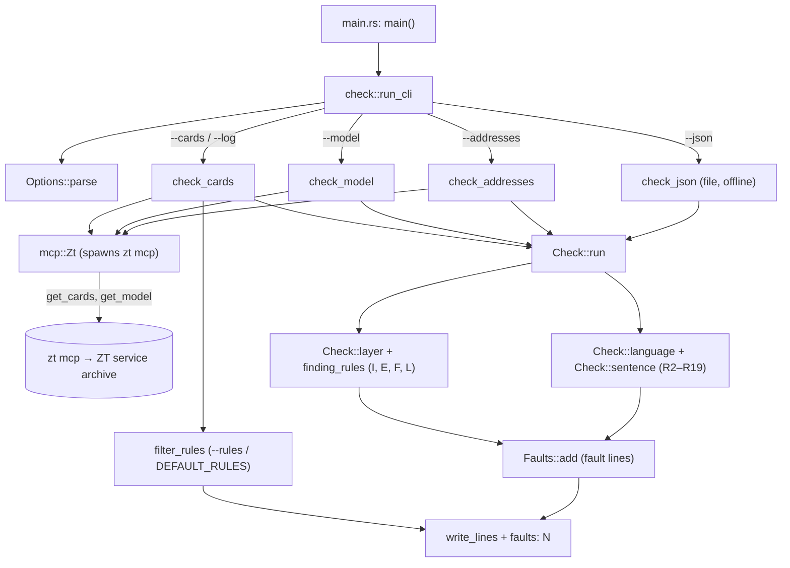

# zt-check

## Purpose

`zt-check` is the Card quality check of the book digest, built as one fast Rust binary. It reads Cards (from a JSON file of drafts, or from the live archive through `zt mcp`) and prints one line per fault against the Card language and structural rules (R2 to R19) and the Card layer rules (I, E, F, L). Every agent that writes digest Cards calls it: Claude sessions, workflow agents, Haiku managers, DeepSeek Harness runs, and the digest scripts through `Invoke-ZtCheck`. It is the only source of truth for Card quality (`tools/zt-check/src/main.rs`, `tools/zt-check/src/check.rs`). It exists as a crate of its own so that it builds and installs without building zt or stopping the ZT service (`tools/zt-check/Cargo.toml`, `scripts/install-zt-check.ps1`).

**Owns:** the rule definitions and their fault text, the order of fault lines, the default rule set of `--cards`, the size limits and their defaults, the Card categories of `--cards` mode, the `--json` entry format, the `zt mcp` client in `tools/zt-check/src/mcp.rs`, the library entry points (`tools/zt-check/src/lib.rs`: `check::run_lines`, `mcp::Zt`), and the build and install of `zt-check.exe`.

**Does not own:** the MCP tools it calls (`get_card`, `get_model`, `get_tree`, `list_trees`; see [MCP server](mcp-server.md)), the ZT service that `zt mcp` needs (see [Service, CLI and storage](service-and-cli.md)), Relation kinds and Link parsing inside zt (see [Cards, Workspaces and Links](cards-and-links.md)), the build report and Elaboration level (see [Models and math](models-and-math.md)), the PowerShell wrapper `Invoke-ZtCheck` and the compilers and audit that build its input (see [Digest scripts](digest-scripts.md)), the SELF-CHECK lines in the agent prompts (see [Digest prompts](digest-prompts.md)), the approval rules in the workflows (see [Digest workflows](digest-workflows.md)), and the `zt-digest-protocol` skill that documents it for agents (see [Agent skills](agent-skills.md)).

## At a glance

| | |
|---|---|
| Entry points | `zt-check` command line (`main` in `tools/zt-check/src/main.rs` → `check::run_cli`); the library (`zt_check::check::run_lines(args, Some(&mut zt))`, `zt_check::mcp::Zt`), which [zt-digest](zt-digest.md) runs in-process; `scripts/install-zt-check.ps1` (build and install) |
| Key files | `tools/zt-check/Cargo.toml` — a crate with its own `[workspace]`, so it never builds zt; `anyhow`, `regex`, `serde_json`, plus platform process bindings (`windows-sys` on Windows, `libc` on Unix) |
| | `tools/zt-check/Cargo.lock` — pinned versions (regex 1.13.1, anyhow 1.0.104, serde_json) |
| | `tools/zt-check/src/lib.rs` — the library: `pub mod check; pub mod graph; pub mod mcp;` |
| | `tools/zt-check/src/main.rs` — collects the arguments, calls `zt_check::check::run_cli`, prints `zt-check: <error>` and exits 1 on an error |
| | `tools/zt-check/src/check.rs` — the rules, the PowerShell text semantics, the four input modes, the option parser, the output, and the unit tests |
| | `tools/zt-check/src/mcp.rs` — `Zt`, a minimal JSON-RPC client that starts `zt mcp` and makes `tools/call` requests |
| | `tools/zt-check/src/mcp/owned.rs` — owned process-tree containment, bounded exit observation and termination |
| | `scripts/install-zt-check.ps1` — `cargo build --release` into `D:\zt-check-target`, then copies `zt-check.exe` beside `zt.exe` |
| Depends on | [MCP server](mcp-server.md) (`zt mcp`, read tools only); [Service, CLI and storage](service-and-cli.md) (the service must be up for `zt mcp` tool calls); the answer shapes of [Models and math](models-and-math.md) (`get_model` `head`, `parts`, `level`, `build.setting`, `build.order`) and [Cards, Workspaces and Links](cards-and-links.md) (`get_tree` `links`, `kinds`); Rust crates `regex`, `serde_json`, `anyhow` |
| Used by | [zt-digest](zt-digest.md) (a path dependency: `Check::run` calls `run_lines` on the step's own `zt mcp`); [Digest scripts](digest-scripts.md) (`Invoke-ZtCheck` in `scripts/book-digest/zt-calls.ps1`, for PowerShell callers and the tests; every digest script now forwards to a `zt-digest` tool that runs the check in-process); [Digest prompts](digest-prompts.md) (DeepSeek SELF-CHECK commands); [Digest workflows](digest-workflows.md) (managers approve `zt-check` as read-only); [Agent skills](agent-skills.md) (`skills/zt-digest-protocol/SKILL.md`, `skills/zettelkasten/SKILL.md`) |
| Tests | `mod tests` in `tools/zt-check/src/check.rs`; `scripts/book-digest/tests/zt-check.tests.ps1` with `card-style-fixture.json`; `scripts/book-digest/tests/card-layer.tests.ps1` with `card-layer-fixture.json` |

## Concepts

- `Card language` — the plain-text rules for Card titles and bodies (ASD-STE100 adapted for Chinese). zt-check checks rules 2 to 7, 9, 12 to 17, and the standalone pilot rules 20 and 21 of the list in [docs/self-sufficient-models-proposal.md](../self-sufficient-models-proposal.md) and [docs/derivation-explanations-proposal.md](../derivation-explanations-proposal.md); rules 1, 8, 10, and 11 are not mechanical and are not checked (`Check::language`, `Check::sentence`, `local_reference`, `unnamed_referent` in `tools/zt-check/src/check.rs`).
- `Card layer rules` — the checks on Cards outside models: I (Idea Cards), E (Event Cards), F (Finding Cards), L (Links). They run only on entries that carry a `category` (`Check::layer`, `finding_rules`).
- `Fault line` — `<address> <rule> <text>`: the text on one line, white space collapsed, clipped to 90 UTF-16 units with `…` (`Faults::add`). A run ends with `faults: N`.
- `Advisory` — a fault line whose text starts with `(advisory)` (I1, I6, L3, E5, R20, R21, and I7's unknown-source line). In `--cards` mode it is printed but not counted (`filter_rules`); in the other modes every line counts (`digest-audit` splits the two).
- `Standalone rule` — R20 and R21, the pilot's text heuristics for a Card that must stand alone (D125–D134). They are advice in the pilot: they name the matched fragment, the text and the reason, and a semantic review still decides.
- `Source evidence` — the Citation keys a Card's claim comes from, as I7 reads them: an explicit `sources` set, else the `来源` line's Literature Links, else the Literature tree the Card is filed in. Empty is unknown, never a pass (D069–D073).
- `Entry` — one Card as zt-check reads it: a JSON object with `address`, `title`, `body`, `facet`, and optional layer fields (see "Data and storage"). Property names ignore case (`prop`).
- `Category` — what a Card is for the layer rules: `idea`, `anchor`, `event`, `finding` get layer rules; `root`, `hub`, `part`, `model`, `terms`, `structure` get the R rules only. `--cards` mode computes it as `digest-audit.ps1` (`Get-Category`) does (`check_cards`).
- `Model part` / `Model Card` — read from `get_model`; a Card with a `facet` is a part. A part whose facet starts with `推导` (or `derivation`, any case) is a `Derivation part`, which gets the step and explanation rules R14 to R17 (`Check::language`).
- `Elaboration level` — `concept` or `formal`. A concept model skips R13 to R17; a model with no level gets the formal rules (`Check::language`).
- `Term table` — the table under the line holding `术语表` in the setting Card's body (a model's setting, or the Book term table): `| term | words not to use | 意思 | 首次定义 |`. R6 reads the first two columns (`read_terms`, `Check::with_terms`); `term_table` is the public parser the digest uses for all four (`zt_check::check::term_table`, `TermRow`; #97, D063). Both share one row parse, so R6 and the digest never disagree about a row: `不用` splits on `、,，/`, allows the `—`/`无` of "none", and a later row naming the same term (case ignored) replaces the earlier one. R6 still skips a row with no rejected word, exactly as before, and the four-column reader reports such a row with an empty `avoid`.
- `Shared part` — a part whose `build.order` item (or `--json` entry) has `line: shared`. It follows its home model's term table, so R6 skips it; `--skip-shared` drops it from a `--model` run (`check_model`, `Check::with_shared`).
- `Limits` — the size numbers of R13, R14, R17, I2, L2 (`Limits` struct; defaults in "Configuration").
- `UTF-16 form` — text in which each character outside the Basic Multilingual Plane is two private-use stand-ins (U+E000.., U+E400..), so lengths, regex classes, and clips match .NET (`utf16_form`, `from_utf16_form`).

## Architecture

The crate has a library (`lib.rs`: the checker `check.rs` and the zt client `mcp.rs`) and a binary (`main.rs`). `check.rs` is itself layered: input readers build a list of entries, `Check::run` applies the language rules per Card and then the layer rules across Cards, `run_lines` filters and returns the lines with `faults: N` last, and `run_cli` prints them. `run_lines(args, zt)` takes an open `Zt` or, given `None`, starts one only when the mode reads the archive (`--json` and an empty `--cards` start none).



| Component | File | Role |
|---|---|---|
| `main` | `tools/zt-check/src/main.rs` | Arguments in; on `Err`, `zt-check: {error:#}` on stderr and exit code 1 |
| `Options`, `run_cli`, `write_lines` | `tools/zt-check/src/check.rs` | Parse flags, pick one mode, run, filter, print UTF-8 with CRLF on Windows |
| `check_json`, `check_addresses`, `check_model`, `check_cards` | `tools/zt-check/src/check.rs` | Build the entries, the term table, the level, and the shared list for one mode |
| `Check` (`new`, `with_terms`, `with_shared`, `run`, `language`, `sentence`, `layer`) | `tools/zt-check/src/check.rs` | The rules |
| Text helpers (`plain`, `measure`, `prose_lines`, `split_sentences`, `passive`, `read_terms`, `leads_to`, `book_place`, `bigrams`, `similarity`) | `tools/zt-check/src/check.rs` | What text the rules see and how it is counted |
| PowerShell semantics (`ps_eq`, `ps_in`, `culture`, `culture_starts_with`, `culture_cmp`, `ps_string`, `truthy`, `strings`, `ps_int`, `key`) | `tools/zt-check/src/check.rs` | Reproduce the deleted PowerShell checkers' comparisons and conversions |
| `Zt` (`start`, `call`, `Drop`) | `tools/zt-check/src/mcp.rs` | The `zt mcp` client |

## Interfaces

`mcp::Zt::archive_view()` makes one `get_cards` call with no addresses and validates the complete empty read, revision, persisted 32-hex archive id and nonempty resolved path. It returns that verified view for preparation/ledger binding. Missing identity or incomplete protocol data raises an explicit error before a caller begins writing; ordinary bulk readers retain their existing API.


### Shared graph classification and orphan evidence

`tools/zt-check/src/graph.rs` is the pure shared graph contract. `category(card, literature, anchor_counts)` replaces separate audit/compiler/standalone classification code. It retains typed Finding/Event/Model/part/Hub distinctions and Literature anchors, term tables and structure inference; notation tables are explicit `notation`. Callers supply the complete anchor counts needed by structure inference. `check::check_cards` obtains those counts from one fresh, complete `export_titles` at the same revision as its selected body reads; it does not infer a whole-book denominator from a requested subset.

`graph::is_orphan(address, category, inbound)` defines one orphan: an eligible substantive Regular Card without a valid authored inbound Link from another Card. Eligible categories are `idea,event,finding,model,part`; excluded purposes are `root,anchor,structure,terms,notation,hub`. A self-Link does not help. Filing, a navigation parent, outbound citations and generated Reverse text are not authored inbound evidence. An actual authored Link from the parent does count. Inbound sources span both Workspaces; repair targets stay in the agent Workspace.

`graph::orphan_report(cards, revision, changed_cards)` requires explicit classification and complete inbound/Idea-kinded facts. It returns sorted target/eligible/excluded/orphan addresses, count, source Workspaces, revision and a separate `inbound_from_idea_with_kind` map. Missing facts, unknown categories, duplicate targets and human repair targets are errors. `changed_cards` describes authored target changes; callers label the baseline with `changes_since`. No stronger layer statistic is used to define orphanhood. I5 uses the same predicate; E4/F4 continue to report the stronger Idea-kinded evidence separately.


`mcp::Zt::cards(addresses, view)` returns `CardRead { cards, archive_revision }` through that command's existing MCP process. It chunks at 200 addresses, halves a chunk after a structured byte/address limit error, and fails when a single Card still cannot fit. It verifies complete/missing/count/address order and a common revision across chunks. Missing input or a changing read view fails explicitly; it cannot become an empty successful dataset.

`--addresses` and `--cards` use lean batches through one MCP process. `--addresses` asks for a model context only when its first Card is a Model Card/part. `--cards` uses the returned Link/kind/parent facts and reads each required primary model context once when its filed members establish ownership; a shared part's home is resolved independently. The valid numeric Topic ids and letter-led Literature keys identify agent Literature membership without tree scans. The existing categories, language and layer rules are unchanged.

`--model` uses the head and parts in its complete model context. Required external settings use lean batches. Each live mode compares the archive revision before and after collecting inputs and refuses a changing view. Public temporary-archive tests retain language, term-table and formal explanation faults while blocking old per-Card/tree reads. See `docs/digest-reliability-delivery-status.md` for the current completion boundary.

### Command line

```text
zt-check --json <file> [--setting <address>] [--level concept|formal] [--require-explain] [limits]
zt-check --model <address> [--skip-shared] [--setting <address>] [--level concept|formal] [--require-explain] [limits]
zt-check --addresses <a,b,...> [--setting <address>] [--level concept|formal] [--require-explain] [limits]
zt-check --cards <a,b,...> [--log <file>] [--book <key>] [--rules R2,R3,...] [limits]
limits: --max-sentences 12 --max-chars 400 --max-steps 6 --max-explain-sentences 16
        --max-explain-chars 600 --min-idea-chars 40 --max-idea-chars 300 --min-reason 8
```

(`USAGE` in `tools/zt-check/src/check.rs`; the doc comment in `main.rs` lists only three of the modes.)

| Mode | Input | Reads zt | Term table (R6) | Level | Layer rules | `faults: N` counts |
|---|---|---|---|---|---|---|
| `--json <file>` | A JSON array of entries, or one entry (BOM allowed) | no | `--setting` names an entry in the file; its body gives the table | `--level`, else none (formal rules) | yes, for entries with `category` | every line |
| `--addresses <list>` | Addresses (split on commas and white space) | Bounded `get_cards` text batches; `get_model` for the first Card only when it is a Model Card/part; final revision probe | `--setting`, else the first model's `build.setting`; a required external setting is another lean batch | `--level`, else the first model's `level` | no | every line |
| `--model <address>` | Any Card of a model | `get_model` head/parts; revision probes; lean external setting when required | `--setting`, else `build.setting` | `--level`, else the model's `level` | no | every line |
| `--cards <list>` / `--log <file>` | Addresses from the list plus one per line of the log file | Bounded lean batches; required primary model contexts shared across known filed members; one complete `export_titles` that is also I6's Workspace context; final revision probe | each model's own setting | each model's own level | yes, by computed category | hard (non-advisory) lines of the selected rules |

Flags:

| Flag | Applies to | Effect |
|---|---|---|
| `--setting <address>` | `--json`, `--model`, `--addresses` | The setting Card whose `术语表` gives R6's term table |
| `--level concept\|formal` | `--json`, `--model`, `--addresses` | Overrides the level; any other value is an error; lower-cased |
| `--require-explain` | `--json`, `--model`, `--addresses` | R15 to R17 also on Derivation parts with neither 思路 nor 解读 (older parts) |
| `--skip-shared` | `--model` only | Drops shared parts from the run |
| `--log <file>` | `--cards` | Adds one address per line; a missing file is ignored silently |
| `--book <key>` | `--cards` only | The Citation key for I3 and F2 on every layer Card; default: the Card's tree when it is an agent Literature tree |
| `--rules <list>` | `--cards` only | The rules to print and count; default `DEFAULT_RULES` |
| `--max-*`, `--min-*` | all | The limits; each takes a whole number |
| `-h`, `--help` | — | Prints the usage as an error (exit code 1) |

Errors (exit code 1, `zt-check: <message>` on stderr, no `faults:` line): no mode or two modes (`name one input: --json, --model, --addresses, or --cards/--log`); `--cards` with `--setting`, `--level`, `--require-explain`, or `--skip-shared`; `--book` or `--rules` outside `--cards`; `--skip-shared` outside `--model`; a flag without its value; a limit that is not a whole number; an unknown option; a file that cannot be read or is not JSON; `zt mcp` that does not start or closes; a tool error (`zt: <message>`, for example `the ZT service is not available; run zt up`); `get_model` of a Card in no model (`` `<at>` belongs to no model``).

### Output

```text
K/1|a|a|1 R3 E 在时点 1 付不出去；E 能部分付出。
K/1|a|a|4 R13 (13 sentences > 12) split the part into two or more parts
5/1 I1 (advisory) the title states no claim: 税
faults: 3
```

UTF-8 whatever the console code page, CRLF line ends on Windows and LF elsewhere (`write_lines`). With `--cards` and no addresses, the output is `no Cards to check` and `faults: 0`. A run that prints no `faults:` line did not run.

### Rules

The default column is the default rule set of `--cards` (`DEFAULT_RULES`). The other modes print every rule they check.

| Rule | Checks | Applies to | Default | Fault text |
|---|---|---|---|---|
| R2 | Sentence length: Chinese at most 40 characters (30 in a numbered Derivation step); other text at most 25 words (20 in a step). Formulas, Links, code, bold marks, quotes and brackets do not count | every prose sentence | yes | `(N characters > 40) <sentence>` |
| R3 | No `；` or `;` | every sentence | yes | `<sentence>` |
| R4 | No `被` passive, except `被告`, `被保险`, `被动`, `被子`, and a party (`被收购方`: one or two CJK characters then `方`) | every sentence | yes | `<sentence>` |
| R5 | No light verb + CJK (`进行`, `加以`, `予以`, `作出`, `做出`) | every sentence | yes | `<sentence>` |
| R6 | No word the term table rejects for a term (the term's own text is removed first) | every sentence of a non-shared Card, when a term table is known | no | ``uses `<word>` for `<term>`: <sentence>`` |
| R7 | At most two `的` in one noun phrase (three `的` with at most 7 non-punctuation characters between) | every sentence | yes | `<sentence>` |
| R9 | No hedge or praise word (18 listed in `HEDGES`, such as `值得注意的是`, `精妙`) | every sentence | yes | `` `<word>`: <sentence>`` |
| R12 | Title at most 40 characters (25 words), and no `；`/`;` (two claims) | every title | yes | `(N characters > 40) <title>` or `two claims: <title>` |
| R13 | A Model part holds at most `max-sentences` prose sentences, else at most `max-chars` Chinese prose characters. Steps and explanation do not count | Cards with a facet, not in a concept model | yes | `(N sentences > 12) split the part into two or more parts` |
| R14 | A Derivation part holds at most `max-steps` numbered steps | Derivation parts, not in a concept model | yes | `(N steps > 6) split the derivation into a chain of Derivation parts` |
| R15 | The sections are exactly `思路, 起点, 步骤, 结果, 解读`, in that order | Derivation parts that have 思路 or 解读 (all of them with `--require-explain`), not in a concept model | yes | `sections <found>; want 思路, 起点, 步骤, 结果, 解读` |
| R16 | 思路 at most 5 sentences; 解读 at most 6 (`待写` does not count) | as R15 | yes | `(思路 has N sentences > 5)` |
| R17 | One `说明` line per numbered step, not before the first step, of at most 2 sentences; 思路 + 说明 + 解读 together at most `max-explain-sentences` sentences, else at most `max-explain-chars` characters | as R15 (the position errors are reported in every Derivation part) | yes | `a second 说明 line under step N: …`, `(N explanation sentences > 16) shorten the explanation` |
| R18 | Exact repeated substantive prose paragraph, after only line-ending/outer-whitespace normalization | every authored body outside excluded regions | yes | `repeated prose paragraph at lines A-B and C-D` |
| R19 | A repeated Card title heading in authored body text | every authored body outside excluded regions | yes | `repeated Card title at body line N` |
| R20 | Advisory: a local label that stands in for content — `式 (12)`, `命题 3.G.3`, `第 6 章`, `模型 1`, `本节`/`本章`, `§11.D`. The text left after the labels must carry at least `LOCAL_REFERENCE_CONTENT` (5) characters of content, so `式 (12) 的加成项来自需求弹性` passes and `式 (12) 有该项` does not. `第一福利定理` is a name, code/quotes/formulas are skipped, and a `来源` line may carry the locator (D126, D132–D134) | every title and authored prose sentence | yes (advice) | ``(advisory) local reference `<label>` names no content: <text>`` |
| R21 | Advisory: a deictic phrase (`那里`, `那儿`, `那张卡`, `这张卡`, `该卡`, `该卡片`) with no `[[Link]]` in the same sentence. A Link in the sentence before does not name it (D127, D134) | every title and authored prose sentence | yes (advice) | ``(advisory) unnamed referent `<word>` with no named Link in its sentence: <text>`` |
| I1 | Advisory: a title of at most 6 characters with no claim verb (`CLAIM_VERB`) | `idea`, `anchor` | yes | `(advisory) the title states no claim: <title>` |
| I2 | Prose size: over `max-idea-chars` is a split candidate, under `min-idea-chars` a merge candidate | `idea` | yes | `(N characters > 300) split candidate` |
| I3 | A Link to the book's Literature Card or one of its anchors (`<key>/<n>`) | `idea`, `event` with `book` and `links` | yes | `no source line: no Link to [[key]] or one of its anchors` |
| I4 | A kinded Link to a Card other than the parent | `idea` with `kinds` | yes | `no kinded Link to a Card other than the parent` |
| I5 | Another Card has a valid authored inbound Link here; a self-Link does not count | substantive categories with `inbound` | no | `no other Card has an authored Link here` |
| I6 | Advisory: no other title in the same Workspace with bigram (Dice) similarity of 0.8 or more, or an exact normalized equality. Candidates come from an inverted bigram index over the Workspace title context; only pairs touching the checked Cards are reported, once per unordered pair | `idea` (a checked Idea Card; the context is read-only) | no | `(advisory) a title very similar to [[a]]` |
| I7 | A Topic Idea Card's `rests-on` Link enters its own source's Literature tree. `illustrates`, `corresponds`, and `contrasts` are no dependency, another book is none, and a Card filed in that tree rests on it by design. Missing source evidence is reported as unknown, never as a pass | `idea` with `relations` | yes | `` `rests-on` [[a]] enters its own source `key` `` or `(advisory) source evidence unknown, so [[a]] may be an own-source premise` |
| E1 | A date in the title (a year 1000–2099, or a number + `年`/`世纪`) | `event` | yes | `no date in the title: <title>` |
| E2 | The labels `时间`, `地点`, `参与者`, `经过`, `来源` at line starts (list marker and bold allowed) | `event` | yes | `missing labels: 参与者、经过、来源` |
| E4 | An Idea Card links it with a kind word (`inbound_kinded` > 0) | `event` with `inbound_kinded` | no | `no Idea Card links it with a kind word` |
| E5 | Advisory: no other Event Card with the same year and bigram similarity of 0.5 or more | `event` | no | `(advisory) the same event as [[a]]?` |
| F1 | The labels `测量`, `数据`, `方法`, `结果`, `局限`, `来源` at line starts | `finding` | yes | `missing labels: 方法` |
| F2 | The `来源` line links the book or one of its anchors when the book is known, else is not empty | `finding` with a `来源` line | yes | `the source line links neither [[key]] nor one of its anchors` |
| F3 | One `结果` label, with at most one list item under it (to the next label or blank line) | `finding` | yes | `(2 结果 labels) one result per Card: split it` |
| F4 | As E4, for a Finding Card | `finding` with `inbound_kinded` | no | `no Idea Card links it with a kind word` |
| L1 | Every Link has a Relation kind: not in `kinds`, not a book place (a Citation key or `<key>/<n>`), and not after `引出` in its sentence → `refers` | layer Cards with `links` | yes | `(N Links read as refers) [[a]] [[b]]` (at most 5 shown) |
| L2 | A sentence with a Link (not a `来源`/`出处`/`Source` line) has at least `min-reason` characters of reason, or an inline formula | layer Cards | yes | `(N characters < 8) a Link with no reason: <sentence>` |
| L3 | Advisory: one target linked in two or more paragraphs | layer Cards | no | `(advisory) [[a]] is linked in N paragraphs` |

Rules R1, R8, R10, R11, and E3 exist in the design docs but zt-check does not check them.

### `zt mcp` client (`tools/zt-check/src/mcp.rs`)

zt-check has no MCP server mode of its own. It is an MCP client: `Zt::start()` runs `zt mcp` (the program in `ZT_CHECK_ZT`, default `zt` on PATH) with piped stdin and stdout and stderr discarded, sends `initialize` (`protocolVersion` `2025-06-18`), waits for the reply with id 0, and sends `notifications/initialized`. `Zt::call(tool, arguments)` sends one `tools/call` per line with a rising id, skips reply lines that are not JSON or have another id, joins the `text` parts of `result.content`, and parses them as JSON. A JSON-RPC `error` or `result.isError: true` becomes `zt: <message>` (the `error` field of a JSON message when there is one). `Zt::request(tool, arguments)` returns the whole reply instead, an error reply included; `reply_text` and `reply_error` read it (the zt-digest helper uses them). It mirrors the protocol of `skills/zt/scripts/zt-mcp.ps1`.

A caller that needs long edit patience declares it once for the shared client (`zt_check::mcp::child_edit_patience(180)`), and every child it starts then inherits `ZT_EDIT_PATIENCE`; the value is child-process policy, never a per-command argument (R269). One small I/O worker owns the pipes. Each exchange, including initialize and a blocked stdin write, has a 240-second deadline in the calling thread. Wrong-id/non-JSON noise does not renew that deadline. Input is strict UTF-8 and a reply line cannot exceed 32 MiB; the server's own encoded-tool-result limit remains smaller. This bounds memory and waiting without adding another process/client or changing JSON-RPC tool behavior. A timeout poisons that client, terminates its owned tree and observes exit before returning `TransportFault`. The stable fields are `code` (`command_timeout` or `transport_closed`), operation, child PID, `cleanup_confirmed` and observed cause. A timed-out write may have committed: the domain adapter must recover the accepted operation's receipts, not invent a new identity or assume rollback.

The library also holds the service resolution a digest stage uses before its archive work (R320): `observe_service(program)` runs one bounded `<program> status` and parses `state:`, `pid:`, `archive_root:`, `revision:`, the daemon's `version=` and `last_exit:`, `observed_service()` returns the last successful observation, and `ensure_service(program, wait)` polls it at 500 ms intervals for at most `SERVICE_WAIT` (120 s). `ensure_service` never launches a daemon: `zt status` is the one path that clears a stale record and starts one service, so concurrent stages share a single restart. A service that stays down is one `infrastructure_fault` error that names the wait and leaves the run's units and files as they are. A program that does not answer like `zt status` within the 45-second observation bound (an isolated seam standing in for the MCP server) reports `None`, so a stand-in never becomes a false service state. The crate also exports `VERSION`, so a run report can name the checker that checked its Cards. zt-check's own `Zt::start` is unchanged; [zt-digest](zt-digest.md) calls the resolution for every archive command.

`Zt::shutdown()` first closes the command channel, so the idle worker drops stdin. It allows two seconds for ordinary EOF exit, then force-terminates the owned tree and waits at most two seconds, followed by at most two seconds for the I/O worker. `Drop` uses that path and reports unconfirmed cleanup; it has no unconditional blocking child wait. A timeout skips the graceful phase. Failure to confirm termination remains explicit evidence, not permission for a replacement writer.

On Windows, `owned::Owned` creates the child suspended, assigns it to one Job Object with kill-on-close and resumes its initial thread. Descendants remain in that job; terminating the compiler closes its job handle as well. Termination uses job/process handles rather than executable-name searches. The separately living ZT daemon and explicit Scholar Archive `start` use the narrow service-launch paths in [Service, CLI and storage](service-and-cli.md) and [Scholar Archive bridge](scholar-bridge.md); they leave the client job and inherit no capture handles. Pair/revoke helpers and archive-writing MCP processes stay contained. Unix uses a fresh process group and group termination; Windows parent-death behavior is the host-qualified path, and Unix parent-death equivalence is not claimed.

`mcp-lifecycle.tests.ps1` drives both public binaries and a real archive. It checks silent initialization/receive, unrelated reply noise, a blocked large stdin write, refused EOF shutdown, descendant cleanup, unrelated-process survival, compiler death, before/after actual batch commit timeouts with exact receipt recovery, daemon restart survival before any status repair, and independent Scholar Archive startup without retained capture pipes. Only a canonical temporary `mcp-lifecycle-test-*/config` fixture can shorten deadlines through `ZT_MCP_TEST_TIMEOUT_MS`/`ZT_MCP_TEST_SHUTDOWN_MS` (100–10000 ms); production ignores those variables outside that scope. No provider or actual digest workflow runs.

| Tool called | Arguments | Used by | Fields read |
|---|---|---|---|
| `get_cards` | `{ addresses, view: "text" }` | every live mode (`--model`, `--addresses`, `--cards`; never `--json`) | `cards[].address`, `title`, `body`, `facet`, `type`, `tree`, `links[]`, `kinds`, `archive_revision`, `complete`, `missing` |
| `get_model` | `{ at }` | `--model`, `--addresses` (the first Card when it is a model), `--cards` (each model it checks) | `head`, `parts[]`, `level`, `build.setting`, `build.order[].line`, `build.order[].address` |
| `export_titles` | `{}` | `--cards` | `titles[].address`, `titles[].tree`, `count`, `complete`, `archive_revision` |

### Install script (`scripts/install-zt-check.ps1`)

```powershell
pwsh -NoProfile -File scripts\install-zt-check.ps1 [-TargetDir D:\zt-check-target] [-BinDir <folder>]
```

It sets `CARGO_TARGET_DIR` to `-TargetDir`, runs `cargo build --release` in `tools/zt-check`, deletes the old `<BinDir>\zt-check.exe` or, when a running check holds it open, renames it to `zt-check.exe.old-<yyyyMMdd-HHmmss>`, copies the new one, and prints `installed <target> (on PATH: <found>)`. `-BinDir` defaults to the folder of the `zt` on PATH (normally `~\.cargo\bin`); the script fails when `zt` is not on PATH. It never stops the ZT service.

## Behaviour

### Exact corruption checks

`check.rs::corruption` runs for every checked body before the sentence rules. R18 compares substantive prose paragraphs after CRLF/lone-CR normalization and outer paragraph trimming only. Interior whitespace, indented paragraph continuation, Markdown and inline formula content remain part of exact equality. Each repeated occurrence reports the first and current body-line ranges; three copies yield two paired faults. Source-only lines, known unwritten placeholders and text without prose letters are not substantive paragraphs. A source label followed by substantive prose cannot hide a repeated paragraph.

R19 reports every authored level-one heading that repeats the Card title, with its body line. Valid closing ATX hash decoration is recognized. Both checks exclude code/chart fences, display formulas (`$$`, `\[...\]` and supported equation/align/gather environments), indented code, Markdown block quotations including lazy continuation, nested HTML blockquotes, whole explicitly quoted paragraphs and generated Reverse content. Heading/section labels and tables do not become repeated prose. These rules report; they do not remove duplicates, compare paraphrases or rewrite uncertain Chinese characters such as 向向/价价. Source review decides those cases.


### A `--json` run (drafts, offline)

1. `run_cli` reads the file; `check_json` strips a BOM and parses an array (or wraps one object).
2. Entries with `line: shared` form the shared list. When `--setting` is given, the entry with that address gives the term table (`read_terms`); a setting that is not in the file gives no table (no `get_card`).
3. `Check::run` runs `language` on each entry in input order, keeping each Card's prose character count, then `layer` on the entries that carry a truthy `category`.
4. `run_cli` appends `faults: <number of lines>` and `write_lines` prints.

### A `--model` run

1. `Zt::start` launches `zt mcp`. `check_model` calls `get_model { at }`; `head.address` must exist. It first probes the revision with one empty `get_cards` text read.
2. The entries are the `get_model` head and every `parts[]` item, reduced to `address`, `title`, `body`, `facet` (`card_entry`).
3. The setting and level come from the flags, else from `build.setting` and `level`. Shared parts are the `build.order` items with `line: shared`; `--skip-shared` removes them.
4. `setting_body` takes the setting's body from the entries, else from one required lean `get_cards` read for that external setting. `Check::run` runs; no entry has a category, so only R rules apply.

### A `--addresses` run

1. One bounded text `get_cards` read for every address. When the first Card is a Model Card, one `get_model` read gives its default setting and level; otherwise the flags (else empty) apply.
2. As `--model` from step 4, with no shared list (R6 applies to every Card).

### A `--cards` run (self-check, as the audit sees it)

1. The addresses of `--cards` and of the `--log` file (one per line, BOM stripped) are de-duplicated (case counts, ignorable characters do not). An empty list prints `no Cards to check`.
2. `check_cards` makes one bounded text `get_cards` read of those Cards, one complete `export_titles` catalogue for classification, and one `get_model` read per distinct model it must check. Each lean row carries its indexed `links` and `kinds`, so no per-Card or per-tree read remains.
3. Each Card gets a category: `root` (the tree entry's kind is `topic` or `literature`), `hub`, `event`, `finding`, `part` (type `model` with a facet), `model`, then in an agent Literature tree `anchor` (`<key>/<n>`), `terms` (title starts with `术语表`), `structure` (body starts with `本卡是《…》的结构卡`), else `idea`.
4. `part` and `model` Cards with a model head are grouped by head; each group runs as one `Check` with its model's setting, level, and `require_explain = true`.
5. The rest run together; `idea`, `anchor`, `event`, `finding` entries get `category`, `parent`, `links`, `kinds`, and `book` (`--book`, else the tree when it is a Literature tree).
6. `filter_rules` keeps the lines whose rule is in `--rules` (default `DEFAULT_RULES`) and counts the non-advisory ones; `faults: N` is that count.

### How text is read

1. `prose_lines` drops fenced code (including chart fences), `$$` blocks, single-line `$$…$$`, headings, and lines that start with `|`, `>`, `<`, or `![`; it strips a list marker and marks numbered lines as steps.
2. `split_sentences` hides formulas and Links, splits after `。！？!?` and after a `.` followed by white space, then restores them.
3. `plain` replaces formulas with `F`, code with `C`, removes Links and bold marks. `measure` counts characters (after removing white space, quotes, brackets, and every `F`/`C`, any case) when the sentence holds a CJK character, else words.
4. In a Derivation part, a line `思路`/`起点`/`步骤`/`结果`/`解读` (bold allowed) opens a section; the position line `第 N 张，共 M 张` in 思路 is skipped; `说明：` lines under 步骤 are explanation; a `来源` line after 解读 is not.

### Rules the code keeps

- Fault order: per Card in input order: structural R18/R19 in body scan order, R12, then per sentence R2, R3, R4, R5, R6, R7, R9 (R17 position faults inline), then R15, R16, R17, then R13, R14. Layer faults follow all language faults: per Card I1, I2, I3, I4, I5, E1, E2, E4, F1–F4, L1, L2, L3; then I6 in checked-Card order (candidates in catalogue order), then E5. In `--cards` mode the model groups come before the other Cards. Callers and tests compare lines in this order.
- R13 and R14 apply only when the level is not `concept`; R15 to R17 likewise. R13 applies only to Cards with a facet, so a Model Card is never size-checked.
- One `Zt` process per run; calls are sequential. zt-check never writes: it calls only read tools.
- Every mode except `--cards` counts advisory lines in `faults: N`.

## Data and storage

zt-check keeps no state. It exchanges two formats.

The `--json` entry (fields read with case-insensitive names; all but `address` optional):

```json
[
  { "address": "S/1|a|a", "facet": "设定", "title": "设定", "body": "…| 术语 | 不用 |\n…", "line": "head" },
  { "address": "S/1|a|a|1", "facet": "推导：参与约束", "title": "推导：参与约束", "body": "**思路**\n…", "line": "shared" },
  { "address": "5/1", "title": "税", "body": "依赖 [[5/3]] 的结论，税负落在买方。",
    "category": "idea", "parent": "", "links": ["5/3"], "kinds": ["5/3"],
    "relations": { "5/3": "rests-on" }, "book": "Hart1995", "tree": "5", "workspace": "agent",
    "inbound": ["5/2"], "inbound_kinded": 1 }
]
```

I6's Workspace context is a separate read-only catalogue, either in the bundle around the
entries or from the mode's own bulk reader:

```json
{ "cards": [ … ], "context": { "complete": true,
  "titles": [ { "address": "5/1", "title": "税", "workspace": "agent" } ] } }
```

| Field | Meaning | Used by |
|---|---|---|
| `address`, `title`, `body` | The Card | all rules |
| `facet` | Makes the entry a Model part; `推导…` makes it a Derivation part | R13–R17 |
| `line` | `shared` puts the entry in the shared list | R6 |
| `category` | `idea`, `anchor`, `event`, `finding`; anything else (or none) skips the layer rules | I, E, F, L |
| `parent` | The parent's address | I4, I5 |
| `links` | Link targets out | I3, L1 |
| `kinds` | The targets of kinded Links | I4, L1 |
| `relations` | The kind word of every kinded Link (`{ "<target>": "rests-on" }`, as `get_card` returns it). Without it I7 sees no dependency | I7 |
| `sources` | The Card's explicit source evidence: the Citation keys of its Literature trees. Absent, I7 derives them from the `来源` line, else from the Card's own Literature tree | I7 |
| `book` | The Citation key | I3, F2 |
| `tree` | The tree id | I7 |
| `workspace` | `agent` or `human`; I6 compares only inside one Workspace | I6 |
| `inbound` | Addresses that link here | I5 |
| `inbound_kinded` | How many Idea Cards link here with a kind word | E4, F4 |

The term table in a setting body (R6 needs the first two columns; the digest's concept review reads all four):

```markdown
术语表

| 术语 | 不用 | 意思 | 首次定义 |
|---|---|---|---|
| 清算 | 卖资产、变卖资产 | 把资产换成现金 | §3.1 |
| 可承诺的还款 | 还款额 | 契约能保证的偿还金额 | §4.2 |
```

The first column is the term; the second lists the words not to use, split on `、`, `,`, `，`, `/`; `无`, `-`, `—` mean none. The table ends at the first non-table line after a row.

The wire format to `zt mcp` is one JSON-RPC 2.0 message per line (see "Interfaces").

## Configuration

| Setting | Where | Default | Effect |
|---|---|---|---|
| `--max-sentences` | flag | 12 | R13 sentence limit |
| `--max-chars` | flag | 400 | R13 character limit |
| `--max-steps` | flag | 6 | R14 step limit |
| `--max-explain-sentences` | flag | 16 | R17 explanation sentence budget |
| `--max-explain-chars` | flag | 600 | R17 explanation character budget |
| `--min-idea-chars` | flag | 40 | I2 merge candidate below |
| `--max-idea-chars` | flag | 300 | I2 split candidate above |
| `--min-reason` | flag | 8 | L2 reason length |
| `--rules` | flag (`--cards`) | `R2,R3,R4,R5,R7,R9,R12,R13,R14,R15,R16,R17,I1,I2,I3,I4,L1,L2,E1,E2,F1,F2,F3` | Which rules print and count |
| `ZT_CHECK_ZT` | environment | `zt` | The program started as `<program> mcp` |
| `-TargetDir` | `install-zt-check.ps1` | `D:\zt-check-target` | Cargo target folder (E: has little free space) |
| `-BinDir` | `install-zt-check.ps1` | folder of `zt` on PATH | Where `zt-check.exe` goes |
| `[profile.release]` | `tools/zt-check/Cargo.toml` | `opt-level = 3`, `codegen-units = 16` | Release build |

The fixed limits R2 (40/30 characters, 25/20 words), R12 (40/25), R16 (5 and 6), R17 (2 per 说明), I1 (6 characters), I6 (0.8), and E5 (0.5) are constants in `tools/zt-check/src/check.rs`.

## Usage

The digest scripts call it through `Invoke-ZtCheck` (`scripts/book-digest/zt-calls.ps1`), which maps PowerShell parameters to flags, always passes all eight limits, merges stderr into the output, and throws when no `faults: N` line appears:

```powershell
. scripts\book-digest\zt-calls.ps1
Invoke-ZtCheck -Json $file -Setting 'K/1|a|a'                         # drafts (card-compiler, hub-compiler, model-compiler explain-check)
Invoke-ZtCheck -Model $model -SkipShared -MaxSentences 12 -MaxChars 400 # model-compiler report step
Invoke-ZtCheck -Addresses "$a,$b" -RequireExplain                      # model-compiler tests
```

DeepSeek writers run it themselves, from the SELF-CHECK line of their job file (`scripts/book-digest/prepare-book-digest.ps1`, `scripts/book-digest/prepare-link-pass.ps1`, `scripts/book-digest/dsh-fill-instructions.zh.md`):

```powershell
zt-check --cards "Smith2024/3" --log "D:\out\owned-3.txt" --book Smith2024
zt-check --log "D:\out\allow-2.txt" --cards "" --book Smith2024 --rules L1,L2,R2,R3,R4,R5,R7,R9
zt-check --addresses "3/1|a|a|1,3/1|a|a|2" --max-sentences 12 --max-chars 400 --max-steps 6 --require-explain
```

The compilers check drafts by writing `--json` entries with a `category` so the layer rules apply (`Get-DraftFaults` in `scripts/book-digest/event-compiler.ps1`, `New-CheckEntry` in `scripts/book-digest/card-compiler.ps1`); the hub compiler sends plain entries (no category) and keeps only R2, R3, R4, R5, R7, R9 (`scripts/book-digest/hub-compiler.ps1`).

### Adding a rule

1. Add the check in `Check::sentence` (per sentence), `Check::language` (per Card), `Check::layer` or `finding_rules` (layer, by category), and report it with `faults.add(address, "<Rule>", text)`. Prefix an advisory text with `(advisory)`.
2. Keep the rule id matching `FAULT_LINE` (`[RIELF]\d+`); a new letter needs that pattern changed, or `--cards` drops its lines.
3. Add it to `DEFAULT_RULES` if `--cards` should report it by default.
4. Add a unit test in `mod tests` with the exact lines, and update the PowerShell fixture tests if the `--json` output of their fixtures changes.
5. Run `cargo test`, then `pwsh -NoProfile -File scripts\install-zt-check.ps1`, then the PowerShell tests. Tell callers that filter rule letters (see pitfalls).

### Adding an input field

Read it with `prop(card, "<name>")` and the PowerShell conversions (`text`, `strings`, `ps_int`, `truthy`). For `--cards`, also set it in `check_cards` (the item built for layer Cards), or the rule never fires there.

## Testing

| Test | Command | Covers |
|---|---|---|
| Unit tests, `mod tests` in `tools/zt-check/src/check.rs` (12 tests) | `cd tools/zt-check; $env:CARGO_TARGET_DIR='D:\zt-check-target'; cargo test` | One fault per rule on `card-style-fixture.json` (included with `include_str!`), card size, R15–R17, the position line, the I/E/L rules, the F rules, the standalone rules R20/R21 (content-bearing label, name, source locator, code/quote/formula exclusion, same-sentence and preceding-sentence referents), I7 (own source, other book, `illustrates`, own Literature tree, unknown evidence, `来源` line), UTF-16 lengths and clipping, sentence splitting, culture order, the rule filter |
| `scripts/book-digest/tests/zt-check.tests.ps1` | `pwsh -NoProfile -File scripts\book-digest\tests\zt-check.tests.ps1` | The same fixture, card size, and R15–R17 through `Invoke-ZtCheck` |
| `scripts/book-digest/tests/card-layer.tests.ps1` | `pwsh -NoProfile -File scripts\book-digest\tests\card-layer.tests.ps1` | I, E, L rules on `card-layer-fixture.json`, plus formulas and table pipes |
| Compiler tests on scratch archives | `pwsh -NoProfile -File scripts\book-digest\tests\finding-compiler.tests.ps1 [-Zt <zt.exe>] [-ZtCheck <zt-check.exe>]` (also `event-compiler`, `model-compiler`, `hub-compiler` tests) | `--addresses` and `--json` against a live scratch `zt mcp` |

The PowerShell tests run the `zt-check` found on PATH (`$script:ZtCheck` in `zt-calls.ps1`), not the source: install first. `finding-compiler.tests.ps1` copies the debug builds from `D:\zt-target` and `D:\zt-check-target` into a scratch `bin` at the front of PATH and sets `ZT_CONFIG_DIR`, so zt-check's `zt mcp` reaches the scratch archive.

Gaps: no test of `mcp.rs`; no unit test of `--model`, `--addresses`, or `--cards` (they need a live `zt mcp`; the compiler tests exercise `--addresses` and `scripts/book-digest/tests/workspace-titles.tests.ps1` exercises `--cards` with its Workspace context); no test of `Options::parse` errors; I5, I6, E4, F4 are tested only through `--json` fields apart from that I6 test, and `--addresses` sets no layer category, so it checks no layer rule at all (including I6 and I7).

## Decisions and pitfalls

### Decisions

- **One checker, the only source of truth.** zt-check replaced `card-style-check.ps1` and `self-check.ps1` (deleted 2026-10-15) with the same faults, in the same order, in the same words, so every agent and script gets one fault format (`tools/zt-check/src/check.rs` header; [docs/digest-card-layers-proposal.md](../digest-card-layers-proposal.md) D4 and its note; `skills/zt-digest-protocol/SKILL.md`).
- **PowerShell semantics in Rust.** To keep the old output exactly, lengths count UTF-16 units, matches ignore case, string comparisons drop culture-ignorable characters, hashtable keys ignore case, and sorts use an approximation of ICU collation (`weight`, `culture_cmp`).
- **A crate of its own, read through `zt mcp`.** It needs none of zt's code and sees the same answers as every other zt client; building or installing it never touches the running service (`tools/zt-check/src/mcp.rs`, `tools/zt-check/Cargo.toml`). Build into `D:` because E: is nearly full (`scripts/install-zt-check.ps1`).
- **R6 is not a default rule.** A book term table may name different concepts as synonyms, so a fix by it changes meaning; the audit reports R6, and the card cycle fixes it only on request ([docs/digest-card-layers-proposal.md](../digest-card-layers-proposal.md) D13).
- **Concept models keep their parts whole.** R13 to R17 apply only to formal models and models with no level; a concept model has no derivation to split ([docs/self-sufficient-models-proposal.md](../self-sufficient-models-proposal.md) "Card language", [docs/derivation-explanations-proposal.md](../derivation-explanations-proposal.md) section 4, [docs/model-elaboration-levels-design.md](../model-elaboration-levels-design.md)).
- **Older Derivation parts are silent.** A part with neither 思路 nor 解读 raises no R15 unless `--require-explain`; writers set it, the build report and the audit do not ([docs/derivation-explanations-proposal.md](../derivation-explanations-proposal.md)). `--cards` always sets it for model groups.
- **Finding Cards:** I3 does not apply (F2 is stricter), I1, I2, I4, I6 do not apply, F4 is not default like E4 ([docs/finding-cards-design.md](../finding-cards-design.md)).
- Related design docs: [docs/self-sufficient-models-proposal.md](../self-sufficient-models-proposal.md) (the Card language table), [docs/model-compiler-design.md](../model-compiler-design.md) (writers check their own Cards; the report step runs `--model --skip-shared`), [docs/zt-digest-framework.md](../zt-digest-framework.md) (drafts need `category`).

### Pitfalls

- **I6 reads a Workspace title context, and only advice comes of it.** `--cards` builds it from one complete `export_titles` read (the same read that classifies the Cards) and refuses a partial or changing catalogue; `--json` accepts it as the bundle's `context` object. Rows are comparisons only: I6 reports on the checked Card, never on a context Card, and never edits, merges, or deletes. A pair is reported once, on the later checked Card. Without a context the comparison is limited to the entries the run holds, which is why a digest's scoped review passes the catalogue through its own reader.
- **`anchor-title` is a hub fault, not similarity.** `src/hub.rs` normalizes whitespace and case only and refuses an exact match with the anchor's title in a new draft (`zt-digest hub -Step precheck`); a differently worded navigation title is no fault, and an existing hub is reported read-only until its correction is authorized.
- **`faults: N` means different things.** In `--cards` it counts hard lines of the selected rules; in `--json`, `--model`, `--addresses` it counts every line, advisory included. A `--json` run on layer entries can report `faults: N > 0` with only advisory lines.
- **`--cards` never fires I5, E4, F4.** `check_cards` sets no `inbound` or `inbound_kinded`, so those rules need `--json` entries that carry them (as `digest-audit.ps1` writes). They are also outside `DEFAULT_RULES`.
- **I7 needs the relationship evidence.** `get_card` returns `kinds` as a `{target: kind}` object; `check_cards` passes it as `relations` and `digest-audit` writes it into every entry. An entry without `relations` reports nothing for I7 — it is not a silent pass, because the published-Card path always carries it, and the audit and card cycle both use that path.
- **R20 and R21 are advice.** They start in the pilot as `(advisory)` lines inside `DEFAULT_RULES` and `DEFAULT_CARD_RULES`: visible in every check, counted as no fault by `--cards`, and split out by the audit (`style.advisory`, `style.advice_by_rule`). Promoting an unambiguous case to a blocking fault is a later frozen change with its own fixtures.
- **`--cards` knows books only in the agent Workspace** (`list_trees { workspace: "agent" }`); a Card in a human Literature tree is categorised as if it were in a Topic tree.
- **`--cards` checks shared parts under the model in the group** (no shared list); harmless by default because R6 is not a default rule.
- **`--addresses` takes the setting and level from the first Card's model** for all Cards; mixing models gives the wrong term table and level.
- **`PLACEHOLDERS` is `(?i)F|C`:** it removes every `F`, `f`, `C`, `c`, not only the formula and code placeholders, before counting Chinese sentence size, I1 titles, L2 reasons, and bigrams. This mirrors the PowerShell `-replace`; changing it changes counts.
- **English prose counts zero characters.** `measure` gives words for a sentence without CJK, and `language` adds only character sizes, so R13's character limit and I2 see English Cards as empty (I2 then reports a merge candidate).
- **One 240-second exchange deadline.** `Zt::receive` waits for a line with the id inside the configured deadline (240 s in production, shorter only in an isolated lifecycle fixture) and reports `command_timeout` with the owned child and cleanup fact; `zt mcp` stderr is discarded, so ordinary server failures show only as the deadline or `zt mcp closed`. The ZT service must be up for tool calls.
- **`--help` exits 1** (it is reported as an error) and `--log` with a missing file is ignored silently.
- **Rule-letter filters in callers.** `card-compiler.ps1` (`Invoke-StyleCheck`) and `digest-audit.ps1` (`Invoke-Check`) keep only lines matching `[RIEL]\d+`, so F lines are dropped there; `model-compiler.ps1` explain-check keeps only `R\d+`. A new rule letter must be added to those patterns too.
- **Install before testing.** `Invoke-ZtCheck` resolves `zt-check` from PATH once, when `zt-calls.ps1` is dot-sourced; a changed PATH after that has no effect.
- **A locked `zt-check.exe`** is renamed aside, not deleted; old `zt-check.exe.old-*` files collect in the bin folder.
- **Stale descriptions:** the `description` in `tools/zt-check/Cargo.toml` and the comment in `scripts/book-digest/zt-calls.ps1` name the layer rules I, E, L without F, and the doc comment in `tools/zt-check/src/main.rs` omits `--addresses`.
- **R16 does not report an empty 思路 or 解读**, although [docs/derivation-explanations-proposal.md](../derivation-explanations-proposal.md) lists "an empty section" as an R16 fault; only too many sentences are reported.

## Change history

- `2026-10-19` — #101 (S10): `zt-digest register -Step plan` reads every agent book term table through the same public `check::term_table` (#97), so the register's proposed rows and R6 never disagree about a row either. No rule changes.
- `2026-10-19` — #97 (design D063): expose the term-table parse as a small public library function for the digest. `check::term_table(body) -> Vec<TermRow>` returns all four columns (`术语`, `不用`, `意思`, `首次定义`), while `read_terms` keeps R6's own view of the same parse: the first two columns, a row with no rejected word skipped before it can replace an earlier row, and the ordered-hashtable replacement of a term that differs only in case. R6's faults are unchanged, which the unit test `the_term_table_exposes_all_four_columns_without_changing_r6` pins.

- `2026-10-19` — #93 S03: I6 compares a checked Idea title with every title of its own Workspace through a read-only title context (an inverted bigram index, the same Dice function, one line per unordered pair, only pairs touching the checked Cards). `--cards` builds the context from its complete `export_titles` read; `--json` accepts a `{"cards": …, "context": …}` bundle. The entry contract gains `workspace`.
- `2026-10-19` — The standalone pilot rules of #93 S02: R20 (an unexplained local reference, with its content constant), R21 (a deictic with no named Link in its sentence), and I7 (a Topic Idea Card resting on its own source's Literature tree, with unknown source evidence reported as unknown). `relations` (the kind word of every kinded Link), `sources`, and `tree` join the entry contract; `check_cards` supplies `tree` and `relations` from the bulk readers, `digest-audit` writes `relations`, and both default rule lists carry R20, R21, and I7. The audit splits advice from blocking style faults (`style.advisory`, `style.advice_by_rule`).
- `2026-10-17` — Bound MCP writes/reads and shutdown using one in-process I/O worker and owned process containment. Add typed cleanup facts, native Windows kill-on-close ownership and public hangs/parent-death/real receipt-recovery/service-lifetime tests.

- `2026-10-17` — All live modes use required lean Card batches or complete model contexts through one client, preserve Link/category/term/explanation rules, reuse filed-model ownership within the command, and refuse revision changes. Public tests cover the removed per-Card/tree reads and the existing fault outputs.

- `2026-10-17` — Add the shared bounded bulk client used by digest link preparation, with public tool-boundary tests for chunk reduction and explicit missing-input failures. Migrate `--addresses` and external setting reads; the Card input-mode migration remains in progress in #67.

- `2026-10-16` — Every digest script forwards to a `zt-digest` tool (stage 2), so the card, model, hub, Bridge, event, and finding checks all run in-process through `check::Check`; `Invoke-ZtCheck` stays for PowerShell callers.
- `2026-10-16` — zt-check becomes a library too (`src/lib.rs`): `check::run_lines` returns the lines on a given `Zt`, `Zt::request` returns a raw reply, and `reply_text`/`reply_error` read it, for zt-digest.
- `2026-10-16` `753bd7b` — Finding Cards: the F1 to F4 rules (`finding_rules`), category `finding` in `--cards` (from the Card type), F1–F3 added to `DEFAULT_RULES`, I5 also on Finding Cards.
- `2026-10-15` `02499c0` — zt-check created: the Rust crate replaces `card-style-check.ps1` and `self-check.ps1` with the same rules R2–R17, I, E, L; modes `--json`, `--model`, `--addresses`, `--cards`; the `zt mcp` client; `scripts/install-zt-check.ps1`; DeepSeek writers run it on their own Cards.
- `2026-10-16` — Wiki doc created.
