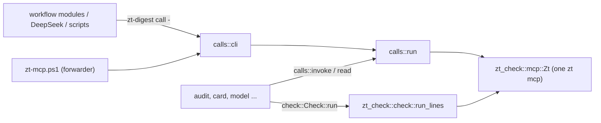

# zt-digest

## Purpose

`zt-digest` is the book digest's tool set as one Rust binary. It replaces the PowerShell scripts that the digest workflows run, tool by tool, with the same parameters and the same output, so that a step starts no pwsh, no helper process per call, and no checker process. One `zt-digest` process holds one `zt mcp` for all its reads and writes and runs [zt-check](zt-check.md) in-process (`tools/zt-digest/src/main.rs`). The first tool is `call`, the zt helper that DeepSeek runs and the scripts write through (`tools/zt-digest/src/calls.rs`). `audit` (the read-only digest audit) and `card` (the card layer cycle) replace `digest-audit.ps1` and `card-compiler.ps1` (`src/audit.rs`, `src/card.rs`), and the model tools `model`, `model-context`, and `list-models` replace `model-compiler.ps1`, `model-context.ps1`, and `list-models.ps1` (`src/model.rs` and `src/model/`). Stage 2 ported the rest: `hub`, `bridge`, `math`, `event`, `finding`, `terms`, `skeleton`, `organize-survey`, `organize-apply`, `figures`, `prepare`, `prepare-link`, and `snapshot-topics` (one module each, see the table below). Every digest script now only forwards to its tool, and the workflows and the job files run the tools directly. It exists as a crate of its own, like zt-check, so that it builds and installs without building zt or stopping the ZT service (`tools/zt-digest/Cargo.toml`, `scripts/install-zt-digest.ps1`).

**Owns:** the `zt-digest` command line and its tools, the PowerShell-style parameter parser, the helper semantics (`@@N`, the allow-list, the logs, the Topic gate, `append_card`, the output lines and the resume line), `Invoke-Zt` semantics in Rust (`calls::invoke`, `calls::read`), `Invoke-ZtCheck` semantics in Rust (`check::Check`), the `audit` and `card` tools (the ports of `digest-audit.ps1`, `card-compiler.ps1`, `relatedness.ps1`, and the audit's part of `book-of.ps1`), the model compiler, the model context pack, and the model list, and the stage 2 tools (hub, Bridge, math, event, finding, terms, skeleton, Organize, figures, Prepare, the link pass preparation, the Topic snapshot): their steps, state, job files, and output; the PowerShell and .NET semantics those tools keep (`src/ps.rs`); and the build and install of `zt-digest.exe`.

**Does not own:** the Card check itself and the `zt mcp` client (see [zt-check](zt-check.md)); the MCP tools it calls (see [MCP server](mcp-server.md)); the forwarding scripts, `book-of.ps1`, `relatedness.ps1`, and `zt-calls.ps1` (kept for PowerShell callers and tests), the job and state formats of the compilers, and the tests (see [Digest scripts](digest-scripts.md)); the commands the workflow modules run (see [Digest workflows](digest-workflows.md)); the helper instructions in the DeepSeek prompts (see [Digest prompts](digest-prompts.md)); the helper path `skills/zt/scripts/zt-mcp.ps1`, which forwards to `call`, and the `zt` skill text that tells agents to use the helper (see [Agent skills](agent-skills.md)).

## At a glance

| | |
|---|---|
| Entry points | `zt-digest <tool> [-Name value ...]` (`main` in `tools/zt-digest/src/main.rs`); `skills/zt/scripts/zt-mcp.ps1` (forwards to `zt-digest call`); every digest script in `scripts/book-digest/` (forwards to its tool, table under Concepts); `scripts/install-zt-digest.ps1` (build and install) |
| Key files | `tools/zt-digest/Cargo.toml` — a crate with its own `[workspace]`; depends on `zt-check` (path), `anyhow`, `regex`, `serde_json` with `preserve_order` |
| | `tools/zt-digest/src/main.rs` — the tool dispatch; prints `zt-digest <tool>: <error>` and exits 1 on an error |
| | `tools/zt-digest/src/args.rs` — `Args`: `-Name value`, `-Name:value`, switches, positional values |
| | `tools/zt-digest/src/calls.rs` — the helper (`run`, `cli`) and `invoke`/`read` for the other tools |
| | `tools/zt-digest/src/check.rs` — `Check`: Invoke-ZtCheck's parameters and defaults, run in-process |
| | `tools/zt-digest/src/util.rs` — UTF-8 files without a BOM, CRLF console lines, compact JSON, `print_last` |
| | `tools/zt-digest/src/zt.rs` — re-exports `zt_check::mcp::Zt` |
| | `tools/zt-digest/src/model.rs` — the model tools' entry points, `read_calls` (`Invoke-Zt` reads with the script's error text), and `Scripts` (the script paths job files name) |
| | `tools/zt-digest/src/model/compiler.rs` — `model`: state, plans (`test_plan`), the steps, job files, writes with `-Moves` |
| | `tools/zt-digest/src/model/text.rs` — Derivation sections, chain position lines, `set_section`, the setting's tables, the explanation and its core |
| | `tools/zt-digest/src/model/context.rs` — `model-context`; `build` also serves `model brief` and `model explain` |
| | `tools/zt-digest/src/model/list.rs` — `list-models` |
| | `tools/zt-digest/src/audit.rs` — `audit`: the global read-only report; Organize and skeleton call `run` in-process; Card cycles use their scoped quality reader in `card.rs` |
| | `tools/zt-digest/src/audit/book_of.rs` — Card categories and inferred book attribution (`Get-BookIndex` of `book-of.ps1`) |
| | `tools/zt-digest/src/audit/markdown.rs` — `audit.md` |
| | `tools/zt-digest/src/ps.rs` — PowerShell and .NET semantics, shared by every tool: truthiness, `[string]` (`s`, `field`), `[int]`, `-eq` and `-like` on text, `@(...)` and pipeline enumeration, `CiMap` (hashtable keys ignore case), UTF-16 lengths, `ConvertTo-Json` output, the `Sort-Object` introsort, culture string order, `[Random]::new(seed)`, `Join-Path`, `Split-Path`, `Get-Content` lines, local time |
| | `tools/zt-digest/src/card.rs` — `card`: `plan`, `apply`, `check`, `report`, `precheck` |
| | `tools/zt-digest/src/card/text.rs` — what a rewrite must keep, kind words, Link kinds (`Get-Keep`, `Test-Kinded`, `Get-LinkKinds`) |
| | `tools/zt-digest/src/card/relatedness.rs` — TF-IDF over character bigrams (`relatedness.ps1`); `pub(crate)`, also used by `bridge` and `prepare` |
| | `tools/zt-digest/src/hub.rs` — `hub`: survey, plan, precheck, apply, check, report (hub-compiler.ps1) |
| | `tools/zt-digest/src/bridge.rs` and `src/bridge/` — `bridge`: plan, precheck, report, apply; `answer.rs` (judge answers), `report.rs` (the immutable report), `apply.rs` (guarded apply) |
| | `tools/zt-digest/src/canon.rs` — shared SHA-256, canonical JSON, repeated-key refusal, bounds/order/time helpers; the unchanged Bridge helpers also serve identified compiler plans and receipt verification |
| | `tools/zt-digest/src/math.rs` and `src/math/text.rs` — `math`: the 13 steps of math-compiler.ps1; the statement index, `Set-Section`, the dependency map |
| | `tools/zt-digest/src/event.rs`, `src/finding.rs`, `src/event/layer.rs` — `event` and `finding`; `layer.rs` is the cycle both share (plan, precheck, apply, report, state.json, zt-check on the drafts, the `ZT_RACE_*` test seam) |
| | `tools/zt-digest/src/terms.rs`, `src/skeleton.rs` — `terms` (book-terms.ps1), `skeleton` (book-skeleton.ps1, the audit in-process) |
| | `tools/zt-digest/src/organize.rs` and `src/organize/` — `organize-survey` (`survey.rs`, the audit in-process), `organize-apply` (`apply.rs`, one move per call with `-Moves`), `common.rs` (shared by terms, skeleton, and Organize) |
| | `tools/zt-digest/src/figures.rs` — `figures` (attach-figures.ps1 with figures.ps1's functions, which `prepare` also uses) |
| | `tools/zt-digest/src/prepare.rs` — `prepare` (prepare-book-digest.ps1) and `prepare-link` (prepare-link-pass.ps1) |
| | `tools/zt-digest/src/snapshot.rs` — `snapshot-topics`; its Card lines also serve `prepare-link` |
| | `scripts/install-zt-digest.ps1` — `cargo build --release` into `D:\zt-digest-target`, then copies `zt-digest.exe` beside `zt.exe` |
| Depends on | [zt-check](zt-check.md) (library: `check::run_lines`, `mcp::Zt`, `reply_text`, `reply_error`); [MCP server](mcp-server.md) (`zt mcp`); [Service, CLI and storage](service-and-cli.md) (the service must be up) |
| Used by | [Digest scripts](digest-scripts.md) (every digest script forwards to its tool; `zt-calls.ps1` writes through the helper path); [Digest workflows](digest-workflows.md) (`zdTool` runs every script as its tool); [Digest prompts](digest-prompts.md) (DeepSeek runs the helper); [Agent skills](agent-skills.md) (`skills/zt/SKILL.md` names the helper) |
| Tests | `cargo test` in `tools/zt-digest` (`args`, `calls`, `ps`, `audit`, `card`, `model::text`, and the stage 2 tools' pure parts); every `scripts/book-digest/tests/*.tests.ps1` runs its tool through the forwarder (`run-all.ps1`); `tests/seam-zt-mcp.mjs` stands in for `zt mcp` in the Bridge fault and race tests |

## Concepts

- `Tool` — one subcommand of `zt-digest`, named after the script it replaces:

  | Tool | Script | Tool | Script |
  | --- | --- | --- | --- |
  | `call` | `zt-mcp.ps1` | `event` | `event-compiler.ps1` |
  | `audit` | `digest-audit.ps1` | `finding` | `finding-compiler.ps1` |
  | `card` | `card-compiler.ps1` | `terms` | `book-terms.ps1` |
  | `model` | `model-compiler.ps1` | `skeleton` | `book-skeleton.ps1` |
  | `model-context` | `model-context.ps1` | `organize-survey` | `organize-survey.ps1` |
  | `list-models` | `list-models.ps1` | `organize-apply` | `organize-apply.ps1` |
  | `hub` | `hub-compiler.ps1` | `figures` | `attach-figures.ps1` (and the removed `figures.ps1`) |
  | `bridge` | `bridge-compiler.ps1` | `prepare` | `prepare-book-digest.ps1` |
  | `math` | `math-compiler.ps1` | `prepare-link` | `prepare-link-pass.ps1` |
  | | | `snapshot-topics` | `snapshot-topics.ps1` |

  All 19 are ported. `book-of.ps1` and `relatedness.ps1` stay as PowerShell for old callers and their own tests; the tools use their Rust ports.
- `Forwarder` — a PowerShell script whose body is replaced by a call of its tool (`& $exe <tool> @args`), kept so that callers and tests that name the script still work. `ZT_DIGEST` names the binary to use; otherwise it is `zt-digest` on PATH. Most forwarders rebuild `$args` first: an array becomes a comma-separated value, and `-Name:value`, which `pwsh -File` and `&` hand over as two arguments, becomes one again. A forwarder whose tool reads instruction files (`card`, `math`, `bridge`, `event`, `finding`, `terms`, `skeleton`, `prepare`) sets `ZT_DIGEST_SCRIPTS` to its own folder.
- `Script paths` — job files name the scripts as the scripts named themselves: `HELPER:` the helper `skills\zt\scripts\zt-mcp.ps1` and the `dsh-*.zh.md` files in `scripts\book-digest`. `model::Scripts` takes them from the repository zt-digest was built from (`CARGO_MANIFEST_DIR`), or from `ZT_DIGEST_REPO`.
- `PowerShell semantics` — what the scripts' output depended on and the ported tools keep: case-insensitive string comparison and hashtable keys, `Sort-Object` order (an unstable introsort with the zh-CN culture's case-insensitive collation), `@($null)` as one item, `[int]` rounding half to even, and `ConvertTo-Json` formatting (`src/ps.rs`).
- `Call` — one `{ "tool", "arguments" }` object of a helper batch; `@@N` in a string argument is the address of call N.
- `Done` / `Failure` — what `calls::run` returns: the lines of the calls that succeeded, and the call that failed with its message and the addresses so far.

## Architecture



A tool parses its parameters with `Args`, opens one `Zt`, and passes it to every read, write, and check. The audit uses that same client for its fresh catalogue, bounded text batches, required model contexts and relationship reports. It starts no read-worker pool. `card::invoke_scoped_audit` reads the required group or book quality scope on its own `Zt`; its `precheck` starts no `Zt`, because zt-check `--json` reads no Card.

## Interfaces

The Card cycle's default rule set includes R18/R19, so exact prose/title corruption becomes ordinary repair work. Explicit caller rule selections retain their meaning. Link paragraph draft checks also retain R18/R19 and use the verified draft Card's actual title for R19; unrelated existing prose remains outside that paragraph language check. The archive's leading-title guard still revalidates real writes, including identified creates/edits.


### One revision-scoped orphan set

The audit's `book_of::book_index` and the Card cycle use `zt_check::graph` for classification and orphan predicates. Both reports contain `orphan_check` with actual sorted sets, declared targets/exclusions, both source Workspaces, the checked revision and separate Idea-kinded inbound counts. Full graph Links come from authored Link metadata; self-Links cannot rescue a target. Human authored sources count for ordinary and kinded inbound evidence. External Idea carriers needed for stronger rules remain required reads; unreadable inputs stop completion.

`audit -CitationKey <key> -OrphanTargets <file>` accepts one explicit address per line to match a Card cycle's declared target scope, including owned Topic work that lacks source attribution. This option changes only orphan coverage. Ordinary audit quality/Bridge scope retains its existing book attribution. Missing targets, human repair targets and another Literature tree are refused. Without this option, the audit retains its default selected agent book scope. The report's `changes_since: command_start` and empty `changed_cards` describe its read-only, stable-revision invocation.

The Card cycle reports `changes_since: before` after planning and compares current authored fingerprints against `before/audit-cards.json`; generated Reverse-only changes do not appear. Added/deleted/edited scoped targets are named. A group check without relationship coverage explicitly marks orphan checking `not_run` with incomplete coverage rather than zero. Public plan/check/report orphan counts use the shared set, including substantive models/parts. The historical `orphans-*` job family can still carry ordinary-orphan or stronger incoming-Link repair work; its queue size is separately named `inbound_repair_cards`. That queue's size is not an orphan definition. All actual workflow adaptation remains under the later slices.


### Link drafts through the identified helper

`call -OperationPrefix ... -Allow <manifest>` checks the complete accepted list before any write. It refuses Topic/Literature creation and requires every target to be either a manifest address or an exact earlier `@@N` result. A guessed suffix such as `@@0/1` does not grant access. Allowed successor creation can provide later accepted results without guessing their allocated addresses. The batch and helper both count nested `owned_paragraph.text` bytes when splitting inputs.

`call <draft.json> -OperationPrefix <run/unit/revision/step> -Allow <manifest> -CheckOnly` validates 1–64 owned paragraph edits within one 1 MiB batch through the archive preview. It requires complete results, matching final authored fingerprints, every proposed paragraph and Link/kind fact, and a stable revision. It then runs the existing checker in-process over temporary paragraph entries and retains the Link SELF-CHECK rules `L1,L2,R2,R3,R4,R5,R7,R9,R18,R19`. Independent existing prose is outside this paragraph language check. Missing input never reports `faults: 0`. Output states `preview: not_applied revision=N` followed by the actual selected faults/count; the exit code is nonzero for faults or incomplete validation. Without `OperationPrefix`, `CheckOnly` refuses before the legacy writer starts.

Normal identified apply repeats transaction/base/Link validation and rereads persisted fingerprints. A successful precheck is no promise that a later base still matches. Check each bounded Link draft separately; this path does not yet provide ledger-backed completion of every owned Card/disposition in a Link unit. Other compiler draft modes remain their own responsibility. No additional Link service or binary is involved.


`snapshot-topics` calls one fresh `export_titles` per invocation, retaining the existing Workspace headers, type/facet marks and UTF-16 title truncation. `snapshot::read_title_trees` validates completeness/count/revision and adapts those rows to the existing renderer without sharing results between groups. The adapter restores the former binary tree/address input order, including multi-digit Topic ids, before the existing culture-sensitive rendering and candidate-ranking sorts. The API retains numeric ZET order.

`prepare-link` uses that title catalogue and `Zt::cards(..., "text")` in the same MCP process. It compares revisions, preserves ownership and existing-link exclusion, and uses the old ranking inputs: full bodies for non-root agent candidates, compact excerpts for human Cards and Topic roots. Its global candidate-ranking corpus still requires one bulk text pass over the catalogue; it does not read each tree or calculate a model per Card. Limit errors reduce chunks, and missing required input stops the command. Group/whole-book audit and checker migration is still in progress under #67.

`call <file|-> -OperationPrefix <run/unit/positive-plan-revision/step>` is the identified write transport. It accepts an immutable, dependency-ordered list of the four `apply_batch` write tools, validates supported calls/earlier references/single-item size before writing, then sends deterministic chunks of at most 64 items and 1 MiB of authored input. Stable item keys use the original accepted-list index. Cross-chunk references resolve through recovered receipt addresses; within-chunk references remain local. It holds one MCP process per command and creates no placeholders for forward references.

Every receipt is historical evidence. Before the identified command reports success, it bulk-rereads the final output per address and compares the authored fingerprint, including type/model/math/BibTeX metadata and excluding generated Reverse links. It also verifies a common archive revision. An independent edit or missing output fails verification without overwriting that Card. A failed chunk leaves earlier committed chunks recoverable; repeat the same accepted input and prefix from the beginning. Only each chunk is atomic. Successful output retains the existing `N ok <address>` lines; failures cannot be resumed with the legacy `-From/-Addresses` pair. This mode explicitly refuses legacy log/move/Topic-gate option combinations rather than silently bypassing their guards. Manual calls retain their existing transport.

`terms -Step apply -Apply -OperationPrefix ...` is the first compiler adoption. It atomically retains an immutable `terms/accepted-<prefix-hash>.json` operation plan with `tempfile::persist_noclobber` before calling the archive. A retry reuses that plan, preserving whether the accepted operation was a create or guarded edit. Changed rendered input under the same prefix is refused; a newly accepted revision gets another retained plan. The file records accepted input, not commit authority: only the archive receipt establishes a commit. The compiler uses the same output reread/fingerprint verification and returns receipt keys with its normal result. Model-compiler adoption, ledger/fencing and manager-process qualification remain unfinished under the implementation plan.

Every identified edit has an authored base: a direct edit provides `base_fingerprint` or `base_receipt`; an edit at an earlier `@@N` result automatically receives that operation's receipt as its base. Raw single-edit bases are refused in identified mode. `calls::authored_fingerprint` reconstructs the archive's standard-JSON projection from a complete lean read, distinct from the legacy PowerShell JSON renderer. The terms compiler retains that fingerprint in an accepted edit plan. An unrelated incoming Link may change generated Reverse text between read and apply without causing a false conflict; authored title/body/type/model/math/BibTeX changes remain conflicts.

Ownership inference retains the former structure/index guard: an unlogged Card with at least eight distinct outbound targets belongs to the coordinator, rather than being inferred into a digest group. It reads the lean `outbound_count`, including Broken targets and excluding repeated/fenced occurrences, instead of relying on the removed full-view `outbound` array. A missing required count fails as incomplete input. Explicit owned logs keep their existing precedence.

Normal `card` group cycles (`-Groups` with `-NoOrphans`, without requested book-context rules) read their exact owned manifests/anchors and the required book term table through bounded text batches. Parent context uses fresh catalogue titles. Whole-book cycles, and group cycles requesting book-context checks, read the book plus declared owned Topic Cards and Topic Cards already attributed to the book. One indexed Link list supplies membership/incoming addresses; only necessary external Idea/Finding carriers need authored bodies for kinded inbound checks. Known navigation anchors need no extra body read. No Card cycle invokes the global hub/Bridge report.

The existing `book_index` and offline checker retain category and quality semantics. Explicit ownership keeps an unsourced Topic Card in the checked book scope, where it can receive source/term faults. Human ownership and another Literature tree are refused. An unreadable declared staging folder, missing owned manifest, missing required body or changed revision stops planning. Required external carriers/parents have category `context`, so they cannot become writable work or orphan candidates.

The retained 10,895-Card release comparison in `docs/digest-bulk-command-benchmark.json` verifies exact snapshot, Card-plan state/fault and all 343 link-preparation file projections. Candidate medians are 0.592 s for snapshot, 2.4–2.7 s for the Card steps and 7.963 s for prepare-link, using one MCP process per command. These are local command measurements on preserved archive copies, not workflow throughput. These retained timings precede the shared orphan semantics described above; its actual scope/revision evidence is qualified separately.

`before`/`after` artifacts label the group/book scope, checked addresses and revision, with archive-global checks `not_run` and book relationship checks labelled separately. The public global `audit` remains the independent report. Fixture language/Link and orphan/Event quality faults match that report for the same attributed Cards; explicit owned Cards with missing attribution are also checked. The retained command comparison and the shared-set tests qualify separate performance and consistency gates under #67. Host execution incidents are recorded in `docs/windows-defender-build-investigation.md` and the delivery status.

### Command line

```text
zt-digest call <file|-> [-From N -Addresses a0,a1,...] [-Log f] [-Allow f] [-Moves f] [-SrcLog f] [-TopicGate f] [-TopicSimilarity 0.8]
zt-digest call -Tool <tool> [-Json '{...}']
zt-digest call <file|-> -OperationPrefix <run/unit/plan-revision/step>
zt-digest audit [-CitationKey <key>] -Out <folder> [-MaxSentences 12] [-MaxChars 400] [-MaxSteps 6] [-Throttle N] [-Chunk N] [-Sample 15] [-SkipModels]
zt-digest card -Step plan|apply|check|report|precheck -Work <folder> [-Book <key>] [-Staging <folder>] [-Groups "1,2"] [-PerJob 8] [-Sample 0] [-Seed 1] [-Rules R2,...] [-MaxCards 0] [-NoOrphans] [-Notes <file>] [-Compact] [-MaxJobs 0] [-Job <id>] [-File <json>]
zt-digest model -Step <step> -Work <folder> [-Staging <folder>] [...]
zt-digest model-context -Staging <folder> -Model <address> -Out <file>
zt-digest list-models -Staging <folder> (-Groups 1,2,3 | -All [-CitationKey <key>])
zt-digest hub -Step survey|plan|apply|check|report|precheck -Work <folder> [-File f] [-Limits json] [-Trees a,b] [-PerJob 0] [-Rebuild]
zt-digest bridge -Step plan|precheck|report|apply -Staging <folder> -CitationKey <key> [-Work <folder>] [-Profile book|math] [-MaxSources 60] [-Candidates 5] [-Books a,b] [-Job br-NNN] [-ReportId r-…] [-Accept ids|all] [-AcceptEarlier ids|all] [-Apply]
zt-digest math -Step <step> -Staging <folder> [-Out <folder>] [-UnitsPerJob 4] [-Supply examples] [-MainResults 7] [-CoreBudget 3] [-MaxSymbols 80] [-Apply]
zt-digest event -Step plan|precheck|apply|report -Staging <folder> [-Work <folder>] [-Job <id>] [-GroupsPerJob 3] [-Apply]
zt-digest finding -Step plan|precheck|apply|report -Staging <folder> [-Work <folder>] [-Job <id>] [-GroupsPerJob 3] [-MaxCandidates 16] [-Apply]
zt-digest terms -Step plan|apply -Staging <folder> [-MaxTerms 60] [-MaxCandidates 160] [-Apply] [-OperationPrefix <run/unit/plan-revision/step>]
zt-digest skeleton -Step plan|apply -Staging <folder> -Work <folder> [-Audit <audit.json>] [-Thesis <text>] [-Decisions <file>] [-Apply]
zt-digest organize-survey -Staging <folder> -Work <folder> [-Notes <file>] [-Similar 0.5] [-CrossLinks 4] [-Small 3]
zt-digest organize-apply -Work <folder> [-DryRun]
zt-digest figures -CitationKey <key> [-FileId 0] [-Staging <folder>] [-Source <md>] [-MinFigureBytes 3000] [-Report <file>] [-Batch 40] [-FiguresFile <json>] [-NoDocuments] [-Apply]
zt-digest prepare -Source <md> -Out <folder> -CitationKey <key> -BibTeX <bibtex> [-BookTitle ''] [-StartHeading 导论] [-EndHeading 参考] [-SkipHeadings ''] [-MaxChars 20000] [-MaxUnits 3] [-MinUnitChars 1000] [-FileId 0] [-MinFigureBytes 3000] [-MaxEventCandidates 12] [-Instructions dsh-instructions.zh.md] [-NoEventCandidates] [-NoFigures] [-Apply]
zt-digest prepare-link -Staging <folder> [-TitleChars 40]
zt-digest snapshot-topics -Out <file> [-TitleChars 40]
zt-digest version
```

Parameter names ignore case. `-Name:value` works. A switch is `-Name` alone (or `-Name:$false`). An unknown name fails, as in PowerShell. A value that does not follow a name is positional: the file of `call`; for the other tools it binds to the next parameter, in the script's `param(...)` order, that was not named, as in PowerShell (`util::bind_positional`), and a value left over fails.

### `call`

Input: a UTF-8 JSON file, or `-` for stdin, holding one call or an array of calls (a BOM is ignored). Output, one line per call in order: `N ok <address>` for a create, edit, append, move, insert, or delete call that returned an address; `N <compact JSON>` for any other call (the reply text as is when it is not JSON). On the first failure: `N error <message>` (white space around line breaks collapsed), then `resume: -From N -Addresses a0,a1,...`, and exit code 1.

| Option | Effect |
|---|---|
| `-From N -Addresses a0,...` | skip the calls before N; their addresses still resolve `@@` |
| `-Log f` | append the address of every Card a `create*` call makes |
| `-Allow f` | only these Cards (one per line) and Cards made in this run may be the `at` of `edit_card`, `append_card`, `create_successor`; `create_topic`, `move_card`, `insert_card`, `delete_card`, `create_literature`, `edit_literature_metadata` fail |
| `-Moves f` | append `{"i":N,"moved":{...}}` per call whose answer has a non-empty `moved` map |
| `-SrcLog f` | append `<address>\t<src>` per Card made from a call with `src`; `src` never reaches zt |
| `-TopicGate f` | lock `f` (no sharing; wait up to 120 s) around `create_topic`; refuse a title equal to or similar to (character-bigram Dice ≥ `-TopicSimilarity`) an agent Topic, naming it: ``topic exists: `<root>` <title>. File the Card under that Topic instead of creating one.`` |

`append_card { at, text }` reads the Card and sends `edit_card { at, body: <body without trailing space> + "\n\n" + <text trimmed> }`.

### `audit`

The port of `digest-audit.ps1`; [Digest scripts](digest-scripts.md) describes what it reports. It makes only read calls: one fresh title export, bounded lean Card batches, `get_model` for required scoped models unless `-SkipModels`, `list_hubs` and `list_broken_links`. Its archive-wide category, attribution, Bridge and orphan report requires the complete graph; the indexed lean facts supply outgoing relations and complete inbound counts. Bodies are reused from that read, without a second per-Card pass. Model contexts are read only for the selected report scope.

Missing required input or a revision change is an explicit error, so it cannot produce a successful zero-fault report. A completed report records `complete: true` and `archive_revision`, after checking that the graph, model and relationship inputs share the revision. `-Throttle` and `-Chunk` remain accepted integer compatibility options; server limits control adaptive batches and the command always uses one client. It runs zt-check `--json` in-process, once per model and once per book. A `-CitationKey` that is not an agent Literature tree fails with ``no agent Literature tree `<key>` ``.

| Output | Content |
|---|---|
| stdout | `read N Cards in M trees (S s)`, `read N bodies, M models (S s)`, `Card language: N faults (S s)`, then the summary as compact JSON |
| `audit.json` | the report: `generated`, `complete`, `archive_revision`, `scope`, `limits`, `seconds`, `workspace`, `books[]` |
| `audit.md` | the report for people |
| `audit-faults.txt` | every Card language and Card layer fault line, sorted by address |
| `audit-cards.json` | every Card checked outside a model, with body, Links, kinds, inbound Links, category, tree, book, parent |
| `audit-addresses.txt` | every agent Card address |

### `card`

The port of `card-compiler.ps1`; [Digest scripts](digest-scripts.md) describes the cycle, the job files, and the JSON formats. One `Zt` serves the scoped quality reads and the writes. `invoke_audit` selects the group/book scope and calls `invoke_scoped_audit`; the former `audit::Params::for_card`/global-report path is removed. Writes go through `calls::run` in one batch; after a failed call, the rest go again from the next call.

| Step | Last line | Files |
|---|---|---|
| `plan` | `{book, picked, with_faults, review, orphans, inbound_repair_cards, faults, jobs}`; with `-Compact` also `dir`, `lead`, `prompts`, and short `jobs` | `before/` (the audit), `state.json`, `fix-NN.md`, `orphans-NN.md`, the two instruction files with `{{KEY}}` replaced |
| `apply` | `{applied_jobs, pending_jobs, retried_jobs, waiting_jobs, counts}` | `state.json` after every job; `owned-gNN.txt` gains each split Card |
| `check` | `{jobs, faults, orphans, inbound_repair_cards}` (and the `-Compact` fields) | `after/`, `state.json`, `fix-NN-r2.md`, `fix-NN.md`, `orphans-NN.md` |
| `report` | the report with `refused` as a count | `after/`, `report.json`, `decisions.json` |
| `precheck` | fault lines, then `faults: N` | none |

Each job file holds `SELF-CHECK: zt-digest card -Step precheck -Work "<absolute work folder>" -Job <id>`, so the writer's self-check starts no pwsh. The tool reads `dsh-card-instructions.zh.md` and `dsh-orphan-instructions.zh.md` from `ZT_DIGEST_SCRIPTS`, which the forwarder sets to its own folder, or else from the `scripts/book-digest` folder of the repository the binary was built from. The explain job files of `model` name `SELF-CHECK: zt-digest model -Step explain-check …` the same way.

### `model`

The model compiler of `model-compiler.ps1` (`model::compiler`). Parameters, with defaults: `-Step`* (one of the steps below, case ignored), `-Work`*, `-Staging`, `-Models` (`a,b,…`), `-Plan`, `-Need` (`a=N;b=M`), `-Changed`, `-Rebuild`, `-Level`, `-MaxSentences` (12), `-MaxChars` (400), `-MaxSteps` (6), `-MaxExplainSentences` (16), `-MaxExplainChars` (600), `-MaxParts` (0), `-BriefDoc`, `-FillDoc`, `-ReviewDoc` (default: the shared `dsh-brief`, `dsh-fill`, `dsh-review` instructions), `-Job`, `-File`. `*` marks a mandatory parameter; an empty `-Work` fails.

| Step | Reads | Writes | Prints |
| --- | --- | --- | --- |
| `brief` | `get_model` per model | the model's entry in `state.json` (status `brief`); `<slug>/context.md` (in-process `model-context`), `read-only.allow.txt`, `brief-job.md` | `{"jobs":[…],"skipped":[…]}` |
| `validate` | `-Plan`, `get_model`, `figures.json`, unit forms | nothing | one fault per line, then `faults: N` |
| `apply` | each `<slug>/plan.json` with status `brief` or `planned` | Cards (level, skeleton, moves, merges, 结构); `setting.md`; `job-fNN.md` and `job-fNN.allow.txt`; `moves.tmp` | `{"jobs":[…],"models":[{"model","status","error"}]}` |
| `derive` | `plan.json`, premise Cards | `job-dNN.md`, allow files; status `derived` | `{"jobs":[…]}` |
| `review` | `get_model` | `review-NN.md`; status `reviewed`; clears `rereview` | `{"jobs":[…]}` |
| `split` | new `review-*.json`, `-Need` | Cards (new parts, cut 结果, re-pointed next part, 结构, chain lines); allow files; `follow-NN.md` or a new `job-dNN.md` | `{"jobs":[…],"orphans":[…]}` |
| `report` | `get_model`, zt-check `--model … --skip-shared` | nothing | `{"models":[…]}` |
| `explain` | `get_model`, the setting Card, the Model Card | `setting.md`, `context.md` (with `-Staging`), `explain-NN.md`, `out/`; `state.explain` | `{"jobs":[…],"parts":N.0}` (a double, as `Measure-Object -Sum` gave it) |
| `explain-check` | `-Job`, its result file (or `-File`), the Cards, zt-check `--json` | nothing | fault lines, `(blocked, …)`, `(kept: …)`, `<address> ok`, then `faults: N` |
| `explain-apply` | every explain job with parts left | Cards (25 edits per helper call), `explain-follow-NN.md`; `state.explain` | `{"applied","refused","blocked","kept","jobs"}` |
| `explain-report` | `get_model` per explained model | nothing | `{"models":[…]}` |

`state.json` is written as `ConvertTo-Json` wrote it: two-space indent, CRLF line ends, keys in first-assignment order. Job files keep the script's HEADER lines (`HELPER:`, `CHECK:`, `ALLOW:`, `LIMITS:`, `SELF-CHECK:`), and the lines a StringBuilder wrote keep their CRLF ends. Writes go through `calls::run` with `-Moves <Work>\moves.tmp`, one renumbering call at a time; every address in `state.json` follows each moved map. Reads use `model::read_calls`, which fails with `zt-mcp failed: <i> error <message>` as zt-calls.ps1 did; a write fails with `zt: <message>`. A failed `apply` of one model records that text as the model's `error`.

### `model-context`

`model::context` (model-context.ps1). Parameters: `-Staging`*, `-Model`*, `-Out`* (an empty value fails, as PowerShell's mandatory binding did). Reads the Model Card, `get_model`, the book's tree, `owned-g*.txt`, `manifest.json`, and the section files; writes the Markdown pack to `-Out` (UTF-8, CRLF line ends); prints `{"model","group","anchor","sections","parts","context"}`. `model brief` and `model explain` call `context::build` on their own `zt mcp`; a failure fails `brief` with `model-context.ps1 failed for <model>` and leaves `explain` with `上下文包: 无`.

### `list-models`

`model::list` (list-models.ps1). Parameters: `-Staging`*, and `-Groups` (a string such as `1,2,3`) or `-All` with an optional `-CitationKey`; giving both sets fails. Reads `owned-g*.txt`, `list_trees`, the trees in `Sort-Object -Unique` order (culture order, case ignored), and `get_model` per Model Card; prints `{"models":[{"address","title","group","level","form","parts","issues","faults"}]}`.

### The stage 2 tools

Each keeps its script's parameters, defaults, mandatory parameters, steps, stdout lines, and files; [Digest scripts](digest-scripts.md) describes what each does. What the port changed:

| Tool | One process does | Job-file lines |
| --- | --- | --- |
| `hub` | survey, plan, apply, check, report on one `zt mcp`; zt-check on the reasons and group names in-process | `SELF-CHECK: zt-digest hub -Step precheck -Work "…" -File "…"` |
| `bridge` | reads above 40 calls on up to six threads, one `zt mcp` each; zt-check in-process; precheck and report start no `zt mcp`; with `-Apply` the unused preview read is gone | `SELF-CHECK: zt-digest bridge -Step precheck -Staging '…' -CitationKey '…' -Work '…' -Job br-NNN` |
| `math` | the 13 steps; writes with `-Log owned-gNN.txt -SrcLog src-gNN.txt` in `skeleton` | none (the script wrote no SELF-CHECK line) |
| `event`, `finding` | one shared cycle (`event/layer.rs`); zt-check on the drafts in-process, so precheck starts no `zt mcp` unless an event names an `existing` Card | `SELF-CHECK: zt-digest event\|finding -Step precheck -Staging "…" -Work "…" -Job <id>` |
| `terms` | plan and apply; `get_tree` and one write with `-Apply` | none |
| `skeleton` | the audit in-process (`audit::run`) into `<Work>\audit`, on the same `zt mcp` | `SELF-CHECK: \`zt-digest skeleton -Step apply -Staging "…" -Work "…"\`（不要加 -Apply）` |
| `organize-survey` | the audit in-process into `<Work>\audit` | none |
| `organize-apply` | each merge and move one `calls::run` call with `-Moves <Work>\moves.jsonl`; later addresses follow every `moved` map | none |
| `figures` | Card reads and writes on one `zt mcp`; `zt scholar keep-figures`, `sql`, `file` still start `zt` once each (no MCP tool keeps all of a document's figures in one call) | none |
| `prepare` | the Literature tree with `-Apply` through `calls::run` (no pwsh helper); `zt scholar` as `figures` | the group files already named `zt-digest call` |
| `prepare-link` | `get_card` of every agent Card on min(12, CPU count) threads, one `zt mcp` each | unchanged (`zt-digest call`, `zt-check`) |
| `snapshot-topics` | the agent Topic trees on one `zt mcp` | none |

The instruction-file copies replace `{{HELPER}}` with `zt-digest call`; no instruction file holds the token any more, so this changes no file.

### Library functions for the tools

| Function | Does |
|---|---|
| `calls::run(zt, calls, options)` | the helper, returning `Done` lines and an optional `Failure` |
| `calls::invoke(zt, calls)` | `Invoke-Zt`: the answers of the calls whose reply text is a JSON object, in order; a failure is `zt: <message>` |
| `calls::read(zt, tool, arguments)` | one read; its answer |
| `audit::run(zt, params, host)` | the audit; `host` gets the progress lines; `audit::Params::for_card(book, out)` gives the parameters `card` uses |
| `check::Check { .. }.run(zt)` | `Invoke-ZtCheck`: zt-check's lines; fails with `zt-check did not run: …` when no `faults: N` line comes back |
| `util::print_last(value)` | the last line of a compiler step |

## Behaviour

### A tool run

1. `main` takes the tool name (case ignored) and hands the rest of the arguments to the tool.
2. The tool parses them with `Args`; an unknown name or a missing value ends the run with `zt-digest <tool>: <error>` and exit code 1.
3. The tool starts one `Zt` when it needs the archive, and passes it to every `calls::invoke`, `calls::run`, and `Check::run`.
4. It prints its lines; a compiler step prints compact JSON last (`util::print_last`).
5. Dropping the `Zt` closes the server's stdin and waits for it.

### A helper batch (`calls::run`)

For each call from `-From` on: resolve `@@N`; apply the allow list; turn `append_card` into `get_card` and `edit_card`; remove `src`; with `-TopicGate` and `create_topic`, lock the gate file and compare the title with the agent Topics (`list_trees`); send the call; release the gate; on an error stop with a `Failure`; record the address; log `create*` addresses, `src`, and `moved` maps; keep the output line. A transport failure (`zt mcp` closed) is an error of the whole run, not a `Failure`.

## Data and storage

zt-digest keeps no state of its own. The helper appends to the files its options name (`-Log`, `-SrcLog`, `-Moves`: UTF-8 without a BOM, one entry per line) and uses `-TopicGate` only as a lock. The ported compilers keep the work folders, `state.json`, job files, and reports of the scripts they replace (see [Digest scripts](digest-scripts.md)).

## Configuration

| Setting | Default | Effect |
|---|---|---|
| `ZT_CHECK_ZT` | `zt` on PATH | the program `Zt::start` runs as `<program> mcp` |
| `ZT_DIGEST` | `zt-digest` on PATH | the binary a forwarder script runs (a test of an unreleased build) |
| `ZT_DIGEST_REPO` | the repository zt-digest was built from | where `model` finds the paths its job files name (`scripts\book-digest\…`, `skills\zt\scripts\zt-mcp.ps1`) |
| `ZT_DIGEST_SCRIPTS` | `scripts/book-digest` of the repository the binary was built from | where `card`, `math`, `bridge`, `event`, `finding`, `terms`, `skeleton`, and `prepare` read their instruction files (and the folder job files name for them); their forwarders set it |
| `ZT_RACE_TARGET`, `ZT_RACE_FLAG`, `ZT_RACE_LINE` | unset | a test seam of `event` and `finding` (`event/layer.rs`): before the first write batch that edits the target, make the flag file and append the line to the Card, as a parallel stage would. Inert unless the first two are set |
| `ZT_CHECK_ZT` = `tests\seam-zt-mcp.cmd` | — | the Bridge tests' stand-in for `zt mcp` (`seam-zt-mcp.mjs`): forwards to the real server and injects the faults and races of `ZT_FAIL_*` and `ZT_RACE_*` |
| `-TargetDir` of the install script | `D:\zt-digest-target` | the Cargo target folder (E: is nearly full) |

## Usage

```bash
pwsh -NoProfile -File scripts/install-zt-digest.ps1
cd tools/zt-digest && CARGO_TARGET_DIR=D:/zt-digest-target cargo test --release
```

A DeepSeek run or a script calls the helper as `zt-digest call - -Log <file>` with the batch on stdin.

## Testing

- `cargo test` in `tools/zt-digest`: the parameter parser, the helper's `@@N` and Topic-gate title rules, the PowerShell semantics of `ps` (truthiness, `[int]`, `-eq`, UTF-16 cuts, `Join-Path`, `Split-Path`, `ConvertTo-Json`, `Sort-Object` order, hashtable keys), the text functions of `model::text` (chain lines, `set_section`, the explanation and its core, the tables), and the no-main-line plan check of `model::compiler` (`lacks_main_line`: only filed parts count, so a model built only from linked parts may start a main line).
- `scripts/book-digest/tests/model-compiler.tests.ps1` drives every `model` step through the forwarder; `math-compiler.tests.ps1` runs `model validate` on a unit plan; `zt-calls.tests.ps1` runs `list-models` under a GBK console.
- `cargo test` in `tools/zt-digest`: the parameter parser and the helper's `@@N` and Topic-gate title rules; `ps` against values pwsh 7.6 printed (`Sort-Object` orders of 200 and 40 items, `[Random]::new(1)`, `ConvertTo-Json` text); `book_of.rs` with the assertions of `book-of.tests.ps1`; the audit's figure names, quantiles, tallies, and Bridges (an incomplete read leaves `island` null, the assertion `bridge-planning.tests.ps1` made through a faulting helper); `audit.md` lists; the card cycle's kind words, Link kinds, rewrite test, ranking, and job text.
- `scripts/book-digest/tests/card-compiler.tests.ps1`, `digest-audit.tests.ps1`, `organize.tests.ps1`, `book-terms.tests.ps1`, `bridge-human.tests.ps1`, and `bridge-planning.tests.ps1`: `audit` and `card` through the forwarders on scratch archives.
- `scripts/book-digest/tests/zt-helper-gate.tests.ps1`: `-SrcLog`, `-TopicGate`, and two helpers at once, through the forwarder.
- Every compiler test of [Digest scripts](digest-scripts.md) writes through the forwarder, so `pwsh -NoProfile -File scripts/book-digest/tests/run-all.ps1` checks the helper on scratch archives.

## Decisions and pitfalls

- **Same parameters, same output.** A tool keeps the PowerShell script's parameter names and output lines, so the workflows, the prompts, and the tests change only the program they start.
- **One process, one `zt mcp`.** The helper used to cost a pwsh and a `zt mcp` per batch (about 0.8 s); a tool now reuses one server for every call and check.
- **zt-check as a library.** The check runs on the tool's own `Zt`, and its rules stay in one crate.
- **Key order.** `serde_json` has `preserve_order`, so compact JSON keeps the order zt and the tools wrote, as `ConvertTo-Json` did.
- **PowerShell's order, not Rust's.** `src/ps.rs` copies what the scripts' files depended on: `Sort-Object` is .NET's introsort (equal keys come out in its order, not input order, above 16 items), strings sort by the zh-CN culture ignoring case (Han before Latin letters), `[Random]::new(seed)` is the .NET generator, and JSON is written as `ConvertTo-Json` writes it (two-space indent, CRLF, `1.0` for a whole double). On the card-compiler test flow and on a 635-Card archive, every file `audit` and `card` write equals the script's, byte for byte, except where PowerShell's order was random: the keys of an unordered `@{}` (`limits`, `bridges.out`, `bridges.in`) and ties in the relatedness ranking.
- **Audit inputs.** The audit uses bounded bulk reads in one MCP client. Legacy `-Throttle` and `-Chunk` values are parsed for wrapper compatibility; they do not create workers or override server limits. Read failures stop the audit rather than becoming null rows.
- **The forwarder must read stdin as UTF-8.** It sets `[Console]::InputEncoding`; without it a GBK console garbles the batch.
- **PowerShell semantics are kept on purpose.** The model tools compare text as `-eq` did (case and ignorable characters do not count), look up `@{}` keys without case, count lengths in UTF-16 units, treat `@($null)` as one element, and write doubles where `Measure-Object` gave doubles (`src/ps.rs`). State maps read back from `state.json` are case-sensitive, as `ConvertFrom-Json -AsHashtable` made them.
- **Ties and unordered keys.** Where the scripts' output depended on the enumeration order of an unordered `@{}` (randomised per pwsh process), the tools write insertion order, so their output is now stable: the keys of a new `state.json` of `event`/`finding`, `setup-calls.json` of `prepare`, Bridge plan and report objects, and the order of equal-count word groups in `terms`' job. Ties in the relatedness ranking (the keep-150 or keep-80 cut, equal scores) are broken by text order, as in `card`; the scripts broke them in hashtable order and differed from run to run. This changes a few "most related sections" lines in `prepare`'s group files, some candidate lines of `prepare-link`, and on one source the Bridge plan id. An Int32-keyed hashtable whose order the output showed (`event`'s refused list) is reproduced (`int_hashtable_order`).
- **Loops that never ended now fail.** `-UnitsPerJob` (math) or `-GroupsPerJob` (event, finding) of 0 or less with work to split fails with a message; the scripts looped for ever.
- **Error texts are not PowerShell's.** A PowerShell runtime error (a null hashtable index, a failed `[int]` cast) had a localized message; the tool writes an English one. Errors on stderr are `zt-digest model: <error>`, not a PowerShell error record.

## Change history

- `2026-10-17` — Preserve the link preparation structure/index ownership guard through the lean distinct-outbound count, with public inferred-ownership and full-view count comparisons.

- `2026-10-17` — Give Card cycles one scoped group/book quality reader. Include declared and inferred external Topic members, use indexed incoming facts and necessary carrier bodies, preserve title-only parent context, and refuse missing/foreign ownership. Remove the global-audit fallback from Card planning/check/report.

- `2026-10-17` — Migrate global audit graph/body reads to bounded lean batches and remove the read-worker/null-fallback path. Preserve frozen report/fault output, require complete models, record the revision, and fail on missing inputs or concurrent edits. Organize/skeleton callers use the same audit path.

- `2026-10-17` — Switch snapshots and link preparation to fresh title exports and bounded lean reads, preserving rendering, source ownership, excerpt-based ranking and linked-target exclusion. Add process/call-count, chunk-limit and missing-input regression coverage.
- `2026-10-17` — Add owned-manifest group quality inputs with explicit scope/global-coverage labels, preserving required term-table checks and refusing missing inputs before a plan is published. Global audit migration remains open.

- `2026-10-16` — Stage 2: the rest of the digest scripts ported (`hub`, `bridge`, `math`, `event`, `finding`, `terms`, `skeleton`, `organize-survey`, `organize-apply`, `figures`, `prepare`, `prepare-link`, `snapshot-topics`); their scripts forward, `figures.ps1` is gone, and the job files name the tools. Side by side with the old scripts every output file is equal except the ties and unordered keys above, the SELF-CHECK lines, time stamps, and error texts. Times on the test flows (old script / tool / forwarder): math 19 steps 33.0 / 1.3 / 11.9 s; event and finding 22 steps 44.0 / 1.3 / 14.0 s; terms, skeleton, and Organize 15 steps 29.8 / 1.7 / 11.9 s; prepare -Apply 5.2 / 0.4 / 1.0 s, prepare-link 2.0 / 0.2 / 0.8 s, attach-figures 1.4–1.9 / 0.2 / 0.8 s; Bridge on the bridge-math fixture plan 1.8 / 0.10 / 0.70 s, and on a 149-tree archive precheck 19 / 0.6 / 1.2 s, report 22.8 / 1.0 / 1.6 s, plan 164 / 99 / 81 s (zt's `get_tree` takes 73 s of it); hub on the test flow 24 steps 32.7 / 1.7 / 15.2 s (apply 5.8 / 0.2 / 0.8 s), and on an 8052-Card archive survey 95 / 42 s, apply 286 / 124 s, 96 prechecks 263 / 91 s, where `zt mcp`'s `get_tree` and `get_hub` take most of the time. The `HELPER:` line of the hub and model job files is `zt-digest call` (it was the path of `zt-mcp.ps1`).
- `2026-10-16` — The job files of `card` and `model` name their self-checks as `zt-digest card -Step precheck …` and `zt-digest model -Step explain-check …`, not the forwarding scripts. The workflows run every ported script as its tool (`zdTool` in `zt-digest-lib.js`).
- `2026-10-16` — The model tools: `model` (model-compiler.ps1, every step), `model-context`, and `list-models`, with `model::ps` for the PowerShell semantics they keep; the three scripts are forwarders. The 19 steps of `model-compiler.tests.ps1` take 1.3 s in the tool, 11.6 s through the forwarders, and 34 s in the old script.
- `2026-10-16` — `audit` and `card`: the ports of `digest-audit.ps1` and `card-compiler.ps1` (with `relatedness.ps1` and the audit's part of `book-of.ps1`), `audit/ps.rs` for PowerShell and .NET semantics, and `util::bind_positional`; the two scripts forward to the tools.
- `2026-10-16` — zt-digest created: the crate, the `call` tool (the zt helper in Rust), `Invoke-Zt` and `Invoke-ZtCheck` in Rust, `zt-mcp.ps1` as a forwarder, `scripts/install-zt-digest.ps1`.
