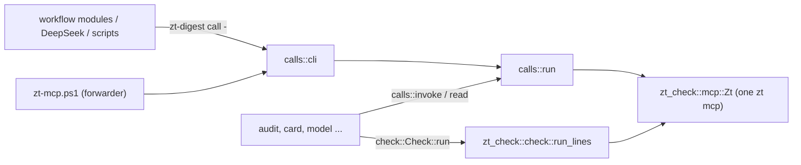

# zt-digest

## Purpose

`zt-digest` is the book digest's tool set as one Rust binary. It replaces the PowerShell scripts that the digest workflows run, tool by tool, with the same parameters and the same output, so that a step starts no pwsh, no helper process per call, and no checker process. One `zt-digest` process holds one `zt mcp` for all its reads and writes and runs [zt-check](zt-check.md) in-process (`tools/zt-digest/src/main.rs`). The first tool is `call`, the zt helper that DeepSeek runs and the scripts write through (`tools/zt-digest/src/calls.rs`). `audit` (the read-only digest audit) and `card` (the card layer cycle) replace `digest-audit.ps1` and `card-compiler.ps1` (`src/audit.rs`, `src/card.rs`), and the model tools `model`, `model-context`, and `list-models` replace `model-compiler.ps1`, `model-context.ps1`, and `list-models.ps1` (`src/model.rs` and `src/model/`). Stage 2 ported the rest: `hub`, `bridge`, `math`, `event`, `finding`, `terms`, `skeleton`, `organize-survey`, `organize-apply`, `figures`, `prepare`, `prepare-link`, and `snapshot-topics` (one module each, see the table below). Every digest script now only forwards to its tool, and the workflows and the job files run the tools directly. It exists as a crate of its own, like zt-check, so that it builds and installs without building zt or stopping the ZT service (`tools/zt-digest/Cargo.toml`, `scripts/install-zt-digest.ps1`).

**Owns:** the `zt-digest` command line and its tools, the PowerShell-style parameter parser, the helper semantics (`@@N`, the allow-list, the logs, the Topic gate, `append_card`, the output lines and the resume line), `Invoke-Zt` semantics in Rust (`calls::invoke`, `calls::read`), `Invoke-ZtCheck` semantics in Rust (`check::Check`), the `audit` and `card` tools (the ports of `digest-audit.ps1`, `card-compiler.ps1`, `relatedness.ps1`, and the audit's part of `book-of.ps1`), the model compiler, the model context pack, and the model list, and the stage 2 tools (hub, Bridge, math, event, finding, terms, skeleton, Organize, figures, Prepare, the link pass preparation, the Topic snapshot): their steps, state, job files, and output; the PowerShell and .NET semantics those tools keep (`src/ps.rs`); and the build and install of `zt-digest.exe`.

**Does not own:** the Card check itself and the `zt mcp` client (see [zt-check](zt-check.md)); the MCP tools it calls (see [MCP server](mcp-server.md)); the forwarding scripts, `book-of.ps1`, `relatedness.ps1`, and `zt-calls.ps1` (kept for PowerShell callers and tests), the job and state formats of the compilers, and the tests (see [Digest scripts](digest-scripts.md)); the commands the workflow modules run (see [Digest workflows](digest-workflows.md)); the helper instructions in the DeepSeek prompts (see [Digest prompts](digest-prompts.md)); the helper path `skills/zt/scripts/zt-mcp.ps1`, which forwards to `call`, and the `zt` skill text that tells agents to use the helper (see [Agent skills](agent-skills.md)).

## At a glance

| | |
|---|---|
| Entry points | `zt-digest <tool> [-Name value ...]` (`main` in `tools/zt-digest/src/main.rs`); `skills/zt/scripts/zt-mcp.ps1` (forwards to `zt-digest call`); every digest script in `scripts/book-digest/` (forwards to its tool, table under Concepts); `scripts/install-zt-digest.ps1` (build and install) |
| Key files | `tools/zt-digest/Cargo.toml` — a crate with its own `[workspace]`; depends on `zt-check` (path), `anyhow`, `regex`, `serde_json` with `preserve_order` |
| | `tools/zt-digest/src/main.rs` — the tool dispatch; prints `zt-digest <tool>: <error>` and exits 1 on an error |
| | `tools/zt-digest/src/args.rs` — `Args`: `-Name value`, `-Name:value`, switches, positional values |
| | `tools/zt-digest/src/calls.rs` — the helper (`run`, `cli`) and `invoke`/`read` for the other tools |
| | `tools/zt-digest/src/check.rs` — `Check`: Invoke-ZtCheck's parameters and defaults, run in-process |
| | `tools/zt-digest/src/util.rs` — UTF-8 files without a BOM, CRLF console lines, compact JSON, `print_last` |
| | `tools/zt-digest/src/zt.rs` — re-exports `zt_check::mcp::Zt` |
| | `tools/zt-digest/src/model.rs` — the model tools' entry points, `read_calls` (`Invoke-Zt` reads with the script's error text), and `Scripts` (the script paths job files name) |
| | `tools/zt-digest/src/model/compiler.rs` — `model`: state, plans (`test_plan`), the steps, job files, writes with `-Moves` |
| | `tools/zt-digest/src/model/text.rs` — Derivation sections, chain position lines, `set_section`, the setting's tables, the explanation and its core |
| | `tools/zt-digest/src/model/context.rs` — `model-context`; `build` also serves `model brief` and `model explain` |
| | `tools/zt-digest/src/model/list.rs` — `list-models` |
| | `tools/zt-digest/src/audit.rs` — `audit`: the global read-only report; Organize and skeleton call `run` in-process; Card cycles use their scoped quality reader in `card.rs` |
| | `tools/zt-digest/src/audit/book_of.rs` — Card categories and inferred book attribution (`Get-BookIndex` of `book-of.ps1`) |
| | `tools/zt-digest/src/audit/markdown.rs` — `audit.md` |
| | `tools/zt-digest/src/ps.rs` — PowerShell and .NET semantics, shared by every tool: truthiness, `[string]` (`s`, `field`), `[int]`, `-eq` and `-like` on text, `@(...)` and pipeline enumeration, `CiMap` (hashtable keys ignore case), UTF-16 lengths, `ConvertTo-Json` output, the `Sort-Object` introsort, culture string order, `[Random]::new(seed)`, `Join-Path`, `Split-Path`, `Get-Content` lines, local time |
| | `tools/zt-digest/src/card.rs` — `card`: `plan`, `apply`, `check`, `report`, `precheck` |
| | `tools/zt-digest/src/card/text.rs` — what a rewrite must keep, kind words, Link kinds (`Get-Keep`, `Test-Kinded`, `Get-LinkKinds`) |
| | `tools/zt-digest/src/card/relatedness.rs` — TF-IDF over character bigrams (`relatedness.ps1`); `pub(crate)`, also used by `bridge` and `prepare` |
| | `tools/zt-digest/src/hub.rs` — `hub`: survey, plan, precheck, apply, check, report (hub-compiler.ps1) |
| | `tools/zt-digest/src/bridge.rs` and `src/bridge/` — `bridge`: plan, precheck, report, apply; `answer.rs` (judge answers), `report.rs` (the immutable report), `apply.rs` (guarded apply) |
| | `tools/zt-digest/src/canon.rs` — shared SHA-256, canonical JSON, repeated-key refusal, bounds/order/time helpers; the unchanged Bridge helpers also serve identified compiler plans and receipt verification |
| | `tools/zt-digest/src/math.rs` and `src/math/text.rs` — `math`: the 13 steps of math-compiler.ps1; the statement index (`scan_index`, `check_value`), the notation table (`notation_table`), the group extension marker, `Set-Section`, the dependency map |
| | `tools/zt-digest/src/event.rs`, `src/finding.rs`, `src/event/layer.rs` — `event` and `finding`; `layer.rs` is the cycle both share (plan, precheck, apply, report, state.json, zt-check on the drafts, the `ZT_RACE_*` test seam) |
| | `tools/zt-digest/src/terms.rs`, `src/skeleton.rs` — `terms` (book-terms.ps1), `skeleton` (book-skeleton.ps1, the audit in-process) |
| | `tools/zt-digest/src/organize.rs` and `src/organize/` — `organize-survey` (`survey.rs`, the audit in-process), `organize-apply` (`apply.rs`, one move per call with `-Moves`), `common.rs` (shared by terms, skeleton, and Organize) |
| | `tools/zt-digest/src/figures.rs` — `figures` (attach-figures.ps1 with figures.ps1's functions, which `prepare` also uses) |
| | `tools/zt-digest/src/prepare.rs` — `prepare` (prepare-book-digest.ps1) and `prepare-link` (prepare-link-pass.ps1) |
| | `tools/zt-digest/src/ledger.rs` — prepared identity/schema, root registration, claims/faults/gates, optional target choices, frozen startup inputs, checked group completion, aggregate publication revisions, and the mathematics variant's per-unit obligation registration and completions |
| | `tools/zt-digest/src/snapshot.rs` — `snapshot-topics`; its Card lines also serve `prepare-link` |
| | `scripts/install-zt-digest.ps1` — `cargo build --release` into `D:\zt-digest-target`, then copies `zt-digest.exe` beside `zt.exe` |
| Depends on | [zt-check](zt-check.md) (library: `check::run_lines`, `mcp::Zt`, `reply_text`, `reply_error`); [MCP server](mcp-server.md) (`zt mcp`); [Service, CLI and storage](service-and-cli.md) (the service must be up) |
| Used by | [Digest scripts](digest-scripts.md) (every digest script forwards to its tool; `zt-calls.ps1` writes through the helper path); [Digest workflows](digest-workflows.md) (`zdTool` runs every script as its tool); [Digest prompts](digest-prompts.md) (DeepSeek runs the helper); [Agent skills](agent-skills.md) (`skills/zt/SKILL.md` names the helper) |
| Tests | `cargo test` in `tools/zt-digest` (`args`, `calls`, `ps`, `audit`, `card`, `model::text`, and the stage 2 tools' pure parts); every `scripts/book-digest/tests/*.tests.ps1` runs its tool through the forwarder (`run-all.ps1`); `tests/seam-zt-mcp.mjs` stands in for `zt mcp` in the Bridge fault and race tests |

## Concepts

- `Tool` — one subcommand of `zt-digest`, named after the script it replaces:

  | Tool | Script | Tool | Script |
  | --- | --- | --- | --- |
  | `call` | `zt-mcp.ps1` | `event` | `event-compiler.ps1` |
  | `audit` | `digest-audit.ps1` | `finding` | `finding-compiler.ps1` |
  | `card` | `card-compiler.ps1` | `terms` | `book-terms.ps1` |
  | `model` | `model-compiler.ps1` | `skeleton` | `book-skeleton.ps1` |
  | `model-context` | `model-context.ps1` | `organize-survey` | `organize-survey.ps1` |
  | `list-models` | `list-models.ps1` | `organize-apply` | `organize-apply.ps1` |
  | `hub` | `hub-compiler.ps1` | `figures` | `attach-figures.ps1` (and the removed `figures.ps1`) |
  | `bridge` | `bridge-compiler.ps1` | `prepare` | `prepare-book-digest.ps1` |
  | `math` | `math-compiler.ps1` | `prepare-link` | `prepare-link-pass.ps1` |
  | | | `snapshot-topics` | `snapshot-topics.ps1` |

  All 19 are ported. `book-of.ps1` and `relatedness.ps1` stay as PowerShell for old callers and their own tests; the tools use their Rust ports.
- `Forwarder` — a PowerShell script whose body is replaced by a call of its tool (`& $exe <tool> @args`), kept so that callers and tests that name the script still work. `ZT_DIGEST` names the binary to use; otherwise it is `zt-digest` on PATH. Most forwarders rebuild `$args` first: an array becomes a comma-separated value, and `-Name:value`, which `pwsh -File` and `&` hand over as two arguments, becomes one again. A forwarder whose tool reads instruction files (`card`, `math`, `bridge`, `event`, `finding`, `terms`, `skeleton`, `prepare`) sets `ZT_DIGEST_SCRIPTS` to its own folder.
- `Script paths` — job files name the scripts as the scripts named themselves: `HELPER:` the helper `skills\zt\scripts\zt-mcp.ps1` and the `dsh-*.zh.md` files in `scripts\book-digest`. `model::Scripts` takes them from the repository zt-digest was built from (`CARGO_MANIFEST_DIR`), or from `ZT_DIGEST_REPO`.
- `PowerShell semantics` — what the scripts' output depended on and the ported tools keep: case-insensitive string comparison and hashtable keys, `Sort-Object` order (an unstable introsort with the zh-CN culture's case-insensitive collation), `@($null)` as one item, `[int]` rounding half to even, and `ConvertTo-Json` formatting (`src/ps.rs`).
- `Call` — one `{ "tool", "arguments" }` object of a helper batch; `@@N` in a string argument is the address of call N.
- `Done` / `Failure` — what `calls::run` returns: the lines of the calls that succeeded, and the call that failed with its message and the addresses so far.

## Architecture



A tool parses its parameters with `Args`, opens one `Zt`, and passes it to every read, write, and check. The audit uses that same client for its fresh catalogue, bounded text batches, required model contexts and relationship reports. It starts no read-worker pool. `card::invoke_scoped_audit` reads the required group or book quality scope on its own `Zt`; its `precheck` starts no `Zt`, because zt-check `--json` reads no Card.

## Interfaces

### Prepared input contract for ledger binding

`prepare -Variant econ|math -Apply` adds `manifest.run_contract` schema 1. `prepare.rs::run_contract` records the actual persisted archive identity, exact original source-byte SHA/path/file id, Citation key, effective preparation options (including bibliographic input hash), embedded base/variant versions and artifact schema. Every selected group and section has its real file hash/locator; the sorted canonical group manifest has a SHA. The translated book, index, prefixes, figure map, event-candidate artifact and generated `setup-calls.json` are also hashed. Full source/Card bodies are not duplicated in this contract. Omitting `Variant` retains the legacy preparation response shape. Variant binding requires apply and valid UTF-8 input; hashes refer to the bytes actually decoded, including any BOM/CRLF. The source is checked again before contract publication. Older schema-1 contracts without `setup_calls` remain readable; they do not acquire invented historical receipts.

The command reuses its one MCP process for strict body-free identity probes and setup. Missing/partial identity refuses before archive setup writes, and an epoch change refuses binding. Base/variant versions come from the actual compiled blueprint sources; no installed frozen script is edited. Reliable preparation publishes its pending contract and immutable `prepare-plan.json`, initializes the ledger with all required roots/dependencies and a claimed `prepare/book@1`, then performs setup through native receipts. Workers remain waiting until verified setup completion. This establishes prepared input, not verified group completion.

The private `prepare.rs::write` delegates to the shared `util::write_atomic`: a same-directory `NamedTempFile`, complete UTF-8 write, file sync and atomic persist. Group startup uses that same evidence publisher. No in-place truncation or delete-then-write fallback is used. A locked destination can refuse publication on Windows; the error preserves the old complete file and retry can succeed after the reader closes. This is per-file atomicity; a complete manifest is published last and consumers must still validate its artifact hashes. See [Microsoft's file move/replace contract](https://learn.microsoft.com/en-us/windows/win32/fileio/moving-and-replacing-files).


### Prepared ledger initialization and inspection

`ledger.rs` owns one `<out>/ledger.sqlite3`, using the root crate's `rusqlite 0.32` and bundled SQLite. It has exactly `meta`, `units`, `deps`, `outputs` and `events`, the two specified scheduling indexes, foreign keys, WAL and a ten-second busy timeout. JSON columns carry typed details rather than new layer tables. Event update/delete triggers enforce append-only history. Schema, initial identity, all root units/dependencies, preparation evidence and the initial event commit in one short `BEGIN IMMEDIATE` transaction; filesystem reads, hashing and MCP calls finish before that transaction.

Existing ledgers pass `verify_schema` before initialization, inspection or mutation: both schema version markers, WAL mode, the exact five tables/required columns, the two scheduling indexes with their column order, the actual append-only trigger definitions, expected unit/dependency/output/event foreign keys and `foreign_key_check`. A damaged schema is an explicit error, never an implicit repair or a fresh run identity. Offline status uses the same check without archive access. `ledger-schema.tests.ps1` injects and restores actual schema faults through Node SQLite and verifies both public commands refuse; correcting the injected faults reopens the original retained run.

`zt-digest ledger init -Out <out>` validates schema and compiled workflow contracts, exact source/group/section/artifact hashes, manifest locators/group enumeration, the current persisted archive identity, agent Literature metadata and every anchor. It then creates the ledger or verifies its immutable binding. An existing run retains its random 128-bit run id; repeated init adds no rows/events and does not count as a resume invocation. A mismatch refuses before a ledger transition. Legacy folders without a schema-1 prepared contract need the separate adoption work, rather than invented history. Preparation refuses any output directory already containing a ledger **before** regenerating its frozen files.

Initialization registers every selected digest group, enabled Terms work and required fixed book publications. Only preparation is `done`: existing placeholder anchors never establish substantive digest coverage. Success and settled dependencies are distinct, and unsealed dynamic layers have explicit barrier metadata. Each fixed book publication registers revision 1 of a derived input manifest and seals its own layer's enumeration barrier; see [Aggregate publication revisions](#aggregate-publication-revisions). The default target is the full variant: economics includes Event/Finding layers even when `NoEventCandidates` disables legacy date extraction; mathematics declares its index/docs/skeleton/notation/theory/check obligations and excludes Events/Findings. `NoFigures` is an explicit figure exclusion. Declared optional choices are described below; live scheduler adapters remain under implementation.

`zt-digest ledger status -Out <out> [-Layer <layer>]` reads a consistent ledger transaction without starting MCP or needing the archive service. It returns durable unit inputs, hashes, states, attempts/tokens/lease/retry timestamps, progress/results/faults, dependencies and declared inclusions/exclusions. `archive_verification: "not_requested"` makes that inspection limit explicit; it does not claim a fresh archive verification. It reconciles the declared group and fixed book target against retained root units and input hashes, naming missing/changed units in `coverage_faults`. Its `publications` array selects the latest revision of every aggregate publication and names the earlier revisions it superseded, whether that revision still describes the present inputs (`current`) and the stored `counts.superseded`. A superseded revision is terminal history: it is excluded from `failed`/`open`, from `unresolved` and from `rerun-list`. These are stored work facts; domain adapters must still verify current outputs before completion.

Public initialization coverage is `ledger-core.tests.ps1` (real prepare/MCP/CLI, exact five tables/WAL, complete root registration, idempotence, mismatch refusal with byte-identical ledger-row evidence, protected inputs, identity changes during reads and offline read-only inspection) and `ledger-preparation.tests.ps1` (including automatic initialization). `ledger-prepare-recovery.tests.ps1` checks lost archive replies, immutable source/setup refusal, committed-prefix conflicts, missing prerequisite edges, before/after ledger-commit failures, exact frozen-file preservation, repeated completion, missing output registration and a differing BibTeX Citation key. Legacy setup remains outside this receipt contract.

### Receipt-backed preparation completion

`ledger done -Out <out> -Unit prepare/book@1 -Token <current-token> -Outputs <out>/prepare-plan.json` resumes the same retained setup. `Prepared::read_mode` checks every frozen input and the actual archive identity while permitting anchors not yet created. The same input-only validation lets the current preparation token use `ledger renew` or typed `fail` before its tail anchors exist. The completion verifier still requires the current unexpired claim and the per-unit OS guard; it never adopts a different input or resets a lost owner.

`setup_calls` accepts only the frozen agent Literature root followed by the exact Direct anchors. The root's native preview must allocate the declared Citation key, including when BibTeX names a different key. `setup_readback` reconciles committed receipts and their current authored fingerprints before any missing chunk is written. Every preview rolls back; it uses ordinary 64-item/1-MiB batches, stops at the first missing chunk during recovery and supports a complete setup longer than the separate 1024-item sequence-preview bound. Stable keys are `<run>/prepare-book/1/setup/item-NNNNNN`; attempts do not enter them. Actual commits use the existing identified batch client.

After writes, the verifier reads the actual root/anchors, metadata, archive identity/revision and receipt fingerprints, rechecks frozen inputs and publishes actual `manifest.created` lines plus `prepare-completion.json`. It commits file/Card/receipt output registrations, done state, event and readiness consequences in one short ledger transaction. A lost reply or failed ledger commit can leave archive writes and files, but retry recovers their receipts instead of duplicating the tree. Repeated done verifies registered evidence, files and current receipts without new archive writes. Offline coverage reconciles the complete initial root/dependency target and typed preparation output registration; it explicitly remains an offline view.

This path covers a retained initialized preparation and current token. Expired-owner reclamation, parent-death cancellation and complete invocation recovery remain #71/#87 work. Legitimate downstream edits need the separate checked lineage work before old setup receipts can be reverified as current. No live workflow acceptance is inferred.

### Claims, faults and durable gates

The available ledger surface is now `init`, `status`, `next`, `renew`, `done`, `fail`, `gate`, `rerun-list`, `publish`, `notes`, `relocate` and `math`, with separate `group-start` and `group-finish` commands below. Every command requires explicit `-Out`; it does not infer a staging directory from the working directory. Unknown/irrelevant arguments and missing/invalid values return 2, an operational/validation failure returns 1, and an ordinary successful command returns 0. `done` dispatches the deterministic preparation, digest/group, Terms, aggregate publication, note-suggestion and mathematics verifiers. Unsupported layer evidence and address-only objects fail; other compiler verifiers remain unfinished.

| Command | Current checked behavior |
| --- | --- |
| `ledger next -Out <out> -Layer <layer> -Take <1..64> -Owner <id>` | Revalidate the prepared filesystem/identity through one MCP process before any write transaction. Reconcile success/settled prerequisites, select ready units in stable logical-key/revision/id order and assign owner, increasing token, 120-second lease and attempt reservation under `BEGIN IMMEDIATE`. Return claimed ids, owner, token, input hash/inputs and the layer coverage fields. Empty claims never imply completion. |
| `ledger renew -Out <out> -Unit <id> -Token <n>` | Extend only the exact current, still-unexpired claimed token. Record a renewal event. A wrong, expired or already-settled claim fails with `stale_claim`. |
| `ledger fail -Out <out> -Unit <id> -Token <n> -Class retryable\|content\|operator -Fault <json>` | Require the current claim and a bounded fault document with matching `unit`, `input_hash`, known `code` and nonempty `cause`. Check the supplied class against the code's fixed mapping; caller prose cannot make a permission/content fault transient. Record fault, transition and readiness consequences in one transaction. |
| `ledger gate -Out <out> -Layer <layer>` | Report `sealed`, `settled`, `complete`, `excluded`, done/failed/blocked/open/superseded counts, exact unresolved ids, coverage faults, the latest publication revision of each logical key and what each superseded. Return 3 while the enumeration is unsealed, a required publication is absent, or work remains open; a settled partial target returns 0 with `complete:false`. Deliberate exclusions also remain distinct from successful work. |
| `ledger rerun-list -Out <out>` | Read-only unresolved units and prerequisite/downstream closure, with dependencies and stored fault/progress evidence. Done builds and superseded revisions stay excluded. Failed/blocked/retry/claimed roots are inspection inputs, not authorization to replace a still-running writer. |
| `ledger publish -Out <out> -Layer <layer> [-Key <key>] [-Scope <file>]` | Derive and register the next revision of one aggregate publication from its sorted input manifest; see [Aggregate publication revisions](#aggregate-publication-revisions). `-Key` defaults to `book`; `-Scope` is required by `hubs` and refused elsewhere. |
| `ledger notes -Out <out> -Suggestions <file>` | Register one `notes/<id>@1` unit per independent note suggestion, bound to the Card state the suggestion was made from. |
| `ledger relocate -Out <out> -Moves <file>` | Apply a recorded structural mapping to every published Card address; see [Recorded locators after a move](#recorded-locators-after-a-move). |
| `ledger math -Out <out>` | Register the mathematics variant's per-unit boundary and proof obligations from the compiler's retained plans; see [Mathematics variant obligations](#mathematics-variant-obligations). |

Readiness waiting never spends an attempt. A failed success prerequisite blocks dependants with exact prerequisite ids; a settled prerequisite can carry its failure to a partial aggregate. Fixed aggregate book work stays registered until its producers settle. Prepare/Terms/digest are sealed because their enumeration is complete, and an aggregate publication layer is sealed by the revision that enumerates it (see [Aggregate publication revisions](#aggregate-publication-revisions)); dynamic layers remain unsealed until their future checked producer adapters record closure. A layer whose required publication revision is absent is not settled even with no queued rows, so a deleted or never-registered publication is outstanding work rather than an empty queue. A zero-row Event queue cannot seal itself. Economics explicitly excludes mathematical-only work; mathematics explicitly excludes Event/Finding work.

Blocked fault lists are recomputed even when the state stays `blocked`. If another independent producer fails later, the dependent's facts and event record gain that exact prerequisite without spending an attempt. The independent ready queue remains runnable. The public claim fixture registers an additional isolated prerequisite to exercise this transition; it does not establish a verified domain completion from the injected rows.

Readiness also diagnoses pending dependency cycles in the same short ledger transaction before selecting claims. An iterative graph pass identifies all cyclic producers, including overlapping cycles; a path search within each component records a real closed path through each affected unit as `fault.cycle`, with code `dependency_cycle` and a readable cause. These producers fail with zero added attempts, ordinary success dependants become blocked, and independent ready units remain claimable. Done/failed/claimed units are outside this pending-cycle transition, so the scheduler does not fail a live writer. `ledger-dependencies.tests.ps1` verifies actual named dependency edges in every returned path on the graph A↔B and A→C→B, alongside a blocked dependant and an independent claim. Domain plan-to-part registration and missing-part diagnostics still belong to the model adapter work.

The current invocation allows three claim reservations, including the initial one. A retryable failure schedules attempt two after 5 seconds and attempt three after 20 seconds, adding 0 or 1 second of OS-random jitter. Backoff/dependency waiting does not add attempts. Tokens increase on every new claim; fault and claim events retain attempt facts. Automatic invocation resume/reset and reconciliation of a claim that never began execution remain under #71/#87.

Stable retryable codes are `lock_busy`, `sharing_violation`, `sqlite_busy`, `transport_closed`, `command_timeout`, `service_unavailable`, `provider_cap`, `provider_transient`, `missing_result`, `missing_jobs`, `pending_jobs`, `read_view_changed`, `lease_lost`. Operator codes are `access_refused`, `invalid_arguments`, `identity_mismatch`, `operation_conflict`, `owned_paragraph_conflict`, `unreconciled_move`. Content codes are `invalid_plan`, `dependency_cycle`, `source_unavailable`, `unsupported_claim`, `stale_content`, `check_failed`. Unknown codes or a class mismatch refuse without a transition. Internal dependency propagation records `dependency_failed` with the failed prerequisite ids.

`ledger-claims.tests.ps1` uses actual concurrent CLI processes, both variant targets, real 5/20-second delays and all three attempts. It checks stale renewal/failure tokens, final permission faults, partial gates, zero-attempt blocked groups, exclusion/empty-layer distinctions, SQL append-only/foreign-key enforcement and an injected missing publication. The unit guard now protects startup/failure transitions as described below. Complete compiler mutation integration, periodic heartbeats, safe lease reclamation and registered external-job cancellation/reconciliation remain required. This core does not reclaim an expired claim automatically.

The shared [MCP client](zt-check.md) now bounds stdin writes, initialization and replies to 240 seconds, with bounded graceful/forced child-tree shutdown and typed `TransportFault` cleanup facts. Its single I/O worker stays inside the compiler process. Windows contains trusted MCP descendants in a kill-on-close Job Object before their initial thread runs; killing the compiler closes that ownership as well. Independent ZT/Scholar Archive service launches preserve their own lifetime and inherit no capture pipes. `mcp-lifecycle.tests.ps1` verifies actual timeouts before/after archive commit, owned-writer exit before retry, exact accepted-key replay and one resulting archive revision. These are transport/lifetime proofs, not automatic ledger reclaim: command registration, periodic renewals, provider cancellation and guarded owner recovery still need their ledger-aware adapters.

### Frozen optional layer choices

`prepare -Variant econ|math -Apply -RunOptions <json>` accepts a flat object of optional boolean switches, using the existing workflow names. For example, `{"terms":false}` explicitly excludes the term-table layer. Effective values, including defaults, are retained under `manifest.run_contract.options.run_options` and participate in the immutable preparation hash. Subsequent commands use those values; the original options file can be changed or deleted without reconfiguring the run. A changed frozen manifest or inconsistent `meta.target` refuses recovery/inspection instead of hiding required work.

| Switch | Availability and effect |
| --- | --- |
| `terms` | Both variants; false omits the Terms unit and that success prerequisite on digest groups. It does not create a successful disabled unit. |
| `models` | Both variants; false excludes model compilation and its derived formal-explanation layer. Other source/quality/publication obligations remain declared. |
| `events`, `findings` | Economics; mathematics explicitly excludes these layers. |
| `hubs`, `figures`, `bridge` | Both variants; false excludes that optional tail layer. |
| `notation`, `boundary`, `proof`, `theory` | Mathematics; economics explicitly excludes these layers. |

Applicable switches default to true. `-NoFigures` fixes the effective `figures` choice to false and also controls preparation's figure extraction; explicitly requesting `figures:true` with that flag is a conflict. `figures:false` alone excludes the later figure layer. Required core work such as final audit, card quality and math-check is retained. Unknown keys, non-boolean values, duplicate JSON keys, a true choice unavailable to the variant and figure conflicts refuse **before** creating prepared files or archive setup.

Disabled fixed roots are omitted from registration and required-root reconciliation. They remain in `excluded_layers`; their gate is settled/excluded with `complete:false`. A schema-1 contract produced before this optional field existed retains its original full default target and run identity; the compatibility fixture reconstructs that published contract shape without the field. Status exposes frozen `run_options`, effective preparation options, variant, Citation key, source/identity locators, contracts and resume count so callers can inspect the retained setup. The later workflow adapter still needs to bind its manager/provider/batch/review settings alongside these layer choices.

### Frozen group startup

`zt-digest group-start -Out <out> -Group <positive integer> -Token <positive integer>` validates the prepared target and exact unexpired `digest/gNNN@1` claim, then takes its OS file lock under `<out>/locks/`. Lock-file presence is diagnostic; actual ownership comes from the held OS lock. Invalid/stale tokens are checked before lock acquisition and again after it. `ledger fail` takes the same guard before changing the unit state, so it cannot revoke a protected startup. Closing/killing the owning process releases the lock; a leftover empty file does not keep the unit busy.

For a new claim startup, the command renews the lease, reads the current anchor and obtains one fresh complete `export_titles` through its existing MCP client. The shared legacy snapshot renderer preserves ordering, marks human Cards read-only and creates the startup snapshot. Anchor/title/identity reads must agree on archive revision and identity; a changed view is retryable `read_view_changed`. A failed/missing snapshot cannot publish a usable job or establish coverage.

Files live under `<out>/group-jobs/gNNN/claim-<token>/`: `snapshot.md`, `shared-prefix.md`, `prompt.md`, `job.json`, an optional copied `terms.md`, and the expected future `draft.json` output. The source sections are reread and checked against their frozen byte hashes before prompt assembly. Prefix/snapshot/term/prompt/job evidence uses atomic publication and hashes the bytes actually produced, with a readback check. When Terms is enabled, startup requires the verified `outputs` entry `terms/book@1` / key `terms` / kind `file` and matching canonical `terms.md` bytes; a file alone is insufficient.

The static `unit_input_hash` binds the registered group. The new `input_hash` binds exact startup inputs: preparation/group identity, current anchor fingerprint, copied prefix, snapshot hash/revision, applicable term input, claim token and prompt/draft contract versions. `job.json` declares one `draft_only` job, an output file, and archive read/write permissions. The prompt contains selected source, current anchor context and the exact draft envelope; its `calls` remain proposals. The ledger stores only the accepted job locator/hash, token and input hash in progress plus a `group_started` event, committing them with a fresh lease after rechecking the claim. Card bodies and archive revision do not change.

Repeating the same accepted start validates its retained files/bindings and renews the same claim, returning `reused:true`; it does not replace the frozen prompt with a newer snapshot. Edited/missing accepted artifacts are explicit faults. A new token has a separate input directory. The response returns unit/token, both input hashes, job/prompt/snapshot/draft paths, snapshot revision and current `lease_until`. Startup leaves the unit `claimed`; it does not establish digest completion.

`ledger-group-start.tests.ps1` exercises snapshot failure despite an existing skeleton anchor, post-preparation context, one MCP/one export, nearly expired lease renewal, immutable replay, a real competing Windows byte-range lock, stale-token diagnosis, released-lock behavior and prompt tampering. Provider launch/permission enforcement belongs to the later workflow adapter; this command records the declared scope but launches no provider or workflow. The checked completion path is described below. Periodic compiler heartbeat and safe reclaim remain unfinished.

### Checked group completion

`zt-digest group-finish -Out <out> -Group <n> -Token <n> -Draft <file> [-CheckOnly]` consumes the one JSON output named by the frozen startup job. It checks the current unexpired claim before taking the same per-unit OS guard used by startup/failure, then checks it again. An already done unit can be verified again only with its retained token. Unknown/stale claims, changed prepared input, missing startup evidence or modified frozen job artifacts refuse completion.

The strict draft envelope has exactly `schema_version: 1`, `unit`, `token`, `input_hash`, `disposition` and `calls`. The binding must match the accepted startup; duplicate JSON keys, unexpected envelope/call fields, a different output path, a file outside the prepared directory or more than 16 MiB encoded JSON are refused. `calls` contain only `tool` and object `arguments`. An optional single-line `arguments.src` is retained as a source-log note and removed before native validation. It cannot substitute for the frozen selected source sections.

An edit may target the group's anchor or an exact earlier result. A group cannot edit the book root or another existing Card, create another Literature root, or use the Link-only owned-paragraph mode. New Literature Cards must be within this anchor's Side branch, including when an earlier anchor edit is named through `@@N`; the direct anchor line remains reserved for the frozen groups. Filing new Cards in agent Topic trees remains available through ordinary native validation. Topic creation holds the existing gate and uses its title normalization and 0.8 character-bigram Dice threshold. New/replayed roots are compared with current roots and other roots proposed in the same plan; a replay does not compete with itself.

For `disposition: cards`, the final draft must include the checked anchor and at least one additional nonblank substantive Card classified by the shared graph classifier. The anchor itself is excluded from that set even if its type is changed to Model. A Topic root, Terms/navigation Card or skeleton anchor alone cannot meet that condition. For `no_cards`, calls must be empty and every selected, hash-verified source section must contain only blank lines and ATX headings. The tool records the actual enumeration, zero body-line count and `source_has_no_body` reason. Any authored body line names its exact file/line and refuses that disposition. This conservative deterministic case does not accept an agent assertion that ordinary prose contains nothing useful.

`-CheckOnly` uses the complete native sequence preview, bounded at 1024 operations/8 MiB authored input and the normal 8 MiB encoded MCP reply. It simulates actual 64-item/1-MiB write chunk bindings, including partially committed receipts, and rolls back all changes. The client checks ordered identities, final Card count and authored fingerprints before running zt-check in-process over the actual draft bodies/classification/Link facts. R18/R19 corruption refuses the draft. Other reported hard faults remain explicit repair work. Advisory observations are retained separately: JSON checker mode counts them in its printed total, while persisted Card mode excludes them. The verifier validates the appropriate exact count for each mode instead of suppressing observations. CheckOnly returns explicit `check_only`, `applied: false`, owned/substantive sets and actual checker evidence. It creates no accepted plan, archive writes, output files or completion transition.

Normal completion repeats validation, renews the claim, and atomically publishes `accepted-gNNN.json` without replacing an existing plan. That plan contains immutable run/unit/input identity, plan revision 1, calls, source notes and any checked no-cards enumeration. Changed accepted calls are refused. Identified operation prefixes are `<run>/digest-gNNN/1/apply`; neither token nor attempt enters the receipt key. Actual writes retain the 64-item/1-MiB chunk limit. A lost chunk reply leaves archive receipts as the commit authority; a new process previews/replays the same accepted plan, recovers original addresses and writes only the unseen tail. Final authored readback must match the last receipt for each Card. Normal ownership and substantive locators are rebuilt from the committed receipt results, because a concurrent writer can reserve a previewed slot. Preview addresses are temporary. Completion never attributes that other writer's Card to this group, and done verification reconciles the exact owned set against current archive receipt addresses.

The command publishes the existing `owned-gNN.txt` and `src-gNN.txt` paths from verified addresses and immutable selected section locators. It checks persisted outputs through the complete existing Card/model checker, stores actual SELF-CHECK evidence in `self-check-gNNN.json`, and publishes `completion-gNNN.json`. Files use atomic replacement and byte-hash readback. The archive identity/revision must still agree at the final evidence check. The result distinguishes `verified`, `deferred` and source-backed `no_cards`; `done` here means the producer's checked handoff, not completion of the whole book.

One short ledger transaction records those file/Card/archive-receipt references, registers every derived child and dependency, appends registration/completion events, and changes the producer to done. No MCP or checker call runs inside that transaction. Enabled group children are `cards/gNNN@1`, `events/gNNN@1`, `findings/gNNN@1` and `link/gNNN@1`. A stable local `models/gNNN-mIIII@1` is emitted once per actual Model header, with parts mapped to their whole-model consumer. Link work needs the group and offline Card work; fixed book Card/Link checks gain settled prerequisites on their group children. Model-part quality faults go to a registered Model consumer; ordinary Card faults go to the registered offline Card consumer. Every deferred fault must name an emitted unit that can repair that Card category. A disabled Model layer cannot hand a Model fault to the general Card cycle; hard faults on Topic roots and other unwritable navigation categories are refused before applying a draft. Touched trees are retained in completion facts for downstream publication work.

The result retains exact child ids, input hashes and required dependency edges. Offline status/gates reconcile those against registered units and output-key sets, so a changed/missing child, dependency or required SELF-CHECK registration cannot silently preserve complete coverage. Repeating a completed group validates current authored Card fingerprints, every retained evidence file, actual archive receipts through a fully rolled-back preview, registered child contracts and the exact output set; it returns `reused: true` and creates no children or writes. `ledger done -Out ... -Unit digest/gNNN@1 -Token ... -Outputs <out>/completion-gNNN.json` invokes this same verifier/recovery path. Supplying arbitrary addresses, a different evidence locator or another layer is insufficient.

The two public group-finish suites inject failures after outputs, before/after children, before commit and after commit. Before-commit failures leave no partial ledger completion; archive receipts remain recoverable. After-commit reply loss returns the same verified completion on retry. They also cover complete multi-chunk drafts, a real lost first-chunk MCP reply, source-backed no-cards, advisory-count semantics, alias placement guards, Topic duplication, partial previews, Model consumers, changed evidence/child input and missing output registration. They use temporary archives with Terms explicitly disabled to isolate this slice and launch no provider/workflow.

This is still partial #70/#71 delivery. The default enabled Terms prerequisite has the claimed compiler path below, and reliable preparation initializes its ledger before receipt-backed setup. The shared MCP client now has bounded transport waits and owned-child cleanup. Other compiler completion adapters, downstream revision/producer sealing, periodic heartbeats, registered provider cancellation and safe claim reclamation remain unfinished. No default target is changed or disabled during recovery to conceal these obligations.

Preparation also recognizes `#`/`##` range headings without surrounding blank lines. It separates headings outside backtick/tilde fences before choosing the source range; code examples containing an end-heading line remain source text. The regression checks the actual selected units and excluded trailing prose. Existing initialized preparations keep their immutable source/range hashes; this parser fix applies to new preparations.

### Claimed Terms compilation

The existing compiler supports `terms -Step plan -Staging <out> -Token <claim>` followed by `terms -Step apply -Staging <out> -Token <claim> -Apply`. It uses the current `terms/book@1` claim in the same ledger/MCP process and holds the per-unit OS guard. An operation prefix is derived internally as `<run>/terms-book/1/apply`; supplying another prefix with a claim is refused. The legacy Terms CLI retains its existing parameters and output for staging folders without a prepared ledger/contract. A managed run refuses planning and unkeyed writes without `-Token`, including a partially initialized prepared contract. Claimed mode requires the full immutable preparation, source/identity checks and a real enabled Terms unit.

Planning freezes positive `MaxTerms` (default 60) and `MaxCandidates` (default 160), retaining explicit budgets beyond the defaults. They live in progress and the hashed job input, and cannot change on a repeat or a later attempt. Omitted values on later steps use the retained configuration. The prompt states the actual maximum. The existing compiler enumerates bold terms, definition sentences, bracketed original-language terms and frequent word groups over the selected section files. `candidate_count` sums those native candidate entries; categories can overlap. Zero means that every category is empty, rather than a claim that an agent supplied no useful output.

The original `terms/job.md` and `terms/dsh-terms-instructions.zh.md` locations remain available. A claim freezes the exact consumed prompt/instructions and `job.json` under `terms/claim-<token>/`. The answer stays at `terms/out/terms.json`. Each job declares draft-only archive permission, exact output path and expected job count. Its input hash binds run/unit/token, preparation and unit hashes, parameters, native plan-data hash and candidate counts. Repeating plan checks the actual files and recomputed source enumeration before returning `reused: true`; edited prompts, changed source/configuration and mismatched job counts refuse reuse.

When candidates exist, exactly one answer is required. Its envelope is `schema_version: 1`, `unit: terms/book@1`, current `token`, exact `input_hash`, `disposition: terms` and a nonempty `terms` array. Each row has `term`, `avoid` as a string array, nonempty `meaning`, and nonempty `section`. Answers have a 16 MiB encoded-input bound; native preview/apply still enforce the existing 1 MiB authored-write bound. Unknown fields, duplicate JSON keys, invalid UTF-8, unsafe table-line delimiters, duplicate terms, skipped rows and more rows than the frozen maximum are refused. A selected canonical term cannot appear in another selected term's avoid list, so the generated R6 context cannot prohibit a term that it also endorses. The original safe normalization of redundant avoid words still serves rendering.

An empty object, missing answer or an agent's `no_terms` assertion with positive source candidates is not a completion. For a verified zero-candidate plan, the compiler returns `expected_jobs: 0`, `jobs: []` and an explicit `no_terms_candidates` no-op reason with enumeration hash/counts. Apply rechecks that enumeration, expects no agent answer, publishes a checked zero-row `terms.md` context and records `no_terms` without creating a Card or archive receipt. Both economics and mathematics keep Terms enabled in this path; it is distinct from a deliberately disabled target.

For a nonempty table, the existing renderer and term-call builder supply one native identified create. An existing unreceipted Terms Card requires legacy adoption instead of an automatic overwrite. A retained call must exactly match the expected table and Side-successor placement before native preview; its file cannot redirect a create into a Topic root or an unrelated Card. Current readback also checks the Literature tree, regular Idea type, Side edge and actual parent. The compiler previews actual native validation, runs zt-check in-process, persists an immutable accepted plan before the write, applies through archive receipts and verifies current authored readback and the persisted checker. The accepted plan is `terms/accepted-ledger.json`; it retains the exact normalized input/calls and stable unit identity, with no token/attempt component in operation keys. A process that loses the committed MCP reply reuses that accepted create and recovers its original address.

Completion publishes `terms.md`, `terms/self-check.json` and `terms/completion.json` atomically, with verified plan, answer and accepted-file records. Actual Card and archive-receipt references join those files in one short ledger transaction with the done state and completion event. No checker or MCP runs inside the transaction. Before-commit faults roll back all ledger output/state/event changes together; dependent groups remain waiting. After-commit reply loss reuses the checked completion. The existing group-start verifier requires the real registered `terms` file/hash and copies it into the frozen group job.

`ledger done -Out <out> -Unit terms/book@1 -Token <n> -Outputs <out>/terms/completion.json` runs the same deterministic verifier/recovery function. It accepts no arbitrary address shortcut. Completed repeats validate the current claim/startup binding, exact required output-key set, evidence byte hashes, current Card fingerprint and actual retained native receipt. A read-only full preview must replay every named receipt; matching Card text cannot substitute for a missing archive receipt, and a simulated replacement create is always rolled back. Offline Terms gates also reconcile required output registrations instead of trusting the done state alone.

Reliable JSON artifacts use a bounded 16 MiB read and are parsed and hashed from one byte buffer, with strict UTF-8 and the shared duplicate-key parser. Frozen job checks compare that parsed buffer's hash with the recorded artifact. Accepted plans hash the actual bytes written/read. Group drafts and Terms answers are rechecked after preview and again before completion. A late file replacement therefore cannot acquire the hash of a different, already-checked input. The public MCP seam replaces an isolated draft after preview to exercise that race; it permits replacements only under the temporary fixture directory. It also injects a real independent Side-successor reservation between preview and apply to verify that ownership follows receipts instead of predicted allocation.

`ledger-terms.tests.ps1` verifies default enabled Terms dependencies, frozen planning/configuration, edited artifacts, strict/nonempty rows, cross-term avoid conflicts, duplicate keys/UTF-8 errors, positive-candidate no-op refusal, actual lost-write-reply recovery, atomic before/after-commit failures, typed recovery, current receipt authority and required-output reconciliation. It checks that an economics group starts with the actual verified context and that a mathematics zero-candidate result releases a normally enabled prerequisite. These are temporary archives and deterministic answer stand-ins, with no provider or actual digest workflow run.

The Card cycle's default rule set includes R18/R19, so exact prose/title corruption becomes ordinary repair work. Explicit caller rule selections retain their meaning. Link paragraph draft checks also retain R18/R19 and use the verified draft Card's actual title for R19; unrelated existing prose remains outside that paragraph language check. The archive's leading-title guard still revalidates real writes, including identified creates/edits.


### Aggregate publication revisions

A completed producer can make downstream work stale. `ledger publish` registers one **immutable revision** per logical publication key instead of reopening completed work or leaving a stale report in place. The layers are `cards-book`, `link-check`, `organize`, `skeleton`, `figures`, `bridge`, `audit` and `hubs`; every one of them is derived from the same sorted input manifest, so an ordinary content unit keeps revision 1 while an aggregate gains the next revision when its inputs change.

The manifest is the revision's identity, and `input_hash` is `canon::hash_value` of it. It records `schema_version`, the publication contract version, `layer`, `logical_key`, the preparation hash, the declared `scope` (null except for a hub refresh), and two sorted arrays:

| Manifest field | Content |
| --- | --- |
| `contributions` | Every contributing producer that is `done`, with its state and one order-independent fingerprint of its registered `outputs` rows. |
| `dispositions` | Every other relevant producer, with a stable disposition (`pending` or `unresolved`) and its fault code. Scheduling states — `registered`, `ready`, `claimed`, `retry` — are one `pending` disposition, so a queue transition alone never creates a revision while a real status change always does. |

The producer layers are fixed by layer, and every publication also reads the Model candidates its groups registered, so a repaired or newly built model changes the input set of every downstream revision. `organize`, `skeleton`, `figures`, `bridge`, `audit` and `hubs` read the `digest` groups and the `models` candidates; `cards-book` adds the `cards` children, `link-check` adds the `link` children, and `organize` also reads the registered `notes` suggestions it must dispose. A group that later emits nothing, and a model candidate that appears after a repair, therefore still change the manifest. A revision's dependencies are its own manifest: each contribution is a `success` prerequisite and each disposition a `settled` one, which is what lets an honest partial publication run when a producer has genuinely failed.

`ledger publish -Out <out> -Layer <layer> [-Key <key>]` therefore has three outcomes. The same manifest as an existing revision returns that revision with `reused: true` and writes nothing at all. A changed manifest registers `{layer}/{key}@<next revision>` and makes every older revision of that key that is not yet done terminal: `failed` with fault code `superseded`, naming its replacement. A done revision is never reopened or rewritten. Registering a revision also seals that layer's enumeration barrier, so the revision leaves `registered` as soon as its producers settle — and `ledger next` never hands out a stale revision, because a superseded one is `failed` and `reconcile` re-derives nothing on its own.

`-Key` is a readable logical key (`book` by default, a Topic tree id for `hubs`) of at most 200 bytes from `A-Za-z0-9._-`. A layer the prepared run deliberately excluded cannot publish a revision at all.

**Hub refreshes** are coalesced by touched tree rather than by book. `publish -Layer hubs -Key <tree>` requires `-Scope <file>` holding exactly `tree`, `upper` and `register`; `tree` must equal `-Key`, `upper` is at most 64 nonempty addresses and `register` is an address or null. The manifest keeps only the producers whose retained completion facts name that tree as touched; a producer that has not run yet has no recorded tree, so it stays a required disposition. The scope is part of the manifest, so declaring a different set of upper hubs derives a new revision. The hub compiler's own report verifies the hub structure and membership policy; the ledger records and hash-binds the declared scope.

### Checked publication completion

`ledger done -Out <out> -Unit <layer>/<key>@<revision> -Token <n> -Outputs <out>/publication-<layer>-<key>-<revision>.json` completes a claimed revision only when its evidence accounts for the whole manifest it was registered with:

- `consumed` must name a subset of the manifest's contributions with **exactly** the fingerprints recorded there, so a publication cannot claim a different verified output.
- `unresolved` must name a subset of the manifest's dispositions, the two sets must be disjoint and together they must cover every manifest entry.
- `disposition` follows from that accounting: `no_work` for an empty manifest, `published` when nothing is unresolved, `partial` otherwise. Claiming `published` while anything is unresolved is refused.
- `artifacts` must name exactly the layer's compiler artifacts — `decisions` and `applied` for `organize`; `skeleton` for `skeleton`; `report` for `figures`, `bridge`, `hubs`, `audit`, `cards-book` and `link-check`. Each path is canonicalized, read and hash-bound by the ledger, so a changed file is visible.
- `coverage` is the layer's checked coverage set, where that layer has one.

The completion publishes `publication-completion-<layer>-<key>-<revision>.json`, registers the artifact and `coverage/…` outputs, sets `done` and appends a completion event in one short transaction. Repeating it with the same token validates the stored evidence and returns `reused: true`; a fault injected after the outputs are written rolls the outputs, the done state and the event back together.

**Checked coverage** is where domain rules reach the ledger. `organize` must dispose every registered `notes` suggestion exactly once, and the disclosed outcome must equal the suggestion's own retained outcome, so Organize cannot restate a refusal as an application. `skeleton` must classify every prepared anchor exactly once: `indexed` requires that anchor's producer to be a done contribution whose retained disposition is not `no_cards`, `gap` requires a completed producer without substantive Cards and a reason, and `unresolved` requires a producer that has not completed and a reason. Fabricated coverage for an anchor whose group never produced Cards is refused. `figures` must classify every reference in the prepared figure map exactly once; a `shown` reference must carry the prepared path and `sha256` unchanged, and `unmatched`/`unresolved` need a reason. `bridge` must bind one immutable discovery report: its `schema`, `citation_key` and `report_id` are checked, the id must recompute as `r-<Content-Hash>` over the report without `report_id`/`created_at`, every proposal id must be one unique `bNNN`, and every proposal must reach `accepted`, `open` or `refused` exactly once — an open proposal is a review decision, never a missing digest write.

`ledger notes -Out <out> -Suggestions <file>` registers one `notes/<id>@1` unit per independent suggestion. The file is an array of `{id, card, note}`; `id` is a readable key of at most 64 bytes, `note` must name the `[[target]]` Link it proposes, and one bounded read records the Card's authored fingerprint at registration. The same key with the same content reuses its unit; rebinding a key to different content is refused. Completion reads the actual Card and accepts exactly one outcome: `applied` (the proposed Link is authored now **and** the Card changed), `already_present` (authored now and unchanged since registration) or `refused` (with the source or relationship reason). A claimed `applied` that changed nothing, or an `already_present` whose Card moved on, is refused rather than accepted as prose.

### Recorded locators after a move

A publication records the Card addresses it produced as `outputs` rows of kind `card`. A later structural move renames those addresses, so `ledger relocate -Out <out> -Moves <file>` reconciles them against a recorded mapping. The file is either one JSON object of old-to-new addresses or the helper's `-Moves` log of `{"i":N,"moved":{…}}` records; chained moves compose, so an address that moved twice ends at its final place.

Every named destination must still exist in the archive, and any published address the archive no longer has must be explained by the mapping. Otherwise the command refuses with `unreconciled_move` naming the exact addresses: a silently stale locator is never accepted. Applied moves rewrite the recorded `card/…` key and locator, append a `relocated` event and report the affected units; reapplying the same mapping changes nothing.

### Mathematics variant obligations

The mathematics variant keeps the `math` tool's existing steps and gives them the same ledger rather than a second scheduler (`ledger.rs`, `math.rs`). Initialization registers its fixed book obligations in the variant's declared stage order: `math-index`, `math-docs`, `math-skeleton`, `notation`, then `theory` (which also waits for `link-check/book@1`) and `math-check` (which waits for `audit/book@1`). Each of those barriers is sealed at initialization, so a layer waits for the checked result before it, never for an enumeration that never comes. `ledger math -Out <out>` reads the compiler's retained `math/boundary/plan.json` and `math/proof/plan.json` and registers one `boundary/<address>@1` or `proof/<address>@1` unit per planned mathematical unit, binding the exact plan entry it was enumerated from. The same plan reuses its units, and rebinding one key to different work is refused. A unit depends on `math-skeleton/book@1` and, when the notation layer is enabled, on `notation/book@1`, so notation is applied and available before the proof work that requires it.

A prepared mathematics run declares `run_contract.group_extension`: the skeleton appends its own unit list to each group file, and `Prepared::read_mode` verifies the prepared prefix byte for byte against the recorded length and hash while permitting only an append that opens with that declared marker. Every other prepared byte stays exact.

Each layer completes through its own deterministic verifier instead of a caller-supplied address list:

| Unit | Checked completion |
| --- | --- |
| `math-index/book@1` | Re-index the prepared section files and require the retained `math/index.json` to account for exactly those statements, forms and examples/exercises. A missing or changed section fails. |
| `math-docs/book@1` | Re-derive each of the five math prompt files from the frozen shared instruction file and its math supplement with this run's key, title, staging and index, and require the retained files to be those bytes. |
| `math-skeleton/book@1` | Require the retained `math/units.json` to account for every indexed statement exactly once, every addressed unit and Theory Card to exist in this book's agent Literature tree, and each prepared group file to carry the unit list of its own units. The result states `disposition: allocated`; allocation is not a built unit, and a `待写` statement stays open. |
| `notation/book@1` | Re-derive the notation table from the retained answer and unit list and require the Card this run wrote to be exactly that title and body. The result records the symbol count and `available`. |
| `boundary/<address>@1` | Every candidate the plan created keeps its own disposition. A supplied candidate needs its independent review; a rejected one must be gone through the archive's confirmed two-step deletion, with the confirmation token, what was removed and its reason recorded; the part that named it goes with it. A recorded mapping from the archive's own deletion replies resolves an address that a neighbouring deletion renumbered, and a kept candidate must still be the same Card at its resolved address. A batch count is never the record. |
| `proof/<address>@1` | The reviewed steps must be the unit model's current main-line premise/proof/conclusion steps, one verdict each. An accepted fix must be the body the archive now holds and keep every Link the step had; an untouched step must still be the fingerprint the review read. A refused correction keeps the unit open and is reported as a named obligation. |
| `math-check/book@1` | Re-run the M1–M18 report against the archive and require it to equal the retained `math-audit.json`, then record the `audit` revision it describes. The retained evidence is not rewritten by a refusal. |

Public coverage is `ledger-math.tests.ps1`: a real `prepare -Variant math -Apply`, the real `math` steps and `ledger` commands on the same staging folder, and the named regression scenarios for allocation-versus-building, the notation gate, unreviewed and rejected boundary candidates, a hidden deletion, unreviewed and refused proof steps, a stale final audit, and the resume facts — a done Model unit stays out of the resume list and unchanged while its boundary and proof obligations drain.


The audit's `book_of::book_index` and the Card cycle use `zt_check::graph` for classification and orphan predicates. Both reports contain `orphan_check` with actual sorted sets, declared targets/exclusions, both source Workspaces, the checked revision and separate Idea-kinded inbound counts. Full graph Links come from authored Link metadata; self-Links cannot rescue a target. Human authored sources count for ordinary and kinded inbound evidence. External Idea carriers needed for stronger rules remain required reads; unreadable inputs stop completion.

`audit -CitationKey <key> -OrphanTargets <file>` accepts one explicit address per line to match a Card cycle's declared target scope, including owned Topic work that lacks source attribution. This option changes only orphan coverage. Ordinary audit quality/Bridge scope retains its existing book attribution. Missing targets, human repair targets and another Literature tree are refused. Without this option, the audit retains its default selected agent book scope. The report's `changes_since: command_start` and empty `changed_cards` describe its read-only, stable-revision invocation.

The Card cycle reports `changes_since: before` after planning and compares current authored fingerprints against `before/audit-cards.json`; generated Reverse-only changes do not appear. Added/deleted/edited scoped targets are named. A group check without relationship coverage explicitly marks orphan checking `not_run` with incomplete coverage rather than zero. Public plan/check/report orphan counts use the shared set, including substantive models/parts. The historical `orphans-*` job family can still carry ordinary-orphan or stronger incoming-Link repair work; its queue size is separately named `inbound_repair_cards`. That queue's size is not an orphan definition. All actual workflow adaptation remains under the later slices.


### Link drafts through the identified helper

`call -OperationPrefix ... -Allow <manifest>` checks the complete accepted list before any write. It refuses Topic/Literature creation and requires every target to be either a manifest address or an exact earlier `@@N` result. A guessed suffix such as `@@0/1` does not grant access. Allowed successor creation can provide later accepted results without guessing their allocated addresses. The batch and helper both count nested `owned_paragraph.text` bytes when splitting inputs.

`call <draft.json> -OperationPrefix <run/unit/revision/step> -Allow <manifest> -CheckOnly` validates 1–64 owned paragraph edits within one 1 MiB batch through the archive preview. It requires complete results, matching final authored fingerprints, every proposed paragraph and Link/kind fact, and a stable revision. It then runs the existing checker in-process over temporary paragraph entries and retains the Link SELF-CHECK rules `L1,L2,R2,R3,R4,R5,R7,R9,R18,R19`. Independent existing prose is outside this paragraph language check. Missing input never reports `faults: 0`. Output states `preview: not_applied revision=N` followed by the actual selected faults/count; the exit code is nonzero for faults or incomplete validation. Without `OperationPrefix`, `CheckOnly` refuses before the legacy writer starts.

Normal identified apply repeats transaction/base/Link validation and rereads persisted fingerprints. A successful precheck is no promise that a later base still matches. Check each bounded Link draft separately; this path does not yet provide ledger-backed completion of every owned Card/disposition in a Link unit. Other compiler draft modes remain their own responsibility. No additional Link service or binary is involved.


`snapshot-topics` calls one fresh `export_titles` per invocation, retaining the existing Workspace headers, type/facet marks and UTF-16 title truncation. `snapshot::read_title_trees` validates completeness/count/revision and adapts those rows to the existing renderer without sharing results between groups. The adapter restores the former binary tree/address input order, including multi-digit Topic ids, before the existing culture-sensitive rendering and candidate-ranking sorts. The API retains numeric ZET order.

`prepare-link` uses that title catalogue and `Zt::cards(..., "text")` in the same MCP process. It compares revisions, preserves ownership and existing-link exclusion, and uses the old ranking inputs: full bodies for non-root agent candidates, compact excerpts for human Cards and Topic roots. Its global candidate-ranking corpus still requires one bulk text pass over the catalogue; it does not read each tree or calculate a model per Card. Limit errors reduce chunks, and missing required input stops the command. Group/whole-book audit and checker migration is still in progress under #67.

`call <file|-> -OperationPrefix <run/unit/positive-plan-revision/step>` is the identified write transport. It accepts an immutable, dependency-ordered list of the four `apply_batch` write tools, validates supported calls/earlier references/single-item size before writing, then sends deterministic chunks of at most 64 items and 1 MiB of authored input. Stable item keys use the original accepted-list index. Cross-chunk references resolve through recovered receipt addresses; within-chunk references remain local. It holds one MCP process per command and creates no placeholders for forward references.

Every receipt is historical evidence. Before the identified command reports success, it bulk-rereads the final output per address and compares the authored fingerprint, including type/model/math/BibTeX metadata and excluding generated Reverse links. It also verifies a common archive revision. An independent edit or missing output fails verification without overwriting that Card. A failed chunk leaves earlier committed chunks recoverable; repeat the same accepted input and prefix from the beginning. Only each chunk is atomic. Successful output retains the existing `N ok <address>` lines; failures cannot be resumed with the legacy `-From/-Addresses` pair. This mode explicitly refuses legacy log/move/Topic-gate option combinations rather than silently bypassing their guards. Manual calls retain their existing transport.

`terms -Step apply -Apply -OperationPrefix ...` is the first compiler adoption. It atomically retains an immutable `terms/accepted-<prefix-hash>.json` operation plan with `tempfile::persist_noclobber` before calling the archive. A retry reuses that plan, preserving whether the accepted operation was a create or guarded edit. Changed rendered input under the same prefix is refused; a newly accepted revision gets another retained plan. The file records accepted input, not commit authority: only the archive receipt establishes a commit. The compiler uses the same output reread/fingerprint verification and returns receipt keys with its normal result. Model-compiler adoption, ledger/fencing and manager-process qualification remain unfinished under the implementation plan.

Every identified edit has an authored base: a direct edit provides `base_fingerprint` or `base_receipt`; an edit at an earlier `@@N` result automatically receives that operation's receipt as its base. Raw single-edit bases are refused in identified mode. `calls::authored_fingerprint` reconstructs the archive's standard-JSON projection from a complete lean read, distinct from the legacy PowerShell JSON renderer. The terms compiler retains that fingerprint in an accepted edit plan. An unrelated incoming Link may change generated Reverse text between read and apply without causing a false conflict; authored title/body/type/model/math/BibTeX changes remain conflicts.

Ownership inference retains the former structure/index guard: an unlogged Card with at least eight distinct outbound targets belongs to the coordinator, rather than being inferred into a digest group. It reads the lean `outbound_count`, including Broken targets and excluding repeated/fenced occurrences, instead of relying on the removed full-view `outbound` array. A missing required count fails as incomplete input. Explicit owned logs keep their existing precedence.

Normal `card` group cycles (`-Groups` with `-NoOrphans`, without requested book-context rules) read their exact owned manifests/anchors and the required book term table through bounded text batches. Parent context uses fresh catalogue titles. Whole-book cycles, and group cycles requesting book-context checks, read the book plus declared owned Topic Cards and Topic Cards already attributed to the book. One indexed Link list supplies membership/incoming addresses; only necessary external Idea/Finding carriers need authored bodies for kinded inbound checks. Known navigation anchors need no extra body read. No Card cycle invokes the global hub/Bridge report.

The existing `book_index` and offline checker retain category and quality semantics. Explicit ownership keeps an unsourced Topic Card in the checked book scope, where it can receive source/term faults. Human ownership and another Literature tree are refused. An unreadable declared staging folder, missing owned manifest, missing required body or changed revision stops planning. Required external carriers/parents have category `context`, so they cannot become writable work or orphan candidates.

The retained 10,895-Card release comparison in `docs/digest-bulk-command-benchmark.json` verifies exact snapshot, Card-plan state/fault and all 343 link-preparation file projections. Candidate medians are 0.592 s for snapshot, 2.4–2.7 s for the Card steps and 7.963 s for prepare-link, using one MCP process per command. These are local command measurements on preserved archive copies, not workflow throughput. These retained timings precede the shared orphan semantics described above; its actual scope/revision evidence is qualified separately.

`before`/`after` artifacts label the group/book scope, checked addresses and revision, with archive-global checks `not_run` and book relationship checks labelled separately. The public global `audit` remains the independent report. Fixture language/Link and orphan/Event quality faults match that report for the same attributed Cards; explicit owned Cards with missing attribution are also checked. The retained command comparison and the shared-set tests qualify separate performance and consistency gates under #67. Host execution incidents are recorded in `docs/windows-defender-build-investigation.md` and the delivery status.

### Command line

```text
zt-digest call <file|-> [-From N -Addresses a0,a1,...] [-Log f] [-Allow f] [-Moves f] [-SrcLog f] [-TopicGate f] [-TopicSimilarity 0.8]
zt-digest call -Tool <tool> [-Json '{...}']
zt-digest call <file|-> -OperationPrefix <run/unit/plan-revision/step>
zt-digest audit [-CitationKey <key>] -Out <folder> [-MaxSentences 12] [-MaxChars 400] [-MaxSteps 6] [-Throttle N] [-Chunk N] [-Sample 15] [-SkipModels]
zt-digest card -Step plan|apply|check|report|precheck -Work <folder> [-Book <key>] [-Staging <folder>] [-Groups "1,2"] [-PerJob 8] [-Sample 0] [-Seed 1] [-Rules R2,...] [-MaxCards 0] [-NoOrphans] [-Notes <file>] [-Compact] [-MaxJobs 0] [-Job <id>] [-File <json>]
zt-digest model -Step <step> -Work <folder> [-Staging <folder>] [...]
zt-digest model-context -Staging <folder> -Model <address> -Out <file>
zt-digest list-models -Staging <folder> (-Groups 1,2,3 | -All [-CitationKey <key>])
zt-digest hub -Step survey|plan|apply|check|report|precheck -Work <folder> [-File f] [-Limits json] [-Trees a,b] [-PerJob 0] [-Rebuild]
zt-digest bridge -Step plan|precheck|report|apply -Staging <folder> -CitationKey <key> [-Work <folder>] [-Profile book|math] [-MaxSources 60] [-Candidates 5] [-Books a,b] [-Job br-NNN] [-ReportId r-…] [-Accept ids|all] [-AcceptEarlier ids|all] [-Apply]
zt-digest math -Step <step> -Staging <folder> [-Out <folder>] [-UnitsPerJob 4] [-Supply examples] [-MainResults 7] [-CoreBudget 3] [-MaxSymbols 80] [-Apply]
zt-digest ledger init|status|gate|next|renew|done|fail|rerun-list|publish|notes|relocate|math -Out <folder> [-Layer <layer>] [-Key <key>] [-Scope <file>] [-Suggestions <file>] [-Moves <file>] [-Take 1..64 -Owner <id>] [-Unit <id> -Token <n> -Outputs <file>] [-Class retryable|content|operator -Fault <file>]
zt-digest group-start -Out <folder> -Group <n> -Token <n>
zt-digest group-finish -Out <folder> -Group <n> -Token <n> -Draft <file> [-CheckOnly]
zt-digest event -Step plan|precheck|apply|report -Staging <folder> [-Work <folder>] [-Job <id>] [-GroupsPerJob 3] [-Apply]
zt-digest finding -Step plan|precheck|apply|report -Staging <folder> [-Work <folder>] [-Job <id>] [-GroupsPerJob 3] [-MaxCandidates 16] [-Apply]
zt-digest terms -Step plan|apply -Staging <folder> [-MaxTerms 60] [-MaxCandidates 160] [-Apply] [-OperationPrefix <run/unit/plan-revision/step>]
zt-digest skeleton -Step plan|apply -Staging <folder> -Work <folder> [-Audit <audit.json>] [-Thesis <text>] [-Decisions <file>] [-Apply]
zt-digest organize-survey -Staging <folder> -Work <folder> [-Notes <file>] [-Similar 0.5] [-CrossLinks 4] [-Small 3]
zt-digest organize-apply -Work <folder> [-DryRun]
zt-digest figures -CitationKey <key> [-FileId 0] [-Staging <folder>] [-Source <md>] [-MinFigureBytes 3000] [-Report <file>] [-Batch 40] [-FiguresFile <json>] [-NoDocuments] [-Apply]
zt-digest prepare -Source <md> -Out <folder> -CitationKey <key> -BibTeX <bibtex> [-BookTitle ''] [-StartHeading 导论] [-EndHeading 参考] [-SkipHeadings ''] [-MaxChars 20000] [-MaxUnits 3] [-MinUnitChars 1000] [-FileId 0] [-MinFigureBytes 3000] [-MaxEventCandidates 12] [-Instructions dsh-instructions.zh.md] [-NoEventCandidates] [-NoFigures] [-Apply]
zt-digest prepare-link -Staging <folder> [-TitleChars 40]
zt-digest snapshot-topics -Out <file> [-TitleChars 40]
zt-digest version
```

Parameter names ignore case. `-Name:value` works. A switch is `-Name` alone (or `-Name:$false`). An unknown name fails, as in PowerShell. A value that does not follow a name is positional: the file of `call`; for the other tools it binds to the next parameter, in the script's `param(...)` order, that was not named, as in PowerShell (`util::bind_positional`), and a value left over fails.

### `call`

Input: a UTF-8 JSON file, or `-` for stdin, holding one call or an array of calls (a BOM is ignored). Output, one line per call in order: `N ok <address>` for a create, edit, append, move, insert, or delete call that returned an address; `N <compact JSON>` for any other call (the reply text as is when it is not JSON). On the first failure: `N error <message>` (white space around line breaks collapsed), then `resume: -From N -Addresses a0,a1,...`, and exit code 1.

| Option | Effect |
|---|---|
| `-From N -Addresses a0,...` | skip the calls before N; their addresses still resolve `@@` |
| `-Log f` | append the address of every Card a `create*` call makes |
| `-Allow f` | only these Cards (one per line) and Cards made in this run may be the `at` of `edit_card`, `append_card`, `create_successor`; `create_topic`, `move_card`, `insert_card`, `delete_card`, `create_literature`, `edit_literature_metadata` fail |
| `-Moves f` | append `{"i":N,"moved":{...}}` per call whose answer has a non-empty `moved` map |
| `-SrcLog f` | append `<address>\t<src>` per Card made from a call with `src`; `src` never reaches zt |
| `-TopicGate f` | lock `f` (no sharing; wait up to 120 s) around `create_topic`; refuse a title equal to or similar to (character-bigram Dice ≥ `-TopicSimilarity`) an agent Topic, naming it: ``topic exists: `<root>` <title>. File the Card under that Topic instead of creating one.`` |

`append_card { at, text }` reads the Card and sends `edit_card { at, body: <body without trailing space> + "\n\n" + <text trimmed> }`.

### `audit`

The port of `digest-audit.ps1`; [Digest scripts](digest-scripts.md) describes what it reports. It makes only read calls: one fresh title export, bounded lean Card batches, `get_model` for required scoped models unless `-SkipModels`, `list_hubs` and `list_broken_links`. Its archive-wide category, attribution, Bridge and orphan report requires the complete graph; the indexed lean facts supply outgoing relations and complete inbound counts. Bodies are reused from that read, without a second per-Card pass. Model contexts are read only for the selected report scope.

Missing required input or a revision change is an explicit error, so it cannot produce a successful zero-fault report. A completed report records `complete: true` and `archive_revision`, after checking that the graph, model and relationship inputs share the revision. `-Throttle` and `-Chunk` remain accepted integer compatibility options; server limits control adaptive batches and the command always uses one client. It runs zt-check `--json` in-process, once per model and once per book. A `-CitationKey` that is not an agent Literature tree fails with ``no agent Literature tree `<key>` ``.

| Output | Content |
|---|---|
| stdout | `read N Cards in M trees (S s)`, `read N bodies, M models (S s)`, `Card language: N faults (S s)`, then the summary as compact JSON |
| `audit.json` | the report: `generated`, `complete`, `archive_revision`, `scope`, `limits`, `seconds`, `workspace`, `books[]` |
| `audit.md` | the report for people |
| `audit-faults.txt` | every Card language and Card layer fault line, sorted by address |
| `audit-cards.json` | every Card checked outside a model, with body, Links, kinds, inbound Links, category, tree, book, parent |
| `audit-addresses.txt` | every agent Card address |

### `card`

The port of `card-compiler.ps1`; [Digest scripts](digest-scripts.md) describes the cycle, the job files, and the JSON formats. One `Zt` serves the scoped quality reads and the writes. `invoke_audit` selects the group/book scope and calls `invoke_scoped_audit`; the former `audit::Params::for_card`/global-report path is removed. Writes go through `calls::run` in one batch; after a failed call, the rest go again from the next call.

| Step | Last line | Files |
|---|---|---|
| `plan` | `{book, picked, with_faults, review, orphans, inbound_repair_cards, faults, jobs}`; with `-Compact` also `dir`, `lead`, `prompts`, and short `jobs` | `before/` (the audit), `state.json`, `fix-NN.md`, `orphans-NN.md`, the two instruction files with `{{KEY}}` replaced |
| `apply` | `{applied_jobs, pending_jobs, retried_jobs, waiting_jobs, counts}` | `state.json` after every job; `owned-gNN.txt` gains each split Card |
| `check` | `{jobs, faults, orphans, inbound_repair_cards}` (and the `-Compact` fields) | `after/`, `state.json`, `fix-NN-r2.md`, `fix-NN.md`, `orphans-NN.md` |
| `report` | the report with `refused` as a count | `after/`, `report.json`, `decisions.json` |
| `precheck` | fault lines, then `faults: N` | none |

Each job file holds `SELF-CHECK: zt-digest card -Step precheck -Work "<absolute work folder>" -Job <id>`, so the writer's self-check starts no pwsh. The tool reads `dsh-card-instructions.zh.md` and `dsh-orphan-instructions.zh.md` from `ZT_DIGEST_SCRIPTS`, which the forwarder sets to its own folder, or else from the `scripts/book-digest` folder of the repository the binary was built from. The explain job files of `model` name `SELF-CHECK: zt-digest model -Step explain-check …` the same way.

### `model`

The model compiler of `model-compiler.ps1` (`model::compiler`). Parameters, with defaults: `-Step`* (one of the steps below, case ignored), `-Work`*, `-Staging`, `-Models` (`a,b,…`), `-Plan`, `-Need` (`a=N;b=M`), `-Changed`, `-Rebuild`, `-Level`, `-MaxSentences` (12), `-MaxChars` (400), `-MaxSteps` (6), `-MaxExplainSentences` (16), `-MaxExplainChars` (600), `-MaxParts` (0), `-BriefDoc`, `-FillDoc`, `-ReviewDoc` (default: the shared `dsh-brief`, `dsh-fill`, `dsh-review` instructions), `-Job`, `-File`. `*` marks a mandatory parameter; an empty `-Work` fails.

| Step | Reads | Writes | Prints |
| --- | --- | --- | --- |
| `brief` | `get_model` per model | the model's entry in `state.json` (status `brief`); `<slug>/context.md` (in-process `model-context`), `read-only.allow.txt`, `brief-job.md` | `{"jobs":[…],"skipped":[…]}` |
| `validate` | `-Plan`, `get_model`, `figures.json`, unit forms | nothing | one fault per line, then `faults: N` |
| `apply` | each `<slug>/plan.json` with status `brief` or `planned` | Cards (level, skeleton, moves, merges, 结构); `setting.md`; `job-fNN.md` and `job-fNN.allow.txt`; `moves.tmp` | `{"jobs":[…],"models":[{"model","status","error"}]}` |
| `derive` | `plan.json`, premise Cards | `job-dNN.md`, allow files; status `derived` | `{"jobs":[…]}` |
| `review` | `get_model` | `review-NN.md`; status `reviewed`; clears `rereview` | `{"jobs":[…]}` |
| `split` | new `review-*.json`, `-Need` | Cards (new parts, cut 结果, re-pointed next part, 结构, chain lines); allow files; `follow-NN.md` or a new `job-dNN.md` | `{"jobs":[…],"orphans":[…]}` |
| `report` | `get_model`, zt-check `--model … --skip-shared` | nothing | `{"models":[…]}` |
| `explain` | `get_model`, the setting Card, the Model Card | `setting.md`, `context.md` (with `-Staging`), `explain-NN.md`, `out/`; `state.explain` | `{"jobs":[…],"parts":N.0}` (a double, as `Measure-Object -Sum` gave it) |
| `explain-check` | `-Job`, its result file (or `-File`), the Cards, zt-check `--json` | nothing | fault lines, `(blocked, …)`, `(kept: …)`, `<address> ok`, then `faults: N` |
| `explain-apply` | every explain job with parts left | Cards (25 edits per helper call), `explain-follow-NN.md`; `state.explain` | `{"applied","refused","blocked","kept","jobs"}` |
| `explain-report` | `get_model` per explained model | nothing | `{"models":[…]}` |

`state.json` is written as `ConvertTo-Json` wrote it: two-space indent, CRLF line ends, keys in first-assignment order. Job files keep the script's HEADER lines (`HELPER:`, `CHECK:`, `ALLOW:`, `LIMITS:`, `SELF-CHECK:`), and the lines a StringBuilder wrote keep their CRLF ends. Writes go through `calls::run` with `-Moves <Work>\moves.tmp`, one renumbering call at a time; every address in `state.json` follows each moved map. Reads use `model::read_calls`, which fails with `zt-mcp failed: <i> error <message>` as zt-calls.ps1 did; a write fails with `zt: <message>`. A failed `apply` of one model records that text as the model's `error`.

### `model-context`

`model::context` (model-context.ps1). Parameters: `-Staging`*, `-Model`*, `-Out`* (an empty value fails, as PowerShell's mandatory binding did). Reads the Model Card, `get_model`, the book's tree, `owned-g*.txt`, `manifest.json`, and the section files; writes the Markdown pack to `-Out` (UTF-8, CRLF line ends); prints `{"model","group","anchor","sections","parts","context"}`. `model brief` and `model explain` call `context::build` on their own `zt mcp`; a failure fails `brief` with `model-context.ps1 failed for <model>` and leaves `explain` with `上下文包: 无`.

### `list-models`

`model::list` (list-models.ps1). Parameters: `-Staging`*, and `-Groups` (a string such as `1,2,3`) or `-All` with an optional `-CitationKey`; giving both sets fails. Reads `owned-g*.txt`, `list_trees`, the trees in `Sort-Object -Unique` order (culture order, case ignored), and `get_model` per Model Card; prints `{"models":[{"address","title","group","level","form","parts","issues","faults"}]}`.

### The stage 2 tools

Each keeps its script's parameters, defaults, mandatory parameters, steps, stdout lines, and files; [Digest scripts](digest-scripts.md) describes what each does. What the port changed:

| Tool | One process does | Job-file lines |
| --- | --- | --- |
| `hub` | survey, plan, apply, check, report on one `zt mcp`; zt-check on the reasons and group names in-process | `SELF-CHECK: zt-digest hub -Step precheck -Work "…" -File "…"` |
| `bridge` | reads above 40 calls on up to six threads, one `zt mcp` each; zt-check in-process; precheck and report start no `zt mcp`; with `-Apply` the unused preview read is gone | `SELF-CHECK: zt-digest bridge -Step precheck -Staging '…' -CitationKey '…' -Work '…' -Job br-NNN` |
| `math` | the 13 steps; writes with `-Log owned-gNN.txt -SrcLog src-gNN.txt` in `skeleton` | none (the script wrote no SELF-CHECK line) |
| `event`, `finding` | one shared cycle (`event/layer.rs`); zt-check on the drafts in-process, so precheck starts no `zt mcp` unless an event names an `existing` Card | `SELF-CHECK: zt-digest event\|finding -Step precheck -Staging "…" -Work "…" -Job <id>` |
| `terms` | plan and apply; `get_tree` and one write with `-Apply` | none |
| `skeleton` | the audit in-process (`audit::run`) into `<Work>\audit`, on the same `zt mcp` | `SELF-CHECK: \`zt-digest skeleton -Step apply -Staging "…" -Work "…"\`（不要加 -Apply）` |
| `organize-survey` | the audit in-process into `<Work>\audit` | none |
| `organize-apply` | each merge and move one `calls::run` call with `-Moves <Work>\moves.jsonl`; later addresses follow every `moved` map | none |
| `figures` | Card reads and writes on one `zt mcp`; `zt scholar keep-figures`, `sql`, `file` still start `zt` once each (no MCP tool keeps all of a document's figures in one call) | none |
| `prepare` | the Literature tree with `-Apply` through `calls::run` (no pwsh helper); `zt scholar` as `figures` | the group files already named `zt-digest call` |
| `prepare-link` | `get_card` of every agent Card on min(12, CPU count) threads, one `zt mcp` each | unchanged (`zt-digest call`, `zt-check`) |
| `snapshot-topics` | the agent Topic trees on one `zt mcp` | none |

The instruction-file copies replace `{{HELPER}}` with `zt-digest call`; no instruction file holds the token any more, so this changes no file.

### Library functions for the tools

| Function | Does |
|---|---|
| `calls::run(zt, calls, options)` | the helper, returning `Done` lines and an optional `Failure` |
| `calls::invoke(zt, calls)` | `Invoke-Zt`: the answers of the calls whose reply text is a JSON object, in order; a failure is `zt: <message>` |
| `calls::read(zt, tool, arguments)` | one read; its answer |
| `audit::run(zt, params, host)` | the audit; `host` gets the progress lines; `audit::Params::for_card(book, out)` gives the parameters `card` uses |
| `check::Check { .. }.run(zt)` | `Invoke-ZtCheck`: zt-check's lines; fails with `zt-check did not run: …` when no `faults: N` line comes back |
| `util::print_last(value)` | the last line of a compiler step |

## Behaviour

### A tool run

1. `main` takes the tool name (case ignored) and hands the rest of the arguments to the tool.
2. The tool parses them with `Args`; an unknown name or a missing value ends the run with `zt-digest <tool>: <error>` and exit code 1.
3. The tool starts one `Zt` when it needs the archive, and passes it to every `calls::invoke`, `calls::run`, and `Check::run`.
4. It prints its lines; a compiler step prints compact JSON last (`util::print_last`).
5. Dropping the `Zt` closes the server's stdin and waits for it.

### A helper batch (`calls::run`)

For each call from `-From` on: resolve `@@N`; apply the allow list; turn `append_card` into `get_card` and `edit_card`; remove `src`; with `-TopicGate` and `create_topic`, lock the gate file and compare the title with the agent Topics (`list_trees`); send the call; release the gate; on an error stop with a `Failure`; record the address; log `create*` addresses, `src`, and `moved` maps; keep the output line. A transport failure (`zt mcp` closed) is an error of the whole run, not a `Failure`.

## Data and storage

zt-digest keeps no state of its own. The helper appends to the files its options name (`-Log`, `-SrcLog`, `-Moves`: UTF-8 without a BOM, one entry per line) and uses `-TopicGate` only as a lock. The ported compilers keep the work folders, `state.json`, job files, and reports of the scripts they replace (see [Digest scripts](digest-scripts.md)).

## Configuration

| Setting | Default | Effect |
|---|---|---|
| `ZT_CHECK_ZT` | `zt` on PATH | the program `Zt::start` runs as `<program> mcp` |
| `ZT_DIGEST` | `zt-digest` on PATH | the binary a forwarder script runs (a test of an unreleased build) |
| `ZT_DIGEST_REPO` | the repository zt-digest was built from | where `model` finds the paths its job files name (`scripts\book-digest\…`, `skills\zt\scripts\zt-mcp.ps1`) |
| `ZT_DIGEST_SCRIPTS` | `scripts/book-digest` of the repository the binary was built from | where `card`, `math`, `bridge`, `event`, `finding`, `terms`, `skeleton`, and `prepare` read their instruction files (and the folder job files name for them); their forwarders set it |
| `ZT_RACE_TARGET`, `ZT_RACE_FLAG`, `ZT_RACE_LINE` | unset | a test seam of `event` and `finding` (`event/layer.rs`): before the first write batch that edits the target, make the flag file and append the line to the Card, as a parallel stage would. Inert unless the first two are set |
| `ZT_CHECK_ZT` = `tests\seam-zt-mcp.cmd` | — | the Bridge tests' stand-in for `zt mcp` (`seam-zt-mcp.mjs`): forwards to the real server and injects the faults and races of `ZT_FAIL_*` and `ZT_RACE_*` |
| `-TargetDir` of the install script | `D:\zt-digest-target` | the Cargo target folder (E: is nearly full) |

## Usage

```bash
pwsh -NoProfile -File scripts/install-zt-digest.ps1
cd tools/zt-digest && CARGO_TARGET_DIR=D:/zt-digest-target cargo test --release
```

A DeepSeek run or a script calls the helper as `zt-digest call - -Log <file>` with the batch on stdin.

## Testing

- `cargo test` in `tools/zt-digest`: the parameter parser, the helper's `@@N` and Topic-gate title rules, the PowerShell semantics of `ps` (truthiness, `[int]`, `-eq`, UTF-16 cuts, `Join-Path`, `Split-Path`, `ConvertTo-Json`, `Sort-Object` order, hashtable keys), the text functions of `model::text` (chain lines, `set_section`, the explanation and its core, the tables), and the no-main-line plan check of `model::compiler` (`lacks_main_line`: only filed parts count, so a model built only from linked parts may start a main line).
- `scripts/book-digest/tests/model-compiler.tests.ps1` drives every `model` step through the forwarder; `math-compiler.tests.ps1` runs `model validate` on a unit plan; `zt-calls.tests.ps1` runs `list-models` under a GBK console.
- `cargo test` in `tools/zt-digest`: the parameter parser and the helper's `@@N` and Topic-gate title rules; `ps` against values pwsh 7.6 printed (`Sort-Object` orders of 200 and 40 items, `[Random]::new(1)`, `ConvertTo-Json` text); `book_of.rs` with the assertions of `book-of.tests.ps1`; the audit's figure names, quantiles, tallies, and Bridges (an incomplete read leaves `island` null, the assertion `bridge-planning.tests.ps1` made through a faulting helper); `audit.md` lists; the card cycle's kind words, Link kinds, rewrite test, ranking, and job text.
- `scripts/book-digest/tests/card-compiler.tests.ps1`, `digest-audit.tests.ps1`, `organize.tests.ps1`, `book-terms.tests.ps1`, `bridge-human.tests.ps1`, and `bridge-planning.tests.ps1`: `audit` and `card` through the forwarders on scratch archives.
- `scripts/book-digest/tests/zt-helper-gate.tests.ps1`: `-SrcLog`, `-TopicGate`, and two helpers at once, through the forwarder.
- Every compiler test of [Digest scripts](digest-scripts.md) writes through the forwarder, so `pwsh -NoProfile -File scripts/book-digest/tests/run-all.ps1` checks the helper on scratch archives.
- `scripts/book-digest/tests/ledger-publication.tests.ps1` exercises the aggregate publication boundary through the real CLI on temporary archives. It verifies that an unchanged manifest reuses the revision preparation registered without adding a unit, dependency or event; that a failed producer derives the next revision and names the superseded one; that a superseded revision is terminal, uncounted and never offered to a resume; that a settled producer set makes the sealed revision claimable exactly once; that a completion accounts for the whole manifest with hash-bound compiler artifacts and rolls back at an injected fault; that a skeleton must classify every prepared anchor as indexed substantive work or a named gap; that a hub refresh coalesces producers by the declared tree, requires its scope and derives a new revision from a changed scope; that every note suggestion registers its own unit and reaches one archive-checked outcome; that a completed producer registering Model work derives the next downstream revision, which names that Model candidate as an explicit unresolved disposition while the older revision stays terminal; that a real move's recorded mapping updates the published locators while an unexplained move is a precise conflict; and that an immutable Bridge report must recompute its own id and account for its exact proposal set.
- `scripts/book-digest/tests/ledger-math.tests.ps1` exercises the mathematics variant's ledger adapter through the real `math` steps and `ledger` commands on one prepared staging folder. It verifies the stage-order prerequisites (notation before boundary work, the skeleton before its unit obligations, the audit before the final check); that an index which leaves a prepared statement out and a group whose unit list is gone cannot complete; that the retained math prompt files are the shared instruction files with their math supplements; that the skeleton accounts for every indexed statement and Theory Card while a `待写` statement stays open; that a notation table which is not what the retained answer produces cannot complete; that a supplied boundary candidate without its independent review cannot settle; that the rejected part and the role naming it go through the confirmed deletion with its recorded mapping while a hidden deletion is refused; that every selected proof step needs a review, an accepted fix keeps its Links and a refusal stays a named obligation; and that the final M1–M18 check names the audit revision it describes and refuses a stale audit.

## Decisions and pitfalls

- **Same parameters, same output.** A tool keeps the PowerShell script's parameter names and output lines, so the workflows, the prompts, and the tests change only the program they start.
- **One process, one `zt mcp`.** The helper used to cost a pwsh and a `zt mcp` per batch (about 0.8 s); a tool now reuses one server for every call and check.
- **zt-check as a library.** The check runs on the tool's own `Zt`, and its rules stay in one crate.
- **Key order.** `serde_json` has `preserve_order`, so compact JSON keeps the order zt and the tools wrote, as `ConvertTo-Json` did.
- **PowerShell's order, not Rust's.** `src/ps.rs` copies what the scripts' files depended on: `Sort-Object` is .NET's introsort (equal keys come out in its order, not input order, above 16 items), strings sort by the zh-CN culture ignoring case (Han before Latin letters), `[Random]::new(seed)` is the .NET generator, and JSON is written as `ConvertTo-Json` writes it (two-space indent, CRLF, `1.0` for a whole double). On the card-compiler test flow and on a 635-Card archive, every file `audit` and `card` write equals the script's, byte for byte, except where PowerShell's order was random: the keys of an unordered `@{}` (`limits`, `bridges.out`, `bridges.in`) and ties in the relatedness ranking.
- **Audit inputs.** The audit uses bounded bulk reads in one MCP client. Legacy `-Throttle` and `-Chunk` values are parsed for wrapper compatibility; they do not create workers or override server limits. Read failures stop the audit rather than becoming null rows.
- **The forwarder must read stdin as UTF-8.** It sets `[Console]::InputEncoding`; without it a GBK console garbles the batch.
- **PowerShell semantics are kept on purpose.** The model tools compare text as `-eq` did (case and ignorable characters do not count), look up `@{}` keys without case, count lengths in UTF-16 units, treat `@($null)` as one element, and write doubles where `Measure-Object` gave doubles (`src/ps.rs`). State maps read back from `state.json` are case-sensitive, as `ConvertFrom-Json -AsHashtable` made them.
- **Ties and unordered keys.** Where the scripts' output depended on the enumeration order of an unordered `@{}` (randomised per pwsh process), the tools write insertion order, so their output is now stable: the keys of a new `state.json` of `event`/`finding`, `setup-calls.json` of `prepare`, Bridge plan and report objects, and the order of equal-count word groups in `terms`' job. Ties in the relatedness ranking (the keep-150 or keep-80 cut, equal scores) are broken by text order, as in `card`; the scripts broke them in hashtable order and differed from run to run. This changes a few "most related sections" lines in `prepare`'s group files, some candidate lines of `prepare-link`, and on one source the Bridge plan id. An Int32-keyed hashtable whose order the output showed (`event`'s refused list) is reproduced (`int_hashtable_order`).
- **Loops that never ended now fail.** `-UnitsPerJob` (math) or `-GroupsPerJob` (event, finding) of 0 or less with work to split fails with a message; the scripts looped for ever.
- **Error texts are not PowerShell's.** A PowerShell runtime error (a null hashtable index, a failed `[int]` cast) had a localized message; the tool writes an English one. Errors on stderr are `zt-digest model: <error>`, not a PowerShell error record.

## Change history

- `2026-10-17` — Derive checked aggregate publication revisions from a sorted input manifest at the ledger boundary. Seal each publication layer when its revision registers, make a changed manifest supersede every older open revision, select the latest required revision in `status`, complete a revision only when the whole manifest is accounted for with hash-bound compiler artifacts, verify organize/skeleton/figure/Bridge coverage sets, register one unit per note suggestion with an archive-checked outcome, declare a hub refresh's touched tree with its upper hubs and Register, and reconcile published Card locators from a recorded structural mapping. Every publication reads its groups' Model candidates too, so a repaired model derives the next downstream revision.

- `2026-10-17` — Use the shared deadline/owned-process MCP transport for every compiler. Qualify blocked writes, hangs, compiler death and actual before/after-commit receipt recovery while preserving independent service lifetimes; ledger owner reclamation remains open.

- `2026-10-17` — Initialize reliable preparation before archive writes and recover its exact setup through the existing typed `ledger done` path, stable native receipts, frozen inputs, prefix reconciliation and atomic output/readiness publication. Add public interruption, conflict and registration evidence; owner reclamation remains separate.

- `2026-10-17` — Preserve the link preparation structure/index ownership guard through the lean distinct-outbound count, with public inferred-ownership and full-view count comparisons.

- `2026-10-17` — Give Card cycles one scoped group/book quality reader. Include declared and inferred external Topic members, use indexed incoming facts and necessary carrier bodies, preserve title-only parent context, and refuse missing/foreign ownership. Remove the global-audit fallback from Card planning/check/report.

- `2026-10-17` — Migrate global audit graph/body reads to bounded lean batches and remove the read-worker/null-fallback path. Preserve frozen report/fault output, require complete models, record the revision, and fail on missing inputs or concurrent edits. Organize/skeleton callers use the same audit path.

- `2026-10-17` — Switch snapshots and link preparation to fresh title exports and bounded lean reads, preserving rendering, source ownership, excerpt-based ranking and linked-target exclusion. Add process/call-count, chunk-limit and missing-input regression coverage.
- `2026-10-17` — Add owned-manifest group quality inputs with explicit scope/global-coverage labels, preserving required term-table checks and refusing missing inputs before a plan is published. Global audit migration remains open.

- `2026-10-16` — Stage 2: the rest of the digest scripts ported (`hub`, `bridge`, `math`, `event`, `finding`, `terms`, `skeleton`, `organize-survey`, `organize-apply`, `figures`, `prepare`, `prepare-link`, `snapshot-topics`); their scripts forward, `figures.ps1` is gone, and the job files name the tools. Side by side with the old scripts every output file is equal except the ties and unordered keys above, the SELF-CHECK lines, time stamps, and error texts. Times on the test flows (old script / tool / forwarder): math 19 steps 33.0 / 1.3 / 11.9 s; event and finding 22 steps 44.0 / 1.3 / 14.0 s; terms, skeleton, and Organize 15 steps 29.8 / 1.7 / 11.9 s; prepare -Apply 5.2 / 0.4 / 1.0 s, prepare-link 2.0 / 0.2 / 0.8 s, attach-figures 1.4–1.9 / 0.2 / 0.8 s; Bridge on the bridge-math fixture plan 1.8 / 0.10 / 0.70 s, and on a 149-tree archive precheck 19 / 0.6 / 1.2 s, report 22.8 / 1.0 / 1.6 s, plan 164 / 99 / 81 s (zt's `get_tree` takes 73 s of it); hub on the test flow 24 steps 32.7 / 1.7 / 15.2 s (apply 5.8 / 0.2 / 0.8 s), and on an 8052-Card archive survey 95 / 42 s, apply 286 / 124 s, 96 prechecks 263 / 91 s, where `zt mcp`'s `get_tree` and `get_hub` take most of the time. The `HELPER:` line of the hub and model job files is `zt-digest call` (it was the path of `zt-mcp.ps1`).
- `2026-10-16` — The job files of `card` and `model` name their self-checks as `zt-digest card -Step precheck …` and `zt-digest model -Step explain-check …`, not the forwarding scripts. The workflows run every ported script as its tool (`zdTool` in `zt-digest-lib.js`).
- `2026-10-16` — The model tools: `model` (model-compiler.ps1, every step), `model-context`, and `list-models`, with `model::ps` for the PowerShell semantics they keep; the three scripts are forwarders. The 19 steps of `model-compiler.tests.ps1` take 1.3 s in the tool, 11.6 s through the forwarders, and 34 s in the old script.
- `2026-10-16` — `audit` and `card`: the ports of `digest-audit.ps1` and `card-compiler.ps1` (with `relatedness.ps1` and the audit's part of `book-of.ps1`), `audit/ps.rs` for PowerShell and .NET semantics, and `util::bind_positional`; the two scripts forward to the tools.
- `2026-10-16` — zt-digest created: the crate, the `call` tool (the zt helper in Rust), `Invoke-Zt` and `Invoke-ZtCheck` in Rust, `zt-mcp.ps1` as a forwarder, `scripts/install-zt-digest.ps1`.
