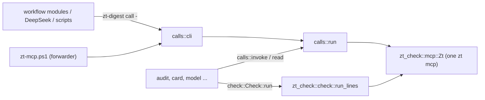

# zt-digest

## Purpose

`zt-digest` is the book digest's tool set as one Rust binary. It replaces the PowerShell scripts that the digest workflows run, tool by tool, with the same parameters and the same output, so that a step starts no pwsh, no helper process per call, and no checker process. One `zt-digest` process holds one `zt mcp` for all its reads and writes and runs [zt-check](zt-check.md) in-process (`tools/zt-digest/src/main.rs`). The first tool is `call`, the zt helper that DeepSeek runs and the scripts write through (`tools/zt-digest/src/calls.rs`). `audit` (the read-only digest audit) and `card` (the card layer cycle) replace `digest-audit.ps1` and `card-compiler.ps1` (`src/audit.rs`, `src/card.rs`), and the model tools `model`, `model-context`, and `list-models` replace `model-compiler.ps1`, `model-context.ps1`, and `list-models.ps1` (`src/model.rs` and `src/model/`). Stage 2 ported the rest: `hub`, `bridge`, `math`, `event`, `finding`, `terms`, `skeleton`, `organize-survey`, `organize-apply`, `figures`, `prepare`, `prepare-link`, `snapshot-topics`, and the report tool `source-faults` (one module each, see the table below). `concepts` is the concept review (#97) and `register` the concept register's plan and publication (#101). Every digest script now only forwards to its tool, and the workflows and the job files run the tools directly. It exists as a crate of its own, like zt-check, so that it builds and installs without building zt or stopping the ZT service (`tools/zt-digest/Cargo.toml`, `scripts/install-zt-digest.ps1`).

**Owns:** the `zt-digest` command line and its tools, the PowerShell-style parameter parser, the helper semantics (`@@N`, the allow-list, the logs, the Topic gate, `append_card`, the output lines and the resume line), `Invoke-Zt` semantics in Rust (`calls::invoke`, `calls::read`), `Invoke-ZtCheck` semantics in Rust (`check::Check`), the `audit` and `card` tools (the ports of `digest-audit.ps1`, `card-compiler.ps1`, `relatedness.ps1`, and the audit's part of `book-of.ps1`), the audit's reproducible baseline (the evidence, explicit source sets, P1–P15 measures, fixed task sheet and baseline comparison of `src/audit/measures.rs`, #94 S01), the model compiler, the model context pack, and the model list, the stage 2 tools (hub, Bridge, math, event, finding, terms, skeleton, Organize, figures, Prepare, the link pass preparation, the Topic snapshot): their steps, state, job files, and output, the concept review (`concepts`) and the concept register's plan and publication (`register`), the PowerShell and .NET semantics those tools keep (`src/ps.rs`), and the build and install of `zt-digest.exe`.

**Does not own:** the Card check itself and the `zt mcp` client (see [zt-check](zt-check.md)); the MCP tools it calls (see [MCP server](mcp-server.md)); the forwarding scripts, `book-of.ps1`, `relatedness.ps1`, and `zt-calls.ps1` (kept for PowerShell callers and tests), the job and state formats of the compilers, and the tests (see [Digest scripts](digest-scripts.md)); the commands the workflow modules run (see [Digest workflows](digest-workflows.md)); the helper instructions in the DeepSeek prompts (see [Digest prompts](digest-prompts.md)); the helper path `skills/zt/scripts/zt-mcp.ps1`, which forwards to `call`, and the `zt` skill text that tells agents to use the helper (see [Agent skills](agent-skills.md)).

## At a glance

| | |
|---|---|
| Entry points | `zt-digest <tool> [-Name value ...]` (`main` in `tools/zt-digest/src/main.rs`); `skills/zt/scripts/zt-mcp.ps1` (forwards to `zt-digest call`); every digest script in `scripts/book-digest/` (forwards to its tool, table under Concepts); `scripts/install-zt-digest.ps1` (build and install) |
| Key files | `tools/zt-digest/Cargo.toml` — a crate with its own `[workspace]`; depends on `zt-check` (path), `anyhow`, `regex`, `serde_json` with `preserve_order` |
| | `tools/zt-digest/src/main.rs` — the tool dispatch; prints `zt-digest <tool>: <error>` and exits 1 on an error |
| | `tools/zt-digest/src/args.rs` — `Args`: `-Name value`, `-Name:value`, switches, positional values |
| | `tools/zt-digest/src/calls.rs` — the helper (`run`, `cli`) and `invoke`/`read` for the other tools |
| | `tools/zt-digest/src/check.rs` — `Check`: Invoke-ZtCheck's parameters and defaults, run in-process |
| | `tools/zt-digest/src/util.rs` — UTF-8 files without a BOM, CRLF console lines, compact JSON, `print_last` |
| | `tools/zt-digest/src/zt.rs` — re-exports `zt_check::mcp::Zt` |
| | `tools/zt-digest/src/model.rs` — the model tools' entry points, `read_calls` (`Invoke-Zt` reads with the script's error text), and `Scripts` (the script paths job files name) |
| | `tools/zt-digest/src/model/compiler.rs` — `model`: state, plans (`test_plan`), the steps, job files, writes with `-Moves` |
| | `tools/zt-digest/src/model/text.rs` — Derivation sections, chain position lines, `set_section`, the setting's tables, the explanation and its core |
| | `tools/zt-digest/src/model/context.rs` — `model-context`; `build` also serves `model brief` and `model explain` |
| | `tools/zt-digest/src/model/list.rs` — `list-models` |
| | `tools/zt-digest/src/audit.rs` — `audit`: the global read-only report; Organize and skeleton call `run` in-process; Card cycles use their scoped quality reader in `card.rs` |
| | `tools/zt-digest/src/audit/measures.rs` — the reproducible baseline (#94 S01): the evidence, the explicit source sets, the P1–P15 measures, the fixed task sheet, the baseline comparison and the accepted proposal's own scope |
| | `tools/zt-digest/src/audit/book_of.rs` — Card categories and inferred book attribution (`Get-BookIndex` of `book-of.ps1`) |
| | `tools/zt-digest/src/audit/markdown.rs` — `audit.md` |
| | `tools/zt-digest/src/finalize.rs` — `finalize`: the declared finite finalization (#86, R299/R300) — the audit plan, the one correction cycle's Card scope, the changed-Card manifest, the scoped publication refresh and the final read-only audit |
| | `tools/zt-digest/src/concepts.rs` — `concepts`: the concept, restatement and filing review (#97) — the term-table evidence through zt-check's parser, the bounded Topic and restatement shortlists, the frozen evidence, the judge-answer and gate-decision validation, and the immutable `concept-review.json`/`.md`; it writes no Card |
| | `tools/zt-digest/src/register.rs` — `register` (#101): the concept register's plan and publication — agent book term tables through zt-check's parser, model-head names, the optional reviewed concept report as read-only evidence, the one-to-three entry selection and its unresolved rows, the staged `out\register-plan.json`, and the create-or-edit publication with a `get_register` read-back verification |
| | `tools/zt-digest/src/ps.rs` — PowerShell and .NET semantics, shared by every tool: truthiness, `[string]` (`s`, `field`), `[int]`, `-eq` and `-like` on text, `@(...)` and pipeline enumeration, `CiMap` (hashtable keys ignore case), UTF-16 lengths, `ConvertTo-Json` output, the `Sort-Object` introsort, culture string order, `[Random]::new(seed)`, `Join-Path`, `Split-Path`, `Get-Content` lines, local time |
| | `tools/zt-digest/src/card.rs` — `card`: `plan`, `apply`, `check`, `report`, `precheck` |
| | `tools/zt-digest/src/card/text.rs` — what a rewrite must keep, kind words, Link kinds (`Get-Keep`, `Test-Kinded`, `Get-LinkKinds`) |
| | `tools/zt-digest/src/card/relatedness.rs` — TF-IDF over character bigrams (`relatedness.ps1`); `pub(crate)`, also used by `bridge` and `prepare` |
| | `tools/zt-digest/src/hub.rs` and `src/hub/` — `hub`: survey, plan, precheck, apply, check, report (hub-compiler.ps1); the precheck also refuses a new line/topic hub whose title copies its anchor's title — a line's anchor Card, and for a topic hub both its tree's Topic Card `<n>/0` and the Card apply files it under (`anchor-title`, whitespace and case normalized only) |
| | `tools/zt-digest/src/bridge.rs` and `src/bridge/` — `bridge`: plan, precheck, report, apply; `answer.rs` (judge answers), `report.rs` (the immutable report), `apply.rs` (guarded apply) |
| | `tools/zt-digest/src/canon.rs` — shared SHA-256, canonical JSON, repeated-key refusal, bounds/order/time helpers; the unchanged Bridge helpers also serve identified compiler plans and receipt verification |
| | `tools/zt-digest/src/math.rs` and `src/math/text.rs` — `math`: the 13 steps of math-compiler.ps1; the statement index (`scan_index`, `check_value`), the notation table (`notation_table`), the group extension marker, `Set-Section`, the dependency map |
| | `tools/zt-digest/src/event.rs`, `src/finding.rs`, `src/event/layer.rs` — `event` and `finding`; `layer.rs` is the cycle both share (plan, precheck, apply, report, state.json, the accepted `plan.json` candidate/job manifest, zt-check on the drafts, the `ZT_RACE_*` test seam) |
| | `tools/zt-digest/src/terms.rs`, `src/skeleton.rs` — `terms` (book-terms.ps1), `skeleton` (book-skeleton.ps1, the audit in-process) |
| | `tools/zt-digest/src/organize.rs` and `src/organize/` — `organize-survey` (`survey.rs`, the audit in-process), `organize-apply` (`apply.rs`, one move per call with `-Moves`), `common.rs` (shared by terms, skeleton, and Organize) |
| | `tools/zt-digest/src/figures.rs` — `figures` (attach-figures.ps1 with figures.ps1's functions, which `prepare` also uses) |
| | `tools/zt-digest/src/prepare.rs` — `prepare` (prepare-book-digest.ps1) and `prepare-link` (prepare-link-pass.ps1) |
| | `tools/zt-digest/src/prepare/notes.rs` — the book's collected notes: mapping to the digest's chapters, the per-chapter read-only files and their spans/hashes/ids, the preparation faults, and the reference block a group file and a model context pack carry |
| | `tools/zt-digest/src/prepare/resolve.rs` — `prepare -Book`: Work id/title resolution, the ranked Markdown files, the generated BibTeX, the heading proposal and the frozen `preparation.json` |
| | `tools/zt-digest/src/faults.rs` — `source-faults`: the retained source-fault record (validation against the prepared source, one entry per location, deduplicated attempts) and its deterministic `source-faults.md` |
| | `tools/zt-digest/src/ledger.rs` — prepared identity/schema, root registration, claims/faults/gates, optional target choices, frozen startup inputs, checked group completion, the Events/Findings layer completion, checked Model and explanation completion, aggregate publication revisions, the mathematics variant's per-unit obligation registration and completions, the owned external resources with their cleanup units and checked cleanup completion, and the verified run report (completeness, gaps, current placeholders, timings, exact per-run usage, the supported resume line) |
| | `tools/zt-digest/src/ledger/adopt.rs` — `ledger adopt`: legacy evidence resolution, the read-only plan and its classifications, the derived artifacts, the prepared manifest of an adopted run, and the applied ledger with `adopted` events and targeted obligations |
| | `tools/zt-digest/src/report.rs` — the run report's pure parts: RFC 3339 time spans, the deduplicated per-run usage projection, the Markdown rendering and the idempotent two-file publication |
| | `tools/zt-digest/src/snapshot.rs` — `snapshot-topics`; its Card lines also serve `prepare-link` |
| | `scripts/install-zt-digest.ps1` — `cargo build --release` into `D:\zt-digest-target`, then copies `zt-digest.exe` beside `zt.exe` |
| Depends on | [zt-check](zt-check.md) (library: `check::run_lines`, `mcp::Zt`, `reply_text`, `reply_error`); [MCP server](mcp-server.md) (`zt mcp`); [Service, CLI and storage](service-and-cli.md) (the service must be up) |
| Used by | [Digest scripts](digest-scripts.md) (every digest script forwards to its tool; `zt-calls.ps1` writes through the helper path); [Digest workflows](digest-workflows.md) (`zdTool` runs every script as its tool); [Digest prompts](digest-prompts.md) (DeepSeek runs the helper); [Agent skills](agent-skills.md) (`skills/zt/SKILL.md` names the helper) |
| Tests | `cargo test` in `tools/zt-digest` (`args`, `calls`, `ps`, `audit`, `card`, `model::text`, the explanation facts, the notes mapping and the source-fault decisions, and the stage 2 tools' pure parts); every `scripts/book-digest/tests/*.tests.ps1` runs its tool through the forwarder (`run-all.ps1`); `tests/seam-zt-mcp.mjs` stands in for `zt mcp` in the Bridge fault and race tests; `explain-finish.tests.ps1` drives the Explain completion through the real commands; `source-notes.tests.ps1` drives the notes preparation, the group and model context packs, the `source-faults` tool and the compiler's plan recording; `cleanup-resources.tests.ps1` drives the resource registration, observation and checked cleanup completion; `finalize.tests.ps1` drives the finite finalization at its command boundary (the four branches, the changed-Card manifest, the new publication revisions and their reuse, the refused stale final audit and the refused second cycle); `service-health.tests.ps1` drives the bounded edit wait and its one log line, the fault/contention split, the active-run marker, the disappeared-and-restarted daemon, the reconnect and receipt replay, and the infrastructure fault of a service that stays down |

## Concepts

- `Tool` — one subcommand of `zt-digest`, named after the script it replaces:

  | Tool | Script | Tool | Script |
  | --- | --- | --- | --- |
  | `call` | `zt-mcp.ps1` | `event` | `event-compiler.ps1` |
  | `audit` | `digest-audit.ps1` | `finding` | `finding-compiler.ps1` |
  | `card` | `card-compiler.ps1` | `terms` | `book-terms.ps1` |
  | `model` | `model-compiler.ps1` | `skeleton` | `book-skeleton.ps1` |
  | `model-context` | `model-context.ps1` | `organize-survey` | `organize-survey.ps1` |
  | `list-models` | `list-models.ps1` | `organize-apply` | `organize-apply.ps1` |
  | `hub` | `hub-compiler.ps1` | `figures` | `attach-figures.ps1` (and the removed `figures.ps1`) |
  | `bridge` | `bridge-compiler.ps1` | `prepare` | `prepare-book-digest.ps1` |
  | `math` | `math-compiler.ps1` | `prepare-link` | `prepare-link-pass.ps1` |
  | `concepts` | `concept-compiler.ps1` | `snapshot-topics` | `snapshot-topics.ps1` |
  | `register` | `register-compiler.ps1` (new, #101) | | |

  All 21 are ported. `book-of.ps1` and `relatedness.ps1` stay as PowerShell for old callers and their own tests; the tools use their Rust ports. `source-faults` is one more tool and replaces no script: it keeps the run's source-fault record and renders its report.
- `Forwarder` — a PowerShell script whose body is replaced by a call of its tool (`& $exe <tool> @args`), kept so that callers and tests that name the script still work. `ZT_DIGEST` names the binary to use; otherwise it is `zt-digest` on PATH. Most forwarders rebuild `$args` first: an array becomes a comma-separated value, and `-Name:value`, which `pwsh -File` and `&` hand over as two arguments, becomes one again. A forwarder whose tool reads instruction files (`card`, `math`, `bridge`, `event`, `finding`, `terms`, `skeleton`, `prepare`) sets `ZT_DIGEST_SCRIPTS` to its own folder.
- `Script paths` — job files name the scripts as the scripts named themselves: `HELPER:` the helper `skills\zt\scripts\zt-mcp.ps1` and the `dsh-*.zh.md` files in `scripts\book-digest`. `model::Scripts` takes them from the repository zt-digest was built from (`CARGO_MANIFEST_DIR`), or from `ZT_DIGEST_REPO`.
- `PowerShell semantics` — what the scripts' output depended on and the ported tools keep: case-insensitive string comparison and hashtable keys, `Sort-Object` order (an unstable introsort with the zh-CN culture's case-insensitive collation), `@($null)` as one item, `[int]` rounding half to even, and `ConvertTo-Json` formatting (`src/ps.rs`).
- `Call` — one `{ "tool", "arguments" }` object of a helper batch; `@@N` in a string argument is the address of call N.
- `Done` / `Failure` — what `calls::run` returns: the lines of the calls that succeeded, and the call that failed with its message and the addresses so far.

## Architecture



A tool parses its parameters with `Args`, opens one `Zt`, and passes it to every read, write, and check. The audit uses that same client for its fresh catalogue, bounded text batches, required model contexts and relationship reports. It starts no read-worker pool. `card::invoke_scoped_audit` reads the required group or book quality scope on its own `Zt`; its `precheck` starts no `Zt`, because zt-check `--json` reads no Card.

## Interfaces

### Prepared input contract for ledger binding

`prepare -Variant econ|math -Apply` adds `manifest.run_contract` schema 1. `prepare.rs::run_contract` records the actual persisted archive identity, exact original source-byte SHA/path/file id, Citation key, effective preparation options (including bibliographic input hash), embedded base/variant versions and artifact schema. Every selected group and section has its real file hash/locator; the sorted canonical group manifest has a SHA. The translated book, index, prefixes, figure map, event-candidate artifact and generated `setup-calls.json` are also hashed. Full source/Card bodies are not duplicated in this contract. Omitting `Variant` retains the legacy preparation response shape. Variant binding requires apply and valid UTF-8 input; hashes refer to the bytes actually decoded, including any BOM/CRLF. The source is checked again before contract publication. Older schema-1 contracts without `setup_calls` remain readable; they do not acquire invented historical receipts.

The command reuses its one MCP process for strict body-free identity probes and setup. Missing/partial identity refuses before archive setup writes, and an epoch change refuses binding. Base/variant versions come from the actual compiled blueprint sources; no installed frozen script is edited. Reliable preparation publishes its pending contract and immutable `prepare-plan.json`, initializes the ledger with all required roots/dependencies and a claimed `prepare/book@1`, then performs setup through native receipts. Workers remain waiting until verified setup completion. This establishes prepared input, not verified group completion.

The private `prepare.rs::write` delegates to the shared `util::write_atomic`: a same-directory `NamedTempFile`, complete UTF-8 write, file sync and atomic persist. Group startup uses that same evidence publisher. No in-place truncation or delete-then-write fallback is used. A locked destination can refuse publication on Windows; the error preserves the old complete file and retry can succeed after the reader closes. This is per-file atomicity; a complete manifest is published last and consumers must still validate its artifact hashes. See [Microsoft's file move/replace contract](https://learn.microsoft.com/en-us/windows/win32/fileio/moving-and-replacing-files).


### Prepared ledger initialization and inspection

`ledger.rs` owns one `<out>/ledger.sqlite3`, using the root crate's `rusqlite 0.32` and bundled SQLite. It has exactly `meta`, `units`, `deps`, `outputs` and `events`, the two specified scheduling indexes, foreign keys, WAL and a ten-second busy timeout. JSON columns carry typed details rather than new layer tables. Event update/delete triggers enforce append-only history. Schema, initial identity, all root units/dependencies, preparation evidence and the initial event commit in one short `BEGIN IMMEDIATE` transaction; filesystem reads, hashing and MCP calls finish before that transaction.

Existing ledgers pass `verify_schema` before initialization, inspection or mutation: both schema version markers, WAL mode, the exact five tables/required columns, the two scheduling indexes with their column order, the actual append-only trigger definitions, expected unit/dependency/output/event foreign keys and `foreign_key_check`. A damaged schema is an explicit error, never an implicit repair or a fresh run identity. Offline status uses the same check without archive access. `ledger-schema.tests.ps1` injects and restores actual schema faults through Node SQLite and verifies both public commands refuse; correcting the injected faults reopens the original retained run.

`zt-digest ledger init -Out <out>` validates schema and compiled workflow contracts, exact source/group/section/artifact hashes, manifest locators/group enumeration, the current persisted archive identity, agent Literature metadata and every anchor. It then creates the ledger or verifies its immutable binding. An existing run retains its random 128-bit run id; repeated init adds no rows/events and does not count as a resume invocation. A mismatch refuses before a ledger transition. Legacy folders without a schema-1 prepared contract need the separate [legacy staging adoption](#legacy-staging-adoption-r410r417) work, rather than invented history. Preparation refuses any output directory already containing a ledger **before** regenerating its frozen files.

Initialization registers every selected digest group, enabled Terms work and required fixed book publications. Only preparation is `done`: existing placeholder anchors never establish substantive digest coverage. Success and settled dependencies are distinct, and unsealed dynamic layers have explicit barrier metadata. Each fixed book publication registers revision 1 of a derived input manifest and seals its own layer's enumeration barrier; see [Aggregate publication revisions](#aggregate-publication-revisions). The default target is the full variant: economics includes Event/Finding layers even when `NoEventCandidates` disables legacy date extraction; mathematics declares its index/docs/skeleton/notation/theory/check obligations and excludes Events/Findings. `NoFigures` is an explicit figure exclusion. Declared optional choices are described below; live scheduler adapters remain under implementation.

`zt-digest ledger status -Out <out> [-Layer <layer>] [-Verify]` reads a consistent ledger transaction without starting MCP or needing the archive service. It returns durable unit inputs, hashes, states, attempts/tokens/lease/retry timestamps, progress/results/faults, dependencies and declared inclusions/exclusions. `archive_verification: "not_requested"` makes that inspection limit explicit; it does not claim a fresh archive verification. It reconciles the declared group and fixed book target against retained root units and input hashes, naming missing/changed units in `coverage_faults`. Its `publications` array selects the latest revision of every aggregate publication and names the earlier revisions it superseded, whether that revision still describes the present inputs (`current`) and the stored `counts.superseded`. A superseded revision is terminal history: it is excluded from `failed`/`open`, from `unresolved` and from `rerun-list`. It also reports the same completeness, gaps, timing, per-run usage and resume facts as the run report; `-Verify` additionally reads the archive for the current placeholder count, while the plain form reports that count as `not_read` and `null` rather than zero (R336). These are stored work facts; domain adapters must still verify current outputs before completion.

Public initialization coverage is `ledger-core.tests.ps1` (real prepare/MCP/CLI, exact five tables/WAL, complete root registration, idempotence, mismatch refusal with byte-identical ledger-row evidence, protected inputs, identity changes during reads and offline read-only inspection) and `ledger-preparation.tests.ps1` (including automatic initialization). `ledger-prepare-recovery.tests.ps1` checks lost archive replies, immutable source/setup refusal, committed-prefix conflicts, missing prerequisite edges, before/after ledger-commit failures, exact frozen-file preservation, repeated completion, missing output registration and a differing BibTeX Citation key. Legacy setup remains outside this receipt contract.

### Receipt-backed preparation completion

`ledger done -Out <out> -Unit prepare/book@1 -Token <current-token> -Outputs <out>/prepare-plan.json` resumes the same retained setup. `Prepared::read_mode` checks every frozen input and the actual archive identity while permitting anchors not yet created. The same input-only validation lets the current preparation token use `ledger renew` or typed `fail` before its tail anchors exist. The completion verifier still requires the current unexpired claim and the per-unit OS guard; it never adopts a different input or resets a lost owner.

`setup_calls` accepts only the frozen agent Literature root followed by the exact Direct anchors. The root's native preview must allocate the declared Citation key, including when BibTeX names a different key. `setup_readback` reconciles committed receipts and their current authored fingerprints before any missing chunk is written. Every preview rolls back; it uses ordinary 64-item/1-MiB batches, stops at the first missing chunk during recovery and supports a complete setup longer than the separate 1024-item sequence-preview bound. Stable keys are `<run>/prepare-book/1/setup/item-NNNNNN`; attempts do not enter them. Actual commits use the existing identified batch client.

After writes, the verifier reads the actual root/anchors, metadata, archive identity/revision and receipt fingerprints, rechecks frozen inputs and publishes actual `manifest.created` lines plus `prepare-completion.json`. It commits file/Card/receipt output registrations, done state, event and readiness consequences in one short ledger transaction. A lost reply or failed ledger commit can leave archive writes and files, but retry recovers their receipts instead of duplicating the tree. Repeated done verifies registered evidence, files and current receipts without new archive writes. Offline coverage reconciles the complete initial root/dependency target and typed preparation output registration; it explicitly remains an offline view.

This path covers a retained initialized preparation and current token. Guarded expired-owner reclamation, the registered-run gate and internal heartbeats are described under [Claims, faults and durable gates](#claims-faults-and-durable-gates); Unix parent-death equivalence remains unqualified, and complete invocation reset stays with the one-resume work. Legitimate downstream edits need the separate checked lineage work before old setup receipts can be reverified as current. No live workflow acceptance is inferred.

### Claims, faults and durable gates

The available ledger surface is now `init`, `adopt`, `status`, `next`, `renew`, `done`, `fail`, `gate`, `rerun-list`, `publish`, `notes`, `relocate`, `math`, `reclaim`, `job` and `resource`, with separate `group-start`, `group-finish`, `link-finish`, `cards-finish`, `model-deps`, `model-finish`, `explain-finish` and `cleanup-finish` commands below. Every command requires explicit `-Out`; it does not infer a staging directory from the working directory. Unknown/irrelevant arguments and missing/invalid values return 2, an operational/validation failure returns 1, and an ordinary successful command returns 0. `done` dispatches the deterministic preparation, digest/group, Cards/group, Model, Explain, Terms, aggregate publication, note-suggestion, mathematics and cleanup verifiers. Unsupported layer evidence and address-only objects fail; other compiler verifiers remain unfinished.

| Command | Current checked behavior |
| --- | --- |
| `ledger next -Out <out> -Layer <layer> -Take <1..64> -Owner <id> [-Wait <0..600>] [-Lease <1..7200>]` | Revalidate the prepared filesystem/identity through one MCP process before any write transaction. `-Wait` keeps the call open until a ready unit appears, the layer settles or the deadline passes; the wait never spends an attempt and is the workflow's clock-free readiness bound (R270). Reconcile success/settled prerequisites, select ready units in stable logical-key/revision/id order and assign owner, increasing token, the lease and attempt reservation under `BEGIN IMMEDIATE`. The lease is the longer of the 120-second default and `-Lease`; a workflow passes its frozen `dshRunCap` (+300 s of command margin), so a claim that starts a provider run cannot expire under a healthy job (#92). Return claimed ids, owner, token, lease/lease_seconds, input hash/inputs and the layer coverage fields. Empty claims never imply completion. |
| `ledger renew -Out <out> -Unit <id> -Token <n>` | Extend only the exact current, still-unexpired claimed token. Record a renewal event with the manager process id. A wrong, expired or already-settled claim fails with `stale_claim`. |
| `ledger reclaim -Out <out> [-Unit <id>] [-Take <1..64>]` | Turn an expired claim into the next attempt. For each candidate it takes that unit's OS guard first, so a claim in the middle of an active apply cannot be revoked; it then re-reads the row under `BEGIN IMMEDIATE`, requires the same token and an expired lease, refuses while a registered external run is not terminal (`jobs_running`), and moves the token forward before setting `ready` with no owner. Named with `-Unit` it refuses `claim_active` for a live lease and `lock_busy` for a held guard; without it, contended or changed candidates are reported in `skipped` and job-blocked ones in `blocked`. The lost owner's old token then fails `renew`/`fail`/`done`. |
| `ledger job -Out <out> -Unit <id> (-Register <file> -Token <n> \| -Observe <file> \| -Cancel <run id> \| -List)` | Register, observe and cancel the external runs a unit owns. `-Register` requires the current claim token and records `{id, kind, facts, started_at, cap_seconds}` plus the token/owner as a running job in the unit's progress; `started_at` is the provider's own registered start (an epoch second in the facts, else now) and `cap_seconds` is the frozen `settings.dsh_run_cap`. Every answer adds `elapsed_seconds`, `cap_remaining_seconds`, `cap_exceeded` and `action` (`wait`, `cancel`, `await_terminal`), so the provider cap is measured from the registered start and a restart never resets it (R267/R268). `-Observe` records a running or terminal state (a terminal one needs its `outcome`) and is monotone; `-Cancel` records the cancellation request while the job stays running until a terminal observation arrives, and an unconfirmed cancellation keeps blocking a replacement claim or completion. |
| `ledger fail -Out <out> -Unit <id> -Token <n> -Class retryable\|content\|operator -Fault <json\|file>` | Require the current claim and a bounded fault document (given as JSON text, the form the frozen workflow modules use, or as a file) with matching `unit`, `input_hash`, known `code` and nonempty `cause`. Check the supplied class against the code's fixed mapping; caller prose cannot make a permission/content fault transient. Record fault, transition and readiness consequences in one transaction. |
| `ledger gate -Out <out> -Layer <layer>` | Report `sealed`, `settled`, `complete`, `excluded`, done/failed/blocked/open/superseded counts, exact unresolved ids, coverage faults, the latest publication revision of each logical key and what each superseded. Return 3 while the enumeration is unsealed, a required publication is absent, or work remains open; a settled partial target returns 0 with `complete:false`. Deliberate exclusions also remain distinct from successful work. |
| `ledger rerun-list -Out <out>` | Read-only unresolved units and prerequisite/downstream closure, with dependencies and stored fault/progress evidence. Done builds and superseded revisions stay excluded. Failed/blocked/retry/claimed roots are inspection inputs, not authorization to replace a still-running writer. |
| `ledger publish -Out <out> -Layer <layer> [-Key <key>] [-Scope <file>]` | Derive and register the next revision of one aggregate publication from its sorted input manifest; see [Aggregate publication revisions](#aggregate-publication-revisions). `-Key` defaults to `book`; `-Scope` is required by `hubs` and refused elsewhere. |
| `ledger notes -Out <out> -Suggestions <file>` | Register one `notes/<id>@1` unit per independent note suggestion, bound to the Card state the suggestion was made from. |
| `ledger relocate -Out <out> -Moves <file>` | Apply a recorded structural mapping to every published Card address; see [Recorded locators after a move](#recorded-locators-after-a-move). |
| `ledger math -Out <out>` | Register the mathematics variant's per-unit boundary and proof obligations from the compiler's retained plans; see [Mathematics variant obligations](#mathematics-variant-obligations). |
| `ledger resource -Out <out> (-Register <file> \| -Observe <file> [-Unit <id> -Token <n>] \| -List [-Unit <id>])` | Record, observe and list the external conversations a run owns; see [Owned resources and cleanup completion](#owned-resources-and-cleanup-completion-r231-r322r330). An `-Observe` of per-run `usage` is keyed by provider run id and request id, so a repeated read or a continuation is never double counted. |
| `ledger adopt -Out <out> -Variant econ\|math [-Apply]` | Reconcile a legacy staging folder read-only and write its ledger only on `-Apply`; see [Legacy staging adoption](#legacy-staging-adoption-r410r417). |
| `ledger report -Out <out>` | Render the verified run report into `<out>/run-report.json` and `<out>/run-report.md` and print the same facts; see [The verified run report](#the-verified-run-report-r331r346). It reads the ledger and one verified placeholder read, writes no Card, and is idempotent. `ledger status [-Verify]` returns the same facts concisely. |

Readiness waiting never spends an attempt. A failed success prerequisite blocks dependants with exact prerequisite ids; a settled prerequisite can carry its failure to a partial aggregate. Fixed aggregate book work stays registered until its producers settle. Prepare/Terms/digest are sealed because their enumeration is complete, and an aggregate publication layer is sealed by the revision that enumerates it (see [Aggregate publication revisions](#aggregate-publication-revisions)). A **dynamic child layer** (`cards`, `events`, `findings`, `link`, `models`) is sealed by the closure of its producer enumeration: the last `digest` unit to become terminal closes them in its own completion transaction, and `reconcile`/`gate` record the same closure fact for a run whose last group failed instead of finishing. The `explain` layer closes when the Models closure is sealed and every Model unit is terminal, because only a Model completion can register explanation work (R301). The `cleanup` layer closes once every unit outside it is terminal, because only the owner of a claimed unit can register a resource; a layer whose own closure belongs to another slice (`notes`) stays unsealed without keeping cleanup open. The closure is one `meta.barrier/<layer>` record plus one `sealed_enumeration` event naming the layer, its producer and the reason; it is monotone and a later registration still keeps the gate unsettled by its open count. A layer whose required publication revision is absent is not settled even with no queued rows, so a deleted or never-registered publication is outstanding work rather than an empty queue. A zero-row Event queue cannot seal itself. Economics explicitly excludes mathematical-only work; mathematics explicitly excludes Event/Finding work.

Blocked fault lists are recomputed even when the state stays `blocked`. If another independent producer fails later, the dependent's facts and event record gain that exact prerequisite without spending an attempt. The independent ready queue remains runnable. The public claim fixture registers an additional isolated prerequisite to exercise this transition; it does not establish a verified domain completion from the injected rows.

Readiness also diagnoses pending dependency cycles in the same short ledger transaction before selecting claims. An iterative graph pass identifies all cyclic producers, including overlapping cycles; a path search within each component records a real closed path through each affected unit as `fault.cycle`, with code `dependency_cycle` and a readable cause. These producers fail with zero added attempts, ordinary success dependants become blocked, and independent ready units remain claimable. Done/failed/claimed units are outside this pending-cycle transition, so the scheduler does not fail a live writer. `ledger-dependencies.tests.ps1` verifies actual named dependency edges in every returned path on the graph A↔B and A→C→B, alongside a blocked dependant and an independent claim. Domain plan-to-part registration and missing-part diagnostics still belong to the model adapter work.

The attempt budget is the prepared run's frozen settings.max_attempts (default 3, declared as maxAttempts and persisted by prepare -MaxAttempts): ledger fail keeps a retryable unit retryable while its attempts are below that budget and records ailed once they reach it. A retryable failure schedules the next attempt after 5 seconds for the second and 20 seconds afterwards, adding 0 or 1 second of OS-random jitter. Backoff/dependency waiting does not add attempts. Tokens increase on every new claim; fault and claim events retain attempt facts. A resume invocation's own counter reset stays with the one-resume work.

**Owner recovery and long commands (R176–R186).** The default lease is 120 seconds, and `ledger next -Lease <seconds>` lets a caller extend it: the digest workflow claims with its frozen `dshRunCap` (+300 s), so a claim that starts a provider run outlives the run it supervises and a healthy six-minute group job is never re-readied under its own claim (#92). Every command that holds a claim — `group-start`, `group-finish`, `link-finish`, `cards-finish`, the preparation completion and every mathematics/publication adapter, including their `-CheckOnly` previews — starts one internal heartbeat thread once `finish_claim`/`check_claim` accepts the exact token. It renews immediately and then every 30 seconds, recording a `renewed` event whose facts hold the lease, the process id, the interval and a sequence number; a renewal never shortens a lease, a lost claim ends the thread, and a transient ledger fault waits for the next beat. Between commands the manager renews with `ledger renew` while it polls its registered run; a claimed chain waits on a job at most 90 seconds at a time and runs that renewal with every wait round. A claim whose lease expired is not offered to `ledger next`; only `ledger reclaim` can hand it to a replacement attempt, and it does so under the same per-unit OS guard the mutation path holds across its archive apply, re-checking the token inside the write transaction and moving the token forward so the lost owner's token can no longer renew, fail or complete. A Windows sharing violation on the guard is the same retryable `lock_busy` class as a failed exclusive lock. A registered external run blocks both reclaim and completion until an observation records its terminal outcome, so no replacement writer starts beside a live provider run and no completion claims work whose run may still change the drafts.

`ledger-claims.tests.ps1` uses actual concurrent CLI processes, both variant targets, real 5/20-second delays and all three attempts. It checks stale renewal/failure tokens, final permission faults, partial gates, zero-attempt blocked groups, exclusion/empty-layer distinctions, SQL append-only/foreign-key enforcement, an injected missing publication, and the guarded reclaim that offers the replacement attempt after expiry. `ledger-owner-recovery.tests.ps1` covers the manager-loss and long-command contract end to end: a dead manager's claim is completed by a separately started compiler with no duplicate attempt; a command slowed past a shortened lease still finishes under its own token because its heartbeat renewed it, with the compiler's own process id in the facts; reclaim refuses while another writer holds the per-unit guard and changes nothing; after release it names the lost owner, fences the token and lets `next` issue the replacement attempt; the lost owner's `renew`/`fail` and its frozen draft job are refused; and a registered run must be cancelled and observed terminal before either reclaim or a completion preview proceeds. The shared [MCP client](zt-check.md) bounds its transport and owns its children separately.

Stable retryable codes are `lock_busy`, `sharing_violation`, `sqlite_busy`, `transport_closed`, `command_timeout`, `service_unavailable`, `provider_cap`, `provider_transient`, `missing_result`, `missing_jobs`, `pending_jobs`, `read_view_changed`, `lease_lost`. Operator codes are `access_refused`, `invalid_arguments`, `identity_mismatch`, `operation_conflict`, `owned_paragraph_conflict`, `unreconciled_move`. Content codes are `invalid_plan`, `dependency_cycle`, `source_unavailable`, `unsupported_claim`, `stale_content`, `check_failed`, `unknown_producer`, `named_part_missing`, `named_part_changed`, `explanation_missing`. Unknown codes or a class mismatch refuse without a transition. Internal dependency propagation records `dependency_failed` with the failed prerequisite ids.

`ledger-claims.tests.ps1` uses actual concurrent CLI processes, both variant targets, real 5/20-second delays and all three attempts, and the guarded reclaim of an expired owner. The unit guard now protects startup/failure transitions, mutation and reclaim as described below. A registered external run is recorded with its cancellation request and terminal observation, and both reclaim and completion refuse while one is not terminal.

A write-capable step gives its child `zt mcp` long edit patience (`ZT_EDIT_PATIENCE=180`), while an ordinary read or precheck keeps `zt`'s default short bound (R269). `zt-digest` sets it once per process from the step and switches it runs (`util::writes_cards`: the helper, the two apply-only tools, `-Apply`, and the write steps of the model, math, terms and skeleton compilers); `zt mcp` validates the value as 1–300 seconds, reports an invalid one once in `zt.log`, and falls back to 20. The patience reaches the actual child: a contended digest write logs its `edit wait:` line with `patience_s=180` in the child's own process ([Service, CLI and storage](service-and-cli.md)). The shared [MCP client](zt-check.md) now bounds stdin writes, initialization and replies to 240 seconds, with bounded graceful/forced child-tree shutdown and typed `TransportFault` cleanup facts. Its single I/O worker stays inside the compiler process. Windows contains trusted MCP descendants in a kill-on-close Job Object before their initial thread runs; killing the compiler closes that ownership as well. Independent ZT/Scholar Archive service launches preserve their own lifetime and inherit no capture pipes. `mcp-lifecycle.tests.ps1` verifies actual timeouts before/after archive commit, owned-writer exit before retry, exact accepted-key replay and one resulting archive revision. Reclaim and job observation are the ledger-aware adapters above; Unix process-group and parent-death equivalence is implemented but not qualified on this Windows host.

Every `zt-digest` command that opens the archive client resolves the service first (R320, `zt::start`): one bounded `<program> status` is parsed and a service that is down is polled at 500 ms intervals for at most 120 seconds (`zt_check::mcp::ensure_service`), so a restart started by `zt status` itself is waited for and never duplicated. The resolution applies only when the client program is the `zt` CLI; an isolated seam with another name is never queried, so a stand-in cannot stall a test. A service that stays down is one `infrastructure_fault` (exit 4 from `service-wait`, an error from any other command) that names the wait and leaves the run's units and files untouched; a valid restart means the next command starts a fresh child client, and the identified helper's receipt replay reconciles writes the disappearance interrupted. For a stage-level or operator check, `zt-digest service-wait [-Wait 0..120] [-Out <folder>]` performs the same resolution and then reports `{ok, state, waited_ms, pid, archive_root, archive_revision, last_exit_abnormal, reconnected, stage}` as one compact JSON line; `state: unobserved` means the client program was not the `zt` CLI.

The same client start records the archive's active-run marker (`zt::renew_active_run`, `<archive>/zt.digest.run` with `run_id`, `out`, `unit`, pid, `renewed` and a 300-second `ttl_s`), and a claimed unit's heartbeat refreshes it while a long command runs. The daemon's minute heartbeat reads it and stops when the renewals stop (R318, [Service, CLI and storage](service-and-cli.md)).

### Frozen optional layer choices

`prepare -Variant econ|math -Apply -RunOptions <json|file>` accepts a flat object of optional boolean switches (as JSON text or as a file; the frozen prepare stage passes text), using the existing workflow names. For example, `{"terms":false}` explicitly excludes the term-table layer. Effective values, including defaults, are retained under `manifest.run_contract.options.run_options` and participate in the immutable preparation hash. Subsequent commands use those values; the original options file can be changed or deleted without reconfiguring the run. A changed frozen manifest or inconsistent `meta.target` refuses recovery/inspection instead of hiding required work.

| Switch | Availability and effect |
| --- | --- |
| `terms` | Both variants; false omits the Terms unit and that success prerequisite on digest groups. It does not create a successful disabled unit. |
| `models` | Both variants; false excludes model compilation and its derived formal-explanation layer. Other source/quality/publication obligations remain declared. |
| `events`, `findings` | Economics; mathematics explicitly excludes these layers. |
| `hubs`, `figures`, `bridge` | Both variants; false excludes that optional tail layer. |
| `notation`, `boundary`, `proof`, `theory` | Mathematics; economics explicitly excludes these layers. |

Applicable switches default to true. `-NoFigures` fixes the effective `figures` choice to false and also controls preparation's figure extraction; explicitly requesting `figures:true` with that flag is a conflict. `figures:false` alone excludes the later figure layer. Required core work such as final audit, card quality and math-check is retained. Unknown keys, non-boolean values, duplicate JSON keys, a true choice unavailable to the variant and figure conflicts refuse **before** creating prepared files or archive setup.

Disabled fixed roots are omitted from registration and required-root reconciliation. They remain in `excluded_layers`; their gate is settled/excluded with `complete:false`. A schema-1 contract produced before this optional field existed retains its original full default target and run identity; the compatibility fixture reconstructs that published contract shape without the field. Status exposes frozen `run_options`, effective preparation options, variant, Citation key, source/identity locators, contracts and resume count so callers can inspect the retained setup. The later workflow adapter still needs to bind its manager/provider/batch/review settings alongside these layer choices.

### Frozen group startup

`zt-digest group-start -Out <out> -Group <positive integer> -Token <positive integer>` validates the prepared target and exact unexpired `digest/gNNN@1` claim, then takes its OS file lock under `<out>/locks/`. Lock-file presence is diagnostic; actual ownership comes from the held OS lock. Invalid/stale tokens are checked before lock acquisition and again after it. `ledger fail` takes the same guard before changing the unit state, so it cannot revoke a protected startup. Closing/killing the owning process releases the lock; a leftover empty file does not keep the unit busy.

For a new claim startup, the command renews the lease, reads the current anchor and obtains one fresh complete `export_titles` through its existing MCP client. The shared legacy snapshot renderer preserves ordering, marks human Cards read-only and creates the startup snapshot. Anchor/title/identity reads must agree on archive revision and identity; a changed view is retryable `read_view_changed`. A failed/missing snapshot cannot publish a usable job or establish coverage.

Files live under `<out>/group-jobs/gNNN/claim-<token>/`: `snapshot.md`, `shared-prefix.md`, `prompt.md`, `job.json`, an optional copied `terms.md`, and the expected future `draft.json` output. The source sections are reread and checked against their frozen byte hashes before prompt assembly. Prefix/snapshot/term/prompt/job evidence uses atomic publication and hashes the bytes actually produced, with a readback check. When Terms is enabled, startup requires the verified `outputs` entry `terms/book@1` / key `terms` / kind `file` and matching canonical `terms.md` bytes; a file alone is insufficient.

The static `unit_input_hash` binds the registered group. The new `input_hash` binds exact startup inputs: preparation/group identity, current anchor fingerprint, copied prefix, snapshot hash/revision, applicable term input, claim token and prompt/draft contract versions. `job.json` declares one `draft_only` job, an output file, and archive read/write permissions. The prompt contains selected source, current anchor context and the exact draft envelope; its `calls` remain proposals. The ledger stores only the accepted job locator/hash, token and input hash in progress plus a `group_started` event, committing them with a fresh lease after rechecking the claim. Card bodies and archive revision do not change.

Repeating the same accepted start validates its retained files/bindings and renews the same claim, returning `reused:true`; it does not replace the frozen prompt with a newer snapshot. Edited/missing accepted artifacts are explicit faults. A new token has a separate input directory. The response returns unit/token, both input hashes, job/prompt/snapshot/draft paths, snapshot revision and current `lease_until`. Startup leaves the unit `claimed`; it does not establish digest completion.

`ledger-group-start.tests.ps1` exercises snapshot failure despite an existing skeleton anchor, post-preparation context, one MCP/one export, nearly expired lease renewal, immutable replay, a real competing Windows byte-range lock, stale-token diagnosis, released-lock behavior and prompt tampering. Provider launch/permission enforcement belongs to the later workflow adapter; this command records the declared scope but launches no provider or workflow. The checked completion path is described below. Periodic compiler heartbeat and safe reclaim remain unfinished.

### The bounded earlier-Card context pack (#98, S05)

`group-start` publishes `<claim>/earlier-context.json` and `earlier-context.md` before it freezes the job: the earlier Cards this group should read before it writes. `src/earlier.rs` builds it from the startup snapshot's own `export_titles` result and one bounded `get_cards(view: text)` batch, so the pack reuses the snapshot read instead of scanning titles again and starts no retrieval framework (D088, D096).

Two stages keep the read bounded. The title catalogue ranks every Card of both Workspaces by character-bigram TF-IDF: `Relatedness::rank_text` scores the group's query against the corpus without adding it as a document, so the query never changes a document's weights. A corpus too uniform for that ranking — a shared term used by every document carries no weight and is dropped — answers by raw shared-term count through `Relatedness::overlap` instead, and `catalog.ranking` says which answered. The first `POOL` (sixty) addresses, plus the target Cards of accepted register terms this group's text names (up to forty more), are read in one text batch and ranked again on title plus bounded body; a read Card the body stage cannot separate keeps its title-stage place. The group's own anchor and every group of this book that has not completed are excluded, so a placeholder is never offered as earlier thought (D094); Literature roots are excluded too (a source is not earlier thought), while Topic roots, standalone Cards and Model heads and parts are all candidates (D091).

The pack offers at most twenty Cards, in a rank order that puts accepted register targets first. Each candidate carries its address, title, type, facet, form, level, Workspace, whether it is writable, its `destination` (`agent-card`, or `read-only-reference` for a human Card), the checker's `source_evidence`, its excerpt, `excerpt_chars`, `truncated`, the full text's `text_chars` and `text_sha256`, the locator that reads all of it (`{"tool":"get_card","arguments":{"at":…}}`), and why it was selected (D092, D093). Excerpts are cut at 800 Unicode characters and the pack at 16 000 excerpt characters; `omitted` names the pool it could not read, the matches below the twenty, the Cards the budget dropped and any register target the pool could not take, and `sufficiency` reports a sparse context instead of padding it (D095). `faults` reports a register that is missing, duplicated or unreadable, and the pack still builds. The rendered Markdown states the reading rules: the pack is reading material and not a link list, an identity or contradiction or exact-formula match needs the whole Card through its locator, human Cards are read-only references and never a destination, an earlier agent Card may be a Link target but its body is not rewritten.

Every read in the pack must report the snapshot's archive revision and identity. A read set that crosses revisions is retried once, and a second crossing is `read_view_changed`, so the pack is never mixed from two views (AC04). The two published files are recorded in the job's `inputs.earlier_context` (so the pack is part of the frozen `input_hash`), in the job's artifacts (so `read_group_job` verifies their bytes on every reuse), and in the writer job's `files`; the prompt names the Markdown pack. A resumed start therefore reads the same pack, byte for byte (D093, AC07).

`earlier-context.tests.ps1` covers the public behavior on a scratch archive with twenty-five earlier control-rights Topics, a photosynthesis Topic tree (two short Topics, one body longer than one excerpt, and a Model head with a part), a human Topic with its Idea, an accepted register entry and a four-group book: the published pack and its counts, the excerpt and pack budgets, each candidate's locator and content hash, the write scope of every candidate (an agent Card is `agent-card`; a human Card is a read-only reference), the refusal of every unfinished placeholder and Literature root, the prompt and job wiring, the frozen-hash evidence, the byte-identical resume, one title catalogue, one register read and one bounded body batch with no read above the 200-address bound, a reply-limit refusal that halves the read and still yields twenty Cards, a read set that keeps crossing revisions as one `read_view_changed` fault, one crossed read set retried into a single-view pack, the archive identity it binds, the sparse photosynthesis group with its `enough: false`, its shortened excerpt that keeps its locator and its Model part, an accepted register term that puts its own target first, a duplicated register reported as a fault while the pack still builds, the refused start when the read cannot deliver an earlier Card, and that no Card was written; 44 assertions. The selection rules themselves (the twenty-card cap, sparse reporting, placeholders, Literature roots, human read-only, excerpt cut, Model heads and parts, register targets first, a failed register, a homogeneous corpus, proposed claims from the mathematics group extension) are unit tests of `src/earlier.rs` and `card/relatedness.rs`.

### Filing a standalone claim beside earlier thought (S06, #103)

The pack also names the Cards a group may **continue**: `earlier::Pack::place_beside` returns the pack's candidates that are agent Regular Cards in a Topic tree (never a Topic root, never a Literature Card, never the group's own book tree), and `group-start` publishes them as `<claim>/place-beside.txt` in the job's `inputs.place_beside` and artifacts, and hands the file to the writer job. Each of those Cards was read in full for the pack, which is the evidence the writer relies on (D100, D104).

`zt-digest call -Beneath <place-beside file>` then permits exactly one thing beside those Cards: `create_successor` with `kind: side`. A Direct successor beneath an earlier Card is refused (`its Direct chain belongs to its own line of thought`), an `edit_card` there is refused like any Card outside the run (`is not one of your Cards`), a Card that is not on the list is refused, and a human Card is refused by the write itself because the agent Access cannot write the human Workspace. The earlier Card keeps its authored title and body; only its generated Reverse section names the new claim. `-Beneath` is an ordinary `Options` field beside `-Allow` and `-Log`, so the writer passes all three in its one call, and the group's draft is applied by `group-finish` through the same receipt-owned identified path: the group owns the new Card by its receipt, and nothing of the older tree, chain or carrier becomes writable.

The writer prompt applies the ordered filing decision (D097–D102), states the model, claim and conditions locally with a title that names no book-local number, puts the kinded reason in the first substantive sentence of a Card that continues earlier thought, and writes Links in the sentences that use their meaning with no fixed quota and no appended association paragraph (D103, D105–D107). The Card-review prompt carries the semantic half of the same rule: an unlinked claim that only holds under the book's assumptions is not `ok`, and replacing a kind word to silence a check is never a resolution.

The audit keeps measuring the outcome (D108): its P1 own-source `rests-on` rate and its P3/P5 mixed-source filing measures are unchanged by this slice, which changes where a group may file, not how the audit reads what it filed. `standalone-placement.tests.ps1` covers it on a scratch archive with an earlier Topic, its own Side successor and a human Card: the helper's permission matrix (one Side successor allowed; a Direct successor, an edit, an unlisted Card and a human parent refused), the earlier Card's authored body unchanged and only its Reverse section grown, the place-beside file published by `group-start` from the pack (with its Topic root excluded), a group draft that files one Card under the anchor and one beside the earlier Topic Card completing through `group-finish` with three receipts, the replay returning the same Cards, every older authored body byte-identical afterwards, and the placed Card stating its relation in its first sentence.

### Checked group completion

`zt-digest group-finish -Out <out> -Group <n> -Token <n> -Draft <file> [-CheckOnly]` consumes the one JSON output named by the frozen startup job. It checks the current unexpired claim before taking the same per-unit OS guard used by startup/failure, then checks it again. An already done unit can be verified again only with its retained token. Unknown/stale claims, changed prepared input, missing startup evidence or modified frozen job artifacts refuse completion.

The strict draft envelope has exactly `schema_version: 1`, `unit`, `token`, `input_hash`, `disposition` and `calls`. The binding must match the accepted startup; duplicate JSON keys, unexpected envelope/call fields, a different output path, a file outside the prepared directory or more than 16 MiB encoded JSON are refused. `calls` contain only `tool` and object `arguments`. An optional single-line `arguments.src` is retained as a source-log note and removed before native validation. It cannot substitute for the frozen selected source sections.

An edit may target the group's anchor or an exact earlier result. A group cannot edit the book root or another existing Card, create another Literature root, or use the Link-only owned-paragraph mode. New Literature Cards must be within this anchor's Side branch, including when an earlier anchor edit is named through `@@N`; the direct anchor line remains reserved for the frozen groups. Filing new Cards in agent Topic trees remains available through ordinary native validation. Topic creation holds the existing gate and uses its title normalization and 0.8 character-bigram Dice threshold. New/replayed roots are compared with current roots and other roots proposed in the same plan; a replay does not compete with itself.

For `disposition: cards`, the final draft must include the checked anchor and at least one additional nonblank substantive Card classified by the shared graph classifier. The anchor itself is excluded from that set even if its type is changed to Model. A Topic root, Terms/navigation Card or skeleton anchor alone cannot meet that condition. For `no_cards`, calls must be empty and every selected, hash-verified source section must contain only blank lines and ATX headings. The tool records the actual enumeration, zero body-line count and `source_has_no_body` reason. Any authored body line names its exact file/line and refuses that disposition. This conservative deterministic case does not accept an agent assertion that ordinary prose contains nothing useful.

`-CheckOnly` uses the complete native sequence preview, bounded at 1024 operations/8 MiB authored input and the normal 8 MiB encoded MCP reply. It simulates actual 64-item/1-MiB write chunk bindings, including partially committed receipts, and rolls back all changes. The client checks ordered identities, final Card count and authored fingerprints before running zt-check in-process over the actual draft bodies/classification/Link facts. R18/R19 corruption refuses the draft. Other reported hard faults remain explicit repair work. Advisory observations are retained separately: JSON checker mode counts them in its printed total, while persisted Card mode excludes them. The verifier validates the appropriate exact count for each mode instead of suppressing observations. CheckOnly returns explicit `check_only`, `applied: false`, owned/substantive sets and actual checker evidence. It creates no accepted plan, archive writes, output files or completion transition.

Normal completion repeats validation, renews the claim, and atomically publishes `accepted-gNNN.json` without replacing an existing plan. That plan contains immutable run/unit/input identity, plan revision 1, calls, source notes and any checked no-cards enumeration. Changed accepted calls are refused. Identified operation prefixes are `<run>/digest-gNNN/1/apply`; neither token nor attempt enters the receipt key. Actual writes retain the 64-item/1-MiB chunk limit. A lost chunk reply leaves archive receipts as the commit authority; a new process previews/replays the same accepted plan, recovers original addresses and writes only the unseen tail. Final authored readback must match the last receipt for each Card. Normal ownership and substantive locators are rebuilt from the committed receipt results, because a concurrent writer can reserve a previewed slot. Preview addresses are temporary. Completion never attributes that other writer's Card to this group, and done verification reconciles the exact owned set against current archive receipt addresses.

The command publishes the existing `owned-gNN.txt` and `src-gNN.txt` paths from verified addresses and immutable selected section locators. It checks persisted outputs through the complete existing Card/model checker, stores actual SELF-CHECK evidence in `self-check-gNNN.json`, and publishes `completion-gNNN.json`. Files use atomic replacement and byte-hash readback. The archive identity/revision must still agree at the final evidence check. The result distinguishes `verified`, `deferred` and source-backed `no_cards`; `done` here means the producer's checked handoff, not completion of the whole book.

One short ledger transaction records those file/Card/archive-receipt references, registers every derived child and dependency, appends registration/completion events, and changes the producer to done. No MCP or checker call runs inside that transaction. Enabled group children are `cards/gNNN@1`, `events/gNNN@1`, `findings/gNNN@1` and `link/gNNN@1`. A stable local `models/gNNN-mIIII@1` is emitted once per actual Model header, with parts mapped to their whole-model consumer. Link work needs the group and offline Card work; fixed book Card/Link checks gain settled prerequisites on their group children. Model-part quality faults go to a registered Model consumer; ordinary Card faults go to the registered offline Card consumer. Every deferred fault must name an emitted unit that can repair that Card category. A disabled Model layer cannot hand a Model fault to the general Card cycle; hard faults on Topic roots and other unwritable navigation categories are refused before applying a draft. Touched trees are retained in completion facts for downstream publication work.

The result retains exact child ids, input hashes and required dependency edges. Offline status/gates reconcile those against registered units and output-key sets, so a changed/missing child, dependency or required SELF-CHECK registration cannot silently preserve complete coverage. Repeating a completed group validates current authored Card fingerprints, every retained evidence file, actual archive receipts through a fully rolled-back preview, registered child contracts and the exact output set; it returns `reused: true` and creates no children or writes. `ledger done -Out ... -Unit digest/gNNN@1 -Token ... -Outputs <out>/completion-gNNN.json` invokes this same verifier/recovery path. Supplying arbitrary addresses, a different evidence locator or another layer is insufficient.

The two public group-finish suites inject failures after outputs, before/after children, before commit and after commit. Before-commit failures leave no partial ledger completion; archive receipts remain recoverable. After-commit reply loss returns the same verified completion on retry. They also cover complete multi-chunk drafts, a real lost first-chunk MCP reply, source-backed no-cards, advisory-count semantics, alias placement guards, Topic duplication, partial previews, Model consumers, changed evidence/child input and missing output registration. They use temporary archives with Terms explicitly disabled to isolate this slice and launch no provider/workflow.

This is still partial #70/#71 delivery. The default enabled Terms prerequisite has the claimed compiler path below, reliable preparation initializes its ledger before receipt-backed setup, and the offline Cards/group obligation now has its own completion below. The shared MCP client now has bounded transport waits and owned-child cleanup. Other compiler completion adapters, periodic heartbeats, registered provider cancellation and safe claim reclamation remain unfinished. No default target is changed or disabled during recovery to conceal these obligations.

### Offline Cards/group completion

`zt-digest cards-finish -Out <out> -Group <n> -Token <n> [-CheckOnly]` completes the `cards/gNNN@1` unit that `group-finish` registered (R216). It checks the current unexpired claim, takes the same per-unit OS guard, re-hashes the unit's frozen inputs and requires its `digest/gNNN@1` producer to be a done completion whose recorded input hash still matches. The scope is the group's published `owned-gNNN.txt`, re-hashed by the command: no argument can name or extend it, and a changed, duplicated or unreadable manifest refuses.

The SELF-CHECK is the existing checker over exactly those persisted Cards through the same `zt mcp` the command already holds: `zt-check --cards <owned> --book <citation key>` with the rule set the whole-book Card cycle applies (`R2,R3,R4,R5,R7,R9,R12,R18,R19,I1,I2,I3,I4,L1,L2,E1,E2`, one shared constant). Every owned Card must exist in the agent Workspace and the read must describe one archive revision; a missing, foreign or extra Card refuses. The printed `faults: N` count must equal the non-advisory fault lines, and every fault address must be one of the owned Cards. Advisory lines are retained separately and never counted as hard faults.

Every hard fault becomes deferred work with a registered consumer instead of a silent pass: a Model Card goes to the group's registered `models/gNNN-mIIII@1` consumer, and any other fault goes to `cards-book/book@1`, the whole-book Card cycle. A fault whose Card the book cycle cannot repair (a Topic root, a terms table or another excluded category), a missing consumer, or a consumer that is already `done`/`failed`/`blocked` refuses completion, so a consumer that cannot run is never recorded as a repair path. The disposition is `verified` with no hard fault and `deferred` with registered consumers; `complete` is true either way because the disposition and its handoff are the checked outcome.

`-CheckOnly` runs the whole real check including the consumer resolution and returns `check_only: true`, `applied: false`, the owned set, the SELF-CHECK evidence and the deferred faults. It writes no evidence file, publishes no revision and changes no unit state. Normal completion renews the claim and publishes `cards-check-gNNN.json` (owned set, rules, lines, deferred faults, revision) and `cards-completion-gNNN.json` atomically, then records file and per-Card fingerprint outputs, the done state and its completion event in one short ledger transaction. A lost ledger commit recovers the same completion from the retained evidence; no Card is written by this command at all, so there is no receipt to replay.

Repeating a done unit (or `ledger done -Unit cards/gNNN@1 -Token <n> -Outputs <out>/cards-completion-gNNN.json`) re-reads the owned Cards, requires their authored fingerprints to equal the checked ones, re-runs the SELF-CHECK and requires the same lines and disposition, and rechecks each consumer. A Card edited since the check therefore makes the retained completion stale instead of silently describing different Cards.

Public coverage is `cards-finish.tests.ps1` on a real `prepare`/`group-start`/`group-finish` staging folder: a clean group completes as `verified` through the actual checker; the preview publishes nothing; a repeated completion and the `ledger done` dispatch reuse it; a later edit, a changed owned manifest, a wrong token, an unknown group and an injected post-outputs fault are refused (the fault leaves the unit claimed and its done state unchanged); a group with a real `R3` language fault completes as `deferred` naming `cards-book/book@1`; a terminal or missing consumer and an unwritable Card category are refused; an advisory is reported apart from the hard fault; and `ledger publish -Layer cards-book` derives revision 2 from the completed unit while superseding `cards-book/book@1`. `link-finish.tests.ps1` now completes the same obligation with the real command instead of seeding it, so the Link unit's dependency on the offline Card work is real. A `gate -Layer cards` assertion checks that the Cards layer settles on its done unit without claiming the whole run complete, and that a child layer with no items settles only after its producer enumeration closes. No provider or actual digest workflow runs.

Preparation also recognizes `#`/`##` range headings without surrounding blank lines. It separates headings outside backtick/tilde fences before choosing the source range; code examples containing an end-heading line remain source text. The regression checks the actual selected units and excluded trailing prose. Existing initialized preparations keep their immutable source/range hashes; this parser fix applies to new preparations.

### Events/Findings layer completion (R220, R221)

A digest group registers `events/gNNN@1` and `findings/gNNN@1` when those layers are enabled. `zt-digest events-finish -Out <out> -Group <n> -Token <n> [-CheckOnly]` (and `findings-finish`) completes one layer's group from the compiler's own accepted plan and state. It checks the current unexpired claim, takes that unit's OS guard, re-hashes the frozen inputs (group, producer, plan hash and the published owned/source/self-check records) and requires the `digest/gNNN@1` producer to be a done completion with the same plan hash and prepared group contract.

The accepted candidate manifest is `<out>/events/plan.json` (`<out>/findings/plan.json`). `event`/`finding -Step plan` writes it keep-by-id: every planned candidate with a stable id (`gNNN/cNNN`) and its source span, and every job with the groups it covers and its answer path. A later plan pass may add newly planned jobs, but once a job exists it cannot change that job, and after its first jobs exist it cannot change the candidate enumeration. `-Step apply` refuses an entry whose `src` is not a declared candidate span of its group (EV6/FD5). Completion recomputes the enumeration from the frozen source — the prepared `events.json` artifact for Events, the prepared section files with the plan's frozen `max_candidates` for Findings — and requires the accepted manifest to equal it, so a shortened or edited manifest cannot complete.

Every job the manifest says covers this group must be applied, and nothing else may claim the group. A job is applied only when `state.json` holds its answer record (`path` and `sha256`) for the exact current answer file, the per-entry facts for this group and no refused entry for the group. A job under `partial`, a job the state never applied, an answer changed after it was applied, or an entry the accepted plan does not cover refuses. A group with declared candidates and no job covering it refuses instead of becoming a no-op. `-Step apply` records those facts: for every written entry the candidate id, span, section, title, supports, merged flag and the created/existing Card, plus the answer hash and the entries it refused (with their fault). A revised answer re-opens its applied job and reuses the Cards it already made by place, so a corrected entry is written once and no Card is duplicated.

The accepted Cards are read back and checked against the layer. Each must be in the agent Workspace with the layer's type, its exact accepted source line (`来源：[[<key>]] <section>` for Events, `来源：[[<key>/<n>]] <section>` for Findings), every fixed label with a stated value (Events: 时间/地点/参与者/经过; Findings: 测量/数据/方法/结果/局限, where 结果 may state its value in one list item), and its exact placement (a created Event beside its first supported Card, a created Finding under the group anchor). Each supported Card must hold the layer's kinded Link (`案例 [[<card>]]`, `印证 [[<card>]]`). zt-check then runs in-process over the accepted set with the layer's rules (`E1,E2,E5` and `F1,F2,F3,F4`); a hard fault or an empty label value refuses. The dispositions are `verified` (accepted Cards), `no_cards` (declared candidates, every covering job applied, no entry accepted: the answer ruled them out) and `no_candidates` (the frozen enumeration is empty; no job or Card may claim it).

Normal completion renews the claim and publishes `<layer>-list-gNNN.json` (candidates with outcomes, accepted Cards and spans, applied jobs, the check), `<layer>-src-gNNN.txt`, `<layer>-inputs-gNNN.json` (the Link/Organize inputs, the kinded Links and the touched hub trees), `<layer>-check-gNNN.json` and `<layer>-completion-gNNN.json` atomically, then records those five files and one `card/<address>` output for every accepted or supported Card, the done state and its completion event in one short ledger transaction. No MCP or checker call runs inside that transaction. `-CheckOnly` runs the whole verification and writes nothing. A repeat (or `ledger done -Unit events|findings/gNNN@1 -Token <n> -Outputs <out>/<layer>-completion-gNNN.json`) re-reads the accepted Cards, re-runs the rules and requires the same candidates, jobs, fingerprints and lines, returning `reused: true`; a Card or answer edited since then makes the retained completion stale. Offline status/gates reconcile a done unit's required output registration, so a lost list/source/inputs/check record is named.

Public coverage is `ledger-event-finding.tests.ps1` (56 assertions) on three prepared economics books. It checks the accepted manifest (stable ids, spans, job-to-group mapping, the candidate-less group), an unapplied job, a wrong token, a preview that writes nothing, an arbitrary `ledger done` evidence file, the checked completion with its five files and registered inputs, the reused completion, the Event rules and the Finding labels (a lost 局限, a second 结果, a lost kinded Link), the zero-candidate disposition for both layers, a missing/changed/empty-jobs manifest, a changed answer, a stale accepted Card, one refused group beside a completed group, the revised-answer recovery without a duplicate, a pending Finding job and its retry, a merged Event Card completed as `verified`, an applied answer that accepted none of its declared candidates completed as `no_cards`, and the before/after-outputs fault injection that keeps the unit claimed with the producer's work intact. It uses temporary archives and launches no provider or workflow run.

### Checked Model completion and dependencies (R218, R233–R236)

A digest group registers one `models/gNNN-mIIII@1` unit per actual Model header (`group-finish`). `zt-digest model-finish -Out <out> -Model <address> -Token <n> [-CheckOnly]` completes it from its own compiler's checked step state and authored Cards. It checks the current unexpired claim and takes that unit's OS guard, re-hashes the frozen inputs (producer, header and start fingerprint), and requires the `digest/gNNN@1` producer to be a done completion with the recorded input hash. The Model Card must still exist in the agent Workspace; the group's frozen fingerprint is retained as the build's starting point, because the model compiler is meant to rewrite that Card.

The evidence is the compiler's real state, not agent prose. The command finds the accepted `plan.json` under `<out>/models/<batch>/<slug>/`, hashes its bytes and requires the compiler state's `plan_hash` to match, with status `built`, `derived` or `reviewed`. `brief` evidence retains the context pack and its hash; `plan` and `apply` retain the plan hash and `faults: 0`; `derive` and `review` are required when the plan has Derivation parts; `split` evidence is required once the split counter moved; `report` must have seen zero unwritten placeholders. Every model also needs its checked source-review artifact `source-review.json` beside the plan: complete, bound to this plan hash and to the exact context pack the brief read, with one reviewed source span and outcome per written part. A part the artifact records as `supplied` must carry `（补：书中未写）` or `（补：书中略去）`, and any Card of the model with a malformed marker is refused (R298). The exact part map must map every planned id to an existing agent-Workspace Model Card with the accepted facet, and the model's current build order must hold exactly those parts. Any `待写` Model Card or part blocks completion, so "parts greater than zero" is never a completion fact. `closure`, `forward`, `unanchored`, `beyond_level` and `reach_in` build faults block it; zt-check `--model --skip-shared` runs in-process and its style lines are retained as a tolerance (the whole-book Card cycle repairs them), never as a pass.

Completion retains the structure contribution (each part named in the 结构 list), every planned semantic Link that must be authored (a rests-on or `of` relation of a part this build wrote), the state notes, the touched trees and every Card's authored fingerprint. Its `explanation` block records the checked model's actual own Derivation parts (in build order), the explained count, the exact need with the missing sections, and the chain of the parts that still lack text; a concept model records `applicable:false` with reason `concept`, and a formal model with no Derivation part records reason `no_derivations` (R301). Unexplained own Derivation parts become the exact explanation need, and normal completion registers one `explain/<model-key>@1` unit with that need and a `success` dependency on the model unit; a model with no unexplained part registers no obligation. The explanation unit's completion is [Checked explanation completion](#checked-explanation-completion-r219-r301-r302).

Normal completion renews the claim and publishes `model-check-<key>.json` and `model-completion-<key>.json` atomically, then records the file, `part/<plan id>` and `card/<address>` outputs, the done state and its event in one short ledger transaction. `-CheckOnly` runs the whole verification and writes nothing. A repeated `model-finish` (or `ledger done -Unit models/… -Outputs <out>/model-completion-<key>.json`) re-reads the Cards and the step state, requires the same part map, fingerprints, plan hash, steps, structure and explanation facts, and returns `reused: true`; a Card edited since the check makes the retained completion stale. The `ZT_LEDGER_COMPLETE_FAULT` seam injects before/after-outputs failures so a lost ledger commit leaves the unit claimed and the retry recovers the same completion.

`zt-digest model-deps -Out <out> -Model <address> -Token <n>` registers the explicit producer dependency of every `X#A` reference in the accepted plan before any dependent fill or apply. References are read from `take`, `of` and every `rests` entry. Each `X` must name a registered Model unit and a Model Card address; a self reference is refused. The producer dependency is inserted as `success` and the unit is briefly released to `registered` inside the same transaction so cycle detection sees the real graph: a closed path marks every member a `dependency_cycle` content fault with the exact path, and no premise is invented. When every producer is done, the command reads each producer's retained `part/<A>` output, requires the current authored Card fingerprint to equal that accepted output (a changed part is `named_part_changed`), and writes the resolved addresses into the compiler's own part map (`state.json`: `models[X].ids[A]`) and a `model-refs-<key>.json` evidence file, so plan validation and fill resolve `X#A` without a second lookup. A completed producer without the named part is `named_part_missing`; an unregistered producer is `unknown_producer`; both are recorded as precise content faults. When a producer is still incomplete the command releases the claim and returns its reservation, so the dependent waits without spending an attempt and is never handed out early; after the producer completes it is claimed again at the next token with a full attempt budget.

`zt-digest model -Step resume -Work <work> -Staging <out> -Models a,b,…` is the compiler's repair path for a model that a stopped batch left partly written (R235/R236). It requires an accepted plan and part map, requires the plan hash to match the accepted build, and reconciles every mapped Card: a facet that differs from the accepted plan is a `stale part` fault, a missing address is a `missing part` fault (never a silent new skeleton), and a shared part that its home model has not written waits there. Written parts are reused with their current authored fingerprint and are never re-filled. It starts at the **first missing part in build order**: a Derivation part gets the real derive job first, and a later fill waits until that result exists; a non-Derivation part gets the real fill jobs from that point. A model with nothing missing reports `complete: true` and starts no job. Each call records its facts in `state.steps.resume` (round, first missing, missing/fill/derive/reused counts, complete).

`list-models` now reports `todo` and `placeholders` beside `parts`: the exact Model Card or part addresses whose bodies still hold `待写`. Selection can use that checked state instead of the part count. The frozen workflow still runs its legacy rebuild path (a model with parts and no fault is skipped); driving `model-deps`/`resume` from ledger readiness is #82, and this slice's public coverage calls the commands directly.

Public coverage: `model-finish.tests.ps1` (37 assertions) on a real `prepare`/`group-start`/`group-finish` staging folder: two Model units registered from one group, the report/derive/review evidence gates, the placeholder block, a preview that publishes nothing, the checked completion with its explanation unit, the `ledger done` dispatch, stale/wrong-token/unknown-model refusals, a later edit that makes the retained completion stale, the injected fault and its retry, and a concept model's inapplicable explanation layer. `model-dependencies.tests.ps1` (24 assertions) builds a producer to completion and releases a waiting dependent only after it, keeps the neighbour's fingerprints unchanged, and checks the cycle, missing-part, self-reference, unknown-producer and changed-part faults plus the partial gate. `model-resume.tests.ps1` (20 assertions) checks the derivation-before-fill order, stable reuse fingerprints, complete/no-job idempotence, stale/missing part faults, the brief skip fix and the `list-models` placeholder facts. `model-compiler.tests.ps1` keeps 59 assertions for the unchanged chain.

### The whole-book Card cycle revision (R217, R247, R296–R298)

The Cards-book layer is a publication layer (`ledger publish -Layer cards-book`), so one revision consumes the finished `digest`, `models` and `cards` work: contributions become `success` dependencies and any still-open unit becomes a `settled` dependency. That is how the cycle's coverage gate **waits for the delegated Model reviews to settle while model compilation never waits for the cycle** (R248): the revision can be claimed only after the model units reach a terminal state, and no Model unit depends on it.

`zt-digest book-cards-finish -Out <out> -Work <cards work> [-Unit <cards-book/book@N>] -Token <n> [-CheckOnly]` completes it from the cycle's retained report (`<work>/report.json`, the bound `report` artifact) and the registered manifest. It derives the publication completion itself — consumed = every contribution with its shipped fingerprint, unresolved = the manifest's dispositions, disposition `published`/`partial`/`no_work` — writes `publication-cards-book-book-<revision>.json`, and then runs the same [Checked publication completion](#checked-publication-completion) path, so `ledger done` remains the recovery route and a repeated call reuses the checked revision.

The coverage verification (`verify_coverage`, layer `cards-book`) is not a self-declared report:

- The report must be a `cards_cycle` of the whole book (`unit_kind: book`, this citation key) naming the audit folder, its checked set and the cycle's rules; the rule set must contain every rule of the shared whole-book set (a reduced rule pass refuses).
- **The deterministic pass is re-derived** from the recorded checked Cards: the command rebuilds the `--json` entries from `after/audit-cards.json` (body-derived Links and kinds, the retained inbound facts, the book's term table as the setting), runs zt-check in-process, and requires the derived fault lines to equal `after/audit-faults.txt` exactly. A hand-written or shortened fault list therefore cannot stand in for a pass, and a missing JSON/audit file refuses (T18).
- Every checked Card must still hold the authored fingerprint recorded for it, exist in the agent Workspace, and be a real Card of the read. A Card edited after the cycle refuses with "run the Card cycle again" and the archived counter is not used as a proxy for content identity.
- **One reviewed owner per Model draft** (every `type: model` Card of the book tree without a facet and without a mathematical `form`): with the models layer enabled, a `done` model unit whose result carries a complete `source-review` artifact bound to its plan hash; otherwise (or for a settled `failed`/`blocked` unit) the precise `unfinished_chain` obligation naming the unit and its state. With the models layer excluded, the cycle's own review record for that draft must exist with a verdict and the current Card fingerprint.
- **The deterministic Idea sample** (R297) is checked from the cycle's `sample` record: `proves: "sample"` (never universal), the seed equal to the cycle's, size at least the target, every group with an eligible Card covered when the record says it was feasible, each address present in the reviews with its current fingerprint, and the recorded spans, population and eligible population retained.
- A **residual hard fault** of a rule the cycle runs becomes one explicit `unresolved` targeted-correction obligation naming its Card and rule with `obligation: "final-fix"`; rules the cycle does not run (the whole-workspace pair, I5/E4) never enlarge its obligations. Nothing is waived by an explanation.

### Checked explanation completion (R219, R301, R302)

`zt-digest explain-finish -Out <out> -Model <address> -Token <n> [-CheckOnly]` completes the `explain/<model-key>@1` unit that a Model completion registered. It checks the current unexpired claim and takes that unit's OS guard, re-hashes the unit's frozen inputs, and requires its `models/…@1` producer to be a done completion whose `model` and `plan_hash` match and whose recorded need is exactly the registered scope. A deleted or renamed Derivation part is `stale_content`, so the unit never completes against a different model.

The scope is the checked model, not the registered need: the command reads `get_model` and enumerates the model's own (not shared) Derivation parts in build order, then reads those Cards in one bulk read at one revision. Every registered part must still be one of them; every actual part must hold non-empty `思路` and `解读`, or the command refuses with `explanation_missing` naming each part and its missing sections (`1 of 3 Derivation parts … still lack 思路 or 解读`). A concept model never reaches this command: its Model completion records the layer as inapplicable and registers no obligation.

Two further checks come from the compiler's own text and checker. First, the chain: for every chain of the checked model's own Derivation parts, the first authored line of `思路` must be the line the compiler writes — `第 k 张，共 n 张…` from the current results — so a stale or misplaced position line refuses with `explanation_chain`, and `model -Step explain` plans such a part again as the writer's own repair work. Second, zt-check `--model --skip-shared --require-explain` runs in-process; its `R15`, `R16` and `R17` lines on these parts (missing sections, overlong 思路/解读, a second 说明 line, the explanation budget) refuse with `check_failed`. Ordinary Card-language faults stay the whole-book Card cycle's tolerance, exactly as the Model completion treats them: the explanation layer answers for the explanation.

Normal completion renews the claim and publishes `explain-check-<key>.json` and `explain-completion-<key>.json` atomically. The result records the build completion it belongs to (`build.unit`, its part count and plan hash) beside the explanation facts: `status: explained`, the actual part count, per-part facet/title/explanation state, the chains with their `after`/`before` neighbours, every chain position line, and the checker's `R15`/`R16`/`R17` evidence. It also emits the work the layer contributes — `publication_inputs.layers` (the aggregates published after explanations), this unit and the changed authored fingerprints, plus `card/<address>` outputs — so `link-check`, `organize`, `skeleton`, `figures`, `bridge`, `audit`, `hubs` and `theory` derive the next revision from the explanation rather than an older Card text. One short ledger transaction records the files, the Card fingerprints, the done state and the completion event. `-CheckOnly` runs the whole verification and writes nothing.

`ledger done -Out <out> -Unit explain/…@1 -Token <n> -Outputs <out>/explain-completion-<key>.json` dispatches the same verifier and refuses any other layer's evidence or a different evidence locator. Repeating a done unit re-reads the checked model and the Cards, requires the same explanation facts and fingerprints, and returns `reused: true`; a Card edited since then makes the retained completion stale. A build completion and an explanation completion stay separately visible: `ledger gate -Layer models` settles on the built units while `ledger gate -Layer explain` keeps returning 3 with the open `explain/…@1` ids, so an unexplained built model leaves the run's required quality work open (R302).

Public coverage: `explain-finish.tests.ps1` (61 assertions) on a real `prepare`/`group-start`/`group-finish` staging folder with three Model candidates. It checks the exact need (`3` Derivation parts, one chain) and its registered unit, the concept model's inapplicable record and the no-derivation no-op, the two separate gates, a refusal that counts and names every unexplained part, `model -Step resume` leaving the obligation in place, the real explain plan → answer → self-check → apply → report cycle (position lines carried, `起点`/steps/`结果` unchanged), one part losing its text so the next plan covers only that part while the explained neighbours keep their authored fingerprints, a stale position line refused and planned as repair work, a preview that writes nothing, the injected post-outputs fault and its retry, the typed completion with its publication inputs, the settling gate, `ledger done`, wrong token/unknown model/foreign evidence, and a later edit that makes the completion stale. `model-finish.tests.ps1` keeps the model-side concepts.

### Claimed Terms compilation

The existing compiler supports `terms -Step plan -Staging <out> -Token <claim>` followed by `terms -Step apply -Staging <out> -Token <claim> -Apply`. It uses the current `terms/book@1` claim in the same ledger/MCP process and holds the per-unit OS guard. An operation prefix is derived internally as `<run>/terms-book/1/apply`; supplying another prefix with a claim is refused. The legacy Terms CLI retains its existing parameters and output for staging folders without a prepared ledger/contract. A managed run refuses planning and unkeyed writes without `-Token`, including a partially initialized prepared contract. Claimed mode requires the full immutable preparation, source/identity checks and a real enabled Terms unit.

Planning freezes positive `MaxTerms` (default 60) and `MaxCandidates` (default 160), retaining explicit budgets beyond the defaults. They live in progress and the hashed job input, and cannot change on a repeat or a later attempt. Omitted values on later steps use the retained configuration. The prompt states the actual maximum. The existing compiler enumerates bold terms, definition sentences, bracketed original-language terms and frequent word groups over the selected section files. `candidate_count` sums those native candidate entries; categories can overlap. Zero means that every category is empty, rather than a claim that an agent supplied no useful output.

The original `terms/job.md` and `terms/dsh-terms-instructions.zh.md` locations remain available. A claim freezes the exact consumed prompt/instructions and `job.json` under `terms/claim-<token>/`. The answer stays at `terms/out/terms.json`. Each job declares draft-only archive permission, exact output path and expected job count. Its input hash binds run/unit/token, preparation and unit hashes, parameters, native plan-data hash and candidate counts. Repeating plan checks the actual files and recomputed source enumeration before returning `reused: true`; edited prompts, changed source/configuration and mismatched job counts refuse reuse.

When candidates exist, exactly one answer is required. Its envelope is `schema_version: 1`, `unit: terms/book@1`, current `token`, exact `input_hash`, `disposition: terms` and a nonempty `terms` array. Each row has `term`, `avoid` as a string array, nonempty `meaning`, and nonempty `section`. Answers have a 16 MiB encoded-input bound; native preview/apply still enforce the existing 1 MiB authored-write bound. Unknown fields, duplicate JSON keys, invalid UTF-8, unsafe table-line delimiters, duplicate terms, skipped rows and more rows than the frozen maximum are refused. A selected canonical term cannot appear in another selected term's avoid list, so the generated R6 context cannot prohibit a term that it also endorses. The original safe normalization of redundant avoid words still serves rendering.

An empty object, missing answer or an agent's `no_terms` assertion with positive source candidates is not a completion. For a verified zero-candidate plan, the compiler returns `expected_jobs: 0`, `jobs: []` and an explicit `no_terms_candidates` no-op reason with enumeration hash/counts. Apply rechecks that enumeration, expects no agent answer, publishes a checked zero-row `terms.md` context and records `no_terms` without creating a Card or archive receipt. Both economics and mathematics keep Terms enabled in this path; it is distinct from a deliberately disabled target.

For a nonempty table, the existing renderer and term-call builder supply one native identified create. An existing unreceipted Terms Card requires legacy adoption instead of an automatic overwrite. A retained call must exactly match the expected table and Side-successor placement before native preview; its file cannot redirect a create into a Topic root or an unrelated Card. Current readback also checks the Literature tree, regular Idea type, Side edge and actual parent. The compiler previews actual native validation, runs zt-check in-process, persists an immutable accepted plan before the write, applies through archive receipts and verifies current authored readback and the persisted checker. The accepted plan is `terms/accepted-ledger.json`; it retains the exact normalized input/calls and stable unit identity, with no token/attempt component in operation keys. A process that loses the committed MCP reply reuses that accepted create and recovers its original address.

Completion publishes `terms.md`, `terms/self-check.json` and `terms/completion.json` atomically, with verified plan, answer and accepted-file records. Actual Card and archive-receipt references join those files in one short ledger transaction with the done state and completion event. No checker or MCP runs inside the transaction. Before-commit faults roll back all ledger output/state/event changes together; dependent groups remain waiting. After-commit reply loss reuses the checked completion. The existing group-start verifier requires the real registered `terms` file/hash and copies it into the frozen group job.

`ledger done -Out <out> -Unit terms/book@1 -Token <n> -Outputs <out>/terms/completion.json` runs the same deterministic verifier/recovery function. It accepts no arbitrary address shortcut. Completed repeats validate the current claim/startup binding, exact required output-key set, evidence byte hashes, current Card fingerprint and actual retained native receipt. A read-only full preview must replay every named receipt; matching Card text cannot substitute for a missing archive receipt, and a simulated replacement create is always rolled back. Offline Terms gates also reconcile required output registrations instead of trusting the done state alone.

Reliable JSON artifacts use a bounded 16 MiB read and are parsed and hashed from one byte buffer, with strict UTF-8 and the shared duplicate-key parser. Frozen job checks compare that parsed buffer's hash with the recorded artifact. Accepted plans hash the actual bytes written/read. Group drafts and Terms answers are rechecked after preview and again before completion. A late file replacement therefore cannot acquire the hash of a different, already-checked input. The public MCP seam replaces an isolated draft after preview to exercise that race; it permits replacements only under the temporary fixture directory. It also injects a real independent Side-successor reservation between preview and apply to verify that ownership follows receipts instead of predicted allocation.

`ledger-terms.tests.ps1` verifies default enabled Terms dependencies, frozen planning/configuration, edited artifacts, strict/nonempty rows, cross-term avoid conflicts, duplicate keys/UTF-8 errors, positive-candidate no-op refusal, actual lost-write-reply recovery, atomic before/after-commit failures, typed recovery, current receipt authority and required-output reconciliation. It checks that an economics group starts with the actual verified context and that a mathematics zero-candidate result releases a normally enabled prerequisite. These are temporary archives and deterministic answer stand-ins, with no provider or actual digest workflow run.

The Card cycle's default rule set includes R18/R19, so exact prose/title corruption becomes ordinary repair work. Explicit caller rule selections retain their meaning. Link paragraph draft checks also retain R18/R19 and use the verified draft Card's actual title for R19; unrelated existing prose remains outside that paragraph language check. The archive's leading-title guard still revalidates real writes, including identified creates/edits. Since #93 S02 the same default set also carries the standalone rules R20 and R21 and the own-source rule I7 (`card::DEFAULT_CARD_RULES`): a new Card is reviewed for a local number that stands in for its content, a deictic with no named Link in its sentence, and a `rests-on` premise inside its own source tree. They are advice in the checker's fault count and ordinary repair work in the cycle: the Card prompt names them, and replacing `依赖` by `对应` to silence one is no repair. A run started before the change keeps the rule list its own recorded report names, so `cards-finish` still accepts that report; only a run started after it names the new set.


### Aggregate publication revisions

A completed producer can make downstream work stale. `ledger publish` registers one **immutable revision** per logical publication key instead of reopening completed work or leaving a stale report in place. The layers are `cards-book`, `link-check`, `organize`, `skeleton`, `figures`, `bridge`, `audit`, `hubs` and the mathematics `theory`; every one of them is derived from the same sorted input manifest, so an ordinary content unit keeps revision 1 while an aggregate gains the next revision when its inputs change.

The manifest is the revision's identity, and `input_hash` is `canon::hash_value` of it. It records `schema_version`, the publication contract version, `layer`, `logical_key`, the preparation hash, the declared `scope` (null except for a hub refresh), and two sorted arrays:

| Manifest field | Content |
| --- | --- |
| `contributions` | Every contributing producer that is `done`, with its state and one order-independent fingerprint of its registered `outputs` rows. |
| `dispositions` | Every other relevant producer, with a stable disposition (`pending` or `unresolved`) and its fault code. Scheduling states — `registered`, `ready`, `claimed`, `retry` — are one `pending` disposition, so a queue transition alone never creates a revision while a real status change always does. |

The producer layers are fixed by layer, and every publication also reads the Model candidates its groups registered, so a repaired or newly built model changes the input set of every downstream revision. `organize`, `skeleton`, `figures`, `bridge`, `audit` and `hubs` read the `digest` groups, the `models` candidates and the `explain` completions; `cards-book` adds the `cards` children, `link-check` adds the `link` children and the `explain` completions, `organize` also reads the registered `notes` suggestions it must dispose, and `theory` reads the `digest` groups, the `models` candidates and the `explain` completions. A group that later emits nothing, and a model candidate that appears after a repair, therefore still change the manifest; so does checked explanation work, because it edits the model Cards those publications describe (R219). A revision's dependencies are its own manifest: each contribution is a `success` prerequisite and each disposition a `settled` one, which is what lets an honest partial publication run when a producer has genuinely failed.

A publication layer with a declared **prerequisite publication** also carries that publication's current revision as one more input. The mathematics `theory` revision consumes the current `link-check` revision, so the cited-premise Link pass must settle before a Theory Card's summary is published; `organize` consumes the current `theory` revision, so the tail publication follows it (R241). When the prerequisite layer is disabled by the prepared run, or the run is not that variant, the manifest simply has no such entry.

`ledger publish -Out <out> -Layer <layer> [-Key <key>]` therefore has three outcomes. When the **latest** revision of that key already holds the present manifest it returns that revision with `reused: true` and writes nothing at all; an older revision that once held the same manifest is terminal history, so it is never handed back as current work. A changed manifest registers `{layer}/{key}@<next revision>` and makes every older revision of that key that is still open terminal: `failed` with fault code `superseded`, naming its replacement. A revision that is done or already failed is never reopened or rewritten: a done revision stays done, and a real failure keeps its own fault code and the replacement it named, so later supersession never rewrites why an earlier revision stopped. Registering a revision also seals that layer's enumeration barrier, so the revision leaves `registered` as soon as its producers settle — and `ledger next` never hands out a stale revision, because a superseded one is `failed` and `reconcile` re-derives nothing on its own.

`-Key` is a readable logical key (`book` by default, a Topic tree id for `hubs`) of at most 200 bytes from `A-Za-z0-9._-`. A layer the prepared run deliberately excluded cannot publish a revision at all.

A replaced revision is not a dead end for an open fixed obligation. When a new revision makes an older open revision terminal, `ledger publish` re-points the dependency of every open **non-publication** unit from the superseded revision to its replacement and records a `dependency` event naming both. So the final mathematics check follows the current `audit` revision instead of staying blocked on the revision it was registered against after a repair republished the audit (R241). An aggregate publication keeps its own immutable manifest and is not re-pointed: its next `publish` derives the revision whose manifest consumes the replacement.

**Hub refreshes** are coalesced by touched tree rather than by book. `publish -Layer hubs -Key <tree>` requires `-Scope <file>` holding exactly `tree`, `upper` and `register`; `tree` must equal `-Key`, `upper` is at most 64 nonempty addresses and `register` is an address or null. The manifest keeps only the producers whose retained completion facts name that tree as touched; a producer that has not run yet has no recorded tree, so it stays a required disposition. The scope is part of the manifest, so declaring a different set of upper hubs derives a new revision. The hub compiler's own report verifies the hub structure and membership policy; the ledger records and hash-binds the declared scope.

### Checked publication completion

`ledger done -Out <out> -Unit <layer>/<key>@<revision> -Token <n> -Outputs <out>/publication-<layer>-<key>-<revision>.json` completes a claimed revision only when its evidence accounts for the whole manifest it was registered with:

- `consumed` must name a subset of the manifest's contributions with **exactly** the fingerprints recorded there, so a publication cannot claim a different verified output.
- `unresolved` must name a subset of the manifest's dispositions, the two sets must be disjoint and together they must cover every manifest entry.
- `disposition` follows from that accounting: `no_work` for an empty manifest, `published` when nothing is unresolved, `partial` otherwise. Claiming `published` while anything is unresolved is refused.
- `artifacts` must name exactly the layer's compiler artifacts — `decisions` and `applied` for `organize`; `skeleton` for `skeleton`; `applied` for `theory`; `report` for `figures`, `bridge`, `hubs`, `audit`, `cards-book` and `link-check`. Each path is canonicalized, read and hash-bound by the ledger, so a changed file is visible.
- `coverage` is the layer's checked coverage set, where that layer has one.

The completion publishes `publication-completion-<layer>-<key>-<revision>.json`, registers the artifact and `coverage/…` outputs, sets `done` and appends a completion event in one short transaction. Repeating it with the same token validates the stored evidence and returns `reused: true`; a fault injected after the outputs are written rolls the outputs, the done state and the event back together.

**Checked coverage** is where domain rules reach the ledger. `organize` must dispose every registered `notes` suggestion exactly once, naming its `notes/<id>@1` unit, and the disclosed outcome must equal the suggestion's own retained outcome, so Organize cannot restate a refusal as an application. `skeleton` must classify every prepared anchor exactly once: `indexed` requires that anchor's producer to be a done contribution whose retained disposition is not `no_cards`, `gap` requires a completed producer without substantive Cards and a reason, and `unresolved` requires a producer that has not completed and a reason. So a group that completed with no substantive Cards is a named gap rather than a dead end, and fabricated coverage for an anchor whose group never produced Cards is refused. `theory` must classify every Theory Card of the book exactly once, and each `rebuilt` entry is checked against the archive: the applied record's `members` and cited-premise tools must together be exactly the units its model holds now, the Card must still hold the summary that record produced (its body hash), its `结构` section must list those members in that order and its `所用工具` section exactly those tools. A summary that a changed unit set, or the record's own tool Links, no longer matches is stale work rather than a current publication. `figures` must classify every reference in the prepared figure map exactly once; a `shown` reference must carry the prepared path and `sha256` unchanged, and `unmatched`/`unresolved` need a reason. `bridge` must bind one immutable discovery report: its `schema`, `citation_key` and `report_id` are checked, the id must recompute as `r-<Content-Hash>` over the report without `report_id`/`created_at`, every proposal id must be one unique `bNNN`, and every proposal must reach `accepted`, `open` or `refused` exactly once — an open proposal is a review decision, never a missing digest write.

`ledger notes -Out <out> -Suggestions <file>` registers one `notes/<id>@1` unit per independent suggestion. The file is an array of `{id, card, note}`; `id` is a readable key of at most 64 bytes, `note` must name the `[[target]]` Link it proposes, and one bounded read records the Card's authored fingerprint at registration. The same key with the same content reuses its unit; rebinding a key to different content is refused. Completion reads the actual Card and accepts exactly one outcome: `applied` (the proposed Link is authored now **and** the Card changed), `already_present` (authored now and unchanged since registration) or `refused` (with the source or relationship reason). A claimed `applied` that changed nothing, or an `already_present` whose Card moved on, is refused rather than accepted as prose.

### Legacy staging adoption (R410–R417)

A staging folder that predates the run ledger keeps its artifacts but has no prepared manifest, so `ledger init` must not fabricate its history and `ledger resume` refuses it as `legacy_staging`. `zt-digest ledger adopt -Out <out> -Variant econ|math [-Apply]` is the separate operation (`src/ledger/adopt.rs`). It reads the legacy preparation index (`sections/index.md`: the book title, the frozen source it names, one row per section with its group and anchor), the frozen source, the group files, the `owned-gNN.txt`/`src-gNN.txt` logs, the retained model compiler state and plans, and the actual Cards in one bounded tree read, then writes a read-only plan to `<out>/adoption/plan.json` and prints the same facts. `-Apply` is the authorized step: it derives the artifacts the folder does not retain, writes the prepared `manifest.json`, initializes the ledger and imports the plan in one transaction. The plan, the prepared manifest and `<out>/adoption/applied.json` stay separately identifiable artifacts, and the applied ledger names the reviewed plan's hash.

- **Skeleton anchors never prove success.** A group is `verified` only from the substantive Cards of its anchor's own scope (the shared `zt_check::graph::category` classification), or from its owned log together with those Cards. A group whose anchor still carries the `prepare` skeleton text and holds no substantive Card stays `incomplete`, and a group whose owned log names Cards that no longer exist is `incomplete` with those addresses. Without an owned log the group's output is reconstructed read-only from what the anchor's scope holds now, and the plan says so in `owned_source`.
- **Classification (R412).** Each obligation is `verified`, `incomplete` or `unknown` with its exact evidence: the group's file/section hashes, owned/source-log counts, the model's actual parts, placeholders (`待写`) and build faults, a missing accepted plan or source review as a named provenance gap, a retained note that names no Link as a recorded fact rather than an invented suggestion, and the retained Event/Finding job state and Bridge report as facts (`evidence.retained_outputs`). A Finding or Event job the retained plan lists but the state neither applied nor marked partial is a named obligation for the whole-book Card cycle, and a retained Bridge report stays a review decision with no proposal applied.
- **Adopted events (R413).** An adopted unit's result is `group_adoption`, `model_adoption`, `terms_adoption` or `preparation_adoption`: its `adopted` event names the evidence and carries a `verification` block with `mode: read_only`, the date, the tool version and the archive revision. No historic command result or SELF-CHECK is claimed; every adoption record declares its own `emitted` children and `outputs`, so the ledger's emission invariant holds without a fabricated command enumeration. The registration is the declaration: a group registers an output row for every Card in the same fingerprint map its result declares (the anchor beside the substantive Cards), and an adopted preparation declares exactly the `preparation` manifest output it registers, so `ledger status` reports no `producer_outputs_mismatch` or `preparation_outputs_mismatch` for an adopted run. #91's recount of the real Stiglitz evidence found both defects (the anchor output was registered only in the declaration, and the prepared root was the generic `{"disposition":"verified"}` placeholder) and fixed them.
- **Models stay built (R414).** Adoption never rebuilds a built model. A model whose parts are written, hold no `待写` and have no build faults becomes a done `models/adopted-<key>@1` unit; its plan identity is the retained accepted plan's hash, or the verified build itself when the plan is gone, named as `plan_identity`. Its own Derivation parts that still lack `思路` or `解读` become a registered `explain/adopted-<key>@1` unit whose producer is that adoption record, which the Explain layer accepts beside a historic Model completion. A model with `待写` parts or build faults stays a targeted open `models/…@1` unit carrying its exact placeholders.
- **Everything else is registered (R415).** Every missing or unknown group job, every recovered note suggestion (a retained note that names a `[[Link]]`), the derived artifacts, and the book's fixed downstream publications are registered as open work. The plan lists the derived artifacts (`shared-prefix.md`/`link-prefix.md` from the variant's frozen instruction files, an empty Event candidate set, the setup calls, an empty figure list) with the reason each one is derived.
- **Missing scope stays missing (R417).** Without the preparation index, the frozen source, a group file or section, or the book's agent Literature Card, the plan is `insufficient_evidence`, names the missing scope, writes no ledger and exits 3 (also from `-Apply`). The folder keeps its artifacts; nothing restarts the whole book.
- **Idempotence and identity.** Re-applying the same proposal reports `already_applied` and changes no row; a different proposal or another variant on the same ledger refuses (`adoption_changed`, `adoption_variant_changed`); a prepared folder that was not adopted refuses with `already_prepared`. A plan whose evidence moved since it was reviewed refuses with `plan_changed` rather than applying a stale reconciliation.

Public coverage is `ledger-adopt.tests.ps1` (66 assertions) on a real scratch legacy fixture built from `prepare`'s own artifacts: the plan's identity and hashes, the owned-log and reconstructed group classifications, the skeleton-anchor and lost-log refusals, the verified and unfinished models with their exact placeholders, the recovered and prose notes, the retained Finding/Bridge facts, the derived artifacts, the insufficient-evidence and foreign-book refusals, the applied ledger with its adoption events and targeted obligations, the idempotent re-apply with byte-identical rows, the one resume that keeps every adopted unit terminal, the Explain unit accepting the adoption record as its producer, the run report, the changed-source refusal, and the emission invariant of the adopted run (`ledger status -Verify` names only the unbuilt publications, the anchor Card is a registered output, and the adopted preparation is a typed record).

A read-only trial on the observed Stiglitz folder (its evidence copied to a temporary directory, the live folder and the archive untouched) produced a ready plan for `stiglitz2014learning`: 171 groups (160 verified, 11 incomplete), 170 Model Cards (54 verified built, 116 incomplete with closure faults, unanchored faults or `待写` parts), 214 adopted and 127 unresolved units, every group reconstructed because no owned log was retained, and no recovered note suggestion because the folder keeps no model compiler state (`docs/digest-adoption-stiglitz-trial-2026-10-18.json`). [#91's recovery package](../digest-recovery-91.md) then recounts the current archive category by category, applies that plan on a copy (216 done / 127 ready / 8 registered, seven unbuilt publications as the only coverage faults, 232 placeholders in 170 models), spends the one resume, and leaves the live window to the human (`recovery-rehearsal.ps1`).
### Recorded locators after a move

A publication records the Card addresses it produced as `outputs` rows of kind `card`. A later structural move renames those addresses, so `ledger relocate -Out <out> -Moves <file>` reconciles them against a recorded mapping. The file is either one JSON object of old-to-new addresses or the helper's `-Moves` log of `{"i":N,"moved":{…}}` records; chained moves compose, so an address that moved twice ends at its final place.

Every named destination must still exist in the archive, and any published address the archive no longer has must be explained by the mapping. Otherwise the command refuses with `unreconciled_move` naming the exact addresses: a silently stale locator is never accepted. Applied moves rewrite the recorded `card/…` key and locator, append a `relocated` event and report the affected units; reapplying the same mapping changes nothing.

### One resume of a prepared run (R274–R285)

`ledger resume -Out <out>` is the one supported resume of a prepared run. It never prepares, never generates a file and accepts no second configuration: it reads the retained identity, source choices, Citation key, enabled layers, versions, settings and existing authorization-bound selections from the ledger (R274/R276). The workflow exposes it as mode `resume` with args `{mode: "resume", out}`, refuses any routing argument in that mode, and never launches the resume by itself (R275/R277).

- **Verification first (R278).** The command runs the same full preparation check as every other ledger command: manifest and run contract schema, source/group/artifact hashes, base/variant contract versions, effective options, prepared anchors (root kind, anchor kinds, BibTeX hash) and the live archive identity. A changed source range, group manifest, layer switch, contract or archive is refused before any write, and every refused resume leaves every ledger row byte-identical. A folder without a prepared manifest, or a manifest without `ledger.sqlite3`, is `legacy_staging`: [legacy staging adoption](#legacy-staging-adoption-r410r417) is separate work, never an inferred completion (R287).
- **Ownership (R279).** A unit whose claim lease has not expired belongs to another invocation, so `run_active` names it and refuses; an expired claim is reclaimed only through the existing guarded path (per-unit OS guard, forward token, registered-run gate), so a late writer is fenced before the resume counts the unit again (R182).
- **One rerun (R285).** `resume_count` starts at 0 and is spent once. A second resume is refused with `resume_used` and points at the manual worklist; a later repair is a separate preparation or revision.
- **Invocation 2 (R281).** One `BEGIN IMMEDIATE` transaction records the next `invocation` and `resume_count`, resets the attempt budget of exactly the unresolved units (`failed`/`retry`, and each reclaimed claim) with an `attempt_reset` event carrying the prior state and attempts, and returns every `blocked` unit to `dependency_evaluation` (`registered`) rather than directly to `ready`. `reconcile` then re-derives readiness from the current producers. Done units and superseded revisions are never touched: a neighbouring completed build keeps its exact result, attempt count and completion time.
- **Reported facts.** The reply states `status` (`resumed`, `nothing_to_resume`, or the command's refusal), the invocation and resume count, the reclaimed claims, the reset and reevaluated units, the retained done units, the unresolved prerequisites and downstream closure it will drain, and the ready count per layer. `nothing_to_resume` means no unit is executable or failed: it spends nothing and changes no row, so a settled run cannot burn the one resume.
- **Recovery before execution (R280).** A group whose accepted plan already committed is not rebuilt. `group-start` reconciles that plan against the archive receipts; when every call replayed, it publishes a job with `expected_jobs: 0` and a draft rebound to the current claim token, records `group_recovered`, and `group-finish` completes the group from its committed result. No DeepSeek job runs and no Card is rewritten. A plan whose receipts do not all verify yet keeps the ordinary job with `recovery.reason: receipts_pending`.

Public coverage is `ledger-resume.tests.ps1` (43 assertions) on a real scratch run: the legacy refusals, every identity/contract/archive refusal with byte-identical rows, the live-owner refusal, one resume that reclaims a stranded claim, resets a failed group and a failed Cards unit, returns a blocked Link unit to dependency evaluation, retains the done neighbour's exact completion, records the history under invocation 1, publishes the closure, refuses a second resume, recovers the applied-but-lost group from its receipts with no new Card, and reports the persistent failure as a manual gap.

### Owned resources and cleanup completion (R231, R322–R330)

Every external conversation a run creates is an owned resource with a cleanup obligation, settled from ledger evidence rather than from a workspace listing (R322–R330).

- **Registration.** `ledger resource -Register <file>` records the provider's returned ids the moment a manager has them. The file is one `{schema_version: 1, unit, token, workspace: {id, path}, conversations: [{id, run?, answer?}], scratch?}` object. `unit` is the claimed unit that created the conversation (its current attempt token is required), or the literal `run` for a stage-wide chain, which belongs to the run-level `cleanup/book@1` unit. The command derives the label from those three identifiers (`zet-<run>-<unit-slug>-t<token>`) and rejects the literal file's own label, so an orphaned creation response is recovered only by matching that label inside the run's own workspace. A conversation may be recorded as `{lost: true}`; it stays an unresolved reconciliation fact until `-Observe` adopts an id through this run's label. The accepted answer travels with the id: the command writes it under `cleanup/evidence/<id>.answer.txt` and records its hash, so R325's retained answer exists from the first moment. One cleanup unit `cleanup/<unit-slug>-t<token>@1` is created per (unit, attempt) with a `settled` dependency on its owner, so a fix round keeps the conversation alive and a halted path still owes the cleanup (R323). Resources in one workspace merge into the same record.
- **Scratch.** A registration may declare `scratch: [{path, retained: [{from, path, sha256}]}]`. The path must be absolute, inside the exact staging root, outside the retained subtrees (`groups`, `sections`, `notes`, `cleanup`, `locks`) and below the top level, so a top-level staging file or a retained subtree is refused at registration (R329). A retained item names the file it copies and its durable copy; the completion re-reads both and requires equal bytes, so a protected file (an accepted plan, part map, receipt, report, completion, source-fault record or self-check) inside a scratch target keeps it unless an identical copy was stored outside the subtree first (R328).
- **Observation.** `ledger resource -Observe <file>` records one provider fact against an already recorded resource: `terminal` (the provider state and outcome; `absent` is a terminal state for a conversation the provider no longer holds), `evidence`, `usage`, `usage_unavailable`, `deleted` (`confirmed` or `already_absent`), `delete_failed` (code and message), `listing` (the listed conversations and every unrecorded member), `workspace` (removed or not) and `recovered`. Only recorded ids can be addressed; a second terminal observation cannot rewrite the outcome; evidence must sit under the durable evidence path. Once a cleanup unit is claimed, only its current token may observe (T13), and the run-level unit may fence any resource because it removes the shared workspace. `usage` with a `conversation` records that run's own numbers, keyed by its provider run id: `{op, resource, conversation, usage: {field: number, …}, run?, request?, phase?, state?, currency?, estimate?}`. A `request` id stores request-scoped usage under that run, so a continuation adds only its new requests; a run-scoped `total` replaces the same run's cumulative numbers, so retrieving one result twice never adds its cost twice (R343). `estimate` holds numbers derived from a pricing schedule: they stay labelled estimates, never a measured charge (R345). An aggregate `usage` without a conversation records a resource-wide reading; it is retained as this resource's evidence and is never run cost, because the difference of two rolling totals is not a run's cost (R344). `usage_unavailable` records `{conversation, reason}` for a run the provider reports only account-wide, so the report states a known subtotal beside a missing-run count instead of inventing a complete total. Negative, non-finite or non-numeric fields are refused at write time.
- **Completion.** `cleanup-finish -Out <out> -Unit <cleanup unit> -Token <n> [-CheckOnly]` (also reachable as `ledger done -Unit cleanup/…`) verifies the recorded facts: every conversation terminal, its evidence present and hash-bound, its deletion confirmed or already absent, per-run usage recorded (a run's own numbers or an aggregate reading). The workspace rule is one fact about the shared workspace: it may be reported removed only when every recorded conversation there is absent and the listing shows no unrecorded member, and a per-unit cleanup does not need to remove it while the run-level unit does. The command removes the registered scratch targets itself, only inside the staging root, and records what it removed. `content_complete` is computed from the ledger (every unit outside cleanup terminal and every required publication current) and reported apart from `cleanup_complete`, so a cleanup failure never erases content success but makes the run partial (R330). A transient or unverifiable fact refuses with its own code (`cleanup_transient`, `cleanup_evidence_missing`, `cleanup_scratch_refused`, `cleanup_workspace_removed_early`), which keeps the unit claimed and retryable; a terminal reconciliation (an unrecorded workspace member, an unrecovered creation response) instead completes the unit as `status: partial` with `reconciliation` facts and `cleanup_complete: false`. A run with no recorded resource completes the run-level unit as a zero-obligation cleanup.
- **Layer and reporting.** `cleanup/book@1` is registered at initialization with a `settled` dependency on the last content layer (`audit`, or `math-check` for the mathematics variant), so a halted run still owes its cleanup; the `cleanup` layer closes once every unit outside it is terminal. `ledger status` reports `cleanup: {units, open, content_complete, cleanup_complete, run_complete, unresolved}` beside the layer counts, and the run-level completion carries the same two facts. The workflow's cleanup stage renders the run report after these facts settle; see [The verified run report](#the-verified-run-report-r331r346).

### The verified run report (R331–R346)

`zt-digest ledger report -Out <out>` renders one prepared run from its ledger and verified reads. It writes `<out>/run-report.json` (the machine companion) and `<out>/run-report.md` (the same facts as a table report) and prints the JSON facts. Rendering writes no Card: the two files are its only writes, and a file whose bytes did not change is not rewritten, so the same facts give the same report and a second render changes nothing (R331). `ledger status -Verify` returns the same facts as a concise view; without `-Verify`, `status` reads no archive Card and reports the placeholder count as `not_read` with a `null` count.

- **Identity (R332).** Run id, invocation and resume count, Citation key, variant, book title, the source path/hash/file id, the frozen group-manifest hash and book artifact hash, the archive identity with the revision the verified read used, the workflow contract's base/variant versions, the `zt`, `zt-check` and `zt-digest` versions, the effective settings, and the enabled/excluded layers.
- **Counts (R333).** Per layer: `declared` (one per logical key), `done`, `noop` (a checked `no_cards`/`no_work`/`no_link`/`no_terms`/`no_build`/`no_change`/`not_applicable`/`disabled` disposition), `refused` (the checked coverage/note outcomes), `failed`, `blocked`, `registered`, `ready`, `claimed`, `retry`, `superseded`, `open` and `total`; plus per-invocation `claimed`/`completed`/`failed` counts from the append-only event history, so initial work and a resume stay apart.
- **Completeness (R334).** `settled`, `content_complete`, `quality_complete`, `cleanup_complete` and `complete` are separate, with `quality_reason` and `placeholders_verified` explaining a false quality flag. Content completion requires a settled enumeration, no failed/blocked/open unit, no coverage fault and no content gap; quality completion additionally requires the verified current placeholder count to be zero. An unverified count is `false`, never assumed clean (R336).
- **Gaps (R335).** Every unfinished unit (kind by layer: preparation, terms, group_gap, quality, model_build, explanation, empirical_layer, link_fault, note, organize, skeleton_gap, hub_fault, figure, bridge, audit, math, cleanup), every registered external run that is not terminal, every coverage fault, every `partial` publication's unresolved entries and every checked coverage outcome of `gap`/`unresolved`/`unmatched`/`open`, every placeholder address and every cleanup partial reason — each with its exact unit, address or job id and its recorded reason.
- **Placeholders (R336).** The current Model Cards' `待写` parts, read from the book's agent Literature tree and each model's structure at one archive revision. A failed read leaves `status: unknown` and `count: null` with its reason; it never becomes zero, and the run cannot be quality-complete.
- **Timing (R337).** Wall clock, queue wait (registration to first claim), tool time (each claim to its recorded terminal event), external-run time (each registered run from its start to its observation), per-layer wall spans and the longest dependency chain as the critical path. Stage spans are wall clock and parallel stages overlap, so they are never added into a claimed total.
- **Usage (R343–R346).** Exact per-run usage from the recorded runs, deduplicated by provider run id and request id, with cancelled runs counted when the provider recorded their usage, a known measured subtotal, `estimates` kept apart, usage by phase (`initial`, `retry`, `fix`, `resume` from the recorded invocation and attempt), explicit missing coverage with its reason and count, and data faults for negative, non-numeric or currency-inconsistent values. A resource-wide aggregate is reported under `resource_aggregates` with `attribution: "resource"`, never as the run's cost.
- **Resume (R340).** While unresolved work remains and the one resume is unused, `resume.invocation` is the exact supported `Workflow({scriptPath, args: {mode: "resume", out}})` line, in a form a reader can run (no extended-length path). After the resume is consumed, or when the installed variant workflow is absent, it carries `available: false` with its reason and the manual decisions the remaining gaps name. The command never launches a resume itself.
- **Bridge (R339).** The latest done Bridge publication's immutable report id and the counts of open, accepted and refused proposals, labelled `awaiting_optional_review`: an open proposal is a review decision, not a missing digest write.

Coverage is `ledger-report.tests.ps1` (a real prepared run: identity/counts/completeness/publications, idempotent re-render with no archive revision change, verified placeholders and a failed-read unknown, a failed group and a pending external run as named gaps, external-run timing and one critical path, deduplicated per-run usage with a continuation, a cancelled run, an estimate, a missing run and a refused negative charge, a labelled resource aggregate, an explicit Terms no-op, the resume invocation and the uninstalled-workflow refusal, and `ledger status -Verify` equality). The bridge projection and the resume-after-use branch are unit-tested in `ledger.rs`; the Bridge publication boundary itself is covered by `ledger-publication.tests.ps1` and the Bridge suites.

### Mathematics variant obligations


The mathematics variant keeps the `math` tool's existing steps and gives them the same ledger rather than a second scheduler (`ledger.rs`, `math.rs`). Initialization registers its fixed book obligations in the variant's declared stage order: `math-index`, `math-docs`, `math-skeleton`, `notation`, `theory` (an aggregate publication that consumes the current `link-check` revision) and `math-check` (which waits for the current `audit` revision; republishing the audit re-points the open check instead of blocking it). Organize is registered after the theory revision and consumes it, so the tail publication follows the theory work. Each of those barriers is sealed at initialization, so a layer waits for the checked result before it, never for an enumeration that never comes. `ledger math -Out <out>` reads the compiler's retained `math/boundary/plan.json` and `math/proof/plan.json` and registers one `boundary/<address>@1` or `proof/<address>@1` unit per planned mathematical unit, binding the exact plan entry it was enumerated from. The same plan reuses its units, and rebinding one key to different work is refused. A unit depends on `math-skeleton/book@1` and, when the notation layer is enabled, on `notation/book@1`, so notation is applied and available before the proof work that requires it.

A prepared mathematics run declares `run_contract.group_extension`: the skeleton appends its own unit list to each group file, and `Prepared::read_mode` verifies the prepared prefix byte for byte against the recorded length and hash while permitting only an append that opens with that declared marker. Every other prepared byte stays exact.

Each layer completes through its own deterministic verifier instead of a caller-supplied address list:

| Unit | Checked completion |
| --- | --- |
| `math-index/book@1` | Re-index the prepared section files and require the retained `math/index.json` to account for exactly those statements, forms and examples/exercises. A missing or changed section fails. |
| `math-docs/book@1` | Re-derive each of the five math prompt files from the frozen shared instruction file and its math supplement with this run's key, title, staging and index, and require the retained files to be those bytes. |
| `math-skeleton/book@1` | Require the retained `math/units.json` to account for every indexed statement exactly once, every addressed unit and Theory Card to exist in this book's agent Literature tree, and each prepared group file to carry the unit list of its own units. The result states `disposition: allocated`; allocation is not a built unit, and a `待写` statement stays open. |
| `notation/book@1` | Re-derive the notation table from the retained answer and unit list and require the Card this run wrote to be exactly that title and body. The result records the symbol count and `available`. |
| `boundary/<address>@1` | Every candidate the plan created keeps its own disposition. A supplied candidate needs its independent review; a rejected one must be gone through the archive's confirmed two-step deletion, with the confirmation token, what was removed and its reason recorded; the part that named it goes with it. A recorded mapping from the archive's own deletion replies resolves an address that a neighbouring deletion renumbered, and a kept candidate must still be the same Card at its resolved address. A batch count is never the record. |
| `proof/<address>@1` | The reviewed steps must be the unit model's current main-line premise/proof/conclusion steps, one verdict each. An accepted fix must be the body the archive now holds and keep every Link the step had; an untouched step must still be the fingerprint the review read. A refused correction keeps the unit open and is reported as a named obligation. |
| `theory/book@<revision>` | One revision per changed unit set or cited-premise Link pass, registered by `ledger publish -Layer theory` and completed like any aggregate publication with the `applied` artifact. Its coverage classifies every Theory Card of the book exactly once, and each entry must be the Card's current membership and dependency summary; see [Checked publication completion](#checked-publication-completion). |
| `math-check/book@1` | Re-run the M1–M18 report against the archive and require it to equal the retained `math-audit.json`, then record the **current** `audit` revision it describes. That revision is read at completion and must already be `done`, so the check names the final verified audit revision rather than an open or superseded one; an open check follows the revision when the audit republishes. The retained evidence is not rewritten by a refusal. |

Public coverage is `ledger-math.tests.ps1`: a real `prepare -Variant math -Apply`, the real `math` steps and `ledger` commands on the same staging folder, and the named regression scenarios for allocation-versus-building, the notation gate, unreviewed and rejected boundary candidates, a hidden deletion, unreviewed and refused proof steps, a real `link-check` publication completed through its own boundary, the theory revision (its stage-order prerequisite, its coverage of every Theory Card, a stale summary, a changed unit and an advanced Link pass each deriving the next revision, Organize following the completed revision), the final audit revision (an audit republished while the check is open leaves it waiting rather than blocked, an audit republished while the check is claimed cannot be described until it completes, and the completed check names that final revision), and the resume facts — a done Model unit stays out of the resume list and unchanged while its boundary and proof obligations drain.


The audit's `book_of::book_index` and the Card cycle use `zt_check::graph` for classification and orphan predicates. Both reports contain `orphan_check` with actual sorted sets, declared targets/exclusions, both source Workspaces, the checked revision and separate Idea-kinded inbound counts. Full graph Links come from authored Link metadata; self-Links cannot rescue a target. Human authored sources count for ordinary and kinded inbound evidence. External Idea carriers needed for stronger rules remain required reads; unreadable inputs stop completion.

`audit -CitationKey <key> -OrphanTargets <file>` accepts one explicit address per line to match a Card cycle's declared target scope, including owned Topic work that lacks source attribution. This option changes only orphan coverage. Ordinary audit quality/Bridge scope retains its existing book attribution. Missing targets, human repair targets and another Literature tree are refused. Without this option, the audit retains its default selected agent book scope. The report's `changes_since: command_start` and empty `changed_cards` describe its read-only, stable-revision invocation.

The Card cycle reports `changes_since: before` after planning and compares current authored fingerprints against `before/audit-cards.json`; generated Reverse-only changes do not appear. Added/deleted/edited scoped targets are named. A group check without relationship coverage explicitly marks orphan checking `not_run` with incomplete coverage rather than zero. Public plan/check/report orphan counts use the shared set, including substantive models/parts. The historical `orphans-*` job family can still carry ordinary-orphan or stronger incoming-Link repair work; its queue size is separately named `inbound_repair_cards`. That queue's size is not an orphan definition. All actual workflow adaptation remains under the later slices.


### Link drafts through the identified helper

`call -OperationPrefix ... -Allow <manifest>` checks the complete accepted list before any write. It refuses Topic/Literature creation and requires every target to be either a manifest address or an exact earlier `@@N` result. A guessed suffix such as `@@0/1` does not grant access. Allowed successor creation can provide later accepted results without guessing their allocated addresses. The batch and helper both count nested `owned_paragraph.text` bytes when splitting inputs.

`call <draft.json> -OperationPrefix <run/unit/revision/step> -Allow <manifest> -CheckOnly` validates 1–64 owned paragraph edits within one 1 MiB batch through the archive preview. It requires complete results, matching final authored fingerprints, every proposed paragraph and Link/kind fact, and the preview reply's own complete unapplied revision. It does not compare a later read's archive revision: another client's commit is not this preview's fault, and a read-only preview must not fail because a neighbour wrote meanwhile. It then runs the existing checker in-process over temporary paragraph entries and retains the Link SELF-CHECK rules `L1,L2,R2,R3,R4,R5,R7,R9,R18,R19`. Independent existing prose is outside this paragraph language check. Missing input never reports `faults: 0`. Output states `preview: not_applied revision=N` followed by the actual selected faults/count; the exit code is nonzero for faults or incomplete validation. Without `OperationPrefix`, `CheckOnly` refuses before the legacy writer starts.

Normal identified apply repeats transaction/base/Link validation and rereads persisted fingerprints. Every accepted output must come back from one coherent bulk read: the returned count equals the accepted count, every address is present, in the agent Workspace, with exactly its receipt fingerprint, and a missing or repeated output refuses completion. The archive revision is deliberately not part of that check — another client's unrelated commit moves it, so requiring it to stand still would refuse a correct unit under the declared concurrency (issue #89's bounded four-writer workload, where `identified-batch.tests.ps1` injects exactly that commit between the read and completion). A successful precheck is no promise that a later base still matches. Check each bounded Link draft separately. The ledger-backed completion of every owned Card and its disposition is `link-finish`, described below. Other compiler draft modes remain their own responsibility. No additional Link service or binary is involved.

### Link/group completion evidence

`zt-digest link-finish -Out <out> -Group <n> -Token <n> -Draft <file> [-CheckOnly]` completes the `link/gNNN@1` unit that `group-finish` registered. It checks the current unexpired claim, takes the same per-unit OS guard, re-hashes the unit's frozen inputs and enumerates the scope from the group's published owned manifest. A changed or shortened manifest, an unknown unit or a changed input hash refuses completion; no caller-supplied address list can name the scope.

The draft envelope is exactly `schema_version: 1`, `unit`, `token`, `input_hash`, `calls` and `dispositions`. `calls` may contain only `edit_card` with `at`, one authored base (`base_fingerprint` or `base_receipt`, never a raw `base`) and `owned_paragraph` (`text`, optional `replaces_receipt`, optional `adopt_legacy`). Each call addresses one owned Card and one Card cannot be written twice in the same plan revision. A bounded plan holds at most 64 calls and 1 MiB of owned-paragraph text. Every other owned Card needs one disposition: `already_linked`, or `no_link`, each with one nonempty reason line. A duplicate disposition, an invented address and a Card with both outcomes are refused; a Card with no outcome refuses the whole plan, so a silent omission is impossible. `already_linked` is a checked claim: the persisted Card must really carry a Link whose Relation kind is not `refers`.

The identified operation prefix is `<run>/link-gNNN/1/apply`. A Link revision writes only receipt-owned paragraphs, so every call is an `edit_card` with `owned_paragraph`; raw body edits, creates and structural operations are refused. `-CheckOnly` runs the real transaction preview and rolls everything back, requires a kinded Link in each proposed paragraph, verifies the per-Card facts against the draft Cards, and runs the Link SELF-CHECK over every owned Card. It publishes no revision, writes no Card, creates no accepted plan and changes no unit state. Normal completion revalidates, renews the claim, retains `link-accepted-gNNN.json` without replacing an existing plan, applies through the archive receipts, rereads persisted authored fingerprints, re-runs the per-Card checks and the SELF-CHECK against the persisted Cards, and publishes `link-coverage-gNNN.json`, `link-self-check-gNNN.json` and `link-completion-gNNN.json`. One short ledger transaction registers those files, the changed Cards and the archive receipts, marks the unit done and appends its completion event. A lost ledger commit is recovered from the retained plan and its receipts without duplicating the paragraph or publishing a second revision.

The evidence is the design's R222 row: `owned` names every in-scope Card, `outcomes` gives each Card its checked kinded Link or its disposition, `receipt_keys` are the owned paragraph receipts, and `self_check` is the existing checker's `L1,L2` result over the persisted Cards. A language fault the group already deferred stays the card cycle's obligation; the Link unit answers for Links. Repeating a completed unit verifies the retained evidence, the current claim, the owned manifest, the accepted plan enumeration, every receipt through a rolled-back replay and the changed Cards' authored fingerprints; it returns `reused: true`. Receipts are historical, so a later edit of a changed Card refuses reuse instead of rewriting that Card. A done revision is not reopened; a further Link correction is a new plan revision, which belongs to the workflow adapter's later slice.

Public coverage is `link-finish.tests.ps1`: a real `prepare`, `group-start`/`group-finish`, the registered `link/gNNN@1` obligation, `ledger next` and the real `link-finish` command on a temporary archive. The suite first proves the Link unit waits for the Cards/group obligation, then completes that obligation with the real `cards-finish` command, so the dependency is a real one rather than a seeded row. Assertions cover the coverage/ownership/duplicate/kind/reason/base/envelope guards, an unchanged archive after every refusal, an unkinded Link anywhere in an owned Card, an injected post-write ledger fault and its recovery, duplicate-free reuse, a changed owned manifest, a changed accepted plan, a changed Link Card, and the Link-check revision that consumes the result while superseding the older revision. No provider or actual digest workflow runs.


`snapshot-topics` calls one fresh `export_titles` per invocation, retaining the existing Workspace headers, type/facet marks and UTF-16 title truncation. `snapshot::read_title_trees` validates completeness/count/revision and adapts those rows to the existing renderer without sharing results between groups. The adapter restores the former binary tree/address input order, including multi-digit Topic ids, before the existing culture-sensitive rendering and candidate-ranking sorts. The API retains numeric ZET order.

`prepare-link` uses that title catalogue and `Zt::cards(..., "text")` in the same MCP process. It compares revisions, preserves ownership and existing-link exclusion, and uses the old ranking inputs: full bodies for non-root agent candidates, compact excerpts for human Cards and Topic roots. Its global candidate-ranking corpus still requires one bulk text pass over the catalogue; it does not read each tree or calculate a model per Card. Limit errors reduce chunks, and missing required input stops the command. The group and whole-book Card cycles, the global audit and every standalone checker mode read their required scope the same way, so #67's read migration is complete.

`prepare-link`'s ownership is receipt-based (#92): a group owns its anchor, its `owned-gNN.txt` entries and, only inside the book's own Literature tree, a Card under `<key>/<n>|…` that carries a source mark. The former `names_section`/`cites_section` inference is gone, so a `§1.2`-style reference in another book's Card or in an existing Topic tree never hands that Card to a link job. A group is pending only when its `digest/gNNN@R` unit is `done` in the staging ledger; any other state (or, in a folder without a ledger, a missing owned receipt) is reported in `blocked` with an empty allow-list and a link file that names the reason. `link-prepare` logs the blocked groups, `link-pass` runs jobs only for the pending ones, and the run report carries them as `link_blocked`.

`call <file|-> -OperationPrefix <run/unit/positive-plan-revision/step>` is the identified write transport. It accepts an immutable, dependency-ordered list of the four `apply_batch` write tools, validates supported calls/earlier references/single-item size before writing, then sends deterministic chunks of at most 64 items and 1 MiB of authored input. Stable item keys use the original accepted-list index. Cross-chunk references resolve through recovered receipt addresses; within-chunk references remain local. It holds one MCP process per command and creates no placeholders for forward references.

Every receipt is historical evidence. Before the identified command reports success, it bulk-rereads the final output per address and compares the authored fingerprint, including type/model/math/BibTeX metadata and excluding generated Reverse links. It also verifies a common archive revision. An independent edit or missing output fails verification without overwriting that Card. A failed chunk leaves earlier committed chunks recoverable; repeat the same accepted input and prefix from the beginning. Only each chunk is atomic. Successful output retains the existing `N ok <address>` lines; failures cannot be resumed with the legacy `-From/-Addresses` pair. This mode explicitly refuses legacy log/move/Topic-gate option combinations rather than silently bypassing their guards. Manual calls retain their existing transport.

`terms -Step apply -Apply -OperationPrefix ...` is the first compiler adoption. It atomically retains an immutable `terms/accepted-<prefix-hash>.json` operation plan with `tempfile::persist_noclobber` before calling the archive. A retry reuses that plan, preserving whether the accepted operation was a create or guarded edit. Changed rendered input under the same prefix is refused; a newly accepted revision gets another retained plan. The file records accepted input, not commit authority: only the archive receipt establishes a commit. The compiler uses the same output reread/fingerprint verification and returns receipt keys with its normal result. Model-compiler adoption, ledger/fencing and manager-process qualification remain unfinished under the implementation plan.

Every identified edit has an authored base: a direct edit provides `base_fingerprint` or `base_receipt`; an edit at an earlier `@@N` result automatically receives that operation's receipt as its base. Raw single-edit bases are refused in identified mode. `calls::authored_fingerprint` reconstructs the archive's standard-JSON projection from a complete lean read, distinct from the legacy PowerShell JSON renderer. The terms compiler retains that fingerprint in an accepted edit plan. An unrelated incoming Link may change generated Reverse text between read and apply without causing a false conflict; authored title/body/type/model/math/BibTeX changes remain conflicts.

Ownership inference retains the former structure/index guard: an unlogged Card with at least eight distinct outbound targets belongs to the coordinator, rather than being inferred into a digest group. It reads the lean `outbound_count`, including Broken targets and excluding repeated/fenced occurrences, instead of relying on the removed full-view `outbound` array. A missing required count fails as incomplete input. Explicit owned logs keep their existing precedence.

Normal `card` group cycles (`-Groups` with `-NoOrphans`, without requested book-context rules) read their exact owned manifests/anchors and the required book term table through bounded text batches. Parent context uses fresh catalogue titles. Whole-book cycles, and group cycles requesting book-context checks, read the book plus declared owned Topic Cards and Topic Cards already attributed to the book. One indexed Link list supplies membership/incoming addresses; only necessary external Idea/Finding carriers need authored bodies for kinded inbound checks. Known navigation anchors need no extra body read. No Card cycle invokes the global hub/Bridge report.

The existing `book_index` and offline checker retain category and quality semantics. Explicit ownership keeps an unsourced Topic Card in the checked book scope, where it can receive source/term faults. Human ownership and another Literature tree are refused. An unreadable declared staging folder, missing owned manifest, missing required body or changed revision stops planning. Required external carriers/parents have category `context`, so they cannot become writable work or orphan candidates.

The retained 10,895-Card release comparison in `docs/digest-bulk-command-benchmark.json` verifies exact snapshot, Card-plan state/fault and all 343 link-preparation file projections. Candidate medians are 0.592 s for snapshot, 2.4–2.7 s for the Card steps and 7.963 s for prepare-link, using one MCP process per command. These are local command measurements on preserved archive copies, not workflow throughput. These retained timings precede the shared orphan semantics described above; its actual scope/revision evidence is qualified separately. The 2026-10-18 [requalification](../digest-bulk-command-reverify-2026-10-18.json) on the same fixture measured 0.690 s, 2.6–2.7 s and 10.9 s with unchanged call counts, one MCP process each, and the same output facts apart from the documented #75/#76 rule deltas.

`before`/`after` artifacts label the group/book scope, checked addresses and revision, with archive-global checks `not_run` and book relationship checks labelled separately. The public global `audit` remains the independent report. Fixture language/Link and orphan/Event quality faults match that report for the same attributed Cards; explicit owned Cards with missing attribution are also checked. The retained command comparison and the shared-set tests qualify separate performance and consistency gates under #67. Host execution incidents are recorded in `docs/windows-defender-build-investigation.md` and the delivery status.

### Command line

```text
zt-digest call <file|-> [-From N -Addresses a0,a1,...] [-Log f] [-Allow f] [-Moves f] [-SrcLog f] [-TopicGate f] [-TopicSimilarity 0.8]
zt-digest call -Tool <tool> [-Json '{...}']
zt-digest call <file|-> -OperationPrefix <run/unit/plan-revision/step>
zt-digest service-wait [-Wait 0..120] [-Out <folder>]
zt-digest audit [-CitationKey <key>] -Out <folder> [-MaxSentences 12] [-MaxChars 400] [-MaxSteps 6] [-Throttle N] [-Chunk N] [-Sample 15] [-SkipModels]
zt-digest concepts -Step prepare|judge|report|decision -Staging <folder> [-Work <folder>] [-File <json>] [-MaxTopics 10] [-MaxRestatements 10]
zt-digest card -Step plan|apply|check|report|precheck -Work <folder> [-Book <key>] [-Staging <folder>] [-Groups "1,2"] [-PerJob 8] [-Sample 0] [-Seed 1] [-Rules R2,...] [-MaxCards 0] [-NoOrphans] [-ModelReview] [-Notes <file>] [-Compact] [-MaxJobs 0] [-Job <id>] [-File <json>]
zt-digest model -Step <step> -Work <folder> [-Staging <folder>] [...]
zt-digest model-context -Staging <folder> -Model <address> -Out <file>
zt-digest list-models -Staging <folder> (-Groups 1,2,3 | -All [-CitationKey <key>])
zt-digest hub -Step survey|plan|apply|check|report|precheck -Work <folder> [-File f] [-Limits json] [-Trees a,b] [-PerJob 0] [-Rebuild]
zt-digest register -Step plan|apply|check -Work <folder> [-Review <concept-review.json>]
zt-digest bridge -Step plan|precheck|report|apply -Staging <folder> -CitationKey <key> [-Work <folder>] [-Profile book|math] [-MaxSources 60] [-Candidates 5] [-Books a,b] [-Job br-NNN] [-ReportId r-…] [-Accept ids|all] [-AcceptEarlier ids|all] [-Apply]
zt-digest math -Step <step> -Staging <folder> [-Out <folder>] [-UnitsPerJob 4] [-Supply examples] [-MainResults 7] [-CoreBudget 3] [-MaxSymbols 80] [-Apply]
zt-digest ledger init|status|gate|next|renew|done|fail|rerun-list|resume|publish|notes|relocate|math|reclaim|job|resource -Out <folder> [-Layer <layer>] [-Key <key>] [-Scope <file>] [-Suggestions <file>] [-Moves <file>] [-Take 1..64 -Owner <id> [-Wait 0..600] [-Lease 1..7200]] [-Unit <id> -Token <n> -Outputs <file>] [-Class retryable|content|operator -Fault <file>] [-Register <file>| -Observe <file>| -Cancel <id>| -List] [-Recover <file>]
zt-digest cleanup-finish -Out <folder> -Unit <cleanup unit> -Token <n> [-CheckOnly]
zt-digest group-start -Out <folder> -Group <n> -Token <n>
zt-digest group-finish -Out <folder> -Group <n> -Token <n> -Draft <file> [-CheckOnly]
zt-digest link-finish -Out <folder> -Group <n> -Token <n> -Draft <file> [-CheckOnly]
zt-digest cards-finish -Out <folder> -Group <n> -Token <n> [-CheckOnly]
zt-digest book-cards-finish -Out <folder> -Work <cards work> [-Unit cards-book/book@N] -Token <n> [-CheckOnly]
zt-digest events-finish -Out <folder> -Group <n> -Token <n> [-CheckOnly]
zt-digest findings-finish -Out <folder> -Group <n> -Token <n> [-CheckOnly]
zt-digest model-finish -Out <folder> -Model <address> -Token <n> [-CheckOnly]
zt-digest explain-finish -Out <folder> -Model <address> -Token <n> [-CheckOnly]
zt-digest model-deps -Out <folder> -Model <address> -Token <n>
zt-digest event -Step plan|precheck|apply|report -Staging <folder> [-Work <folder>] [-Job <id>] [-GroupsPerJob 3] [-Apply]
zt-digest finding -Step plan|precheck|apply|report -Staging <folder> [-Work <folder>] [-Job <id>] [-GroupsPerJob 3] [-MaxCandidates 16] [-Apply]
zt-digest terms -Step plan|apply -Staging <folder> [-MaxTerms 60] [-MaxCandidates 160] [-Apply] [-OperationPrefix <run/unit/plan-revision/step>]
zt-digest skeleton -Step plan|apply -Staging <folder> -Work <folder> [-Audit <audit.json>] [-Thesis <text>] [-Decisions <file>] [-Apply]
zt-digest organize-survey -Staging <folder> -Work <folder> [-Notes <file>] [-Similar 0.5] [-CrossLinks 4] [-Small 3]
zt-digest organize-apply -Work <folder> [-DryRun]
zt-digest figures -CitationKey <key> [-FileId 0] [-Staging <folder>] [-Source <md>] [-MinFigureBytes 3000] [-Report <file>] [-Batch 40] [-FiguresFile <json>] [-NoDocuments] [-Apply]
zt-digest prepare [-Source <md>] -Out <folder> -CitationKey <key> [-BibTeX <bibtex>] [-Book <work id|title>] [-BookTitle ''] [-StartHeading 导论] [-EndHeading 参考] [-SkipHeadings ''] [-MaxChars 20000] [-MaxUnits 3] [-MinUnitChars 1000] [-FileId 0] [-MinFigureBytes 3000] [-MaxEventCandidates 12] [-Instructions dsh-instructions.zh.md] [-NoEventCandidates] [-NoFigures] [-Apply]
zt-digest prepare-link -Staging <folder> [-TitleChars 40]
zt-digest snapshot-topics -Out <file> [-TitleChars 40]
zt-digest version
```

Parameter names ignore case. `-Name:value` works. A switch is `-Name` alone (or `-Name:$false`). An unknown name fails, as in PowerShell. A value that does not follow a name is positional: the file of `call`; for the other tools it binds to the next parameter, in the script's `param(...)` order, that was not named, as in PowerShell (`util::bind_positional`), and a value left over fails.

### `call`

Input: a UTF-8 JSON file, or `-` for stdin, holding one call or an array of calls (a BOM is ignored). Output, one line per call in order: `N ok <address>` for a create, edit, append, move, insert, or delete call that returned an address; `N <compact JSON>` for any other call (the reply text as is when it is not JSON). On the first failure: `N error <message>` (white space around line breaks collapsed), then `resume: -From N -Addresses a0,a1,...`, and exit code 1.

| Option | Effect |
|---|---|
| `-From N -Addresses a0,...` | skip the calls before N; their addresses still resolve `@@` |
| `-Log f` | append the address of every Card a `create*` call makes |
| `-Allow f` | only these Cards (one per line) and Cards made in this run may be the `at` of `edit_card`, `append_card`, `create_successor`; `create_topic`, `move_card`, `insert_card`, `delete_card`, `create_literature`, `edit_literature_metadata` fail |
| `-Moves f` | append `{"i":N,"moved":{...}}` per call whose answer has a non-empty `moved` map |
| `-SrcLog f` | append `<address>\t<src>` per Card made from a call with `src`; `src` never reaches zt |
| `-TopicGate f` | lock `f` (no sharing; wait up to 120 s) around `create_topic`; refuse a title equal to or similar to (character-bigram Dice ≥ `-TopicSimilarity`) an agent Topic, naming it: ``topic exists: `<root>` <title>. File the Card under that Topic instead of creating one.`` |

`append_card { at, text }` reads the Card and appends `text` through `edit_card { at, body: <body without trailing space> + "\n\n" + <text trimmed> }`.

### `service-wait`

`zt-digest service-wait [-Wait 0..120] [-Out <folder>]` is the explicit stage health check (R320). `-Wait` defaults to 120 and is validated as a whole number of seconds from 0 through 120 before any work. It polls `zt status` at 500 ms intervals through `zt_check::mcp::ensure_service`, never launching a daemon itself; after a valid restart it opens one client (the reconnection) and prints one compact JSON line with `ok`, `state` (`up` or `unobserved`), `waited_ms`, the daemon `pid`, `archive_root`, `archive_revision`, `last_exit_abnormal`, `reconnected` and the `stage` when `-Out` was given. A service that stays down prints `{ok:false, code:"infrastructure_fault", error:…}` and exits 4, leaving every unit and file as it was. `-Out` also records the active-run marker for that staging folder.

### `audit`

The port of `digest-audit.ps1`; [Digest scripts](digest-scripts.md) describes what it reports. It makes only read calls: one fresh title export, bounded lean Card batches, `get_model` for required scoped models unless `-SkipModels`, `list_hubs` and `list_broken_links`. Its archive-wide category, attribution, Bridge and orphan report requires the complete graph; the indexed lean facts supply outgoing relations and complete inbound counts. Bodies are reused from that read, without a second per-Card pass. Model contexts are read only for the selected report scope.

Missing required input or a revision change is an explicit error, so it cannot produce a successful zero-fault report. A completed report records `complete: true` and `archive_revision`, after checking that the graph, model and relationship inputs share the revision. `-Throttle` and `-Chunk` remain accepted integer compatibility options; server limits control adaptive batches and the command always uses one client. It runs zt-check `--json` in-process, once per model and once per book. Those `--json` calls carry a bundle whose `context` is the same complete title projection the audit already read, so I6 compares each checked Idea title with its own Workspace without a second read, and every entry names its `workspace`, `tree`, `relations` (I7), and `book`. Each book's style block splits the standalone R20/R21 advice from blocking language faults (`advisory`, `advice_by_rule`), and its layer block splits every published `(advisory)` line — I1, I6, E5, L3, and I7's unknown-source line — from blocking layer faults, so `layer.faults` holds only lines that are hard by rule and by text. A `-CitationKey` that is not an agent Literature tree fails with ``no agent Literature tree `<key>` ``.

| Output | Content |
|---|---|
| stdout | `read N Cards in M trees (S s)`, `read N bodies, M models (S s)`, `Card language: N faults (S s)`, then the summary as compact JSON |
| `audit.json` | the report: `generated`, `complete`, `archive_revision`, `scope`, `limits`, `seconds`, `workspace`, `books[]`, and `baseline` (#94 S01) |
| `audit.md` | the report for people |
| `audit-faults.txt` | every Card language and Card layer fault line, sorted by address |
| `audit-cards.json` | every Card checked outside a model, with body, Links, kinds, their `relations`, inbound Links, category, tree, book, parent |
| `audit-addresses.txt` | every agent Card address |
| `audit-sources.json` | every Card's explicit source evidence: the `direct` books, the `derived` ones and their `derived_from` heads, `unknown`, `multiple`, beside the existing inferred attribution (D068–D074, #94 S01) |

#### `baseline`: the reproducible Luhmann baseline (#94 S01)

`src/audit/measures.rs` adds one section, `report.baseline` (schema 1), and writes `audit-sources.json`. Nothing here starts a monitoring service, adds telemetry storage, or writes a Card. It reads five optional named inputs and reports each one it did not read as missing evidence:

| Argument | What it supplies |
|---|---|
| `-Baseline <folder\|audit.json>` | an earlier report; the `audit-addresses.txt` beside it defines the new Cards of the interval |
| `-ConceptReport <folder\|concept-review.json>` | a reviewed concept report (#97); a `decision.json` beside it, or `-Decisions`, counts the resolved restatement pairs |
| `-RunReport <folder\|run-report.json>` | the run's Link jobs (`counts.per_layer.link`) and its exact per-run usage |
| `-TaskSheet <sheet.json>` | the fixed manual task sheet |
| `-SampleSeed <int>` (default 1), `-Sample <int>` (default 15) | the annotation sample: the scope's Idea Cards, ordinal, shuffled by .NET's seeded `System.Random`, cut to `-Sample` |

`evidence` records what a reader needs to reproduce the numbers: `archive {id, path, revision}` (from `Zt::archive_view`), `software {zt_digest, zt_check, zt, rules, advisory_rules}` (the zt version comes from the server's own `initialize` answer, `Zt::server_version`), `thresholds`, `scope {kind: workspace|book, name, workspace, books, cards, trees}`, `sample {kind, rule, seed, population, drawn, addresses}`, `inputs`, and `missing[]` with the measures each gap leaves unknown. `baseline.complete` is true only when every named input was read and valid; the report's top-level `complete` keeps its older meaning (the archive graph read is consistent).

`sources` keeps the explicit evidence set apart from the existing inferred attribution (D067–D074): the checker's own `source_evidence` (a `来源` line's Citation keys, else the Card's Literature tree) plus D071's inheritance for a Model part with no direct source (`derived`, `derived_from` the head). `unknown` and `multiple` stay as they are, a semantic Link to another book is no evidence, and `differences[]` shows the Cards where the inference and the evidence disagree.

`measures` holds P1, P2, P3_P5, P4, P7, P8, P9, P11, P12_P13, P14 and P15 (design §14.3). Each is `{known, measure, values{value, denominator, …}, rate{per_100, of, unit}, note, reason}`; a measure whose evidence is missing is `known: false` with its `reason`, never a zero. `comparison` carries an earlier report's value with the scope it was measured on and gives a `delta` only when both scopes are the same; otherwise every row is `scope_mismatch` with both scopes named. `proposal` retains the accepted proposal's own counts with their original scope (the whole live agent Workspace, 10,887 Cards) and is never a delta. `task_sheet` is the validated fixed sheet: schema 1, kinds `first-useful-card`, `kept-spread`, `distant-card`, plus `removed_cards`, `human_replies`, and `annotation` of the sampled addresses. A sheet outside the schema is refused before the report is published; an observation the archive contradicts (a `useful_address` that is no Card, a removed Card that still exists) is a reported fault that leaves its measures unknown.

`audit.md` renders all of it under `## Baseline measures (#94 S01)`, including `No measure below is reported as a zero` when every input was read.


### `finalize`

The finite finalization branch of a prepared run (#86, R299/R300). It works from the run's own ledger and its published audit revision; it writes no Card prose and never regenerates the book. Four steps, one immutable plan:

- `-Step plan -Out <out> [-Report <audit.json>]` publishes the scheduling audit revision when it is still open (from the audit stage's report, which becomes the revision's checked `report` artifact) and derives `<out>/finalize/audit-plan.json` and `audit-plan.md`. Every fault line of `audit-faults.txt` gets one disposition: `fix` (a writable Card — idea, event, finding, anchor — whose audited authored projection still matches the current archive), `conflict` (the Card changed after the audit it scheduled, so a rewrite from that stale base is refused), `blocked` (a Model, Model part, Hub, structure or term-table Card: correcting it would reopen a done build), `stale` (the audited Card no longer exists) or `advisory` (I1, I6, E5, L3 and `N1`, which never block a run). The branch is `no_fix`, `fix`, `conflict` or `unresolved`, and the plan declares `fix_cycle {permitted: 1, used: 0, rules, cards, card_list}`: the exact Cards and rules the one correction cycle may touch, written to `<out>/finalize/fix-cards.txt` for `card -Step plan -Cards`. The plan also declares the refresh layers with their applicable reason. A recorded cycle (`fix-cycle.json`) makes the plan immutable and refuses a second plan or scope.
- `-Step scope -Out <out> [-FixWork <dir>]` records the cycle's exact changed-Card/touched-tree manifest once, into `<out>/finalize/changes.json`: per changed Card its kinds (`structure`, `links`, `figures`, `new`), category, tree and before/after authored projection, the touched trees, and a `change_hash`. It compares the audited projection (title, body, facet) with the current archive, so a projection difference is never mistaken for a real edit. A second scope is refused: the one cycle is spent.
- `-Step refresh -Out <out> -Layer <layer> [-Changes <file>] -Report <path> [-Scope <hub-scope.json>] [-Coverage <file>]` publishes and completes one affected aggregate publication at a new revision whose declared `scope` is that manifest, through the same `publication_finish` boundary (`consumed`, `unresolved`, `disposition`, exact artifacts, coverage). The identical manifest reuses the registered revision. Only the publications this branch re-derives are refreshed — the Link check (from the cycle's own report) and the final audit; the layers whose own stage generates their content (Organize's Opus decisions, the skeleton job, the Hubs plan, the Bridge judges, the mathematics theory summary) are reported `stage_owned` with that reason and are never republished from an artifact this branch did not re-derive.
- `-Step final -Out <out> [-Report <audit.json>]` runs the read-only audit again into `<out>/finalize/final-audit` (or verifies a given report): a report at or before the scheduling revision is refused, so the final audit is always after the corrections and refreshes. It publishes the next `audit/book@N` revision with the change scope and writes `<out>/finalize/final-report.json` and `final-report.md`: the new `graph_revision`, the scheduling and final audit revisions, the change facts, every refresh fact, every residual fault by class (`hard`, `source`, `infrastructure`) and the status — `done` only when no hard/source/infrastructure fault remains, otherwise `partial`.

`finalize` never loops: the plan permits exactly one cycle, `scope` records it, and every later step is idempotent on the same manifest. Its public coverage is `finalize.tests.ps1` (a scratch archive, a real `prepare -Variant econ -Apply`, the real `zt-digest audit`, a real `card` cycle scoped by the plan, and all four branches) plus the unit tests for the dispositions, the branches, the refresh applicability and the change kinds.

### `gate`

The concept-meaning Topic gate of a managed digest (#100, S07; design §7.1, §7.2; D139–D154, D302, D337). The existing exact/near-title check stays the fast first check; beyond it the gate compares the proposed Topic's **question** with every agent Topic's title and question, the accepted register terms and the run's book term rows, shortlists at most ten plausible Topics, reads representative Cards for that shortlist, and freezes the evidence. `gate.rs` takes no lock while preparing or judging; only creation takes the run's **own Topic gate file** — `<Staging>\topic-gate.lock`, the file `prepare` writes into every group's write command (`-TopicGate`) and `ledger` group-apply guards with (`gate::run_gate`) — revalidates the decision against the live concept inputs and holds the lock until the receipt is known. It is that one file and not a second one beside it: two files would let a managed group writer and this gate create the same Topic twice (D148, D154).

| Step | Reads (one `zt mcp`) | Writes (under `<Staging>\gate`) | Prints (last line) |
|---|---|---|---|
| `prepare -Title <t> -Question <q>` | `export_titles`, bounded `get_cards` text batches for every agent Topic and the shortlist's representatives, `get_register`; the run's `terms.md` from disk | `evidence.json` (frozen, id = content hash), `prepare.json` | `{schema_version, step, outcome: new\|judge\|incomplete, complete, evidence, evidence_id, inputs_fingerprint, proposed, fast, shortlist, missing, lock}` |
| `decide -Answer <file>` | the frozen `evidence.json` and the answer file (duplicate JSON keys refused) | `decision.json` (frozen, `id` = content hash) | the decision: `{verdict, candidates, reason, evidence, selected_topic?, selected_entry?, missing?, evidence_id, inputs_fingerprint, lock, id}` |
| `create [-Decision <file>] -OperationPrefix <run/unit/rev/step>` | first a `apply_batch` preview of the one `create_topic` item (a committed operation answers `replayed`), then the same thing the decision read: Topics, register and term rows | `create.json`, `gate-report.json`/`.md` | `{created, address, receipt, verdict, title, competing}` or `{created:false, reason, detail, missing?}` |
| `report` | the three frozen files only | `gate-report.json`/`.md` | the report with its prepared outcome, shortlist size, evidence completeness, `missing`, verdict, reason, result and bounded guarantee (both files) |

The **fast check** normalises titles (`calls::title_key`: case, spaces and punctuation dropped) and reports exact and near (Dice over character bigrams ≥ 0.8) matches. Its exact branch is a hard refusal at creation: an agent Topic whose normalised title equals the proposal is the same Topic whatever a judge said about the shortlist. The **shortlist** adds the TF-IDF order (`Relatedness::rank_text_scored`, keeping only a cosine ≥ 0.15 and ≥ 0.35 of the best match so a card sharing one common bigram is not a candidate) and any Topic that names a term the proposal also names through the book table or the register. A Topic's representatives are its own Topic Card and up to three Regular Cards of its tree, read in one bounded batch with their source evidence; a matched term row is carried as a labelled definition (`terms.md`, its meaning and words not to use) when the meaning differs.

`prepare` reports `outcome: new` only when the shortlist is empty and the concept inputs are complete; `outcome: judge` when a shortlist needs a decision; and `outcome: incomplete` when the register or term table could not be compared. An absent register (`status: absent`) or absent term table (`status: absent`) is a fact — there are no accepted terms to compare — and is reported in `optional_missing`; an unreadable term table is `failed` and two registers are `ambiguous`, both of which leave `complete: false`, because an unknown is not a clearance. `create` then refuses with `incomplete_evidence` (exit 3) and names the missing inputs, so nothing becomes a new Topic from evidence the gate could not read (D302). `evidence.inputs_fingerprint` is the content hash of the proposed title and question, every agent Topic's title and question, the accepted register terms and the book term rows — nothing else, so an unrelated Card edit does not stale a decision while a new or reworded Topic does (D150).

`decide` validates one answer against the frozen evidence: the same proposed title, question and fingerprint; a `verdict` of `same`/`different`/`uncertain`; one candidate line per shortlisted Topic (no unknown address, no repeat); a `different` decision that accounts for **every** shortlisted Topic, marks none of them `same`, and selects no existing Topic; a `same` decision with an existing shortlisted Topic and a read Regular Card that is also marked `same`; an `uncertain` decision with a non-empty `missing` list; a `reason`; cited `evidence` limited to addresses the gate read (empty only for an empty shortlist); and no unknown field. A refused answer writes nothing (D302: a failure is never a create).

`create` is receipt-owned (D153). It first previews the one `create_topic` operation under `<OperationPrefix>/item-000000`: a committed operation answers `replayed` and the step returns that address before any new concept decision, so a lost response can never create a second Topic; a replay whose payload changed is refused by the archive's own operation key (`operation key conflict`, exit 1), so a committed key is never reinterpreted. It then answers a `same` or `uncertain` decision from its frozen verdict (a `same` answer names the Topic and its Regular entry; an `uncertain` one names the missing context) after rechecking the fingerprint, and for a `different` decision takes the run's Topic gate file, re-reads the concept inputs, refuses `stale_decision` (exit 3) when they changed, refuses an exact-title Topic, and writes through `calls::invoke_identified` while holding the lock. A second managed writer that arrives while the first holds the file waits for it, then reports `stale_decision` (the Topics changed) or the exact-title refusal; its regenerated decision names the committed Topic in `fast.exact` and cannot create a second one. After the receipt it reads the created Card back, verifies the agent Workspace and Topic kind, and reports any other agent Topic with the same normalised title as `competing`: the gate coordinates managed digest processes only, and a raw Owner or GUI creation is outside it (D154).

`zt-digest call … -OperationPrefix <prefix> -ConceptGate <decision.json>` is the identified helper's own form of the same gate: the one combination the legacy options cannot express, so it is permitted there and nowhere else. A batch with an uncommitted `create_topic` takes the lock and revalidates through `gate::acquire`, holds it across the chunk's `apply_batch`, and refuses a Topic title the decision did not clear; a committed operation is replayed by that same call, before the gate. `-ConceptGate` without `-OperationPrefix`, and the legacy `-TopicGate`/`-TopicSimilarity` beside `-OperationPrefix`, stay refused.

Public coverage: `gate.tests.ps1` (69 assertions) drives `prepare`/`decide`/`create`/`report` and the `-ConceptGate` form of `call` on a scratch archive with two spellings of equilibrium multiplicity, two senses of learning, an unrelated Topic, an accepted register term and a book term table. It checks the shortlist and its ten-Topic bound (twelve term-named Topics fill it), that the title check alone misses the second spelling while the concept stage finds it, the TF-IDF order reaching a Topic that names no term row, the exact-title refusal, the register term and the labelled definition, the representative reads, that preparing and judging never wait for the run gate while a creation waits for it and writes nothing until released, the answer refusals (partial `different`, contradiction, unknown verdict, unread citation, repeated JSON key), the `same` and `uncertain` answers, the locked creation with its receipt, the replay that creates no second Topic, a changed-payload replay refused by its operation key, the stale decision, an unrelated Card edit that does not stale one, a third learning sense kept apart and created, the empty complete shortlist clearing `new` beside a bare one that reports the absent register and term table, an unreadable term table and two registers that both report `incomplete` and refuse a creation by `incomplete_evidence`, the helper's gate form with its own replay and its refusal of a title the decision did not clear, two concurrent managed writers that leave one Topic, the legacy refusals, and the report's evidence completeness, missing/ambiguous input and guarantee in both files. The module's unit tests cover the answer rules, the fingerprint, the question text, the term-table rows (absent, read and unreadable), the shortlist rules and the competing-creation report.

### `concepts`

The concept, restatement and filing review of one prepared run (#97, design §4.2, §4.4, §12; D063–D066, D076–D082, D287, D288, D300, D302). `concepts.rs` is a compiler with four explicit steps and no query language, and it has **no Card-write path at all**: `prepare` and `judge` are read-only archive work, `report` and `decision` touch only staging files.

`-Staging` is the run's staging folder (`manifest.json` names the book's Citation key). The one input the tool does not derive is `<Work>\proposals.json` (default `<Staging>\concepts`), which the caller freezes: per proposed concept a `title`, a `question`, and optionally `statement`, `assumptions`, `formulas`, `sources` and the `terms` names the book's term table defines. Unknown fields, a duplicate title, a term the book's table does not define, more than 20 proposals, or a `book` other than the manifest's are refused.

| Step | Reads | Writes | Prints (last line) |
|---|---|---|---|
| `prepare` | one `zt mcp`: `archive_view`, `export_titles`, bounded `get_cards` text batches | `evidence.json`, `endpoints\<hash>.md` (one retained body per endpoint), `cj-01.md`, `dsh-concept-instructions.zh.md` | `{ok, evidence_id, archive_id, archive_revision, proposals, term_rows, topic_candidates, topic_selected, topic_unselected, restatement_candidates, restatement_selected, restatement_unselected, unread, attempts, evidence, jobs[]}` |
| `judge -File f` | the frozen evidence and the answer file | `judged.json` | `{ok, evidence_id, judged_id, judged, pairs, unjudged, file}` |
| `report` | the frozen `evidence.json` and `judged.json` only — it starts no client | `<Staging>\concept-review.json`, `<Staging>\concept-review.md` | `{ok, report_id, status, complete, findings, judged, unjudged, unread, written, paths[]}` |
| `decision -File f` | `<Staging>\concept-review.json` and the reviewed decision | `decision.json` | `{ok, report_id, decision_id, accepted, file}` |

`prepare` reads the whole term table of the run's book through zt-check's own parser (`zt_check::check::term_table`, the `术语 | 不用 | 意思 | 首次定义` columns; D063), so R6 and the concept review never disagree about a row. It then shorts candidates with the cheap comparisons of §7.1 (character-bigram Dice over titles, questions and statements plus a shared formula), not with a semantic claim: at most ten Topic candidates per proposed concept (D287) and at most ten restatement candidates per proposed statement, deduplicated by unordered pair (D288), with the unselected counts in `coverage`. A Topic's representative Cards are its own numbered entries, at most three. `不用` words are matching evidence only — they are the book's local naming constraint, never a synonym table — and the evidence keeps every matched row beside the candidates so the judge sees the preferred word, the rejected word, the meaning, the book, the definition location, the Topic question and the candidate Cards together (D064).

The frozen evidence binds `schema_version`, `created_at`, `archive {id, path, revision}`, the book, `bounds`, the catalogue counts, `coverage`, `term_table`, one `endpoints` entry per address (title, tree, Workspace, type, authored `fingerprint`, the retained `.md` path and its `sha256`), `unread`, the proposals with their selected candidates, and `evidence_id = "e-" + content_hash(payload, [evidence_id, created_at])` through `canon`. The evidence carries no binary float: a "similarity" is a four-decimal string and the order the shortlist was made in is a `rank`, so another JSON reader's parse cannot land on a neighbouring value and change the id.

All archive reads of `prepare` are one view (D300). The initial `archive_view`, the title export, every Card batch and a closing `archive_view` must report one revision; a different one retries the whole set once and then fails with `incomplete concept evidence: changing read view across archive revisions`, writing nothing. A Card the archive omits from its answer (`missing`/`complete: false`) is an `unread` endpoint, never a silent absence; the step still finishes and names it.

`judge` validates one canned answer file (`canon::read_json`, so a repeated JSON key is refused) against the frozen evidence: `schema_version`, the evidence id, the `judgments` bound, each judgment's allowed fields, its `kind` (`topic-concept`/`restatement`), a proposal and a candidate the evidence prepared, a `verdict` of `same`/`different`/`uncertain`, a reason, a non-empty `evidence` list naming only addresses the review read for that pair, a `scope` for `same`, `needs` (what must be read) for `uncertain`, an `entry` that is one of the candidate's representative Cards, and no verdict over an unread endpoint. A second judgment for the same pair is refused unless it is identical, so a contradiction is an error rather than a silent pick. A refused or absent answer writes nothing and leaves those pairs unjudged: it never becomes a create or merge decision (D302).

`report` renders both files from the frozen evidence and, when present, the accepted answers, and it **starts no `zt mcp`** — the trace test proves a report step makes no tool call, so report generation cannot write a Card. The report holds `report_id = "r-" + content_hash(payload, [report_id, created_at])`, the schema, the archive identity and revision, the book, `bounds`, `coverage` (proposals, pairs, catalogued Topics and Idea Cards, prefiltered, selected and unselected counts), `completeness {complete, judged, unjudged, unread, reasons}`, `term_table`, `endpoints`, the `judged_id` and the accepted judgments, a per-proposal summary (`same`/`different`/`uncertain`/`clears_shortlist`), `unresolved`, `status`, and the `findings`. `completeness.unread` is the frozen evidence's own unread record plus every unread endpoint of a judged pair: a Card the review could not read is named there even when it never became a candidate (its read failed before the shortlist existed), so no report over incomplete reads can claim `complete`. A finding has a report-local id (`c001`, … in kind order), one of the three kinds of D076 (`topic-concept`, `restatement`, `topic-home`), its verdict, reason, `scope`, assumptions, `needs`, `evidence`, affected `addresses`, `formula_match` (a candidate signal, never a verdict), `unjudged`, and the `remedies` the evidence supports. An unjudged pair or an unread endpoint becomes an `uncertain` finding that names what must be read and makes the report `partial`: a shortlist is never presented as an exhaustive semantic comparison (D082). `report` is immutable for one evidence set and one set of answers — a second run publishes the same id and changes no byte, and the Markdown is rendered from the published report, not from a new clock. An `evidence.json` whose content no longer matches its `evidence_id` is refused, so a report can never be built on an edited set.

`decision` re-computes the report's own id (a report that does not match it is refused), then validates the reviewed decision: the exact `report_id`, known `finding` ids, each decision's `verdict` equal to the finding's, one of the remedies that finding offers (`uncertain` findings offer only `defer`), a note, and any `fingerprints` equal to the reviewed endpoint's authored hash. It writes `decision.json` with `decision_id = "d-" + content_hash(...)` and no Card (D303's receipt path is not needed because there is no write).

Public coverage: `concepts.tests.ps1` drives the four steps through `concept-compiler.ps1` on a scratch archive (26 canned judgments over the complete set, the capped shortlist, the two `学习` senses, the shared formula under different assumptions, an unread endpoint via the seam's `ZT_BULK_MISSING`, a hidden Topic root whose read the archive answered as missing although no pair names it, a settled and an unsettled `ZT_DRIFT_REVISION`, an edited evidence file, and the `ZT_TRACE_TOOLS` proof that `report` makes no call), and the module's unit tests cover the answer and decision validation, the report ids, the retained endpoint body's bound, the partial state, and the incomplete read that never reached a candidate.

### `register`

The concept register's plan and publication (#101, design §4.1 and §8.3-8.5, D058-D062, D170-D175, D276, D289, D296, D297, D299). The register is an ordinary Hub Card of level `register` ([Hub Cards](hub-cards.md)); `register.rs` stages its body and publishes it through the MCP tools. It judges no meaning: the concept review (#97, `concepts`) does that, and a reviewed report is read as evidence.

| Step | Reads (one `zt mcp`) | Writes | Prints (last line) |
|---|---|---|---|
| `plan [-Review <file>]` | `get_cards` (body-free identity), `export_titles` (agent), bounded `get_cards` text batches for the term-table bodies, `get_register`, `get_card` for the current register body | `out\register-plan.json` | `{ok, plan_id, archive, register, terms, entries, unresolved, faults, excluded, review, body_lines, path}` |
| `apply` | the staged plan; `get_cards` identity, `export_titles`, `get_register`, `get_card`; then `create_topic`/`create_successor`/`edit_card` and a verifying `get_register` | the Topic `索引`, the register Hub Card, or that one register body | `{ok, plan_id, register, created, changed, entries, unresolved, review, complete, archive_revision, verified}` |
| `check` | the staged plan, when present, and `get_register` | nothing | `{ok, plan_id, register, register_missing, entries, unresolved, complete, faults, missing, diverged, extra, archive_revision}` |

`plan` reads every agent book term table through zt-check's own row parser (`zt_check::check::term_table`, the `术语 | 不用 | 意思 | 首次定义` columns; D063) and every model-head name, and builds one **concept** per source row: its preferred word and the book's `不用` words are its accepted spellings, and each spelling gets the same candidate set, so two spellings of one term point at the same entry Cards without an alias table. A title **names** a term when it contains it, except a Topic Card, whose title must be the term itself (D173-D175). Candidates are ranked by three preferences, not quotas (D170-D173): 1 a clear definition or statement, including a Model part that is the definition and a reviewed `entry`; 2 a Model Card for a whole model; 3 a standalone Topic claim. The three best distinct addresses become the row, at most three; any further acceptable one is counted in `overflow`. A term with no defensible target is `unresolved` with its source row (one finding per row, naming its spellings), and no address is manufactured (D174). Two rows that share a spelling are combined; two different meanings for one spelling are an `ambiguous` fault that keeps every destination (D299).

`-Review` names a reviewed `concept-review.json` (S04). It is read-only evidence: its `archive.id` must match the current archive, its `report_id` must have the reviewed shape (`r-` and 64 lowercase hex; the review tool verifies the content hash), and the plan records `report_id`, `evidence_id`, `status`, `complete`, and the finding count. A `topic-concept` finding with verdict `same` adds the finding's `entry` as a tier-1 target for the proposal title's spelling; a `different` finding keeps its `candidate` out of that spelling's targets. A reviewed entry the agent Workspace does not hold (a human Card, or a stale address) is `excluded` with its reason rather than used: a human target needs an explicit selection and stays read-only.

The plan id is `rp-` plus the content hash (`canon::content_hash`) of the schema, archive identity, terms, unresolved rows, faults, excluded rows, review summary, and body: re-planning the same acceptance gives the same id, and a publication in between does not change it. The body keeps the register's preamble and every group it does not own (`## 领域`, `## 未归入领域的主题`, `## 词条分册`) and replaces only the term group with one `## 词条` row per accepted term. Term and target order are deterministic (`canon::ordinal_cmp`); pinyin grouping and split parts are S11's.

`apply` refuses a plan staged for another archive, a plan that names a Card no longer in the agent Workspace, and a Workspace with two registers; a revision change alone is not a refusal, because the plan's own read bound the revision it was drafted from. With no register it creates the Topic `索引` (`本主题收放代理工作区的入口：索引卡与领域枢纽。`) and its first Card as the register Hub Card; otherwise it edits that one register, and an identical body is not written at all (`changed: false`). It then reads the register back through `get_register` and fails unless the published terms and targets are exactly the planned ones and the view is `complete`. `check` compares the staged plan with the published entries (`missing`, `diverged`, `extra`) without writing.

Public coverage is `register-compiler.tests.ps1` (a scratch archive; a book term table with an accepted rejected word and an unresolvable row; model-head names; a reviewed `same` entry and `different` sense; one, two and three targets; apply, an idempotent second apply, check, and a re-plan with the same id) and the module's unit tests for the selection order, the unresolved row, the ambiguity, the kept field navigation, and the report-id shape.

### `card`

The port of `card-compiler.ps1`; [Digest scripts](digest-scripts.md) describes the cycle, the job files, and the JSON formats. One `Zt` serves the scoped quality reads and the writes. `invoke_audit` selects the group/book scope and calls `invoke_scoped_audit`; the former `audit::Params::for_card`/global-report path is removed. Writes go through `calls::run` in one batch; after a failed call, the rest go again from the next call.

`-Sample` is the deterministic Idea sample of R297: the eligible population is every fault-free Idea Card in scope, each group of the staged `owned-gNN.txt` manifests gives one Card first (taken in the groups' own hash order), the rest of the budget takes the lowest `sha256(seed:group:address)` keys, and a Card the retained `source-faults.json` names for this book is always included. `state.sampled` (and the report's `sample`) records the fraction, seed, population, eligible count, target, size, per-group coverage, the exact addresses, their source spans and `proves: "sample"`. `-ModelReview` extends a whole-book cycle to the Model drafts no model chain owns: the Model Cards are style-checked with the rest, added as review entries (their `src-gNN.txt` span is the reviewed span), and each outcome lands in `state.reviews` and `report.reviews` with the authored fingerprint. A rewrite whose body carries a `（补…` form other than the two established markers is refused by `test_rewrite`, so the precheck and apply agree. `-Cards <file>` restricts the cycle to the exact addresses a finalization plan lists (one per line, category still writable), so the one permitted correction cycle cannot widen into the book; the plan output carries `cards_scope`. The report also records `kind: "cards_cycle"`, `unit_kind`, the cycle's `work` folder, the audit folder with its checked revision, and `quality_complete`.

| Step | Last line | Files |
|---|---|---|
| `plan` | `{book, picked, with_faults, review, orphans, inbound_repair_cards, faults, jobs}`; with `-Compact` also `dir`, `lead`, `prompts`, and short `jobs` | `before/` (the audit), `state.json`, `fix-NN.md`, `orphans-NN.md`, the two instruction files with `{{KEY}}` replaced |
| `apply` | `{applied_jobs, pending_jobs, retried_jobs, waiting_jobs, counts}` | `state.json` after every job; `owned-gNN.txt` gains each split Card |
| `check` | `{jobs, faults, orphans, inbound_repair_cards}` (and the `-Compact` fields) | `after/`, `state.json`, `fix-NN-r2.md`, `fix-NN.md`, `orphans-NN.md` |
| `report` | the report with `refused` as a count | `after/`, `report.json`, `decisions.json` |
| `precheck` | fault lines, then `faults: N` | none |

Each job file holds `SELF-CHECK: zt-digest card -Step precheck -Work "<absolute work folder>" -Job <id>`, so the writer's self-check starts no pwsh. The tool reads `dsh-card-instructions.zh.md` and `dsh-orphan-instructions.zh.md` from `ZT_DIGEST_SCRIPTS`, which the forwarder sets to its own folder, or else from the `scripts/book-digest` folder of the repository the binary was built from. The explain job files of `model` name `SELF-CHECK: zt-digest model -Step explain-check …` the same way.

### `model`

The model compiler of `model-compiler.ps1` (`model::compiler`). Parameters, with defaults: `-Step`* (one of the steps below, case ignored), `-Work`*, `-Staging`, `-Models` (`a,b,…`), `-Plan`, `-Need` (`a=N;b=M`), `-Changed`, `-Rebuild`, `-Level`, `-MaxSentences` (12), `-MaxChars` (400), `-MaxSteps` (6), `-MaxExplainSentences` (16), `-MaxExplainChars` (600), `-MaxParts` (0), `-BriefDoc`, `-FillDoc`, `-ReviewDoc` (default: the shared `dsh-brief`, `dsh-fill`, `dsh-review` instructions), `-Job`, `-File`. `*` marks a mandatory parameter; an empty `-Work` fails.

| Step | Reads | Writes | Prints |
| --- | --- | --- | --- |
| `brief` | `get_model` per model | the model's entry in `state.json` (status `brief`, `steps.brief` with the context/job hashes); `<slug>/context.md` (in-process `model-context`), `read-only.allow.txt`, `brief-job.md` | `{"jobs":[…],"skipped":[…]}` |
| `validate` | `-Plan`, `get_model`, `figures.json`, unit forms, the prepared source the plan's `source_faults` name and the plan's reviewed `src` spans | the run's `source-faults.json` and `source-faults.md` (one entry per source location, attempts merged); `<slug>/source-review.json` (R247: one entry per written part with its resolved spans and outcome, plus the accepted plan hash and the brief's context-pack hash; `complete` only when every written part has a reviewed span) | `source-faults: N recorded, M source faults in <report>` when the plan carries any, `source-review: complete\|incomplete N parts in <file>`, then one fault per line, then `faults: N` |
| `apply` | each `<slug>/plan.json` with status `brief` or `planned` | Cards (level, skeleton, moves, merges, 结构); `setting.md`; `job-fNN.md` and `job-fNN.allow.txt`; `moves.tmp`; the accepted plan's source faults and its source-review artifact (`state.source_review`, `steps.source_review`); a plan whose written part has no reviewed span fails the model instead of building it; `steps.plan`/`steps.apply` with the plan hash | `{"jobs":[…],"models":[{"model","status","error"}]}` |
| `derive` | `plan.json`, premise Cards | `job-dNN.md`, allow files; status `derived`; `steps.derive` | `{"jobs":[…]}` |
| `review` | `get_model` | `review-NN.md`; status `reviewed`; clears `rereview`; `steps.review` | `{"jobs":[…]}` |
| `split` | new `review-*.json`, `-Need` | Cards (new parts, cut 结果, re-pointed next part, 结构, chain lines); allow files; `follow-NN.md` or a new `job-dNN.md`; `steps.split` | `{"jobs":[…],"orphans":[…]}` |
| `report` | `get_model`, zt-check `--model … --skip-shared` | `state.json` (`steps.report`: parts, todo, derivations, style, build faults) | `{"models":[…]}` |
| `resume` | `-Models`, `state.json`, `plan.json`, the mapped Cards, `get_model` | Cards: none; the real fill/derive job files of the first missing step; `steps.resume`; status `derived` when a derivation round starts | `{"models":[{"model","status","plan_hash","from","missing","fill","derive","reused","complete","round","jobs"}],"jobs":[…]}` |
| `explain` | `get_model`, the setting Card, the Model Card | `setting.md`, `context.md` (with `-Staging`), `explain-NN.md`, `out/`; `state.explain` | `{"jobs":[…],"parts":N.0}` (a double, as `Measure-Object -Sum` gave it) |
| `explain-check` | `-Job`, its result file (or `-File`), the Cards, zt-check `--json` | nothing | fault lines, `(blocked, …)`, `(kept: …)`, `<address> ok`, then `faults: N` |
| `explain-apply` | every explain job with parts left | Cards (25 edits per helper call), `explain-follow-NN.md`; `state.explain` | `{"applied","refused","blocked","kept","jobs"}` |
| `explain-report` | `get_model` per explained model | nothing | `{"models":[…]}` |

`state.json` is written as `ConvertTo-Json` wrote it: two-space indent, CRLF line ends, keys in first-assignment order. Job files keep the script's HEADER lines (`HELPER:`, `CHECK:`, `ALLOW:`, `LIMITS:`, `SELF-CHECK:`), and the lines a StringBuilder wrote keep their CRLF ends. Writes go through `calls::run` with `-Moves <Work>\moves.tmp`, one renumbering call at a time; every address in `state.json` follows each moved map. Reads use `model::read_calls`, which fails with `zt-mcp failed: <i> error <message>` as zt-calls.ps1 did; a write fails with `zt: <message>`. A failed `apply` of one model records that text as the model's `error`.

### `model-context`

`model::context` (model-context.ps1). Parameters: `-Staging`*, `-Model`*, `-Out`* (an empty value fails, as PowerShell's mandatory binding did). Reads the Model Card, `get_model`, the book's tree, `owned-g*.txt`, `manifest.json`, and the section files; writes the Markdown pack to `-Out` (UTF-8, CRLF line ends); prints `{"model","group","anchor","sections","parts","context"}`. `model brief` and `model explain` call `context::build` on their own `zt mcp`; a failure fails `brief` with `model-context.ps1 failed for <model>` and leaves `explain` with `上下文包: 无`.

### `list-models`

`model::list` (list-models.ps1). Parameters: `-Staging`*, and `-Groups` (a string such as `1,2,3`) or `-All` with an optional `-CitationKey`; giving both sets fails. Reads `owned-g*.txt`, `list_trees`, the trees in `Sort-Object -Unique` order (culture order, case ignored), and `get_model` per Model Card; prints `{"models":[{"address","title","group","level","form","parts","todo","placeholders","issues","faults"}]}`. `todo`/`placeholders` are the checked unwritten state (a Model Card or part body still holding `待写`), so a partly built model is visible without treating its part count as completion.

### The stage 2 tools

Each keeps its script's parameters, defaults, mandatory parameters, steps, stdout lines, and files; [Digest scripts](digest-scripts.md) describes what each does. What the port changed:

| Tool | One process does | Job-file lines |
| --- | --- | --- |
| `hub` | survey, plan, apply, check, report on one `zt mcp`; zt-check on the reasons and group names in-process | `SELF-CHECK: zt-digest hub -Step precheck -Work "…" -File "…"` |
| `bridge` | reads above 40 calls on up to six threads, one `zt mcp` each; zt-check in-process; precheck and report start no `zt mcp`; with `-Apply` the unused preview read is gone | `SELF-CHECK: zt-digest bridge -Step precheck -Staging '…' -CitationKey '…' -Work '…' -Job br-NNN` |
| `math` | the 13 steps; writes with `-Log owned-gNN.txt -SrcLog src-gNN.txt` in `skeleton` | none (the script wrote no SELF-CHECK line) |
| `event`, `finding` | one shared cycle (`event/layer.rs`); zt-check on the drafts in-process, so precheck starts no `zt mcp` unless an event names an `existing` Card; `plan` also writes the accepted `plan.json` (candidate ids/spans, job-to-group mapping) and `apply` keeps each applied job's answer, entry and refused facts; `events-finish`/`findings-finish` complete the registered layer unit | `SELF-CHECK: zt-digest event\|finding -Step precheck -Staging "…" -Work "…" -Job <id>` |
| `terms` | plan and apply; `get_tree` and one write with `-Apply` | none |
| `skeleton` | the audit in-process (`audit::run`) into `<Work>\audit`, on the same `zt mcp` | `SELF-CHECK: \`zt-digest skeleton -Step apply -Staging "…" -Work "…"\`（不要加 -Apply）` |
| `organize-survey` | the audit in-process into `<Work>\audit` | none |
| `organize-apply` | each merge and move one `calls::run` call with `-Moves <Work>\moves.jsonl`; later addresses follow every `moved` map | none |
| `figures` | Card reads and writes on one `zt mcp`; `zt scholar keep-figures`, `sql`, `file` still start `zt` once each (no MCP tool keeps all of a document's figures in one call) | none |
| `prepare` | the Literature tree with `-Apply` through `calls::run` (no pwsh helper); `zt scholar` as `figures` | the group files already named `zt-digest call` |
| `prepare-link` | one `export_titles` plus one bounded bulk text `get_cards` read of every Card in the same `zt mcp` | unchanged (`zt-digest call`, `zt-check`) |
| `snapshot-topics` | every tree of both Workspaces through one `export_titles` on one `zt mcp` | none |

The instruction-file copies replace `{{HELPER}}` with `zt-digest call`; no instruction file holds the token any more, so this changes no file.

### `prepare -Book`: the resolved book

`-Book` takes a Scholar Archive Work id or an exact title and resolves the book through the read-only bridge on the same `zt mcp`: `scholar_archive_read` with `get_work`, `list_works` and `list_work_files`, and `scholar_archive_file` for the document itself. Nothing is written to the Scholar Archive; the document lands in ZET's document cache, and the only file the resolution writes is the caller's `<Out>\preparation.json`. `prepare/resolve.rs` owns it.

| Step | Decision |
| --- | --- |
| Work | a value of only digits is a Work id and must exist (`get_work`); a title resolves only when exactly one search result's title equals it after whitespace collapse and case folding; two or more exact matches, an inexact title, or no match return the candidates (at most 10, each with its files) for a selection |
| Markdown | the Work's present, linked Markdown files are ranked by saved metadata: `display_role = chinese_bilingual_markdown` (1), a bilingual or Chinese file name such as `.zh-bilingual.md` (2), `display_role = ocr_markdown` (3), any other Markdown (4). One file of the best rank resolves; several are a selection, and `-FileId` picks one (it must be a present Markdown of that Work) |
| BibTeX | generated from the saved metadata as `@book{key, author, title, year, publisher, doi}` with the fields the metadata actually has (the venue is the publisher). A given `-CitationKey` becomes the entry key; without one the key is the first author's surname and the year, or `Work<id>` when that is not a valid key. The key is checked against the archive's Cards first: an existing Card or tree refuses (`Citation key ... already names a Card`) |
| range | the scanned `#`/`##` headings propose `start` after the front matter (`Preface`, `前言`, ...), `end` at the first back matter (`参考文献`, `References`, `附录`, ...), and `skip` for exercises, references, indexes and appendices inside the range. Explicit `-StartHeading`, `-EndHeading` and `-SkipHeadings` are the frozen choice, and a heading the document does not have is a fault |
| conflicts | a given `-Source` must be the resolved document (the same file or the same bytes), a given `-BibTeX` must equal the generated entry after whitespace, a given `-BookTitle` must equal the Work's title, and a `-FileId` must be one of the Work's files: anything else is an input error, never a precedence rule |

The resolution freezes the source path, its SHA-256, the key, the book title and the start/end/skip headings in `<Out>\preparation.json` (schema 1, `status: ready`, `work`, `file`, `citation`, `headings` with the top headings, the preamble, and every excluded section with its `before_start`, `skipped` or `after_end` reason, and `frozen`), and records a compact `book_resolution` plus the result's path in `manifest.json`. Both are written before the first section or group file, so no group work exists without them. The Literature Card's Document links come from the resolved file list, not a second archive read.

A choice that stays open writes only the preparation result (`status: needs_selection`, one `selections` entry with `kind`, `reason`, `message` and the candidates), prints it as the last line, and exits **3** with no Card, group file or manifest. A bridge failure is a specific fault that names the missing fact and the explicit `-Source`/`-FileId` fallback: a missing Work, a Work with no present Markdown, an unavailable file list, or an undeliverable document.

### `prepare`: the chapter endnotes

A digested book's collected notes (`注释`, `尾注`, `notes`, ...) stand outside the range, so a definition the book gives only in a note (the missing endnotes of I30) reached no group. `prepare/notes.rs` extracts that section instead of digesting it (design 11.6, R310/R311).

- **Where the notes are.** The section is the frozen end heading when that heading is a notes label, else the first notes-labelled heading after the range. With no end heading the range runs to the end of the book, so a notes heading inside it is the `notes_inside_range` fault: it names the heading and asks for `-EndHeading`, and no notes are extracted twice. The section's own text is never part of `book.zh.md` or of a unit.
- **Chapter mapping.** The digest's chapters are its level-1 headings in reading order, each with a chapter id (`c01`, `c02`, ...) and its number (`第3章` and `第三章` are 3). A notes subsection maps to exactly one chapter by its heading title, then by its chapter number, then by the prefixes of its note labels (`[1.3]` to chapter 1). One chapter is a mapping; several are `notes_ambiguous` (the subsection names them), none is `notes_unmapped`. Both are preparation faults, never a silent drop.
- **What is written.** `notes/<chapter-id>.md`, or `notes/<chapter-id>-<part>.md` when a chapter's notes exceed `-NoteMaxChars` (6000). A part is a whole number of notes, so a note larger than the budget keeps its own part and is never cut. Each file holds the source path, the original line spans, the note ids and the SHA-256 of its exact note text. `manifest.notes` records the section (heading, line, span, characters, `outside_range`), every chapter (`chapter_id`, `chapter`, `number`, `present`, `files` with path/hash/span/ids, `note_ids`, `spans`, `sha256`, `chars`, `split`, `missing`, `budget`), the notes text, and the faults. Notes create no group and no Card.
- **What the readers get.** Every group file of the chapter, and every model context pack of a group's model, ends with `## 本章注释（只读参考文本…）`: the source lines, the note ids, the notes text inline when it fits the budget, or the labelled part files with their ids when it does not. A note the chapter cites but the book never defines stays visible there (`缺失的注释`) and as the `notes_missing` fault: it is a limitation of the source, never a reason to invent the formula.
- **Where the faults go.** The notes faults are recorded in the run's [source-fault record](#source-faults-the-retained-source-fault-record) under the origin `prepare`, so the person who keeps the Scholar Archive reads one report.

### `source-faults`: the retained source-fault record

`source-faults -Staging <out> [-Json <file>] [-Origin <label>]` (`faults.rs`) keeps the run's source faults and renders `<out>\source-faults.md` from the retained record alone (design 11.6, R312/R313). `prepare` records its notes faults there; the model compiler records each architect plan's `source_faults`; `-Json` takes a list or an object with a `faults` array.

- **A fault entry** names `start_line`/`end_line` (1-based lines of the prepared source), at least one of `chapter`, `equation`, `note`, the `observed` text the source prints there, a `proposed` interpretation, a `confidence` of `high`/`medium`/`low`, and the `affected` Card addresses. An optional `source_sha256`/`file_id` must equal the prepared source's; a different one is refused rather than rebound. An optional `verified` correction needs its `text` and the `evidence` that verified it. `prepare`'s notes faults carry their own kinds and a message.
- **Evidence.** The `observed` text must appear in the source's lines at that span after whitespace folding. A record that does not is kept as an unsupported observation, rendered in its own section and never as a fault about the source, so a stale observation or a historical example from the design notes cannot enter the report as current evidence. Nothing in the tool writes to the Scholar Archive or to a Card.
- **One entry per source location.** A fault's identity is its kind, its lines and its equation/note label; a second observation of the same location merges into the same entry: the first `observed` text stays, every attempt (origin, proposed text, confidence) is kept, and the affected Cards are unioned. A limited notes statement (`notes_missing`, `notes_split`) is identified by its chapter and ids. Re-recording an identical attempt changes nothing.
- **The record and the report.** `<out>\source-faults.json` is the retained record (`schema_version`, the source binding, the faults sorted by their lines). `<out>\source-faults.md` is deterministic: the same record renders byte-identical, without a clock. It lists the source binding and counts, then `## 源码缺陷` (supported source faults, each with its location, observed text, proposed or verified correction, confidence, affected Cards, attempts and origins), `## 未能核对的观察`, `## 准备阶段的映射缺陷` and `## 源码缺失与已声明的限制`. It prints the same counts as one compact JSON line. prepare renders the report once more after it publishes manifest.json, so the file left in the folder names the book; the render still reads the record alone, so a later source-faults render is byte-identical.


### Library functions for the tools

| Function | Does |
|---|---|
| `calls::run(zt, calls, options)` | the helper, returning `Done` lines and an optional `Failure` |
| `calls::invoke(zt, calls)` | `Invoke-Zt`: the answers of the calls whose reply text is a JSON object, in order; a failure is `zt: <message>` |
| `calls::read(zt, tool, arguments)` | one read; its answer |
| `audit::run(zt, params, host)` | the audit; `host` gets the progress lines; `audit::Params::for_card(book, out)` gives the parameters `card` uses |
| `check::Check { .. }.run(zt)` | `Invoke-ZtCheck`: zt-check's lines; fails with `zt-check did not run: …` when no `faults: N` line comes back |
| `util::print_last(value)` | the last line of a compiler step |

## Behaviour

### A tool run

1. `main` takes the tool name (case ignored) and hands the rest of the arguments to the tool.
2. The tool parses them with `Args`; an unknown name or a missing value ends the run with `zt-digest <tool>: <error>` and exit code 1.
3. The tool starts one `Zt` when it needs the archive, and passes it to every `calls::invoke`, `calls::run`, and `Check::run`.
4. It prints its lines; a compiler step prints compact JSON last (`util::print_last`).
5. Dropping the `Zt` closes the server's stdin and waits for it.

### A helper batch (`calls::run`)

For each call from `-From` on: resolve `@@N`; apply the allow list; turn `append_card` into `get_card` and `edit_card`; remove `src`; with `-TopicGate` and `create_topic`, lock the gate file and compare the title with the agent Topics (`list_trees`); send the call; release the gate; on an error stop with a `Failure`; record the address; log `create*` addresses, `src`, and `moved` maps; keep the output line. A transport failure (`zt mcp` closed) is an error of the whole run, not a `Failure`.

## Data and storage

zt-digest keeps no state of its own. The helper appends to the files its options name (`-Log`, `-SrcLog`, `-Moves`: UTF-8 without a BOM, one entry per line) and uses `-TopicGate` only as a lock. The ported compilers keep the work folders, `state.json`, job files, and reports of the scripts they replace (see [Digest scripts](digest-scripts.md)). `register` keeps one staged file, `<Work>\out\register-plan.json`: the accepted body, the terms with their sources and targets, the unresolved rows, the faults, the review summary, the archive identity/revision it was drafted from, its content `plan_id`, and a timestamp. It is never rewritten by `apply`; the published register is the archive's own state, read back through `get_register`.

## Configuration

| Setting | Default | Effect |
|---|---|---|
| `ZT_CHECK_ZT` | `zt` on PATH | the program `Zt::start` runs as `<program> mcp` |
| `ZT_DIGEST` | `zt-digest` on PATH | the binary a forwarder script runs (a test of an unreleased build) |
| `ZT_DIGEST_REPO` | the repository zt-digest was built from | where `model` finds the paths its job files name (`scripts\book-digest\…`, `skills\zt\scripts\zt-mcp.ps1`) |
| `ZT_DIGEST_SCRIPTS` | `scripts/book-digest` of the repository the binary was built from | where `card`, `math`, `bridge`, `event`, `finding`, `terms`, `skeleton`, and `prepare` read their instruction files (and the folder job files name for them); their forwarders set it |
| `ZT_RACE_TARGET`, `ZT_RACE_FLAG`, `ZT_RACE_LINE` | unset | a test seam of `event` and `finding` (`event/layer.rs`): before the first write batch that edits the target, make the flag file and append the line to the Card, as a parallel stage would. Inert unless the first two are set |
| `ZT_CHECK_ZT` = `tests\seam-zt-mcp.cmd` | — | the Bridge tests' stand-in for `zt mcp` (`seam-zt-mcp.mjs`): forwards to the real server and injects the faults and races of `ZT_FAIL_*` and `ZT_RACE_*` |
| `-TargetDir` of the install script | `D:\zt-digest-target` | the Cargo target folder (E: is nearly full) |

## Usage

```bash
pwsh -NoProfile -File scripts/install-zt-digest.ps1
cd tools/zt-digest && CARGO_TARGET_DIR=D:/zt-digest-target cargo test --release
```

A DeepSeek run or a script calls the helper as `zt-digest call - -Log <file>` with the batch on stdin.

## Testing

- `cargo test` in `tools/zt-digest`: the parameter parser, the helper's `@@N` and Topic-gate title rules, the PowerShell semantics of `ps` (truthiness, `[int]`, `-eq`, UTF-16 cuts, `Join-Path`, `Split-Path`, `ConvertTo-Json`, `Sort-Object` order, hashtable keys), the text functions of `model::text` (chain lines, `set_section`, the explanation and its core, the tables), and the no-main-line plan check of `model::compiler` (`lacks_main_line`: only filed parts count, so a model built only from linked parts may start a main line).
- `scripts/book-digest/tests/model-compiler.tests.ps1` drives every `model` step through the forwarder; `math-compiler.tests.ps1` runs `model validate` on a unit plan; `zt-calls.tests.ps1` runs `list-models` under a GBK console. `model-resume.tests.ps1` (20 assertions) checks the checked-state selection and the partial resume; `model-finish.tests.ps1` (37) checks the checked Model completion through a real group and compiler; `model-dependencies.tests.ps1` (24) checks `X#A` producer dependencies, waiting, cycles and named-part faults.
- `cargo test` in `tools/zt-digest`: the parameter parser and the helper's `@@N` and Topic-gate title rules; `ps` against values pwsh 7.6 printed (`Sort-Object` orders of 200 and 40 items, `[Random]::new(1)`, `ConvertTo-Json` text); `book_of.rs` with the assertions of `book-of.tests.ps1`; the audit's figure names, quantiles, tallies, and Bridges (an incomplete read leaves `island` null, the assertion `bridge-planning.tests.ps1` made through a faulting helper); `audit.md` lists; `audit::measures`' source sets (unknown, multiple, D071's inheritance), the seeded sample, P8's reach, the exact and near title pairs, the fixed sheet's field-by-field validation, the observation check, the medians and rates, and the comparison's scope guard; the card cycle's kind words, Link kinds, rewrite test, ranking, and job text.
- `scripts/book-digest/tests/card-compiler.tests.ps1`, `digest-audit.tests.ps1`, `organize.tests.ps1`, `book-terms.tests.ps1`, `bridge-human.tests.ps1`, and `bridge-planning.tests.ps1`: `audit` and `card` through the forwarders on scratch archives.
- `scripts/book-digest/tests/audit-baseline.tests.ps1` (#94 S01, 55 assertions) drives the reproducible baseline through `digest-audit.ps1` on a scratch archive with two books, a model with a Topic-filed part that has no source of its own, Topic Cards with one, two and no explicit source books, a hub line that crosses books, a hub that copies its anchor's title, a register with an accepted and an over-long row, and title pairs. It checks the evidence (identity, revision, software, thresholds, scope, the seed with its sampled addresses, the missing inputs), the source sets and the derived head, P1's own-source rests-on, P4's tails and its unknown run figures, P7's evidence-only crossing, P8's accepted terms and its two-link outbound reach, P9's heuristic rates, P11's two populations and anchor-title fault, the delta only where the scopes match, the refused scope change, the fixed task sheet and its two faults, the refused unknown sheet column, the refused baseline from another archive, and that the audit changes no Card.
- `scripts/book-digest/tests/zt-helper-gate.tests.ps1`: `-SrcLog`, `-TopicGate`, and two helpers at once, through the forwarder.
- `scripts/book-digest/tests/register-compiler.tests.ps1` drives `register` through the forwarder on a scratch archive: an agent book term table with an accepted rejected word and an unresolvable row, three model-head names, and a reviewed report that accepts one entry and keeps one sense apart. It asserts the plan's seven terms with one, two and three targets, the two spellings of one term sharing their targets, the unresolved row with its source, and the recorded report id; the apply that creates the Topic `索引` and its register and verifies every term through `get_register`; the unchanged unrelated Card (and the unchanged authored title and body of a linked one); the second apply with `created: 0`, `changed: false`, the same plan id and no new Card; `check` reporting no difference; and a re-plan with the same content id.
- Every compiler test of [Digest scripts](digest-scripts.md) writes through the forwarder, so `pwsh -NoProfile -File scripts/book-digest/tests/run-all.ps1` checks the helper on scratch archives.
- `scripts/book-digest/tests/ledger-group-start.tests.ps1` checks the frozen group startup on a prepared book: a failed fresh snapshot refuses a usable job, post-preparation context and the human read-only mark reach the snapshot, one MCP and one title export serve the command, a nearly expired lease is renewed without spending an attempt, the accepted job and its frozen files are byte-identical on replay while a new token or a tampered prompt is refused, a real competing Windows byte-range lock blocks startup and failure, and a released guard file is not an active owner. `earlier-context.tests.ps1` (S05, #98; 44 assertions) checks the earlier-context pack at the same seam on a four-group book whose fourth group is sparse, and its fixture adds a human Topic and Idea, a Model head and part, a body longer than one excerpt and an accepted register entry. It asserts the twenty-Card pack and its counts, every excerpt under 800 characters and the pack under 16 000, each candidate's locator and content hash, the write scope of both Workspaces, the refused unfinished placeholders, Literature roots and unrelated Cards, the prompt and job wiring, the frozen input hash, the byte-identical resume, one title catalogue and one bounded body batch with no read above the 200-address bound, the accepted register term whose own target comes first, the read that a reply-limit refusal halves, one retried crossed read set, a persistent crossing as one `read_view_changed` fault, a duplicated register reported as a fault while a sparse pack still builds with its shortened excerpt and Model part, a refused start when an earlier Card cannot be read, and an unchanged archive revision.
- `scripts/book-digest/tests/gate.tests.ps1` (S07, #100; 69 assertions) drives the concept-meaning Topic gate through `zt-digest gate` and the `-ConceptGate` form of `zt-digest call` on a scratch archive with two spellings of equilibrium multiplicity, two senses of learning, an unrelated Topic, an accepted register term and a book term table: the shortlist and its real ten-Topic bound (twelve term-named Topics), the title check missing the second spelling while the concept stage finds it, the TF-IDF order reaching a Topic that names no term row, the exact-title refusal, the register term and the labelled definition, the representative reads, preparing and judging never waiting for the run gate while a creation waits for it and writes nothing until released, the answer refusals (partial `different`, contradiction, unknown verdict, unread citation, repeated JSON key), the `same`/`uncertain` answers, the locked receipt-owned creation and its guarantee note, the replay that creates no second Topic, a changed-payload replay refused by its operation key, the stale decision beside an unrelated Card edit that does not stale one, a third learning sense kept apart and created, the empty complete shortlist beside a bare one reporting an absent register and term table, the helper's gate form with its own replay and its refusal of an uncleared title, two concurrent managed writers that leave one Topic, the refused legacy combinations, and the report's ambiguous input and guarantee in both files.
- `scripts/book-digest/tests/standalone-placement.tests.ps1` (S06, #103; 17 assertions) drives the place-beside rule through `zt-digest call -Beneath` and a real group: one Side successor beneath an earlier agent Topic Card is permitted while a Direct successor, an edit there, an unlisted Card and a human parent are refused, the earlier Card keeps its authored body and gains only the Reverse link, `group-start` publishes the place-beside file from its pack with the Topic root excluded, and a draft filing one Card under the anchor and one beside the earlier Card completes with three receipts, replays to the same Cards and leaves every older authored body byte-identical.
- `cargo test` in `tools/zt-digest`: `gate` refuses a partial `different`, a contradiction, an unknown verdict, an unread citation, an unknown field and a repeated candidate; accepts `same` only with a shortlisted Topic and a read Regular Card that is marked `same`; accepts `uncertain` only with a named missing context; binds the fingerprint to the concepts and not to the archive revision; reads the term table, the question text and the shortlist rules (a term-named Topic enters, an unrelated one does not, an exact title is the fast check); and reports a competing raw creation by title key, never the created Topic itself.
- `cargo test` in `tools/zt-digest`: `earlier` selects at most twenty Cards and reports the rest, never pads a sparse context, refuses placeholders and Literature roots, offers a human Card as a read-only reference, cuts an excerpt at 800 characters while keeping its locator, offers Model heads and parts, puts an accepted register term's targets first, reports a failed register as a fault while selection continues, falls back to raw term overlap for a homogeneous corpus, and reads proposed claims only from a prepared group extension; `card::relatedness` scores a query that never joins the corpus and ranks raw overlap.
- `scripts/book-digest/tests/ledger-owner-recovery.tests.ps1` covers owner recovery and long commands through the real commands on two prepared books: a dead manager's claim completed by a separate compiler with no duplicate claim, one attempt and one token; a `group-start` slowed past a shortened lease that still finishes under its own token because its internal heartbeat renewed it, with the compiler's pid and at least three `renewed` heartbeat facts; a reclaim that refuses `lock_busy` while a real OS guard holder is live and changes nothing; the released reclaim naming the lost owner and fencing the token; the old token's `renew`/`fail` and its frozen draft job refused; the replacement claim with a newer token; and the registered external run whose running state blocks reclaim until cancellation is requested and a terminal observation is recorded, whose old owner cannot register under the fenced token, and which blocks even a `-CheckOnly` completion preview until it is terminal.
- `scripts/book-digest/tests/ledger-publication.tests.ps1` exercises the aggregate publication boundary through the real CLI on temporary archives. It verifies that an unchanged manifest reuses the revision preparation registered without adding a unit, dependency or event; that a failed producer derives the next revision and names the superseded one; that a superseded revision is terminal, uncounted and never offered to a resume; that a settled producer set makes the sealed revision claimable exactly once; that a completion accounts for the whole manifest with hash-bound compiler artifacts and rolls back at an injected fault; that a skeleton must classify every prepared anchor as indexed substantive work or a named gap, so a producer that completed without substantive Cards is a gap rather than a dead end and a substantive producer is indexed; that a hub refresh coalesces producers by the declared tree, requires its scope and derives a new revision from a changed scope; that every note suggestion registers its own unit and reaches one archive-checked outcome, and a completed Organize revision disposes each of them by its `notes/<id>@1` unit with that retained outcome while a restatement is refused; that a completed producer registering Model work derives the next downstream revision, which names that Model candidate as an explicit unresolved disposition while the older revision stays terminal, and derives the hub and Link-pass revisions from the same Model work; that a manifest returning to an earlier input set registers fresh work instead of handing back a superseded or done revision; that a done revision stays done and is reported as superseded history rather than reopened; that a real move's recorded mapping updates the published locators while an unexplained move is a precise conflict; and that an immutable Bridge report must recompute its own id and account for its exact proposal set.
- `scripts/book-digest/tests/ledger-math.tests.ps1` exercises the mathematics variant's ledger adapter through the real `math` steps and `ledger` commands on one prepared staging folder. It verifies the stage-order prerequisites (notation before boundary work, the skeleton before its unit obligations, the audit before the final check); that an index which leaves a prepared statement out and a group whose unit list is gone cannot complete; that the retained math prompt files are the shared instruction files with their math supplements; that the skeleton accounts for every indexed statement and Theory Card while a `待写` statement stays open; that a notation table which is not what the retained answer produces cannot complete; that a supplied boundary candidate without its independent review cannot settle; that the rejected part and the role naming it go through the confirmed deletion with its recorded mapping while a hidden deletion is refused; that every selected proof step needs a review, an accepted fix keeps its Links and a refusal stays a named obligation; that a real `link-check` revision completed through its own publication boundary is what the theory revision consumes, that a changed Link pass makes the theory revision stale and derives the next one, and that Organize follows the completed theory revision; that an audit republished while the final check is open leaves it waiting instead of blocked, that an audit republished while the check is claimed cannot be described until it completes, and that the completed check names that final revision while a stale audit is refused; and that draining the boundary and proof obligations leaves the done Model unit and its Card unchanged.
- `scripts/book-digest/tests/cards-finish.tests.ps1` completes the `cards/gNNN@1` offline check on two real prepared single-group books: a clean `verified` completion through the existing checker, the no-write `-CheckOnly`, the `ledger done` dispatch, reuse and its staleness after an owned Card edit, the changed-manifest/stale-token/unknown-group refusals, an injected post-outputs rollback, a real `R3` `deferred` fault with its `cards-book/book@1` consumer, the terminal-consumer and unwritable-category refusals, the advisory count split, the Cards settled-but-not-complete gate, the child-layer closure, and the `cards-book` revision that consumes the unit.
- `scripts/book-digest/tests/book-cards.tests.ps1` (47 assertions) exercises the whole-book Card cycle and its revision through the real CLI on two prepared books (T18, T23). The models-excluded book proves the cycle reviews the Model draft no chain owns (verdict, span, fingerprint), the deterministic sample's population/seed/addresses/spans/group coverage and its "sample, not universal" marker, the `ledger publish` revision that consumes the Cards unit, the no-write preview, the completion with its report artifact, reuse, the wrong-token and missing-report refusals, a hand-written fault list and an edited reviewed Card (both refused), a cycle that reviewed no Model draft (refused), and a residual hard fault completed as an `unresolved` `final-fix` obligation. The models-enabled book proves the coverage gate waits for the delegated model unit (`ledger next` yields nothing), that a settled failed chain becomes precise `unfinished_chain` coverage with the unit named and the revision `partial`, and that the cycle does not review a draft the chain owns. The same suite drives the architect's `source-review.json` through `model validate`: a written part without a span, an unknown outcome, a `supplied` entry without a note and a span the source does not hold are all plan faults, a complete plan records each part's outcome and span, and the card cycle refuses a malformed `（补…）` marker while accepting the two established ones.
- `scripts/book-digest/tests/book-preparation.tests.ps1` (50 assertions) drives `prepare -Book` through the forwarder on a scratch archive, with the `seam-zt-mcp` fixture answering `scholar_archive_read` and `scholar_archive_file` so no real archive is read. It verifies the Work id resolution (Work, bilingual Markdown, generated BibTeX, proposed range, frozen hash) and that exactly the bridge reads and the Citation-key probe run, that an ambiguous or inexact title exits 3 with candidates and no group work, that several Markdown files of one preference need `-FileId` while a bilingual file name wins, that the generated key and its collision are checked, that a disagreeing `-Source`, `-BibTeX`, `-BookTitle` or a foreign `-FileId` is an input error, that explicit range arguments freeze and a missing heading fails, that a missing Work, a PDF-only Work, an unavailable file list and an undeliverable document are specific faults naming the fallback, and that `-Apply` and `-Variant econ -Apply` build the tree and the run contract from the resolved document.
- `scripts/book-digest/tests/source-notes.tests.ps1` (55 assertions) drives the endnote preparation and the source-fault report through their real commands on a scratch archive: `prepare` (the manifest's chapter records, spans, ids and hashes; a chapter without notes; no new group or Card; the digest text unchanged), the chapter blocks in every group file and in a model context pack (inline, by labelled parts when oversized, with the missing note visible), the `source-faults` tool (the preparation's own faults, the report naming its book, one entry per location with the original observation kept across two attempts, the union of affected Cards, a verified correction kept apart from a proposal, a refused wrong source hash, a refused unknown confidence, a refused verified correction without evidence, an unsupported observation in its own section, a byte-identical re-render, and no historical A.66/A.69a/A.53 claim), the inside-range fault of a preparation with no end heading, and the model compiler's `validate` recording a plan's `source_faults` (with and without `-Staging`, a malformed entry as a plan fault, a refused plan changing nothing).
- `scripts/book-digest/tests/cleanup-resources.tests.ps1` drives the owned-resource and cleanup boundary through the real `ledger resource`, `cleanup-finish`, `ledger done` and `ledger gate` commands on prepared books (T13, T29): the registration label and cleanup unit with its `settled` owner dependency, the recorded ids and accepted answer, the registration refusals (a target outside the staging root, a retained subtree, a top-level staging file, a relative path, a superseded attempt token), the run-level owner for a stage-wide chain, the lost creation response refused for a foreign label and adopted for this run's own, the terminal/evidence/usage/deletion observations with their refusals (evidence outside the durable path, an unrecorded id, a rewritten outcome), the claim fence (an unfenced observation refused, an old token refused, the current token accepted), a `-CheckOnly` preview that removes nothing, a per-unit completion whose `content_complete` differs from its `cleanup_complete`, the scratch removal that keeps the retained plan and refuses an accepted plan with no durable copy, reuse through `ledger done`, the shared-workspace rule (reported removed only when every recorded resource agrees, an early removal refused, the unknown member resolved by a later listing), the retryable provider-failure sequence (an active conversation, then no deletion, then a failed deletion, then the confirmed retry) that never rebuilds content, the cleanup layer's closure and the `status` halves, and an unrecovered creation response completed as a `partial` reconciliation naming its workspace.
- `scripts/book-digest/tests/ledger-report.tests.ps1` drives the run report through the real `ledger report` and `ledger status` commands on prepared books: the two report files with their hashes, the run/source/range/archive/workflow/binary identity, the per-layer and per-invocation counts, the four completeness flags, the latest required publication revisions, a byte-identical second render that changes no archive revision, the verified placeholder addresses and parts with their gaps, a failed placeholder read through the `seam-zt-mcp` `ZT_FAIL_TREE` fault reported as unknown rather than zero, a failed group and a pending external run as named gaps with their reasons, the measured external-run time and one critical path, the deduplicated per-run usage (a run read twice, a request-level continuation, a cancelled run, a labelled estimate, a refused negative charge, an explicit missing run and a labelled resource aggregate that is never the run cost), an explicit zero-candidate Terms no-op, the supported resume invocation in runnable form, an uninstalled variant workflow refused with its reason, and `ledger status -Verify` reporting the same facts as the report while the plain status states it read no placeholder count.
- `scripts/book-digest/tests/recovery-rehearsal.ps1` (added by #91) rehearses the Stiglitz reconciliation on a consistent copy of the live archive and a copy of the real legacy staging folder, and is deliberately **not** named `*.tests.ps1`: it needs `-Archive` and `-Staging`. It asserts the recount (the plan's 171/160/11 groups and 170/54/116 models with the eleven named incomplete groups, the Bridge report by hash with 57 proposals and none applied, the derived artifacts; the audit's style rules R18/R19, orphans, unkinded Links, explanations and figures), the apply (216/127/8, seven unbuilt publications as the only coverage faults, 232 placeholders in 170 models), the before manifest of all 216 done units, one injected `check_failed`/`content` failure and the one resume (invocation 2, `resume_count` 1, 135 downstream units, every adopted unit's result/attempts/completion time unchanged), the second resume refused, the report's 374 gaps and 134 unresolved units, the byte-identical Bridge report, an unchanged after recount, the full-parser Link check, and an unmutated live staging folder. It found the two adoption emission defects (see [Legacy staging adoption](#legacy-staging-adoption-r410r417)) and writes the before/after manifest it asserts.

## Decisions and pitfalls

- **Same parameters, same output.** A tool keeps the PowerShell script's parameter names and output lines, so the workflows, the prompts, and the tests change only the program they start.
- **One process, one `zt mcp`.** The helper used to cost a pwsh and a `zt mcp` per batch (about 0.8 s); a tool now reuses one server for every call and check.
- **zt-check as a library.** The check runs on the tool's own `Zt`, and its rules stay in one crate.
- **Key order.** `serde_json` has `preserve_order`, so compact JSON keeps the order zt and the tools wrote, as `ConvertTo-Json` did.
- **PowerShell's order, not Rust's.** `src/ps.rs` copies what the scripts' files depended on: `Sort-Object` is .NET's introsort (equal keys come out in its order, not input order, above 16 items), strings sort by the zh-CN culture ignoring case (Han before Latin letters), `[Random]::new(seed)` is the .NET generator, and JSON is written as `ConvertTo-Json` writes it (two-space indent, CRLF, `1.0` for a whole double). On the card-compiler test flow and on a 635-Card archive, every file `audit` and `card` write equals the script's, byte for byte, except where PowerShell's order was random: the keys of an unordered `@{}` (`limits`, `bridges.out`, `bridges.in`) and ties in the relatedness ranking.
- **Audit inputs.** The audit uses bounded bulk reads in one MCP client. Legacy `-Throttle` and `-Chunk` values are parsed for wrapper compatibility; they do not create workers or override server limits. Read failures stop the audit rather than becoming null rows.
- **The forwarder must read stdin as UTF-8.** It sets `[Console]::InputEncoding`; without it a GBK console garbles the batch.
- **PowerShell semantics are kept on purpose.** The model tools compare text as `-eq` did (case and ignorable characters do not count), look up `@{}` keys without case, count lengths in UTF-16 units, treat `@($null)` as one element, and write doubles where `Measure-Object` gave doubles (`src/ps.rs`). State maps read back from `state.json` are case-sensitive, as `ConvertFrom-Json -AsHashtable` made them.
- **Ties and unordered keys.** Where the scripts' output depended on the enumeration order of an unordered `@{}` (randomised per pwsh process), the tools write insertion order, so their output is now stable: the keys of a new `state.json` of `event`/`finding`, `setup-calls.json` of `prepare`, Bridge plan and report objects, and the order of equal-count word groups in `terms`' job. Ties in the relatedness ranking (the keep-150 or keep-80 cut, equal scores) are broken by text order, as in `card`; the scripts broke them in hashtable order and differed from run to run. This changes a few "most related sections" lines in `prepare`'s group files, some candidate lines of `prepare-link`, and on one source the Bridge plan id. An Int32-keyed hashtable whose order the output showed (`event`'s refused list) is reproduced (`int_hashtable_order`).
- **Loops that never ended now fail.** `-UnitsPerJob` (math) or `-GroupsPerJob` (event, finding) of 0 or less with work to split fails with a message; the scripts looped for ever.
- **Error texts are not PowerShell's.** A PowerShell runtime error (a null hashtable index, a failed `[int]` cast) had a localized message; the tool writes an English one. Errors on stderr are `zt-digest model: <error>`, not a PowerShell error record.

## Change history

- `2026-10-19` — Re-verify S05 (#98, reverification of D088–D096, D286, AC01–AC08) on the tree that carries #99–#106. The pack code needed no change: the four-group scratch fixture now drives every case the issue's Verification names through the real `group-start` — more than twenty candidates (a twenty-Card pack with `below_selection`), sparse matches (a photosynthesis group with six candidates, `enough: false` and no padded Card), truncated excerpts (a 1 441-character body cut to 800 with its locator), Model heads and parts (a Model part marked `model·假设`), human targets (a human Topic and Idea as read-only references), an accepted register entry whose own target leads the next pack, a duplicated register reported as a fault while the pack still builds, a reply-limit refusal that halves the read, changing revisions (retried once, then one `read_view_changed` fault), a refused start when the read cannot deliver an earlier Card, and resumed startup with the frozen pack byte for byte. The MCP trace pins one title catalogue, one register read and one bounded body batch with no read above 200 addresses, and the test also reads the writer instructions' read-the-whole-candidate rule. 44 assertions; the module unit tests are unchanged.

- `2026-10-19` — Re-verify S04 (#97, reverification of D076–D082, D302) on the tree that carries #98–#106. `concepts report` now takes `completeness.unread` from the frozen evidence's own unread record as well as from the judged pairs, so a Card whose read the archive answered as missing before it could become a candidate keeps the report `partial` and is named in `reasons` and `unresolved`; before this, such a report could publish `complete` with `unread: []`. `unread` is sorted and deduplicated before `unresolved` is written, so the partial report is deterministic. Public coverage: `concepts.tests.ps1` gained the hidden Topic root that never becomes a candidate (every shortlisted pair judged, the review still `partial` and naming `13/0`) and shares one canned-answer builder between its two evidence sets; the module's unit tests gained `a_card_the_review_could_not_read_keeps_the_report_partial` and `a_long_endpoint_body_is_retained_within_its_bound`, which pins the retained endpoint body at `ENDPOINT_BODY` plus the ellipsis.

- `2026-10-19` — File a standalone claim beside earlier thought (#103, S06; design §5.2, §5.3; D097–D108, D304). `group-start` now publishes `<claim>/place-beside.txt` — the earlier-context pack's agent Regular Cards in Topic trees, each read in full, never a Topic root or a Literature Card — in the job inputs and artifacts, and names it in the prompt. `zt-digest call -Beneath <file>` then permits one `create_successor` with `kind: side` beneath those Cards and nothing else: a Direct successor, an edit there, an unlisted Card and a human parent stay refused, the earlier Card keeps its authored body (only its generated Reverse section grows), and the group owns the new Card by its receipt through `group-finish`. The writer prompt gains the ordered filing decision, the local statement rule, the first-sentence relation and the inline-Link rule with no quota or appended association paragraph; the Card-review prompt gains the semantic rule for unlinked book-bound claims and refuses a kind-word substitution. Public coverage: `standalone-placement.tests.ps1`.

- `2026-10-19` — Reverify the concept-meaning Topic gate (#100, S07; D141–D154, D302, D337; AC01–AC08). The gate now takes the run's **own** Topic gate file `<Staging>\topic-gate.lock` (`gate::run_gate`) instead of a second `<Staging>\gate\topic-gate.lock` beside it, so a managed group writer (`-TopicGate`, `ledger` group-apply) and this gate actually serialize; `gate-report.md` now carries the missing or ambiguous concept inputs, which only the JSON did before; and `complete` is real (D141, AC02): an absent register or term table is a fact and stays complete, while an unreadable term table (`failed`, which `read_terms` now distinguishes from `absent`) and two registers (`ambiguous`) leave `complete: false`, set `outcome: incomplete` and make `create` refuse `incomplete_evidence` (exit 3) with the missing inputs, so no new Topic is cleared from evidence the gate could not read (D302). New public coverage in `gate.tests.ps1` (33 → 69 assertions): a creation waits for the run gate while another writer holds it and writes nothing until released; two concurrent managed writers leave exactly one Topic and the regenerated decision names it; a changed-payload replay is refused by its operation key; the ten-Topic bound is exercised with twelve term-named Topics; a third learning sense is kept apart and created after an unrelated Card edit while the fingerprint holds; a bare archive reports an absent register and term table, an unreadable term table reports `failed`, and two registers report `ambiguous` as `incomplete` in both report files; the TF-IDF order is proven to reach a Topic naming no term row; a repeated JSON key in the answer is refused; and the helper replays its committed Topic and refuses a title the decision did not clear. A new unit test pins the competing raw-creation report and the unreadable term table. Verified: `cargo test` in `tools/zt-digest` (185 passed).

- `2026-10-19` — Add the concept-meaning Topic gate (#100, S07; design §7.1, §7.2; D139–D154, D302, D337). `zt-digest gate` has four steps: `prepare` freezes the shortlist evidence (fast exact/near title check, TF-IDF over titles and questions with a score floor, term- and register-named candidates, representative reads, labelled definitions), `decide` validates the judge's `same`/`different`/`uncertain` answer against that evidence, `create` resolves a committed receipt before any new decision, takes the archive-shared Topic gate lock, revalidates the concept-input fingerprint, refuses a stale decision (exit 3) or an exact-title Topic and writes through the identified path while holding the lock, and `report` renders the frozen outcome. `calls` accepts `-ConceptGate <decision.json>` beside `-OperationPrefix` (and refuses it anywhere else), so a managed Topic creation is receipt-owned, and the legacy `-TopicGate` options stay refused there. `Relatedness` gains `rank_text_scored` so the shortlist can keep only a meaningful match. Public coverage: `gate.tests.ps1` and the module's unit tests.

- `2026-10-19` — Publish the bounded earlier-Card context pack at group startup (#98, S05; design §5.1; D088–D096, D286, D304; AC01–AC08). `group-start` now writes `earlier-context.json` and `earlier-context.md` in the claim folder before it freezes the job. `src/earlier.rs` selects at most twenty earlier Cards from the startup snapshot's own title export and one bounded text read: a title-vocabulary stage over both Workspaces (with `Relatedness::overlap` for a corpus too uniform for the weighted ranking) then a body stage over the sixty-Card pool plus the target Cards of accepted register terms the group's text names. It excludes the group's own anchor and every group of this book that has not completed, and Literature roots; it keeps Model heads and parts, Topic roots and standalone Cards; a human Card is offered as a read-only reference and never a destination. Each candidate carries its decision evidence — type, facet, Workspace, `destination`, the checker's source evidence, an excerpt of at most 800 Unicode characters, the full text's `text_chars` and `text_sha256`, the `get_card` locator, and why it was selected — with a 16 000-character pack budget and honest omission and sufficiency facts. A read set that crosses archive revisions is retried once and then reported as `read_view_changed`. The pack is frozen in `inputs.earlier_context` and the job artifacts, handed to the writer job's `files`, and named in the prompt, so a resumed start reuses it byte for byte. `Relatedness` gains `rank_text` (score a text that is not a document without changing any weight) and `overlap` (raw shared terms for a homogeneous corpus), both with unit tests. Public coverage: `scripts/book-digest/tests/earlier-context.tests.ps1` (21 assertions, including the new `ZT_DRIFT_MIN_ADDRESSES` seam knob) and the new unit tests of `src/earlier.rs` and `card/relatedness.rs`.

- `2026-10-19` — The audit's layer block now splits advice by the published `(advisory)` text as well as by its advisory rules, so I7's unknown-source line is counted in `layer.advisory` instead of `layer.faults` and `layer.cards_with_faults` (D138). Before this, only rules whose every line is advice (I1, I6, E5, L3) were split, so a layer advisory that shares a hard rule with other faults was miscounted as blocking. Pinned by the layer-advice assertions of `scripts/book-digest/tests/standalone-and-source.tests.ps1`, which compare `layer.faults`/`layer.advisory` with the exact advisory lines in `audit-faults.txt`.

- `2026-10-19` — Add the concept register's plan and publication (#101, S10; design §4.1, §8.3-8.5; D058-D062, D170-D175, D276, D289, D296, D297, D299). `register` has three steps. `plan` reads every agent book term table through zt-check's `check::term_table` and every model-head name, groups each row's preferred word with its `不用` words as the accepted spellings of one concept, ranks one to three entry Cards per term (a definition/statement, a whole Model Card, then a standalone Topic claim), records a term with no defensible target as an unresolved source row, reports two meanings for one spelling as ambiguous, and stages `out\register-plan.json` with the exact body and a content id. `-Review <concept-review.json>` is read-only evidence: a `same` finding supplies its accepted entry, a `different` finding keeps its candidate sense out, a reviewed entry outside the agent Workspace is excluded rather than used, and the plan records the report id. `apply` refuses a plan from another archive or one naming a Card that no longer exists, creates the Topic `索引` and its register when the Workspace has none, otherwise edits that one register while keeping the groups it does not own, writes nothing when the body is already published, and verifies the result through `get_register`. `check` compares the staged plan with the published entries. Public coverage: `register-compiler.tests.ps1` and the module's unit tests.
- `2026-10-19` — Add the concept review of a prepared run (#97, S04; design §4.2, §4.4, §12; D063–D066, D076–D082, D287, D288, D300, D302). `concepts` has four explicit steps — `prepare`, `judge`, `report`, `decision` — and no Card-write path: `prepare` reads the book's term table through zt-check's new public `check::term_table` (all four columns, R6 unchanged), shorts at most ten Topic candidates per proposed concept and ten restatement candidates per proposed statement (deduplicated by unordered pair, with the unselected counts in the evidence), and freezes `evidence.json`, one retained endpoint body per address and the Chinese judge job; `judge` validates canned answers (schema, repeated JSON keys, unknown verdicts, contradictory pairs, missing evidence, unread endpoints) and writes `judged.json`; `report` renders the immutable `concept-review.json` and `concept-review.md` in the staging folder from the frozen files alone, so it starts no client and cannot write a Card; `decision` re-computes the report id and accepts only known findings, the finding's own verdict, one of its remedies and the reviewed fingerprints. A report with unread endpoints or unjudged candidates is `partial` and names them; a view that keeps moving is a changing-view fault after one retry. The evidence carries no binary float, so another reader's parse cannot change its id. Public coverage: `concepts.tests.ps1` and the module's unit tests.
- `2026-10-19` — #93 S02/S03. `audit` passes its already-read complete title projection to zt-check as the bundle `context`, so I6 compares every checked Idea title with its own Workspace without a second read; each audited entry now names `workspace`, `tree`, its kinded `relations` (I7), and `book`, and the style block splits the standalone advice (`advisory`, `advice_by_rule`, summary `style_advisory`) from blocking faults. `card::DEFAULT_CARD_RULES` carries R20, R21, and I7, and `cards-finish` still accepts a report written with the previous complete set. The hub precheck refuses a new line or topic hub that copies its anchor's title (`anchor-title`).
- `2026-10-19` — #93 S03 re-verification: `hub -Step precheck` anchors a new topic-hub draft to both Cards `get_hub` reports `anchor-title` against — its tree's Topic Card `<n>/0` and the Card apply files it under (the parent of the existing topic hub, else `<n>/1`) — so a draft the service would report is refused before it is written, and a draft the precheck refuses is one the report names. `address_parent` mirrors zt's `parent_location` for those addresses.
- `2026-10-18` — Accept the JSON arguments the frozen workflows pass (#90). `prepare -RunOptions` and `ledger fail -Fault` now take JSON text as well as a file (`canon::read_json_arg`): the frozen prepare stage writes `-RunOptions '{"terms":false,…}'` and `zt-digest-lib.js`'s `failUnit` writes `-Fault '<document text>'`, and before this change both commands failed with `Cannot find path …` because they read the value only as a path. The 64 KiB fault bound still applies to either form, and a missing path reports the same `Cannot find path` error as before. Public coverage: `ledger-preparation.tests.ps1` (a prepare given text freezes the declared switches into the run contract) and `ledger-claims.tests.ps1` (a failure given text records the same state as a file, and a stale token with text is refused as `stale_claim`), plus the `canon` unit test for both forms.
- `2026-10-18` — Resume the whole unresolved closure once without rebuilding done work (#87, R274–R285). Add `ledger resume -Out <out>`: it verifies the frozen identity/source/range/contract/options/anchors and the live archive (a moved anchor is `anchor_moved`), refuses a legacy staging folder, a live foreign claim (`run_active`) and a spent budget (`resume_used`), reclaims a lost owner through the guarded path, and opens invocation 2 in one transaction — `resume_count` spent, only the unresolved units' attempts reset (each with an `attempt_reset` event carrying the prior attempts), every blocked unit back to `dependency_evaluation`, done builds untouched — then reports the reclaimed/reset/reevaluated units, the retained done set, the prerequisite and downstream closure and the ready count per layer. `nothing_to_resume` spends nothing. `group-start` recovers a group whose accepted plan already committed: it verifies the plan against the archive receipts, publishes a job with `expected_jobs: 0` and a draft rebound to the current claim, records `group_recovered`, and `group-finish` completes it with no DeepSeek job and no new Card. `Prepared::read` now names a moved prepared anchor precisely instead of a generic missing read. Public coverage: `ledger-resume.tests.ps1` (43 assertions) and two ledger unit tests (`closure_of`, the resume invocation surface).
- `2026-10-18` — Finish with one bounded audit-fix-refresh-final-audit path (#86, R299/R300). Add `finalize` (`src/finalize.rs`): `-Step plan` publishes the scheduling audit revision and derives one immutable audit plan (per-fault disposition `fix`/`conflict`/`blocked`/`stale`/`advisory`, the branch `no_fix`/`fix`/`conflict`/`unresolved`, the single permitted cycle with its exact Cards and rules, the refresh layers and their reasons); `-Step scope` records the one cycle's exact changed-Card/touched-tree manifest from the audited and current authored projections and refuses a second cycle; `-Step refresh` republishes an affected publication at a new revision whose declared scope is that manifest, reusing it for identical changes, and names the layers whose own stage owns their content instead of republishing a stale artifact; `-Step final` runs the read-only audit again (a report at or before the scheduling revision is refused), publishes the next audit revision and writes the final report — new graph revision, refresh facts and every residual hard/source/infrastructure fault as `partial`. The Card compiler gains `-Cards <file>` so the one cycle picks exactly the plan's Cards. Public coverage: `finalize.tests.ps1` (all four branches, the scoped cycle, the reused revision, the refused stale final audit and second scope) and the module's unit tests.

- `2026-10-18` — Settle owned DeepSeek resources and scratch cleanup from ledger evidence (#83, R231, R322–R330). Add the `cleanup` layer's own surface: `ledger resource -Register|-Observe|-List` records the returned conversation ids with the run/unit/token label the moment a manager has them (retaining the accepted answer under `cleanup/evidence/`), creates one cleanup unit per (unit, attempt) with a `settled` dependency on its owner, merges a second conversation of the same workspace, recovers a lost creation response only through this run's own label, and refuses a superseded attempt token. `cleanup-finish` (and its `ledger done` dispatch) verifies terminal state, hash-bound evidence, per-run usage and the confirmed or already-absent deletion of every recorded id, applies the shared workspace rule (removed only when every recorded conversation is absent and the listing shows no unrecorded member), removes only registered scratch inside the staging root after its retained copies exist, and completes with `content_complete` reported apart from `cleanup_complete`. A transient fact refuses as retryable; an unrecorded workspace member or an unrecovered creation response is a recorded `partial` reconciliation. The run-level `cleanup/book@1` is registered at preparation with a `settled` dependency on the last content layer, `ledger status` reports the two completion halves, and the layer closes once every unit outside it is terminal. Public coverage: `cleanup-resources.tests.ps1` and two ledger unit tests (`content_facts`, the label and protected-file rules).

- `2026-10-18` — The managed run's settings, readiness wait and provider cap (#82, R265–R273). `prepare -Variant -MaxAttempts <1..10> -DshRunCap <60..3600> -Apply` validates both finite bounds before writing and persists the effective values in the run contract as `settings`; `ledger status` reports them so a resume reuses the frozen values. `ledger next` gains `-Wait <0..600>` (a bounded tool-side readiness wait that spends no attempt), and `ledger job` records the provider start and the frozen cap and reports `elapsed_seconds`, `cap_remaining_seconds`, `cap_exceeded` and `action` on register, observe, cancel and list. A write-capable step sets `ZT_EDIT_PATIENCE=180` for its child `zt mcp` (`util::writes_cards`); `zt mcp` reads 1–300 seconds and defaults to 20. Public coverage: `ledger-settings.tests.ps1` (settings persistence and refusal, the readiness wait's real duration and its bound, the cap facts, the cancellation observation and the retry), the `writes_cards` unit test and the `zt` `edit_patience` unit test. The Link draft transport remains open.

- `2026-10-18` — Run one whole-book Card cycle with source-review coverage (R217, R247, R296–R298): the model compiler records the architect's checked `<slug>/source-review.json` per model (one reviewed source span and outcome per written part, bound to the accepted plan and the brief's context pack; `validate` prints it and faults a part with no span, an unknown outcome, a `supplied` entry without a note or an unresolvable span), and `model-finish` requires a complete artifact, refusing a supplied part without one of the two established markers. The card cycle gains the deterministic group-covered Idea sample (`-Sample`/`-Seed`, recorded population, addresses, spans, per-group coverage and `proves: "sample"`) and `-ModelReview`, which reviews the Model drafts no model chain owns and records each outcome with its fingerprint. Add `book-cards-finish` (and its `ledger done` dispatch) for a `cards-book/book@N` revision: it re-derives the deterministic pass from the recorded checked Cards, compares it with the recorded fault list, refuses a changed checked Card, requires one reviewed owner per Model draft (the chain's artifact or the cycle's review, and a named `unfinished_chain` for a settled failure), checks the sample record, and records every residual hard fault of its own rule set as an explicit `final-fix` obligation. `-ModelReview` also refuses a malformed supplied-step marker at precheck and apply.

- `2026-10-18` — Supply the chapter endnotes and keep the source faults: `prepare` extracts the notes section outside the digest range into one read-only file per chapter (`prepare/notes.rs`), records each chapter id, original line span, note id and hash in `manifest.json`, maps subsections by explicit headings and note labels, makes an ambiguous or unmapped mapping a preparation fault, splits notes over `-NoteMaxChars` at whole notes and lists the parts with their ids, and appends the chapter's notes (or their labelled parts and the missing-note warning) to every group file and model context pack. Add `source-faults`: the retained record of the architects' structured observations and the preparation's notes faults, validated against the prepared source, deduplicated to one entry per source location with the original observation and every attempt kept, a proposed correction kept apart from a verified one, an unsupported observation kept out of the faults, and a deterministic `<out>\source-faults.md`. `model -Step validate` (and `apply`) records a plan's `source_faults`; `source-notes.tests.ps1` drives it all.

- `2026-10-18` — Resolve a book from the Scholar Archive: `prepare -Book <Work id|title>` (`prepare/resolve.rs`) reads the Work, its ranked Chinese/bilingual Markdown, its BibTeX and its heading range through the read-only bridge, freezes the source hash and every excluded section in `<Out>\preparation.json` and `manifest.json` before group work, returns candidates and exit code 3 when a choice stays open, refuses a disagreeing explicit argument, and names the explicit-source fallback for every missing bridge fact. The digest base 2.4.0 adds `args.book` and the prepare module v4 passes `-Book` alone.

- `2026-10-18` — Report verified coverage, placeholders and exact per-run usage (R331–R346): add `ledger report`, which renders `<out>/run-report.json` and `<out>/run-report.md` from the ledger plus one verified placeholder read (identity, per-layer and per-invocation counts, the four completeness flags, every gap with its unit/address/reason, current placeholder addresses, wall/queue/tool/external timing with one critical path, exact per-run usage and the supported resume line) and is idempotent. Extend `ledger status` with the same facts and `-Verify`. Record per-run usage keyed by provider run id and request id, with labelled estimates, an explicit unavailable reason and data faults, and remove the account-total differencing from the workflows: each stage records the numbers a run's own result reports, and the cleanup stage renders the report after every stage settles.

- `2026-10-18` — Add the checked Model unit and its dependencies: `model-finish` (and its `ledger done` dispatch) completes a `models/gNNN-mIIII@1` unit from the compiler's accepted plan hash, step evidence, exact part map, authored Cards and build checks, refuses any `待写` placeholder, retains structure/Link/note/tree facts and registers the exact explanation needs as `explain/<key>@1`. `model-deps` turns every `X#A` plan reference into a producer dependency before fill, waits without spending an attempt, detects cycles with the real closed path, and refuses a missing or changed named part. `model -Step resume` finishes a partly built model from its first missing step and reuses written parts by their current authored fingerprint; `list-models` reports the checked `todo`/`placeholders` beside the part count.

- `2026-10-18` — Recover lost owners without a second writer: add `ledger reclaim` (per-unit OS guard, expired-lease re-check under `BEGIN IMMEDIATE`, forward token fencing) and the `ledger job` register/observe/cancel surface for external runs, refuse reclaim and completion while a registered run is not terminal, and renew a held claim from a 30-second internal heartbeat in every claim-holding command, with the process id as the recorded fact. Windows sharing violations on the unit guard join the retryable `lock_busy` class.

- `2026-10-18` — #92: `prepare-link` assigns ownership only by receipt (the group's `owned-gNN.txt`, its anchor, and a Card of the book's own Literature tree under its anchor); the `names_section`/`cites_section` inference is removed, so no Card of another book or of an existing Topic tree can reach a link job. A group is pending only when its `digest/gNNN@R` unit is `done`; every other state is reported in `blocked` with an empty allow-list. `ledger next -Lease <1..7200>` makes a claim's lease cover the provider run it starts, and the claimed chain renews it with every 90-second wait round.

- `2026-10-18` — Complete the `cards/gNNN@1` offline check: add `cards-finish` (and its `ledger done` dispatch) running the existing checker over exactly the group's owned Cards with the whole-book Card rule set, publish the checked evidence atomically, and hand every hard fault to a registered consumer (`cards-book/book@1`, or the group's Model consumer) while refusing an unwritable Card category or a consumer that cannot run. Close a dynamic child layer's enumeration when its producer enumeration finishes, recording one closure fact and event.

- `2026-10-18` — Complete the `link/gNNN@1` unit through its exact owned enumeration: add `link-finish` with per-Card kinded-Link or checked-disposition coverage, receipt-owned paragraphs, the Link SELF-CHECK over every owned Card and retained coverage/accepted/SELF-CHECK/completion evidence. Refuse silent omission, invented Cards, raw edits, unkinded or reasonless Links and stale evidence; recover a lost ledger commit from receipts and publish the Link-check revision that consumes the checked result.

- `2026-10-17` — Derive checked aggregate publication revisions from a sorted input manifest at the ledger boundary. Seal each publication layer when its revision registers, make a changed manifest supersede every older open revision, select the latest required revision in `status`, complete a revision only when the whole manifest is accounted for with hash-bound compiler artifacts, verify organize/skeleton/figure/Bridge coverage sets, register one unit per note suggestion with an archive-checked outcome, declare a hub refresh's touched tree with its upper hubs and Register, and reconcile published Card locators from a recorded structural mapping. Every publication reads its groups' Model candidates too, so a repaired model derives the next downstream revision.

- `2026-10-17` — Use the shared deadline/owned-process MCP transport for every compiler. Qualify blocked writes, hangs, compiler death and actual before/after-commit receipt recovery while preserving independent service lifetimes; ledger owner reclamation remains open.

- `2026-10-17` — Initialize reliable preparation before archive writes and recover its exact setup through the existing typed `ledger done` path, stable native receipts, frozen inputs, prefix reconciliation and atomic output/readiness publication. Add public interruption, conflict and registration evidence; owner reclamation remains separate.

- `2026-10-17` — Preserve the link preparation structure/index ownership guard through the lean distinct-outbound count, with public inferred-ownership and full-view count comparisons.

- `2026-10-17` — Give Card cycles one scoped group/book quality reader. Include declared and inferred external Topic members, use indexed incoming facts and necessary carrier bodies, preserve title-only parent context, and refuse missing/foreign ownership. Remove the global-audit fallback from Card planning/check/report.

- `2026-10-17` — Migrate global audit graph/body reads to bounded lean batches and remove the read-worker/null-fallback path. Preserve frozen report/fault output, require complete models, record the revision, and fail on missing inputs or concurrent edits. Organize/skeleton callers use the same audit path.

- `2026-10-17` — Switch snapshots and link preparation to fresh title exports and bounded lean reads, preserving rendering, source ownership, excerpt-based ranking and linked-target exclusion. Add process/call-count, chunk-limit and missing-input regression coverage.
- `2026-10-17` — Add owned-manifest group quality inputs with explicit scope/global-coverage labels, preserving required term-table checks and refusing missing inputs before a plan is published. Global audit migration remains open.

- `2026-10-16` — Stage 2: the rest of the digest scripts ported (`hub`, `bridge`, `math`, `event`, `finding`, `terms`, `skeleton`, `organize-survey`, `organize-apply`, `figures`, `prepare`, `prepare-link`, `snapshot-topics`); their scripts forward, `figures.ps1` is gone, and the job files name the tools. Side by side with the old scripts every output file is equal except the ties and unordered keys above, the SELF-CHECK lines, time stamps, and error texts. Times on the test flows (old script / tool / forwarder): math 19 steps 33.0 / 1.3 / 11.9 s; event and finding 22 steps 44.0 / 1.3 / 14.0 s; terms, skeleton, and Organize 15 steps 29.8 / 1.7 / 11.9 s; prepare -Apply 5.2 / 0.4 / 1.0 s, prepare-link 2.0 / 0.2 / 0.8 s, attach-figures 1.4–1.9 / 0.2 / 0.8 s; Bridge on the bridge-math fixture plan 1.8 / 0.10 / 0.70 s, and on a 149-tree archive precheck 19 / 0.6 / 1.2 s, report 22.8 / 1.0 / 1.6 s, plan 164 / 99 / 81 s (zt's `get_tree` takes 73 s of it); hub on the test flow 24 steps 32.7 / 1.7 / 15.2 s (apply 5.8 / 0.2 / 0.8 s), and on an 8052-Card archive survey 95 / 42 s, apply 286 / 124 s, 96 prechecks 263 / 91 s, where `zt mcp`'s `get_tree` and `get_hub` take most of the time. The `HELPER:` line of the hub and model job files is `zt-digest call` (it was the path of `zt-mcp.ps1`).
- `2026-10-16` — The job files of `card` and `model` name their self-checks as `zt-digest card -Step precheck …` and `zt-digest model -Step explain-check …`, not the forwarding scripts. The workflows run every ported script as its tool (`zdTool` in `zt-digest-lib.js`).
- `2026-10-16` — The model tools: `model` (model-compiler.ps1, every step), `model-context`, and `list-models`, with `model::ps` for the PowerShell semantics they keep; the three scripts are forwarders. The 19 steps of `model-compiler.tests.ps1` take 1.3 s in the tool, 11.6 s through the forwarders, and 34 s in the old script.
- `2026-10-16` — `audit` and `card`: the ports of `digest-audit.ps1` and `card-compiler.ps1` (with `relatedness.ps1` and the audit's part of `book-of.ps1`), `audit/ps.rs` for PowerShell and .NET semantics, and `util::bind_positional`; the two scripts forward to the tools.
- `2026-10-16` — zt-digest created: the crate, the `call` tool (the zt helper in Rust), `Invoke-Zt` and `Invoke-ZtCheck` in Rust, `zt-mcp.ps1` as a forwarder, `scripts/install-zt-digest.ps1`.


