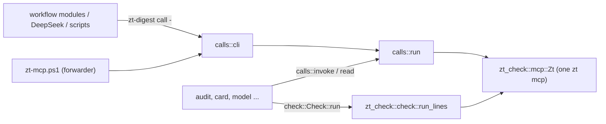

# zt-digest

## Purpose

`zt-digest` is the book digest's tool set as one Rust binary. It replaces the PowerShell scripts that the digest workflows run, tool by tool, with the same parameters and the same output, so that a step starts no pwsh, no helper process per call, and no checker process. One `zt-digest` process holds one `zt mcp` for all its reads and writes and runs [zt-check](zt-check.md) in-process (`tools/zt-digest/src/main.rs`). The first tool is `call`, the zt helper that DeepSeek runs and the scripts write through (`tools/zt-digest/src/calls.rs`). `audit` (the read-only digest audit) and `card` (the card layer cycle) replace `digest-audit.ps1` and `card-compiler.ps1` (`src/audit.rs`, `src/card.rs`), and the model tools `model`, `model-context`, and `list-models` replace `model-compiler.ps1`, `model-context.ps1`, and `list-models.ps1` (`src/model.rs` and `src/model/`). The five scripts only forward to their tools. It exists as a crate of its own, like zt-check, so that it builds and installs without building zt or stopping the ZT service (`tools/zt-digest/Cargo.toml`, `scripts/install-zt-digest.ps1`).

**Owns:** the `zt-digest` command line and its tools, the PowerShell-style parameter parser, the helper semantics (`@@N`, the allow-list, the logs, the Topic gate, `append_card`, the output lines and the resume line), `Invoke-Zt` semantics in Rust (`calls::invoke`, `calls::read`), `Invoke-ZtCheck` semantics in Rust (`check::Check`), the `audit` and `card` tools (the ports of `digest-audit.ps1`, `card-compiler.ps1`, `relatedness.ps1`, and the audit's part of `book-of.ps1`), the model compiler, the model context pack, and the model list (their steps, state, job files, and output), the PowerShell and .NET semantics those tools keep (`audit/ps.rs`, `model::ps`), and the build and install of `zt-digest.exe`.

**Does not own:** the Card check itself and the `zt mcp` client (see [zt-check](zt-check.md)); the MCP tools it calls (see [MCP server](mcp-server.md)); the PowerShell scripts not ported yet, the forwarders `digest-audit.ps1` and `card-compiler.ps1`, the job and state formats of the card cycle, the tests, and `zt-calls.ps1` (see [Digest scripts](digest-scripts.md)); the commands the workflow modules run (see [Digest workflows](digest-workflows.md)); the helper instructions in the DeepSeek prompts (see [Digest prompts](digest-prompts.md)); the helper path `skills/zt/scripts/zt-mcp.ps1`, which forwards to `call`, and the `zt` skill text that tells agents to use the helper (see [Agent skills](agent-skills.md)).

## At a glance

| | |
|---|---|
| Entry points | `zt-digest <tool> [-Name value ...]` (`main` in `tools/zt-digest/src/main.rs`); `skills/zt/scripts/zt-mcp.ps1` (forwards to `zt-digest call`); `scripts/book-digest/digest-audit.ps1` and `card-compiler.ps1` (forward to `audit` and `card`); `scripts/install-zt-digest.ps1` (build and install) |
| Key files | `tools/zt-digest/Cargo.toml` — a crate with its own `[workspace]`; depends on `zt-check` (path), `anyhow`, `regex`, `serde_json` with `preserve_order` |
| | `tools/zt-digest/src/main.rs` — the tool dispatch; prints `zt-digest <tool>: <error>` and exits 1 on an error |
| | `tools/zt-digest/src/args.rs` — `Args`: `-Name value`, `-Name:value`, switches, positional values |
| | `tools/zt-digest/src/calls.rs` — the helper (`run`, `cli`) and `invoke`/`read` for the other tools |
| | `tools/zt-digest/src/check.rs` — `Check`: Invoke-ZtCheck's parameters and defaults, run in-process |
| | `tools/zt-digest/src/util.rs` — UTF-8 files without a BOM, CRLF console lines, compact JSON, `print_last` |
| | `tools/zt-digest/src/zt.rs` — re-exports `zt_check::mcp::Zt` |
| | `tools/zt-digest/src/model.rs` — the model tools' entry points, `read_calls` (`Invoke-Zt` reads with the script's error text), and `Scripts` (the script paths job files name) |
| | `tools/zt-digest/src/model/compiler.rs` — `model`: state, plans (`test_plan`), the steps, job files, writes with `-Moves` |
| | `tools/zt-digest/src/model/text.rs` — Derivation sections, chain position lines, `set_section`, the setting's tables, the explanation and its core |
| | `tools/zt-digest/src/model/context.rs` — `model-context`; `build` also serves `model brief` and `model explain` |
| | `tools/zt-digest/src/model/list.rs` — `list-models` |
| | `tools/zt-digest/src/model/ps.rs` — PowerShell semantics: truthiness, `[string]`, `[int]`, `-eq` on text, `@(...)`, `CiMap` (hashtable keys ignore case), UTF-16 lengths, `Join-Path`, `Split-Path`, `ConvertTo-Json`, `Get-Content` lines, `Sort-Object` order |
| | `tools/zt-digest/src/audit.rs` — `audit`: the read-only audit; `run` is called in-process by `card` |
| | `tools/zt-digest/src/audit/book_of.rs` — Card categories and inferred book attribution (`Get-BookIndex` of `book-of.ps1`) |
| | `tools/zt-digest/src/audit/markdown.rs` — `audit.md` |
| | `tools/zt-digest/src/audit/ps.rs` — PowerShell and .NET semantics: `ConvertTo-Json` output, the `Sort-Object` introsort, culture string order, `[Random]::new(seed)`, `[string]` and `@()` of a value, `Join-Path`, local time |
| | `tools/zt-digest/src/card.rs` — `card`: `plan`, `apply`, `check`, `report`, `precheck` |
| | `tools/zt-digest/src/card/text.rs` — what a rewrite must keep, kind words, Link kinds (`Get-Keep`, `Test-Kinded`, `Get-LinkKinds`) |
| | `tools/zt-digest/src/card/relatedness.rs` — TF-IDF over character bigrams (`relatedness.ps1`) |
| | `scripts/install-zt-digest.ps1` — `cargo build --release` into `D:\zt-digest-target`, then copies `zt-digest.exe` beside `zt.exe` |
| Depends on | [zt-check](zt-check.md) (library: `check::run_lines`, `mcp::Zt`, `reply_text`, `reply_error`); [MCP server](mcp-server.md) (`zt mcp`); [Service, CLI and storage](service-and-cli.md) (the service must be up) |
| Used by | [Digest scripts](digest-scripts.md) (`zt-calls.ps1` and the compilers write through the helper path; `digest-audit.ps1`, `card-compiler.ps1`, `model-compiler.ps1`, `model-context.ps1`, and `list-models.ps1` forward to their tools); [Digest prompts](digest-prompts.md) (DeepSeek runs the helper); [Agent skills](agent-skills.md) (`skills/zt/SKILL.md` names the helper) |
| Tests | `cargo test` in `tools/zt-digest` (`args`, `calls`, `audit`, `card`, `model::ps`, `model::text` unit tests); `scripts/book-digest/tests/zt-helper-gate.tests.ps1`, `zt-calls.tests.ps1` (`list-models`), and every compiler test, which write through the helper path; `card-compiler.tests.ps1`, `digest-audit.tests.ps1`, `organize.tests.ps1`, `book-terms.tests.ps1`, `bridge-human.tests.ps1`, and `bridge-planning.tests.ps1` run `audit` and `card`, and `model-compiler.tests.ps1` and `math-compiler.tests.ps1` (`model validate`) run the model tools, through the forwarders |

## Concepts

- `Tool` — one subcommand of `zt-digest`, named after the script it replaces: `call` (`zt-mcp.ps1`), `audit` (`digest-audit.ps1`), `card` (`card-compiler.ps1`), `model` (`model-compiler.ps1`), `model-context` (`model-context.ps1`), `list-models` (`list-models.ps1`). All six are ported.
- `Forwarder` — a PowerShell script whose body is replaced by a call of its tool (`& $exe <tool> @args`), kept so that callers and tests that name the script still work. `ZT_DIGEST` names the binary to use; otherwise it is `zt-digest` on PATH. The model forwarders rebuild `$args` first: an array becomes a comma-separated value, and `-Name:value`, which `pwsh -File` and `&` hand over as two arguments, becomes one again. `card-compiler.ps1` sets `ZT_DIGEST_SCRIPTS` to its own folder.
- `Script paths` — job files name the scripts as the scripts named themselves: `HELPER:` the helper `skills\zt\scripts\zt-mcp.ps1` and the `dsh-*.zh.md` files in `scripts\book-digest`. `model::Scripts` takes them from the repository zt-digest was built from (`CARGO_MANIFEST_DIR`), or from `ZT_DIGEST_REPO`.
- `PowerShell semantics` — what the scripts' output depended on and the ported tools keep: case-insensitive string comparison and hashtable keys, `Sort-Object` order (an unstable introsort with the zh-CN culture's case-insensitive collation), `@($null)` as one item, `[int]` rounding half to even, and `ConvertTo-Json` formatting (`audit/ps.rs`, `model::ps`).
- `Call` — one `{ "tool", "arguments" }` object of a helper batch; `@@N` in a string argument is the address of call N.
- `Done` / `Failure` — what `calls::run` returns: the lines of the calls that succeeded, and the call that failed with its message and the addresses so far.

## Architecture



A tool parses its parameters with `Args`, opens one `Zt`, and passes it to every read, write, and check. Nothing else starts a process, except the audit's read workers: above one chunk of reads, up to `-Throttle` threads read at once, each on its own `Zt`. `card` runs the audit in-process (`audit::run`) on its own `Zt`; its `precheck` starts no `Zt`, because zt-check `--json` reads no Card.

## Interfaces

### Command line

```text
zt-digest call <file|-> [-From N -Addresses a0,a1,...] [-Log f] [-Allow f] [-Moves f] [-SrcLog f] [-TopicGate f] [-TopicSimilarity 0.8]
zt-digest call -Tool <tool> [-Json '{...}']
zt-digest audit [-CitationKey <key>] -Out <folder> [-MaxSentences 12] [-MaxChars 400] [-MaxSteps 6] [-Throttle 6] [-Chunk 40] [-Sample 15] [-SkipModels]
zt-digest card -Step plan|apply|check|report|precheck -Work <folder> [-Book <key>] [-Staging <folder>] [-Groups "1,2"] [-PerJob 8] [-Sample 0] [-Seed 1] [-Rules R2,...] [-MaxCards 0] [-NoOrphans] [-Notes <file>] [-Compact] [-MaxJobs 0] [-Job <id>] [-File <json>]
zt-digest model -Step <step> -Work <folder> [-Staging <folder>] [...]
zt-digest model-context -Staging <folder> -Model <address> -Out <file>
zt-digest list-models -Staging <folder> (-Groups 1,2,3 | -All [-CitationKey <key>])
zt-digest version
```

Parameter names ignore case. `-Name:value` works. A switch is `-Name` alone (or `-Name:$false`). An unknown name fails, as in PowerShell. A value that does not follow a name is positional: the file of `call`; for `audit` and `card` it binds to the next parameter in the order above that was not named, as in PowerShell, and a value left over fails.

### `call`

Input: a UTF-8 JSON file, or `-` for stdin, holding one call or an array of calls (a BOM is ignored). Output, one line per call in order: `N ok <address>` for a create, edit, append, move, insert, or delete call that returned an address; `N <compact JSON>` for any other call (the reply text as is when it is not JSON). On the first failure: `N error <message>` (white space around line breaks collapsed), then `resume: -From N -Addresses a0,a1,...`, and exit code 1.

| Option | Effect |
|---|---|
| `-From N -Addresses a0,...` | skip the calls before N; their addresses still resolve `@@` |
| `-Log f` | append the address of every Card a `create*` call makes |
| `-Allow f` | only these Cards (one per line) and Cards made in this run may be the `at` of `edit_card`, `append_card`, `create_successor`; `create_topic`, `move_card`, `insert_card`, `delete_card`, `create_literature`, `edit_literature_metadata` fail |
| `-Moves f` | append `{"i":N,"moved":{...}}` per call whose answer has a non-empty `moved` map |
| `-SrcLog f` | append `<address>\t<src>` per Card made from a call with `src`; `src` never reaches zt |
| `-TopicGate f` | lock `f` (no sharing; wait up to 120 s) around `create_topic`; refuse a title equal to or similar to (character-bigram Dice ≥ `-TopicSimilarity`) an agent Topic, naming it: ``topic exists: `<root>` <title>. File the Card under that Topic instead of creating one.`` |

`append_card { at, text }` reads the Card and sends `edit_card { at, body: <body without trailing space> + "\n\n" + <text trimmed> }`.

### `audit`

The port of `digest-audit.ps1`; [Digest scripts](digest-scripts.md) describes what it reports. It makes only read calls (`list_trees`, `get_tree`, `get_model` unless `-SkipModels`, `get_card`, `list_hubs`, `list_broken_links`). It reads in chunks of `-Chunk` calls on up to `-Throttle` workers; a call that fails becomes null, and a tree that could not be read makes `bridges.complete` false. It runs zt-check `--json` in-process, once per model and once per book. A `-CitationKey` that is not an agent Literature tree fails with ``no agent Literature tree `<key>` ``.

| Output | Content |
|---|---|
| stdout | `read N Cards in M trees (S s)`, `read N bodies, M models (S s)`, `Card language: N faults (S s)`, then the summary as compact JSON |
| `audit.json` | the report: `generated`, `scope`, `limits`, `seconds`, `workspace`, `books[]` |
| `audit.md` | the report for people |
| `audit-faults.txt` | every Card language and Card layer fault line, sorted by address |
| `audit-cards.json` | every Card checked outside a model, with body, Links, kinds, inbound Links, category, tree, book, parent |
| `audit-addresses.txt` | every agent Card address |

### `card`

The port of `card-compiler.ps1`; [Digest scripts](digest-scripts.md) describes the cycle, the job files, and the JSON formats. One `Zt` serves the audit, the reads, and the writes. Writes go through `calls::run` in one batch; after a failed call, the rest go again from the next call.

| Step | Last line | Files |
|---|---|---|
| `plan` | `{book, picked, with_faults, review, orphans, faults, jobs}`; with `-Compact` also `dir`, `lead`, `prompts`, and short `jobs` | `before/` (the audit), `state.json`, `fix-NN.md`, `orphans-NN.md`, the two instruction files with `{{KEY}}` replaced |
| `apply` | `{applied_jobs, pending_jobs, retried_jobs, waiting_jobs, counts}` | `state.json` after every job; `owned-gNN.txt` gains each split Card |
| `check` | `{jobs, faults, orphans}` (and the `-Compact` fields) | `after/`, `state.json`, `fix-NN-r2.md`, `fix-NN.md`, `orphans-NN.md` |
| `report` | the report with `refused` as a count | `after/`, `report.json`, `decisions.json` |
| `precheck` | fault lines, then `faults: N` | none |

Each job file holds `SELF-CHECK: zt-digest card -Step precheck -Work "<absolute work folder>" -Job <id>`, so the writer's self-check starts no pwsh. The tool reads `dsh-card-instructions.zh.md` and `dsh-orphan-instructions.zh.md` from `ZT_DIGEST_SCRIPTS`, which the forwarder sets to its own folder, or else from the `scripts/book-digest` folder of the repository the binary was built from. The explain job files of `model` name `SELF-CHECK: zt-digest model -Step explain-check …` the same way.

### `model`

The model compiler of `model-compiler.ps1` (`model::compiler`). Parameters, with defaults: `-Step`* (one of the steps below, case ignored), `-Work`*, `-Staging`, `-Models` (`a,b,…`), `-Plan`, `-Need` (`a=N;b=M`), `-Changed`, `-Rebuild`, `-Level`, `-MaxSentences` (12), `-MaxChars` (400), `-MaxSteps` (6), `-MaxExplainSentences` (16), `-MaxExplainChars` (600), `-MaxParts` (0), `-BriefDoc`, `-FillDoc`, `-ReviewDoc` (default: the shared `dsh-brief`, `dsh-fill`, `dsh-review` instructions), `-Job`, `-File`. `*` marks a mandatory parameter; an empty `-Work` fails.

| Step | Reads | Writes | Prints |
| --- | --- | --- | --- |
| `brief` | `get_model` per model | the model's entry in `state.json` (status `brief`); `<slug>/context.md` (in-process `model-context`), `read-only.allow.txt`, `brief-job.md` | `{"jobs":[…],"skipped":[…]}` |
| `validate` | `-Plan`, `get_model`, `figures.json`, unit forms | nothing | one fault per line, then `faults: N` |
| `apply` | each `<slug>/plan.json` with status `brief` or `planned` | Cards (level, skeleton, moves, merges, 结构); `setting.md`; `job-fNN.md` and `job-fNN.allow.txt`; `moves.tmp` | `{"jobs":[…],"models":[{"model","status","error"}]}` |
| `derive` | `plan.json`, premise Cards | `job-dNN.md`, allow files; status `derived` | `{"jobs":[…]}` |
| `review` | `get_model` | `review-NN.md`; status `reviewed`; clears `rereview` | `{"jobs":[…]}` |
| `split` | new `review-*.json`, `-Need` | Cards (new parts, cut 结果, re-pointed next part, 结构, chain lines); allow files; `follow-NN.md` or a new `job-dNN.md` | `{"jobs":[…],"orphans":[…]}` |
| `report` | `get_model`, zt-check `--model … --skip-shared` | nothing | `{"models":[…]}` |
| `explain` | `get_model`, the setting Card, the Model Card | `setting.md`, `context.md` (with `-Staging`), `explain-NN.md`, `out/`; `state.explain` | `{"jobs":[…],"parts":N.0}` (a double, as `Measure-Object -Sum` gave it) |
| `explain-check` | `-Job`, its result file (or `-File`), the Cards, zt-check `--json` | nothing | fault lines, `(blocked, …)`, `(kept: …)`, `<address> ok`, then `faults: N` |
| `explain-apply` | every explain job with parts left | Cards (25 edits per helper call), `explain-follow-NN.md`; `state.explain` | `{"applied","refused","blocked","kept","jobs"}` |
| `explain-report` | `get_model` per explained model | nothing | `{"models":[…]}` |

`state.json` is written as `ConvertTo-Json` wrote it: two-space indent, CRLF line ends, keys in first-assignment order. Job files keep the script's HEADER lines (`HELPER:`, `CHECK:`, `ALLOW:`, `LIMITS:`, `SELF-CHECK:`), and the lines a StringBuilder wrote keep their CRLF ends. Writes go through `calls::run` with `-Moves <Work>\moves.tmp`, one renumbering call at a time; every address in `state.json` follows each moved map. Reads use `model::read_calls`, which fails with `zt-mcp failed: <i> error <message>` as zt-calls.ps1 did; a write fails with `zt: <message>`. A failed `apply` of one model records that text as the model's `error`.

### `model-context`

`model::context` (model-context.ps1). Parameters: `-Staging`*, `-Model`*, `-Out`* (an empty value fails, as PowerShell's mandatory binding did). Reads the Model Card, `get_model`, the book's tree, `owned-g*.txt`, `manifest.json`, and the section files; writes the Markdown pack to `-Out` (UTF-8, CRLF line ends); prints `{"model","group","anchor","sections","parts","context"}`. `model brief` and `model explain` call `context::build` on their own `zt mcp`; a failure fails `brief` with `model-context.ps1 failed for <model>` and leaves `explain` with `上下文包: 无`.

### `list-models`

`model::list` (list-models.ps1). Parameters: `-Staging`*, and `-Groups` (a string such as `1,2,3`) or `-All` with an optional `-CitationKey`; giving both sets fails. Reads `owned-g*.txt`, `list_trees`, the trees in `Sort-Object -Unique` order (culture order, case ignored), and `get_model` per Model Card; prints `{"models":[{"address","title","group","level","form","parts","issues","faults"}]}`.

### Library functions for the tools

| Function | Does |
|---|---|
| `calls::run(zt, calls, options)` | the helper, returning `Done` lines and an optional `Failure` |
| `calls::invoke(zt, calls)` | `Invoke-Zt`: the answers of the calls whose reply text is a JSON object, in order; a failure is `zt: <message>` |
| `calls::read(zt, tool, arguments)` | one read; its answer |
| `audit::run(zt, params, host)` | the audit; `host` gets the progress lines; `audit::Params::for_card(book, out)` gives the parameters `card` uses |
| `check::Check { .. }.run(zt)` | `Invoke-ZtCheck`: zt-check's lines; fails with `zt-check did not run: …` when no `faults: N` line comes back |
| `util::print_last(value)` | the last line of a compiler step |

## Behaviour

### A tool run

1. `main` takes the tool name (case ignored) and hands the rest of the arguments to the tool.
2. The tool parses them with `Args`; an unknown name or a missing value ends the run with `zt-digest <tool>: <error>` and exit code 1.
3. The tool starts one `Zt` when it needs the archive, and passes it to every `calls::invoke`, `calls::run`, and `Check::run`.
4. It prints its lines; a compiler step prints compact JSON last (`util::print_last`).
5. Dropping the `Zt` closes the server's stdin and waits for it.

### A helper batch (`calls::run`)

For each call from `-From` on: resolve `@@N`; apply the allow list; turn `append_card` into `get_card` and `edit_card`; remove `src`; with `-TopicGate` and `create_topic`, lock the gate file and compare the title with the agent Topics (`list_trees`); send the call; release the gate; on an error stop with a `Failure`; record the address; log `create*` addresses, `src`, and `moved` maps; keep the output line. A transport failure (`zt mcp` closed) is an error of the whole run, not a `Failure`.

## Data and storage

zt-digest keeps no state of its own. The helper appends to the files its options name (`-Log`, `-SrcLog`, `-Moves`: UTF-8 without a BOM, one entry per line) and uses `-TopicGate` only as a lock. The ported compilers keep the work folders, `state.json`, job files, and reports of the scripts they replace (see [Digest scripts](digest-scripts.md)).

## Configuration

| Setting | Default | Effect |
|---|---|---|
| `ZT_CHECK_ZT` | `zt` on PATH | the program `Zt::start` runs as `<program> mcp` |
| `ZT_DIGEST` | `zt-digest` on PATH | the binary a forwarder script runs (a test of an unreleased build) |
| `ZT_DIGEST_REPO` | the repository zt-digest was built from | where `model` finds the paths its job files name (`scripts\book-digest\…`, `skills\zt\scripts\zt-mcp.ps1`) |
| `ZT_DIGEST_SCRIPTS` | `scripts/book-digest` of the repository the binary was built from | where `card` reads the instruction files, and the folder of the script its `SELF-CHECK:` lines name; `card-compiler.ps1` sets it |
| `-TargetDir` of the install script | `D:\zt-digest-target` | the Cargo target folder (E: is nearly full) |

## Usage

```bash
pwsh -NoProfile -File scripts/install-zt-digest.ps1
cd tools/zt-digest && CARGO_TARGET_DIR=D:/zt-digest-target cargo test --release
```

A DeepSeek run or a script calls the helper as `zt-digest call - -Log <file>` with the batch on stdin.

## Testing

- `cargo test` in `tools/zt-digest`: the parameter parser, the helper's `@@N` and Topic-gate title rules, the PowerShell semantics of `model::ps` (truthiness, `[int]`, `-eq`, UTF-16 cuts, `Join-Path`, `Split-Path`, `ConvertTo-Json`, `Sort-Object` order, hashtable keys), and the text functions of `model::text` (chain lines, `set_section`, the explanation and its core, the tables).
- `scripts/book-digest/tests/model-compiler.tests.ps1` drives every `model` step through the forwarder; `math-compiler.tests.ps1` runs `model validate` on a unit plan; `zt-calls.tests.ps1` runs `list-models` under a GBK console.
- `cargo test` in `tools/zt-digest`: the parameter parser and the helper's `@@N` and Topic-gate title rules; `audit/ps.rs` against values pwsh 7.6 printed (`Sort-Object` orders of 200 and 40 items, `[Random]::new(1)`, `ConvertTo-Json` text); `book_of.rs` with the assertions of `book-of.tests.ps1`; the audit's figure names, quantiles, tallies, and Bridges (an incomplete read leaves `island` null, the assertion `bridge-planning.tests.ps1` made through a faulting helper); `audit.md` lists; the card cycle's kind words, Link kinds, rewrite test, ranking, and job text.
- `scripts/book-digest/tests/card-compiler.tests.ps1`, `digest-audit.tests.ps1`, `organize.tests.ps1`, `book-terms.tests.ps1`, `bridge-human.tests.ps1`, and `bridge-planning.tests.ps1`: `audit` and `card` through the forwarders on scratch archives.
- `scripts/book-digest/tests/zt-helper-gate.tests.ps1`: `-SrcLog`, `-TopicGate`, and two helpers at once, through the forwarder.
- Every compiler test of [Digest scripts](digest-scripts.md) writes through the forwarder, so `pwsh -NoProfile -File scripts/book-digest/tests/run-all.ps1` checks the helper on scratch archives.

## Decisions and pitfalls

- **Same parameters, same output.** A tool keeps the PowerShell script's parameter names and output lines, so the workflows, the prompts, and the tests change only the program they start.
- **One process, one `zt mcp`.** The helper used to cost a pwsh and a `zt mcp` per batch (about 0.8 s); a tool now reuses one server for every call and check.
- **zt-check as a library.** The check runs on the tool's own `Zt`, and its rules stay in one crate.
- **Key order.** `serde_json` has `preserve_order`, so compact JSON keeps the order zt and the tools wrote, as `ConvertTo-Json` did.
- **PowerShell's order, not Rust's.** `audit/ps.rs` copies what the scripts' files depended on: `Sort-Object` is .NET's introsort (equal keys come out in its order, not input order, above 16 items), strings sort by the zh-CN culture ignoring case (Han before Latin letters), `[Random]::new(seed)` is the .NET generator, and JSON is written as `ConvertTo-Json` writes it (two-space indent, CRLF, `1.0` for a whole double). On the card-compiler test flow and on a 635-Card archive, every file `audit` and `card` write equals the script's, byte for byte, except where PowerShell's order was random: the keys of an unordered `@{}` (`limits`, `bridges.out`, `bridges.in`) and ties in the relatedness ranking.
- **Read workers.** The audit read with `-Throttle` helper processes; the tool keeps that, with one `zt mcp` per worker thread, because one `zt mcp` answers a `get_card` in about 8 ms.
- **The forwarder must read stdin as UTF-8.** It sets `[Console]::InputEncoding`; without it a GBK console garbles the batch.
- **PowerShell semantics are kept on purpose.** The model tools compare text as `-eq` did (case and ignorable characters do not count), look up `@{}` keys without case, count lengths in UTF-16 units, treat `@($null)` as one element, and write doubles where `Measure-Object` gave doubles (`model::ps`). State maps read back from `state.json` are case-sensitive, as `ConvertFrom-Json -AsHashtable` made them.
- **Error texts are not PowerShell's.** A PowerShell runtime error (a null hashtable index, a failed `[int]` cast) had a localized message; the tool writes an English one. Errors on stderr are `zt-digest model: <error>`, not a PowerShell error record.

## Change history

- `2026-10-16` — The job files of `card` and `model` name their self-checks as `zt-digest card -Step precheck …` and `zt-digest model -Step explain-check …`, not the forwarding scripts. The workflows run every ported script as its tool (`zdTool` in `zt-digest-lib.js`).
- `2026-10-16` — The model tools: `model` (model-compiler.ps1, every step), `model-context`, and `list-models`, with `model::ps` for the PowerShell semantics they keep; the three scripts are forwarders. The 19 steps of `model-compiler.tests.ps1` take 1.3 s in the tool, 11.6 s through the forwarders, and 34 s in the old script.
- `2026-10-16` — `audit` and `card`: the ports of `digest-audit.ps1` and `card-compiler.ps1` (with `relatedness.ps1` and the audit's part of `book-of.ps1`), `audit/ps.rs` for PowerShell and .NET semantics, and `util::bind_positional`; the two scripts forward to the tools.
- `2026-10-16` — zt-digest created: the crate, the `call` tool (the zt helper in Rust), `Invoke-Zt` and `Invoke-ZtCheck` in Rust, `zt-mcp.ps1` as a forwarder, `scripts/install-zt-digest.ps1`.
