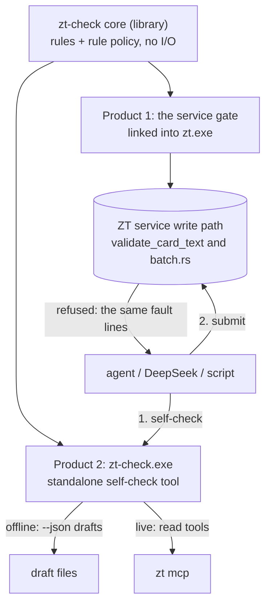

# One zt-check module: a service gate and a self-check tool

Status: proposal (2026-10-24). Nothing in this document is built yet.

## 1. The problem

Today a Card is checked in two places, and they do not agree on what "legal" means.

| Level | Where | What it checks | Who it covers |
|---|---|---|---|
| Write-time validation | the `zt` binary: `validate_card_text` (`src/main.rs`), `card_type::ensure_allowed`, `model::ensure_allowed`, the hub checks, `link_index::validate` | the Card envelope (title line, one Reverse-link marker, no repeated title), the fields a type may carry, Location and Citation key grammar, that Link targets exist, model, math and hub fields | every write, from every client (GUI, terminal Session, shell commands, `zt mcp`, `apply_batch`) |
| zt-check | the separate crate `tools/zt-check`, used by the digest workflows (SELF-CHECK, fix cycle, layer gates, audit) | what a Card of each type must contain: Card language R2–R22, Idea rules I1–I7, Event rules E1–E5, Finding rules F1–F4, Link rules L1–L3 | only writes made inside a digest run |

The result:

1. **A Card can be stored that breaks its type's format.** An Event Card without `时间 / 地点 / 参与者 / 经过 / 来源`, or a Finding Card with two `结果` labels, passes the service. Only a digest catches it, and only after the Card is written. `docs/wiki/cards-and-links.md` records this as a decision ("body conventions are taught, not validated").
2. **Writes outside a digest are not checked for format.** This covers GUI edits, plain MCP writes, zt-idea-grow, and agent sessions that do not run zt-check.
3. **"Legal" has two definitions in two codebases.** The service's envelope rules live in `src/`. The type rules live in `tools/zt-check/src/check.rs`. A client cannot ask one place whether a Card is legal.
4. **The checker cannot be put into the service as it is.** zt-check reads Cards by starting `zt mcp` as a child process (`tools/zt-check/src/mcp.rs`). Inside the service that would be a loop: the service would call itself.

## 2. The proposal

There is one independent module, **zt-check**, which owns the full definition of a legal Card. It has one rule core and two products built from it:



- **Product 1, the gate.** It runs inside the ZT service on every write. A write whose Card is not legal is refused. Nothing is stored and no id is used.
- **Product 2, the self-check tool.** `zt-check.exe` is the standalone command that an agent runs on its drafts *before* it submits. It runs the same rules, at the same version, with the same fault text, so a draft that passes the tool also passes the gate.

The principle is **one rule set, two entry points**. The gate is the authority. The tool is a way to see the gate's answer early and cheaply.

### 2.1 "Two binaries" in Rust terms

The two products come from one crate:

| Product | Build form | Why |
|---|---|---|
| Gate | the `zt-check` library, linked into `zt` as a path dependency with the `core` feature only (no MCP client, no process code) | in-process: no process start per write, no version gap between the service and its gate, and it runs inside the write transaction |
| Self-check tool | the `zt-check` binary (`main.rs`), with the `cli` feature (core, the `zt mcp` client, the offline `--json` reader) | an agent can run it with no service (offline drafts) or against the live archive |

The other option is a separate gate process that the service calls on each write. It is not recommended: every write would need IPC, the gate's version could differ from the service's, and its check would run outside the edit lock.

## 3. The crate layout

```text
tools/zt-check/
  Cargo.toml            features: core (default for zt), cli (default for the binary)
  src/
    lib.rs              pub mod rules; pub mod policy; pub mod context; #[cfg(feature="cli")] pub mod mcp;
    rules/              the rule core: pure functions over Card entries and a context
      envelope.rs       moved from zt: title line, Reverse-link marker, repeated title (R19 merges here)
      language.rs       R2–R22 (from check.rs)
      layer.rs          I, E, F, L (from check.rs)
      model.rs          R13–R17 inputs (level, facet, term table)
    policy.rs           which rule blocks where (section 5)
    context.rs          the Context trait: what a rule may read beyond the Card itself
    graph.rs            unchanged: the whole-graph facts for the audit
    mcp/                cli only: the zt mcp client, the Literature scope, the box pin
    main.rs             cli only: zt-check.exe
```

**The Context trait** is the seam between the rules and storage. A rule never reads storage itself. It asks the context:

```rust
pub trait Context {
    fn card(&self, address: &str) -> Option<CardView>;        // Link targets, parent, book place
    fn model_of(&self, address: &str) -> Option<ModelView>;   // level, setting, facet, shared
    fn term_table(&self, setting: &str) -> Vec<TermRow>;      // R6
    fn book_of(&self, address: &str) -> Option<String>;       // I3, F2, I7
}
```

- **The service** implements `Context` over its SQLite connection, inside the same transaction as the write. The gate therefore sees the archive exactly as the write will change it.
- **zt-check.exe** implements it over `zt mcp` read tools (live mode) or over the entries of a `--json` file (offline mode, as today).

Envelope parsing moves from `src/card.rs` into the module, so that there is only one parser. zt keeps calling it through the library. Location grammar and Link existence stay in zt, because they are storage facts. The gate receives them through `Context`.

## 4. Which rules can run at the gate

Not every current rule can run on one write. Each rule is put into one of three classes.

| Class | Rules | Gate | Self-check tool | Audit (`--cards`) |
|---|---|---|---|---|
| **Card-local**: needs only the Card and its type | envelope, R2–R5, R7, R9, R12, R18, R19, R22, I1, I2, E1, E2, F1, F3, L1, L2 | yes | yes | yes |
| **Context**: needs a bounded read of the Card's model, book or setting | R6, R13–R17 (level and facet), I3, I4, F2, I7 | yes, through `Context` | yes | yes |
| **Graph**: needs other Cards' Links to this Card, or a whole Workspace | I5, E4, F4 (inbound Links), I6, E5 (title similarity), L3 | **no**. When a Card is created, nothing links to it yet. | yes, as advice | yes |

Graph rules stay audit rules. The gate refuses only what one write can be blamed for.

## 5. The rule policy: what blocks where

The current R rules are Chinese digest-language heuristics (sentence length, `被`, `；`). Blocking a person's own GUI note because one sentence has 41 characters would be wrong. The policy therefore separates **format** (what makes a Card of a type legal) from **style** (the digest's writing standard).

| Rule group | human Workspace | agent Workspace |
|---|---|---|
| Envelope, type fields, Links (today's service checks) | block | block |
| Type format: E1, E2, F1, F2, F3, R22 (open formula), R18, R19 | block | block |
| Model structure: R13–R17 (formal models only, as today) | advise | block |
| Card language: R2–R5, R7, R9, R12; layer rules I2–I4, I7, L1, L2 | advise | block |
| Advisory rules: I1, R20, R21, I7 unknown-source, and every graph rule | advise | advise |
| R6 (term table) | off | advise (owner decision D13: a fix can change meaning) |

- **block**: the write is refused and the fault lines are returned.
- **advise**: the write is stored and the fault lines come back in the reply as `warnings`.
- **off**: not checked at the gate.

The policy is data in `policy.rs`, keyed by Workspace and rule. `zt config` can override it per archive (`gate.<workspace>.<rule> = block|advise|off`). Both products read the same policy. The tool prints which lines the gate would block, so `zt-check` exit code 0 means "the gate will accept this".

## 6. Gate behaviour

**Where it runs.** `validate_card_text` (`src/main.rs`) is already the one point that every text write passes: `ops.rs`, `place.rs`, `batch.rs` and the shell commands all call it. The gate is added there. Its signature gains the Card's type, facet, level and Workspace, because today it receives only the address and the text. A retype (`ops.rs` `ensure_allowed`) also runs the gate, because a new type brings new format rules for the same text. Moves, renames and deletes do not change a body, so they run no text rules. They keep today's Link-rewrite and lock checks.

**Existing Cards (the ratchet).** Many stored Cards were written before these rules. An edit must not be refused for a fault the Card already had. On an edit, the gate blocks only the faults that are **new** in the edited text, compared with the old text (same rule and same fault text). Faults that were already there come back as advice. This is the pattern `validate_card_text` already uses for the repeated-title check (`authored_changed`). A new Card has no old text, so every blocking fault blocks.

**The refusal.** A refused write is a tool error with code `card_check`. Its message holds the fault lines in today's format, so agents and scripts parse one format everywhere:

```text
card_check: 2 blocking faults
Grossman2002/14 E2 missing labels: 参与者、来源
Grossman2002/14 R3 E 在时点 1 付不出去；E 能部分付出。
```

**`apply_batch`.** Each item is checked. One blocking fault refuses the whole batch, as today's validation errors do, and the message names the item (`batch item 3 (create_successor): …`). A preview batch (`preview: true`) runs the gate and returns every fault without writing. This gives agents with no binary a self-check through the service itself.

**Version.** The gate states its rule version in the `initialize` answer of `zt mcp` (`zt_check_version`, beside `version`). `zt-check.exe` in live mode compares it with its own version and warns on a mismatch, so a stale tool can never claim that a Card passes.

## 7. The self-check tool

`zt-check.exe` keeps its current modes (`--json`, `--model`, `--addresses`, `--cards`) and their output, with three changes:

1. It loads the same `policy.rs` and adds a `--workspace human|agent` flag (default `agent`). Exit code 1 now means "the gate would refuse this". `faults: N` counts blocking lines only. Advice is printed with `(advisory)`, as `--cards` already does.
2. **A new `--draft <file>` mode** takes Card texts exactly as they will be submitted, with their target address. It runs the envelope, type and context rules. This is the agent's last check before `create_successor` or `edit_card`.
3. Live mode compares its version with the service's gate version (section 6).

The Literature write scope and the box pin stay in the CLI's MCP client. They are a policy of the digest client, not a rule about Card legality.

## 8. What changes for each caller

| Caller | Today | After |
|---|---|---|
| Person in the GUI or terminal | envelope checks only | also blocked on type format (E, F, R22); advised on style |
| Agent through `zt mcp` | envelope checks only | gate as the agent Workspace policy; can self-check with `zt-check --draft` or a preview `apply_batch` |
| Digest workflows | zt-check after writing, then a fix cycle | the same SELF-CHECK before writing; most post-write faults now cannot be stored, so the fix cycle handles graph and advisory faults only |
| zt-idea-grow | no format check | the gate covers its Topic Cards with no workflow change |
| zt-digest (library user) | `run_lines` with its own `zt mcp` | unchanged API; it links the same crate |

## 9. Costs and risks

- **Rule changes need a service redeploy.** Today zt-check builds and installs without stopping the service (a stated decision in `docs/wiki/zt-check.md`). With the gate inside `zt.exe`, a rule change means rebuilding `zt` and restarting the service, which is the locked-exe procedure on Windows. The version check in section 6 makes a gap between the two builds visible.
- **Digest runs may be refused mid-stage.** A stage that wrote a faulty Card and fixed it later will now stop at the write. Every digest writer must run its SELF-CHECK before it submits, and each stage must treat `card_check` as a fix-cycle input, not as a run error. This needs a base workflow release.
- **Write latency.** The rules are regex and string work on one Card, plus bounded context reads in the same transaction. The target is under 5 ms per Card. A benchmark on `apply_batch` with 200 items is part of phase 2.
- **PowerShell semantics.** check.rs reproduces .NET string semantics (UTF-16 lengths, culture comparison). These move with the rules, so the gate and the tool count characters identically.
- **Legacy Cards.** The ratchet keeps them editable. `zt-check --cards` over the whole box gives the count of legacy faults before phase 3 is switched on.

## 10. Phases

1. **Split the crate (no behaviour change).** Move the rules out of `check.rs` into `rules/` behind `Context`. Put the MCP client behind the `cli` feature. All current zt-check and zt-digest tests pass unchanged.
2. **Link the core into zt, advise only.** `validate_card_text` runs the gate, and every fault comes back as `warnings`; nothing is refused. Measure the latency, and count the faults that real writes would hit for one week of use.
3. **Move the envelope parser** from `src/card.rs` into the module. zt calls it through the library. The zt tests for envelope errors pass with the same messages.
4. **Block type format** (section 5, rows 1–2) in both Workspaces, with the ratchet.
5. **Block the agent Workspace's style and model rules.** Release the digest base with the SELF-CHECK-before-submit rule and `card_check` handling in the fix cycle.
6. **Self-check tool changes**: `--workspace`, `--draft`, the version check, and blocking-only `faults: N`.

## 11. Decisions for the owner

1. **Human Workspace policy.** Should type-format rules (E, F) block your own GUI notes, or only advise? The proposal says block, because a mis-labelled Event Card is not an Event Card.
2. **Agent Workspace style rules.** Should the Card language rules (R2–R12) block agent writes, or only advise? Blocking makes every agent write meet the digest standard, including writes from idea-grow and ad-hoc sessions.
3. **Gate process form.** The proposal is in-process (a library linked into zt), not a second gate process the service calls. Confirm.
4. **Preview batch as self-check.** Should the service also be a self-check path (preview `apply_batch` and a `check_cards` MCP tool), or should the standalone binary be the only one?

## 12. Tests

- **Parity:** one fixture set (`card-style-fixture.json`, `card-layer-fixture.json`, plus new envelope cases) runs through the CLI and through the gate on a scratch archive. Both must give the same lines in the same order.
- **Gate:** for each blocking rule, a write is refused and the archive revision does not change. For each advising rule, the write is stored and the warning is returned. An edit of a legacy Card with an old fault passes, and the same edit with a new fault is refused. A refused `apply_batch` names the item and writes nothing.
- **Policy:** a `zt config` override changes block to advise for one rule in one Workspace only.
- **Version:** a CLI at another version warns in live mode.
- **Digest:** the base workflow harness (`scripts/book-digest/tests/framework-harness.mjs`) with a writer that submits a faulty Card receives `card_check` and routes it to the fix cycle.
