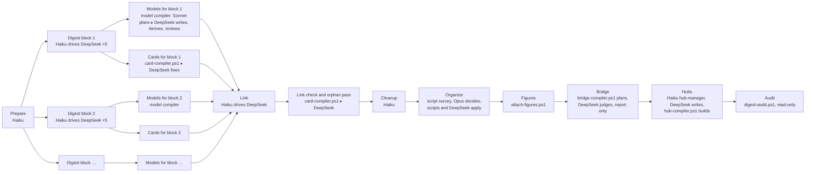

# The ZT digest workflows

The digest turns a book from the Scholar Archive into
Cards in the agent Workspace: a Literature tree for the book, Topic trees for the ideas that stand
on their own, Event Cards for the real events it reports, and a **structured model** for every
model it sets out. Two Workflows run it: `zt-econ-digest` (economics books) and `zt-math-digest`
(mathematics textbooks, see `zt-math-digest-workflow.md`). Both are built by the Workflow Framework
Protocol from the shared base `scripts/book-digest/workflow/zt-digest-base.blueprint.json` and are
installed frozen (`zt-digest-framework.md`). Run one from Claude Code ("run the zt-econ-digest
workflow on …"); it uses DeepSeek Harness for the bulk reading and writing, the **model compiler**
for the models (a Sonnet architect plans each model, a script builds it, DeepSeek writes and
reviews it), and Opus for the final organization.

This doc began as the doc of the hand-written `zt-book-digest.js`, which was removed on 2026-10-16:
the base and its two variants replace it. The stages and arguments below are those of the base.
One difference stays from that history: the model layer runs once after the whole digest, with no
per-block compile and no model sweep.

## Bridge mode

Full mode runs report-only Bridge discovery after Figures and before Hubs. Use `mode: "bridge"` with a fresh `out` and an existing `citationKey` for a bounded report; `bridgeMax`, `bridgeCandidates` and optional `bridgeBooks` control coverage. The workflow publishes `<out>\bridge\report.md` only after every judge job answered. When planning or a judge job fails, it publishes nothing, and the result tells you to run mode `bridge` again with the same `out` to resume. The cleanup always deletes every DeepSeek judge conversation and the DeepSeek workspace, also after a failure. After actual review, use the same folder with `bridgeReport` and `bridgeApply` / `bridgeApplyEarlier` (each `"all"` or a unique array of report ids such as `"b001"`). Apply uses no source probe, judge, model compiler, Organize or Hubs. See [the shared operator contract](zt-digest-framework.md#bridge-discovery-and-apply) for limits, backup, quiet filing, retries and stale-report handling.

## What happens



| Stage | Who | What it does | What you get |
| --- | --- | --- | --- |
| **Prepare** | Haiku runs a script | Extracts the Chinese text, cuts it into section groups (about 20,000 characters each), and creates the agent Literature Card with one anchor Card per group. | `<out>\groups`, `<out>\sections`, the Literature tree `[[Key]]` → `[[Key/1]]` … |
| **Terms** (end of Prepare) | Haiku relays one DeepSeek job | `book-terms.ps1` lists candidate terms (headings, bold terms, definitions, terms with their English original, frequent word groups); DeepSeek chooses the terms and the words not to use; the script writes `terms.md` and the Card 术语表 (a Side successor of `<key>/1`). Each group file names the table, and the audit checks rule R6 against it. | `terms.md`, the term table Card |
| **Digest** | one Haiku manager per block of up to 5 groups; one DeepSeek run per group | Each DeepSeek run gets only its own sections, searches the rest of the book on disk, and writes 6–12 Cards: Idea Cards placed in Topic trees or under its anchor, Event Cards, and **one whole Model Card per model**. Blocks run in parallel. | Cards, and `owned-gNN.txt` (which Cards each group wrote) |
| **Models** | Haiku lists, then the **model compiler** per batch (`perConcept` concept models or `perSonnet` formal models): DeepSeek briefs, one Sonnet architect plans, `model-compiler.ps1` builds, Haiku drivers relay DeepSeek rounds | Starts for a block as soon as that block's DeepSeek runs finish, while other blocks are still digesting. DeepSeek writes a brief of each model's source; the Sonnet architect writes only `plan.json` (level, parts in build order, premises, where Derivation parts go and how many); the script builds the skeleton; DeepSeek writes the Model Card, setting, parts and charts, then the Derivation parts; a DeepSeek reviewer splits any derivation that jumps or is too dense, and the script inserts the new parts. See `docs/model-compiler-design.md`. | Concept models and self-sufficient formal models; a report per model |
| **Cards** (beside Models) | Haiku relays DeepSeek jobs of `card-compiler.ps1` | After each digest block: the script checks the block's Idea Cards, Event Cards, and anchor (Card language and the I, E, L rules); DeepSeek rewrites the Cards with faults, and reviews a sample (`ideaSample`) against the source, as JSON files; the script checks each rewrite (every Link, figure, and formula kept) and writes it, checks again, and sends what is left back once. It never writes a Model Card or part. | Cleaner Cards, `cards-gNN\report.json` |
| **Link** | Haiku drives DeepSeek again | Each group's run appends reasoned Links from its own Cards to the rest of the book, including to the Model part a Card concerns. | Cross-part Links |
| **Link check** | the same cycle on the whole book | Rules L1 and L2 on the Links of the link pass, and the orphan pass: each Card that no other Card links gets a reasoned Link from a related Card. | `cards-link\report.json` |
| **Cleanup** | Haiku | Deletes any DeepSeek conversation a manager left, removes the DeepSeek workspace and scratch files; reports DeepSeek token use. | — |
| **Organize** | a script, Opus, scripts, DeepSeek | `organize-survey.ps1` lists what to decide: duplicate Topics, small Topics, merge proposals, model faults. Opus writes only `decisions.json`: the thesis, Topic merges, moves, and notes for single Cards. `organize-apply.ps1` carries out the merges and moves; a card cycle carries out the notes (rule N1); `book-skeleton.ps1` and one DeepSeek job write the Literature Card index, the structure Card, and the Topic bodies. `organize: "legacy"` runs the old single Opus job. | A finished digest |
| **Figures** | a script | `attach-figures.ps1` shows the book's own figures in every Card that names one, and links the book's PDF and Markdown from the Literature Card. See "The book's figures and documents" below. | Cards that show their figures |
| **Bridge** | `bridge-compiler.ps1`; Haiku drivers relay DeepSeek judge jobs | `plan` finds candidate Cards in other books for each source Card of this book: up to `bridgeCandidates`, plus at most two term matches. DeepSeek judges each pair as JSON (`dsh-bridge-instructions.zh.md`). `precheck` checks each answer, and `report` writes the proposals. Mode `full` never applies a proposal. The report is published only when every judge job answered. A failed stage shows `status: failed` and the run continues. | `<out>\bridge\report.md`, `state.json` |
| **Hubs** | a Haiku hub manager chooses the limits; Haiku drivers relay DeepSeek jobs; `hub-compiler.ps1` builds | Runs on the whole agent Workspace. The script surveys every Topic tree; the hub manager chooses from the survey when a tree or branch needs a hub and how large a hub may be; DeepSeek plans the fields and register terms and writes each topic and line hub as JSON; the script builds the Hub Cards, links them from Topic bodies and the register (Topic `索引`), checks each with `get_hub`, and sends faults back once; the conversations are deleted at the end. Only trees that changed are rewritten on a later run. See `docs/hub-cards-design.md`. | Hub Cards at four levels: line, topic, field, register |
| **Audit** | Haiku runs a script | `digest-audit.ps1` reads the book's Cards and changes none. Per book it counts the Cards by category, the Topic trees, the Card language faults per rule (`zt-check`, R2 to R14), orphans, Idea and Event Cards with no source line or no kinded Link, models that are not self-sufficient, figures named but not shown, and its semantic Bridges out and in by book. It reads the trees of both Workspaces, because a human Card is a Bridge endpoint. For the Workspace it adds missing hubs, broken Links, and the islands (books with no semantic Bridge in or out). See `docs/digest-card-layers-proposal.md` (phase 1). | `audit.md`, `audit.json`, `audit-faults.txt` in `out` |

## DeepSeek Subagent Managed Protocol

Every DeepSeek run goes through a Haiku manager, by the protocol in
`~/.claude/skills/deepseek-subagent-managed-protocol`:

- A manager runs at most 8 DeepSeek conversations (`perManager`, `linkPerManager`, and `dshPerBatch`
  are capped at 8). A compiler step gets one manager per 8 jobs: 1-8 jobs one manager, 9-16 two.
- At most 8 managers are alive at once in the whole run (`dsmpSlot`), so at most 64 DeepSeek
  conversations run at once. More managers wait for a free slot.
- Conversations are deleted, never archived. A digest or link manager deletes each run after it has
  the answer. A compiler step keeps its conversations until its cleanup, because later rounds
  continue them; the cleanup deletes them.
- When the work in a workspace is done, its cleanup removes the workspace with
  `deepseek_remove_workspace` and `delete_conversations: true`. The folder and its files stay on disk.

## Skills for DeepSeek

The manager of each DeepSeek run sends the skills, through the `skills` field of `deepseek_run`
and of every `deepseek_prompt` (a follow-up prompt does not keep the skills of the run before it).
No prompt file carries the text of a skill. Both skills are installed in DeepSeek Harness
(`deepseek_skills` lists them).

| Run | Sent by | Skills |
| --- | --- | --- |
| Digest, Link | Haiku manager | `zettelkasten`, `asd-ste100-zh` |
| Fill and Derive (Models stage), and their split and fix follow-ups | Haiku driver (model compiler) | `asd-ste100-zh` |
| Brief and Review (Models stage) | Haiku driver (model compiler) | none |

The Card language sections of the instruction files keep the project's own limits (40 characters
per description sentence, 30 per derivation step), because `zt-check` checks those
numbers. Where they differ from the skill, the instruction files win. If a skill is not found, the
manager stops and reports; it does not start the run without the skill.

## Elaboration levels (zt 0.13.0)

Not every model needs the full build (`docs/model-elaboration-levels-design.md`). Each Model Card
carries an **elaboration level**:

| Level | When | What the Models stage builds |
| --- | --- | --- |
| 1 `concept` | The book states the model in words or a diagram: a mechanism, a typology, a framework, a verbal argument, or a formal model it only cites. | The Model Card (问题 · 概要 · 结构 · 关联 · 来源) and at most four parts in words (`设定`, `机制`, `结论`, `例子`). No Derivation parts, no derive or review round. |
| 2 `formal` | The book states the model in mathematics: symbols, equations, a derivation, a proposition with a proof. | A self-sufficient model, by the model compiler below. |

- **Digest.** DeepSeek sets `level` on each Model Card it writes (`formal` when unsure).
- **Listing.** `list-models.ps1` reports each model's `level`. Concept models go in batches of
  `perConcept` (default 10); formal and undecided models in batches of `perSonnet` (default 6).
- **Brief and plan.** The DeepSeek brief proposes a level; the Sonnet architect decides it in
  `plan.json`, and the compiler sets it.
- **Check.** A concept model must show no `closure`, `forward`, `unanchored`, or `beyond_level`
  fault in `get_model` `build`; `beyond_level` lists a Derivation part in a concept model.
- **Forcing a level.** `level: "concept"` or `level: "formal"` builds every model of the run to that
  level, and a model whose level differs is never skipped.
- **Organize.** Opus lists each model's level in the book's structure Card and reports a level that
  looks wrong; it does not change levels.

## The model compiler (2026-10-14)

A reader must be able to build each formal model from nothing, reading only its own Cards in build
order (`docs/self-sufficient-models-proposal.md`). Since 2026-10-14 the **model compiler** builds it
(`docs/model-compiler-design.md`); it replaced the Sonnet manager of zt 0.12.0–0.15.0, which planned,
wrote, supervised, and checked everything itself. Per batch of models:

1. **Brief (DeepSeek).** `model-compiler.ps1 -Step brief` writes each context pack; a DeepSeek run
   reads the source passages and writes `brief.md`: the equations in book order with numbers and
   lines, which steps the book skips and how many lines of algebra each needs, the examples, the
   diagrams, the outside premises, and reusable building blocks.
2. **Plan (Sonnet).** One Sonnet architect (`model-architect.md`) writes `plan.json` per model: the
   level, the parts in build order (main line, side, off, shared), each part's premises, and where
   the Derivation parts go and how many (a chain where a step outgrows `maxSteps`). It runs
   `-Step validate` until it prints `faults: 0`. It writes no Card and starts no run.
3. **Fill (script, then DeepSeek).** `-Step apply` builds the skeleton (tree operations, kinded
   Links, the setting's 符号表 and 术语表, the Model Card's 结构 list) and the job files, with the
   source lines copied in. DeepSeek writes the Model Card prose, the setting, each part, and each
   chart (`dsh-fill-instructions.zh.md`).
4. **Derive (DeepSeek).** `-Step derive` gives each chain's parts, with their premises' filled
   bodies copied in, to DeepSeek at `deriveEffort` (high).
5. **Review (DeepSeek, then script).** `-Step review` gives each chain to a DeepSeek reviewer
   (`dsh-review-instructions.zh.md`, `reviewEffort` high). It judges each Derivation part `ok`,
   `fix`, or `split` into N parts with the cut results. `-Step split` inserts the new parts,
   re-points the next member, updates the 结构 list, and sends the work back to the same writer
   conversation. The changed chains are reviewed again, up to `reviewRounds` (2).
6. **Report and clean up.** `-Step report` reads `get_model` and the style check per model; the
   last Haiku driver deletes the batch's conversations, removes its DeepSeek workspace, and
   deletes its folder. A Haiku sweep deletes anything a failed batch left.

Haiku drivers only relay DeepSeek jobs: each runs one compiler step and the jobs it prints.

## Derivation explanations (2026-10-15)

A Derivation part has five sections: **思路**, **起点**, **步骤**, **结果**, **解读** (`docs/derivation-explanations-proposal.md`). 思路 says what the part shows and the route it takes. A `说明：` line under a step explains a step that a reader may not see at once. 解读 says what the result means, with at least one check. In a chain, the first line of 思路 is the part's position, which the compiler writes. The explanation has its own budget (R17), outside R13. The brief records the book's own intuition (直觉), and the writer marks its own words `（补：书中未写）`. The reviewer checks the explanation as its fifth question.

Mode `explain` adds the sections to Derivation parts that a digest wrote before 2026-10-15. `model-compiler.ps1 -Step explain` plans one job per chain, DeepSeek writes JSON (`dsh-explain-instructions.zh.md`) and checks it with `explain-check`, and `explain-apply` writes the Cards. It refuses any change to 起点, a step, or 结果.

## Derivation chains, Card size, and building blocks (zt 0.15.0)

A formal model no longer gets one Derivation part per skipped step. The **Card size** decides how
many parts a step or a statement takes:

| Limit | Default | Argument | Checked by |
| --- | --- | --- | --- |
| Prose sentences in one part | 12 | `maxSentences` | `zt-check` R13 |
| Prose characters in one part | 400 | `maxPartChars` | R13 |
| Numbered steps in one Derivation part | 6 | `maxSteps` | R14 |

Formulas, Links, tables, charts, and quotations do not count. The Model Card and the parts of a
concept model have no size limit.

- **Plan.** The architect counts the lines of each step from the brief. A step longer than
  `maxSteps` lines becomes a **Derivation chain**: consecutive Derivation parts, each starting from
  the `to` of the one before. Any number of Derivation parts may stand between two parts.
- **Skeleton.** The compiler creates every part of a chain in build order and writes each part's
  起点 and 结果, so the derive jobs of one chain run at the same time.
- **Fill and derive.** A DeepSeek writer that cannot fit its part answers `split` with the number
  of Cards it needs. The compiler inserts the new parts, adds them to the job's allow list, and the
  driver sends them to the same conversation.
- **Review.** The DeepSeek reviewer splits a part that jumps, is too dense, or would pass
  `maxSteps` once its gaps are filled, at cut results it names. `get_model` `build.chains` shows
  each chain and the members it connects; the report counts R13 and R14 faults left.
- **Building blocks.** The brief names models that already derive the same result; the architect
  takes in every part of that chain (`take`) instead of planning a copy. A general step (a lemma, a
  correspondence, a solution) is filed once, in the first model that needs it. zt 0.15.0 orders a
  shared chain correctly: each shared part stands after the shared parts it rests on.

The report of each model adds `derivations.chains`, `derivations.longest`, and `split`.

On 2026-10-13, 134 of the 198 parts of the archive's formal models were over the default size, and
40 of their 49 Derivation parts were over 6 steps (the longest held 16). A run with
`mode: "models"` and `rebuild: true` splits them.

## A structured model (zt 0.7.0 – 0.11.0)

DeepSeek writes each model as one Card, because it reads only its own sections and must work
fast. A model rarely fits one Card, and no two models need the same parts, so in the Models stage
a Sonnet agent **designs** each model's structure:

1. It runs `scripts/book-digest/model-context.ps1`, which writes a context pack: the Model Card
   as DeepSeek wrote it, any parts it already has, the Cards that discuss it and those it links,
   its group's source files with their headings and line numbers, the group's anchor Card (the
   part's place in the book), and the book's other models.
2. It reads the source passages in full (and any other book file, Card, or Scholar Archive record
   it needs) and corrects the Model Card where it is wrong.
3. It decides the parts the model needs and names each one with its own **facet** label; marks
   the one to three parts a reader must see `core` and skippable detail `aside`; relates parts by
   Links whose sentence gives the reason and whose word right before the Link names the
   **Relation kind** (`依赖` rests on, `例示` illustrates, `对照` contrasts, `放宽` relaxes,
   `对应` corresponds, `反驳` objects); links the Cards outside the model it relates to, the same
   way; and lets parts that stand apart (a case, a variant) stay **loose**.
4. It writes the parts with charts, rewrites the Model Card as the model's entry point (问题 ·
   概要 · 结构 list · 关联 · 来源), and checks `get_model` (issues, relation kinds, neighbours)
   until it reads as designed.

For example:

```
Key/4|a        Model Card                  GHM 产权模型：……        问题 · 概要 · 结构 list · 来源
Key/4|a|a      设定                         设定：两位经理各用一项资产……
Key/4|a|a|1    假设                         假设：投资可观察但不可验证……     + table: assumption · what it buys · if relaxed
Key/4|a|a|2    议价 (core)                  议价：投资者只拿到边际回报的一半…  + plot with a slider; rests on 设定, 假设
Key/4|a|a|3    命题一 (core)                结论：所有权把激励从一方转给另一方    rests on 议价
Key/4|a|a|3|a  命题二                       结论：互补资产应同属一方            rests on 议价
Key/4|a|a|4    数值例子 (aside)             例子：R=10、r=6 时……               illustrates 命题一
Key/4|a|b      历史案例 (aside, loose)      通用汽车与费雪车身……
Key/5|b|a|2    对应 GHM (shared)            对应：剩余控制权即资产所有权……       corresponds to 议价; also linked from Key/4|a
```

- A part belongs to the Model Card it is filed under and to every Model Card that links it
  (zt 0.10, `docs/open-models-design.md`): new parts are filed under their Model Card, and a part
  two models of the book share stays where it is and is linked from the second Model Card's 结构
  list. The order of that list is the order of the divider tabs.
- Parts need not open with `本卡是模型 [[…]] 的X` nor link their Model Card; each links the parts
  it relates to in a sentence that gives the reason, with its kind word right before the Link.
  `get_model` lists the model's kinded relations, loose parts, and neighbours outside it, and
  reports only a part that belongs to no model.
- In the GUI, a Model Card or part shows divider tabs named by facet along its top edge and the
  **model board** below it: the parts laid out by what rests on what, a thread for each rests-on
  relation and a named dashed arc for every other kind, the open part lifted with its neighbours
  and their kinds and reasons, core parts legible, and the rest receding to their labels; loose
  parts lie apart, and the open Card's neighbours beyond the model are listed below. Charts are
  drawn in the card's colors, follow the light or dark theme, and open a part when clicked.
- Discussion Cards elsewhere link the part they concern, so the part's Reverse links list exactly
  the Cards that discuss it. Sonnet does not edit them; it reports the ones that should, and Opus
  acts on that in Organize.
## The book's figures and documents (zt 0.18.0)

A book's own figures reach its Cards in three places, and every one is the same `artifact:` line:

1. **Prepare.** `prepare-book-digest.ps1` keeps every image of the book's Markdown of at least 3 KB in ZET's artifact store (`zt scholar keep-figures`, through the bridge) and reads each figure's label from the caption next to it (`Figure 2.C.1 (left)`, `FIGURE IV`, `图四`; `figures.ps1`). In the section text an image line becomes ``, its caption lines stay, and the bilingual copy of the same image is written once. `figures.json` in the staging folder lists every figure with its labels and line. The Literature Card's body links the Work's PDF and Markdown with Document links (`原书文档：[原书 PDF](scholar:85) · …`).
2. **Writers.** The digest runs, the brief, and the fill and derive rounds read those lines in the source and paste the line of a figure where a Card discusses it, instead of redrawing it as a chart. The Sonnet architect may name a book figure for a part (`"figure": "2.F.1"`); the compiler hands DeepSeek that figure's line, and `validate` refuses a label ZET does not hold.
3. **Figures stage.** After Organize, `attach-figures.ps1` finds every agent Card of the book (in its Literature tree, or linking its Literature Card) that names a figure (`图 2.C.1`, `图2.C.1`, `图 IV`/`图四`, never `图 2.C.10`) and does not show it yet, and puts the figure in right after the paragraph that first names it (after a table, list, or chart fence that holds the mention; at the top when only the title names it). Hub Cards, the Literature Card, and the anchor line are left alone: they list other Cards' titles. It passes each Card's stored text as `base`, so it never overwrites a Card that changed meanwhile, and a second run changes nothing. It also adds the documents line to the Literature Card when it has none. Mode `figures` runs only this stage, for a book digested before 0.18.0.

## The audit (phase 1 of the card layers proposal, 2026-10-15)

`scripts/book-digest/digest-audit.ps1` measures the Cards that the model and hub stages do not check: Idea Cards, Event Cards, Finding Cards, anchors, Topics, and Links. It makes only zt read calls (a guard refuses any other tool), so it is safe on any digest at any time. It reads the trees of both Workspaces. It attributes each agent Topic-tree Card to the book it cites with `book-of.ps1` (a source line or an anchor counts 10, a Link to another Card of the book counts 1). A human Card is a Bridge endpoint, never part of a book. It reads the bodies in parallel helper processes (`-Throttle`, default 6), and runs `zt-check -Json` in its own process: each model with its own term table and level, the other Cards without a term table. A run on the whole agent Workspace takes a few minutes.

Per book, `bridges` counts the semantic Bridges: kinded Links (not "refers") between substantive Cards of this book and of another book, out and in. It counts them by book, and adds `human` and `unattributed`. `island` is true when a book has no semantic Bridge in or out. It is null when a tree could not be read (`complete` false) or when no substantive Card outside the book exists (`peers` 0). `audit.md` lists the islands in the Agent Workspace table, and gives a "Semantic Bridges" line per book.

```bash
pwsh -NoProfile -File scripts/book-digest/digest-audit.ps1 -Out 'D:\zt-digest\audit'
```

Add `-CitationKey <key>` for one book. The workflow runs it last in mode `full`, or alone in mode `audit`. Run it before and after a change to a digest stage: the difference measures the change.

## The card layers (2026-10-15)

`docs/digest-card-layers-proposal.md` gives the Idea Cards, Event Cards, anchors, Topics, and Links the same shape as the models and hubs: a script checks, DeepSeek writes JSON, a script checks that and writes the Cards, and a report counts the faults before and after. The parts:

- `zt-check` checks the I, E, and L rules for entries that name their category. The model compiler's checks do not change.
- `card-compiler.ps1` (plan, apply, check, report) is the fix cycle. `dsh-card-instructions.zh.md` and `dsh-orphan-instructions.zh.md` are DeepSeek's instructions. A rewrite must keep every Link (an Organize note may replace one), every figure line, and every formula, and the Card must be unchanged since the plan. A split becomes a Side successor and joins its group's `owned-gNN.txt`.
- The zt helper takes `src` on a create call (logged with `-SrcLog`, never sent to zt) and `-TopicGate <file>`, which refuses a Topic whose title another agent Topic has or nearly has. Prepare puts both into each group's write command, with the event candidates and the term table.
- `organize-survey.ps1`, `organize-apply.ps1`, and `book-skeleton.ps1` are the new Organize. The structure Card starts with `本卡是《…》的结构卡`; the audit gives it, and the term table, a category of their own.

To clean an existing digest, run mode `cards` (one book at a time, `cardMax` for a pilot). The first pilot (`grossman2002integration`) took its hard Card layer faults from 111 to 0 and changed no model.

## Running it

Arguments (`args`):

| Argument | Meaning |
| --- | --- |
| `mode` | `full` (default): everything. `cards`: only the card cycle (all hard rules but R6, with the orphan pass) on an existing digest (needs `citationKey` and `out`). `link`: only the link pass (and Organize with `organize: true`) on an existing digest. `models`: only the Models stage on an existing digest's Model Cards. `hubs`: only the hub stage on the whole agent Workspace (needs only `out`). `figures`: only the Figures stage on an existing digest (needs `citationKey` and `out`). `audit`: only the read-only audit, of one book (`citationKey`) or of every book in the agent Workspace (no `citationKey`), written to `out`. `explain`: only adds 思路, 说明 lines, and 解读 to the finished Derivation parts of a book (`citationKey`, or the Model Cards in `only`); it changes no step and rebuilds no model. `bridge`: without a selection, only the Bridge stage on an existing digest (needs `citationKey` and `out`): plan, judge, and publish the report. With `bridgeReport` and `bridgeApply` or `bridgeApplyEarlier`, it applies only those proposals with guarded `edit_card` calls. |
| `source`, `out`, `citationKey`, `bibtex`, `bookTitle` | the bilingual Markdown in the Scholar Archive, the staging folder, and the book's BibTeX |
| `fileId` | the book Markdown's Scholar Archive file id; read from a source path such as `...\scholar-archive\files\83\...` when not given |
| `figures` | `false` skips the Figures stage in a full run |
| `groups` | modes `link` and `models`: the digest's group count |
| `models` | `false` skips the Models stage in a full run |
| `rebuild` | `true` rebuilds models that already have parts (a rerun skips them by default), keeping the facets, emphasis, and charts that still fit; `redoModels` is its old name |
| `level` | `concept` or `formal`: build every model of the run to this elaboration level; default each model's own level |
| `perSonnet` | formal (or undecided) models per batch, one Sonnet architect each (default 6); neighbouring models of the book share a batch |
| `perConcept` | concept models per batch (default 10); they skip the derive and review rounds |
| `dshPerBatch` | DeepSeek runs one batch keeps going at the same time (default 8; `dshPerSonnet` is the old name) |
| `briefEffort`, `deriveEffort`, `reviewEffort` | DeepSeek effort of the brief, the Derivation parts and follow-ups, and the review; `dshEffort` is the digest, link, and fill runs' effort. All default to `high`. |
| `reviewRounds` | review, split, review again (default 2); 0 skips the review |
| `only` | mode `models`: the Model Card addresses to work on (a pilot); default every Model Card of the book |
| `maxSentences`, `maxPartChars`, `maxSteps` | the Card size of a formal model's part (12, 400, 6): a part over a limit splits, and a long step becomes a Derivation chain |
| `dshSource` | where DeepSeek V4.1 Flash runs: `official` (`deepseek-official/deepseek-flash`, the DeepSeek platform), `opencode` (`opencode-go/deepseek-v4.1-flash`), or `auto` (default): a Haiku probe asks the official source for one short answer, takes OpenCode Go when the official source does not answer, and stops the run when neither does. The result names the model in `dsh_model`. |
| `dshModel` | any DeepSeek Harness model (`deepseek_models` lists them); it overrides `dshSource` |
| `perManager`, `maxChars`, `maxUnits` | sizing |
| `hubs` | run the hub stage (default `true` in mode `full`, `false` in mode `link`) |
| `hubWork` | the hub stage's folder and DeepSeek workspace (default `D:\zt-digest\hubs`); its `state.json` lets a later run rewrite only the trees that changed |
| `hubLimits` | an object that overrides the limits the Haiku hub manager chooses, e.g. `{ "topic_min": 8 }` |
| `hubTrees`, `hubRebuild` | only these Topic trees (`"130,122"`, a pilot); rewrite every hub |
| `hubEffort`, `hubFixRounds` | DeepSeek effort of the hub writers and the field planner (high); check, fix, and apply again (1) |
| `bridge` | `false` skips the Bridge stage in a full run (default `true`) |
| `bridgeMax` | the most source Cards of the book that the Bridge stage plans (a whole number, 1 to 120, default 60) |
| `bridgeCandidates` | candidate Cards per source Card (a whole number, 1 to 8, default 5), plus at most two term matches |
| `bridgeBooks` | only these other books, as comma-separated Citation keys; default every other book |
| `bridgeReport` | mode `bridge`: the `report_id` of the report to apply from |
| `bridgeApply` | mode `bridge`: `"all"` or an array of proposal ids (`"b001"`) of the report's new carriers (Cards of this book) to apply |
| `bridgeApplyEarlier` | mode `bridge`: `"all"` or an array of proposal ids of the report's earlier carriers (Cards of another book that gets the Link). It is a separate selection. |
| `audit` | `false` skips the Audit stage in a full run (default `true`) |
| `terms` | `false` skips the term table in a full run |
| `cardChecks` | `false` skips the card cycles in modes `full` and `link` |
| `ideaSample` | the share of a block's Idea Cards without faults that DeepSeek reviews against the source (0.1 in mode `full`, 0 in mode `cards`) |
| `cardRules` | the rules the card cycle fixes (default all hard rules but R6; add R6 once the book's term table is checked) |
| `cardFixRounds` | check, fix, apply again (1) |
| `cardMax` | a pilot: at most this many Cards with faults and this many orphans |
| `maxExplainSentences`, `maxExplainChars` | the explanation budget of a Derivation part: 思路, 说明, and 解读 together (16 sentences, 600 characters; formulas and Links do not count) |
| `explainMax` | mode `explain`, a pilot: at most this many Derivation parts |
| `organize` | `"legacy"`: the old single Opus job instead of survey, decisions, apply, notes, and skeleton |
| `dshManagers` | the most Haiku managers that run the DeepSeek jobs of one compiler step in parallel (8): one manager per `dshPerBatch` (8) jobs, each keeping 8 jobs running; one more Haiku agent runs the step's script and one cleans up |
| `linkPerManager` | the link runs one Haiku manager starts at once (8) |
| `applyShare` | the jobs one apply call of a card cycle writes (30); the workflow repeats apply until no job is pending, so one call ends inside the 10-minute command limit |

**Effort.** The user wants every DeepSeek run at medium effort or more. DeepSeek V4.1 Flash offers `off`, `low`, `high`, and `max` at both sources, with no `medium`, so every DeepSeek effort is `high` or `max`: the workflow raises a lower value to `high` and logs it.

The run's result lists every group's status, every model's parts, relations by kind, neighbours, charts, and open issues, the
DeepSeek token use, and Opus's report. To structure the models of a book digested before 0.6.0 (or, with `redoModels: true`, restructure those of 0.6.0),
run it with `mode: "models"`, `citationKey`, `bookTitle`, and `out` (add `rebuild: true` to make the models of an earlier digest self-sufficient) (the Sonnet agents read the
book from the Scholar Archive when the staging folder is gone).
